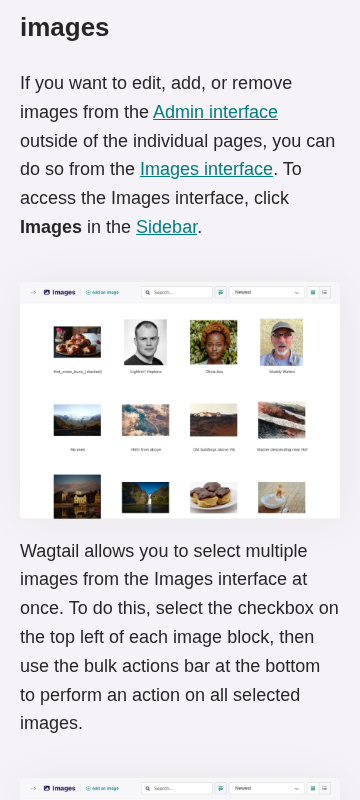
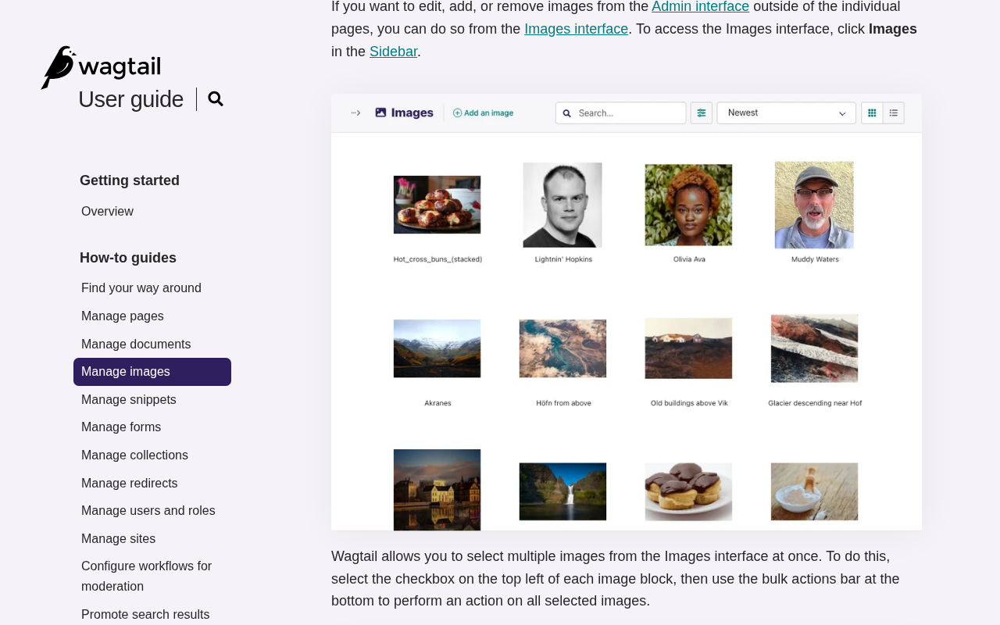

# guide.wagtail.org: sustainability audit

The guide supports reading and search with system fonts and compressed assets. Prioritize the search dialog’s label and response to device theme changes. Build automation has a duplicate trigger path; image sizing and narrow-screen controls need investigation. Findings cover three pages and one search task. The supplied code has not been matched to the live deployment; confirm that match before using it to locate fixes. Passes cover only the stated checks, and unknowns are evidence gaps.

## At a glance

- **46.9/100** — scoped audit score 15 passing, 4 with problems, 13 needing more evidence.
- **3 pages** reviewed 1 visitor journey and 17 selected source files.
- **32 of 71 guideline groups** attempted 39 not assessed. Tests cover selected aspects of each guideline.

!!! info "What the score means"

    15 of 32 attempted guideline groups passed this audit's selected checks. Unknowns stay in the denominator, so missing evidence lowers the score without becoming a site defect. This is not a full WSG conformance grade or a ranking against other sites.

## First-load page sizes

Data downloaded when a visitor first opens the page, before clicking a cookie banner or scrolling. **kB = 1,000 bytes; MB = 1,000,000 bytes.** Ranges show separate visits, not a modeled average.

<table>
<caption>First-load page sizes</caption>
<thead><tr><th scope="col">Page</th><th scope="col">First load</th><th scope="col">Measurement completeness</th></tr></thead>
<tbody>
<tr><th scope="row"><a href="https://guide.wagtail.org/en/">Homepage</a></th><td>59.0 kB</td><td>Complete within the test conditions</td></tr>
<tr><th scope="row"><a href="https://guide.wagtail.org/en/how-to-guides/manage-images/">Manage images</a></th><td>232.1 kB</td><td>Complete within the test conditions</td></tr>
<tr><th scope="row"><a href="https://guide.wagtail.org/en/search/?query=images">Search results</a></th><td>50.8 kB</td><td>Complete within the test conditions</td></tr>
</tbody></table>

The collector recorded the requests within its observation window. Later downloads and untested journeys are outside these first-load figures.

**Digital Carbon Ratings:** A+ for the eligible initial visits, using the fixed comparison model. This estimates a page-load footprint; it does not establish whole-site sustainability.

## Priorities

### 1. Give the search dialog its own input label

**High priority** · Problem found · [WSG 3.6](https://www.w3.org/TR/web-sustainability-guidelines/#ensure-code-follows-good-semantic-practices)

**What we found.** The search-results page contains two inputs with the same search ID. Both Search labels point to the page input, leaving the dialog input without an associated label or explicit accessible name.

**Why it matters.** This can make the search field harder to identify with assistive technology when visitors reopen search from the results page.

**Next step.** Give the dialog input a unique ID and matching label target. Open the dialog from search results and verify the computed accessible names and operation of both search forms.

[How we checked this: Give the search dialog its own input label](#evidence-semantic-forms)

### 2. Follow device theme changes while reading

**Medium priority** · Problem found · [WSG 3.9](https://www.w3.org/TR/web-sustainability-guidelines/#use-media-queries-that-support-sustainability-goals)

**What we found.** All three sampled pages open correctly in dark mode when the device already requests it. Changing that preference while a page is open leaves the light colors in place; reading content remains available.

**Why it matters.** Visitors changing their device theme do not receive the corresponding reading appearance on the open page.

**Next step.** Repeat the change with no saved theme override, then correct the theme-change handling. Verify that pages still open correctly in dark mode and retain an explicit manual theme choice.

[How we checked this: Follow device theme changes while reading](#evidence-preference-behavior)

### 3. Avoid duplicate checks for Renovate updates

**Medium priority** · Problem found · [WSG 4.6](https://www.w3.org/TR/web-sustainability-guidelines/#use-automation-wisely)

**What we found.** The supplied build workflow responds to both Renovate branch pushes and pull requests, creating a path for the same checks to run twice. It has no event guard or concurrency cancellation; actual overlap has not been checked.

**Why it matters.** Overlapping runs could repeat build and test work without adding distinct validation. Their frequency and resource use have not been measured.

**Next step.** Compare paired runs for one Renovate pull request. If they duplicate validation, add an appropriate event guard or cancellation policy while retaining the required build and test checks.

[How we checked this: Avoid duplicate checks for Renovate updates](#evidence-source-automation)

### 4. Check whether smaller screenshots remain readable

**Low priority** · Needs investigation · [WSG 2.9](https://www.w3.org/TR/web-sustainability-guidelines/#optimize-media-to-reduce-resource-use)

**What we found.** The four instructional screenshots on Manage images use 900-pixel-wide sources and display at 320 CSS pixels on narrow screens. Responses already deliver WebP; smaller versions have not been checked for equivalent detail.

**Why it matters.** Smaller versions may reduce transferred data, but the interface details must remain useful for following the instructions. Dimensions alone do not establish waste.

**Next step.** Compare one smaller version with the current image at narrow-screen 1× and 2× pixel densities. Add responsive image sizes only if the comparison supports them, retaining WebP delivery and readable details.

<figure class="audit-illustration" markdown="1">

<figcaption>The guide uses a detailed interface screenshot to explain image management. This later illustration shows the reading context at 360 pixels wide; it is not a test of a smaller replacement image. Captured 2026-11-04, 360 × 800 pixels. This later illustration is separate from the scored measurements.</figcaption>
</figure>

<figure class="audit-illustration" markdown="1">

<figcaption>The same instructional image in its desktop reading context at 1280 pixels wide. Keeping small interface details legible matters when assessing a smaller image version. Captured 2026-11-04, 1280 × 800 pixels. This later illustration is separate from the scored measurements.</figcaption>
</figure>

[How we checked this: Check whether smaller screenshots remain readable](#evidence-media-delivery)

### 5. Check narrow-screen language and navigation controls

**Medium priority** · Needs investigation · [WSG 3.10](https://www.w3.org/TR/web-sustainability-guidelines/#ensure-layouts-work-for-different-devices-and-requirements)

**What we found.** At the sampled narrow width, reading content remains available and no horizontal page overflow is reported. However, the English control’s recorded position extends beyond the viewport; neither its menu nor mobile navigation was opened.

**Why it matters.** The measurements raise a question about reaching these controls, but do not establish clipping or an interaction failure.

**Next step.** At 360 CSS pixels wide, open mobile navigation and language options on the home and Manage images pages. Check visibility, keyboard focus and activation, then correct any confirmed clipping or access problem.

[How we checked this: Check narrow-screen language and navigation controls](#evidence-layout)

## After cookie choices and scrolling

Each cookie choice starts a separate fresh visit. The sizes below are **cumulative totals**, including the first load. They help locate later downloads; they are not additional amounts to add together or guaranteed savings.

??? note "Compare the interaction measurements"

    

    <table>
    <caption>Cumulative data after cookie choices and scrolling</caption>
    <thead><tr><th scope="col">Page</th><th scope="col">Cookie choice tested</th><th scope="col">After cookie choice</th><th scope="col">After scrolling to the bottom</th></tr></thead>
    <tbody>
    <tr><th scope="row"><a href="https://guide.wagtail.org/en/">Homepage</a></th><td>No banner interaction</td><td>59.0 kB</td><td>59.0 kB</td></tr>
    <tr><th scope="row"><a href="https://guide.wagtail.org/en/how-to-guides/manage-images/">Manage images</a></th><td>No banner interaction</td><td>232.1 kB</td><td>232.1 kB</td></tr>
    <tr><th scope="row"><a href="https://guide.wagtail.org/en/search/?query=images">Search results</a></th><td>No banner interaction</td><td>50.8 kB</td><td>50.8 kB</td></tr>
    </tbody></table>

## Further checks

These outcomes apply to the selected checks and sample. Open a check's explanation for the observation, limitations and useful follow-up.

??? note "Browse all check outcomes"

    

    <table>
    <caption>All selected check outcomes</caption>
    <thead><tr><th scope="col">Check</th><th scope="col">Outcome</th></tr></thead>
    <tbody>
    <tr><th scope="row"><a href="#evidence-distraction">Does the conference promotion interrupt finding guidance?</a></th><td>Needs investigation</td></tr>
    <tr><th scope="row"><a href="#evidence-choice">Are feedback and copy choices presented fairly?</a></th><td>Needs investigation</td></tr>
    <tr><th scope="row"><a href="#evidence-comprehension">Keep image guidance clear for editors</a></th><td>Passed this check</td></tr>
    <tr><th scope="row"><a href="#evidence-consistency">Keep navigation and control names consistent</a></th><td>Passed this check</td></tr>
    <tr><th scope="row"><a href="#evidence-motion">Does search respect reduced-motion preferences?</a></th><td>Needs investigation</td></tr>
    <tr><th scope="row"><a href="#evidence-notifications">Keep reading free of unwanted notification prompts</a></th><td>Passed this check</td></tr>
    <tr><th scope="row"><a href="#evidence-documents">Is the printed image guide usable?</a></th><td>Needs investigation</td></tr>
    <tr><th scope="row"><a href="#evidence-unused-code">Which code remains unused after real tasks?</a></th><td>Needs investigation</td></tr>
    <tr><th scope="row"><a href="#evidence-components">Could an interactive feature load when needed?</a></th><td>Needs investigation</td></tr>
    <tr><th scope="row"><a href="#evidence-layout">Are narrow-screen menus fully reachable?</a></th><td>Needs investigation</td></tr>
    <tr><th scope="row"><a href="#evidence-impact-choice">Where would resource-use guidance help editors?</a></th><td>Needs investigation</td></tr>
    <tr><th scope="row"><a href="#evidence-journeys">Keep the route from search to image guidance working</a></th><td>Passed this check</td></tr>
    <tr><th scope="row"><a href="#evidence-media-delivery">Would smaller instructional images preserve useful detail?</a></th><td>Needs investigation</td></tr>
    <tr><th scope="row"><a href="#evidence-font-delivery">Keep the system-font approach readable</a></th><td>Passed this check</td></tr>
    <tr><th scope="row"><a href="#evidence-semantic-forms">Correct the search dialog’s label association</a></th><td>Problem found</td></tr>
    <tr><th scope="row"><a href="#evidence-metadata">Keep metadata appropriate to each page</a></th><td>Passed this check</td></tr>
    <tr><th scope="row"><a href="#evidence-preference-behavior">Update the theme when the device preference changes</a></th><td>Problem found</td></tr>
    <tr><th scope="row"><a href="#evidence-no-js-content">Keep core guidance available without JavaScript</a></th><td>Passed this check</td></tr>
    <tr><th scope="row"><a href="#evidence-api-requests">Are search requests proportionate to typing?</a></th><td>Needs investigation</td></tr>
    <tr><th scope="row"><a href="#evidence-public-cache-policy">Verify that repeat visits reuse public assets</a></th><td>Passed this check</td></tr>
    <tr><th scope="row"><a href="#evidence-text-compression">Keep compression enabled for text assets</a></th><td>Passed this check</td></tr>
    <tr><th scope="row"><a href="#evidence-keyboard-path">Extend keyboard testing through the search dialog</a></th><td>Passed this check</td></tr>
    <tr><th scope="row"><a href="#evidence-disclosure-scope">Connect the sustainability statement to guide-specific work</a></th><td>Passed this check</td></tr>
    <tr><th scope="row"><a href="#evidence-carbon-discovery">Provide a discoverable carbon.txt route</a></th><td>Problem found</td></tr>
    <tr><th scope="row"><a href="#evidence-hosting-evidence">What evidence covers the guide’s actual hosting?</a></th><td>Needs investigation</td></tr>
    <tr><th scope="row"><a href="#evidence-source-reuse">Maintain shared interface components</a></th><td>Passed this check</td></tr>
    <tr><th scope="row"><a href="#evidence-source-dependencies">Can dependency versions be reproduced?</a></th><td>Needs investigation</td></tr>
    <tr><th scope="row"><a href="#evidence-source-runtime">Keep declared runtime versions aligned</a></th><td>Passed this check</td></tr>
    <tr><th scope="row"><a href="#evidence-source-automation">Remove confirmed overlap between build triggers</a></th><td>Problem found</td></tr>
    <tr><th scope="row"><a href="#evidence-source-maintenance">Keep maintenance instructions usable</a></th><td>Passed this check</td></tr>
    <tr><th scope="row"><a href="#evidence-source-change-docs">Keep release information useful to editors</a></th><td>Passed this check</td></tr>
    <tr><th scope="row"><a href="#evidence-source-budgets">What limits trigger performance action?</a></th><td>Needs investigation</td></tr>
    <tr><th scope="row"><a href="#evidence-source-open-source">Keep reuse terms and contribution routes clear</a></th><td>Passed this check</td></tr>
    </tbody></table>

## Next steps for auditing

1. Give the search dialog a unique input ID and matching label, then verify both search forms from the results page.
2. Test device theme changes with no saved theme choice, correct the live response, and verify that manual choices still take precedence.
3. Compare push and pull-request runs for one Renovate update before adjusting workflow triggers or cancellation.
4. At 360 CSS pixels wide, exercise navigation and language options; separately compare one smaller instructional image at 1× and 2× pixel densities.
5. Ask maintainers for hosting evidence, dependency lock contents, and any performance limits with instructions for responding when they are exceeded.

Future audits normally sample 5–10 representative pages, including the homepage, selected from the site's navigation, sitemap and important visitor tasks. This report retains its original smaller sample; its findings have not been relabeled as a wider audit.

## How we checked this

This appendix explains the evidence in ordinary language. Local source files help identify possible fixes, but we have not confirmed that the live site uses the same code revision. A missing selected file or document does not mean the organization has none.

<h3 id="evidence-distraction">Does the conference promotion interrupt finding guidance?</h3>

**Needs investigation** · [WSG 2.5](https://www.w3.org/TR/web-sustainability-guidelines/#design-to-assist-and-not-to-distract)

No overlays were recorded, and search opens on request. The homepage includes a conference promotion, but its visual competition with finding image guidance remains unassessed.

**Next step:** Inspect the homepage while locating Manage images and check whether the promotion obscures or competes with the task.

**Where we looked:**

- Browser observations for [Homepage](https://guide.wagtail.org/en/).
- Browser observations for [Manage images](https://guide.wagtail.org/en/how-to-guides/manage-images/).

<h3 id="evidence-choice">Are feedback and copy choices presented fairly?</h3>

**Needs investigation** · [WSG 2.6](https://www.w3.org/TR/web-sustainability-guidelines/#avoid-being-manipulative-or-deceptive)

Theme, copy options and Happy/Unhappy feedback controls are present. Their defaults, prominence and alternative paths were not tested enough to assess whether they steer visitors.

**Next step:** Open the copy options and exercise both feedback choices, comparing their wording, prominence and resulting steps.

**Where we looked:**

- Browser observations for [Homepage](https://guide.wagtail.org/en/).
- Browser observations for [Manage images](https://guide.wagtail.org/en/how-to-guides/manage-images/).

<h3 id="evidence-comprehension">Keep image guidance clear for editors</h3>

**Passed this check** · [WSG 2.7](https://www.w3.org/TR/web-sustainability-guidelines/#make-deliverables-understandable-and-reusable)

The sampled wording identifies the editor audience, explains CMS and organizes image guidance into concrete tasks. Search descriptions connect to those tasks; understanding by new editors still needs user testing.

**Next step:** Ask a new editor to follow the focal-area instructions and note any terminology or steps they cannot explain.

**Where we looked:**

- Browser observations for [Homepage](https://guide.wagtail.org/en/).
- Browser observations for [Manage images](https://guide.wagtail.org/en/how-to-guides/manage-images/).
- Browser observations for [Search results](https://guide.wagtail.org/en/search/?query=images).

<h3 id="evidence-consistency">Keep navigation and control names consistent</h3>

**Passed this check** · [WSG 2.8](https://www.w3.org/TR/web-sustainability-guidelines/#use-a-design-system-for-interface-consistency)

The three desktop pages repeat navigation labels and use consistent names for search and theme controls. This supports consistency in the sample without establishing a documented design system.

**Next step:** Compare navigation and control names after opening their menus on narrow screens.

**Where we looked:**

- Browser observations for [Homepage](https://guide.wagtail.org/en/).
- Browser observations for [Manage images](https://guide.wagtail.org/en/how-to-guides/manage-images/).
- Browser observations for [Search results](https://guide.wagtail.org/en/search/?query=images).

<h3 id="evidence-motion">Does search respect reduced-motion preferences?</h3>

**Needs investigation** · [WSG 2.10](https://www.w3.org/TR/web-sustainability-guidelines/#ensure-animation-is-proportionate-and-easy-to-control)

No active animations were recorded in the sampled states. The supplied code includes a dialog fade and staggered search results, whose behavior during activation remains untested.

**Next step:** Open search and trigger autocomplete with reduced motion enabled and disabled; compare the transitions and their purpose.

**Where we looked:**

- Browser observations for [Homepage](https://guide.wagtail.org/en/).
- Browser observations for [Manage images](https://guide.wagtail.org/en/how-to-guides/manage-images/).
- Selected local file `apps/core/templates/components/search_modal.html` at revision `31a4547eb1f6`.
- Selected local file `apps/frontend/static_src/js/main.js` at revision `31a4547eb1f6`.

<h3 id="evidence-notifications">Keep reading free of unwanted notification prompts</h3>

**Passed this check** · [WSG 2.12](https://www.w3.org/TR/web-sustainability-guidelines/#avoid-unwanted-notifications)

No notification permission requests or unwanted notification interactions were recorded during reading and search. Browser permission was already denied, so behavior with permission unset remains untested.

**Next step:** Observe a longer reading session with notification permission initially unset.

**Where we looked:**

- Browser observations for [Homepage](https://guide.wagtail.org/en/).
- Browser observations for [Manage images](https://guide.wagtail.org/en/how-to-guides/manage-images/).
- Browser observations for [Search results](https://guide.wagtail.org/en/search/?query=images).

<h3 id="evidence-documents">Is the printed image guide usable?</h3>

**Needs investigation** · [WSG 2.13](https://www.w3.org/TR/web-sustainability-guidelines/#reduce-the-impact-of-downloadable-and-physical-documents)

Print settings hide primary navigation and retain task headings and all four instructional images. Page breaks, clipping and image readability have not been inspected; no downloads were listed.

**Next step:** Inspect Manage images in print preview for awkward page breaks, clipped content and readable image details.

**Where we looked:**

- Browser observations for [Homepage](https://guide.wagtail.org/en/).
- Browser observations for [Manage images](https://guide.wagtail.org/en/how-to-guides/manage-images/).
- Browser observations for [Search results](https://guide.wagtail.org/en/search/?query=images).

<h3 id="evidence-unused-code">Which code remains unused after real tasks?</h3>

**Needs investigation** · [WSG 3.2](https://www.w3.org/TR/web-sustainability-guidelines/#minify-and-remove-unused-code)

Some script functions did not run during the short initial observation. Search, mobile navigation and copying need code later, so these results do not identify anything safe to remove.

**Next step:** Measure code use through search, mobile navigation, copying and feedback before proposing removal.

**Where we looked:**

- Browser observations for [Homepage](https://guide.wagtail.org/en/).
- Browser observations for [Manage images](https://guide.wagtail.org/en/how-to-guides/manage-images/).
- Selected local file `apps/frontend/static_src/js/main.js` at revision `31a4547eb1f6`.

<h3 id="evidence-components">Could an interactive feature load when needed?</h3>

**Needs investigation** · [WSG 3.3](https://www.w3.org/TR/web-sustainability-guidelines/#modularize-bandwidth-heavy-components)

The supplied page template includes search and global scripts, and the recorded search task succeeds. The evidence does not establish which features could load later without affecting their operation.

**Next step:** Map scripts to initial and later interactions, then prototype loading one suitable feature on demand and test its activation.

**Where we looked:**

- Browser observations for [Homepage](https://guide.wagtail.org/en/).
- Selected local file `apps/core/templates/base.html` at revision `31a4547eb1f6`.
- Selected local file `apps/frontend/static_src/js/main.js` at revision `31a4547eb1f6`.

<h3 id="evidence-layout">Are narrow-screen menus fully reachable?</h3>

**Needs investigation** · [WSG 3.10](https://www.w3.org/TR/web-sustainability-guidelines/#ensure-layouts-work-for-different-devices-and-requirements)

Narrow layouts retain reading content and shrink images without reported page overflow. The English control extends beyond the recorded viewport, and menu operation remains untested.

**Next step:** Open navigation and language options at 360 CSS pixels wide and check clipping, focus and activation.

**Where we looked:**

- Browser observations for [Homepage](https://guide.wagtail.org/en/).
- Browser observations for [Manage images](https://guide.wagtail.org/en/how-to-guides/manage-images/).
- Browser observations for [Search results](https://guide.wagtail.org/en/search/?query=images).

<h3 id="evidence-impact-choice">Where would resource-use guidance help editors?</h3>

**Needs investigation** · [WSG 5.4](https://www.w3.org/TR/web-sustainability-guidelines/#communicate-the-environmental-impact-of-user-choices)

Manage images explains formats, compression defaults and upload limits. The evidence does not identify a consequential choice in this reading task that needs additional environmental information.

**Next step:** Identify one real editor decision where supported resource-use advice would change the outcome before adding more guidance.

**Where we looked:**

- Browser observations for [Manage images](https://guide.wagtail.org/en/how-to-guides/manage-images/).
- Browser observations for [Homepage](https://guide.wagtail.org/en/).

<h3 id="evidence-journeys">Keep the route from search to image guidance working</h3>

**Passed this check** · [WSG 2.4](https://www.w3.org/TR/web-sustainability-guidelines/#design-efficient-and-streamlined-user-journeys)

Opening search, entering images, pressing Enter and selecting Manage images reached the expected page and instructions. This confirms the recorded task, while its ease and efficiency for editors remain untested.

**Next step:** Repeat the task with a representative editor and note hesitation or unnecessary steps.

**Where we looked:**

- Browser observations for [Homepage](https://guide.wagtail.org/en/).

<h3 id="evidence-media-delivery">Would smaller instructional images preserve useful detail?</h3>

**Needs investigation** · [WSG 2.9](https://www.w3.org/TR/web-sustainability-guidelines/#optimize-media-to-reduce-resource-use)

Four 900×666 images display at about 756×559 on desktop and 320×237 on narrow screens, without responsive source alternatives. They arrive as WebP; the readability of smaller versions remains unverified.

**Next step:** Compare one smaller version at narrow-screen 1× and 2× pixel densities before changing image delivery.

**Where we looked:**

- Browser observations for [Manage images](https://guide.wagtail.org/en/how-to-guides/manage-images/).

<h3 id="evidence-font-delivery">Keep the system-font approach readable</h3>

**Passed this check** · [WSG 2.11](https://www.w3.org/TR/web-sustainability-guidelines/#use-optimized-web-typography)

The sampled English pages use a system-font stack and make no initial font downloads, avoiding a web-font loading dependency.

**Next step:** Check readability and fallback fonts on another supported operating system.

**Where we looked:**

- Browser observations for [Homepage](https://guide.wagtail.org/en/).
- Browser observations for [Manage images](https://guide.wagtail.org/en/how-to-guides/manage-images/).
- Browser observations for [Search results](https://guide.wagtail.org/en/search/?query=images).

<h3 id="evidence-semantic-forms">Correct the search dialog’s label association</h3>

**Problem found** · [WSG 3.6](https://www.w3.org/TR/web-sustainability-guidelines/#ensure-code-follows-good-semantic-practices)

The search-results page has duplicate search input IDs. Both labels attach to the page field, leaving the dialog field without an associated label or explicit accessible name.

**Next step:** Assign the dialog field a unique ID and matching label, then verify both fields’ accessible names with the dialog open.

**Where we looked:**

- Browser observations for [Search results](https://guide.wagtail.org/en/search/?query=images).
- Selected local file `apps/core/templates/components/search_modal.html` at revision `31a4547eb1f6`.

<h3 id="evidence-metadata">Keep metadata appropriate to each page</h3>

**Passed this check** · [WSG 3.8](https://www.w3.org/TR/web-sustainability-guidelines/#structure-metadata-for-machine-readability)

Home and Manage images have descriptive titles, descriptions and matching canonical URLs. Search is marked noindex. Structured data parses as JSON, but its validity against the intended schema has not been checked.

**Next step:** If structured data serves a required integration, validate one block against its intended schema.

**Where we looked:**

- Browser observations for [Homepage](https://guide.wagtail.org/en/).
- Browser observations for [Manage images](https://guide.wagtail.org/en/how-to-guides/manage-images/).
- Browser observations for [Search results](https://guide.wagtail.org/en/search/?query=images).

<h3 id="evidence-preference-behavior">Update the theme when the device preference changes</h3>

**Problem found** · [WSG 3.9](https://www.w3.org/TR/web-sustainability-guidelines/#use-media-queries-that-support-sustainability-goals)

Dark mode works when pages first open with that preference. All three pages retain light colors after a live preference change; their reading content remains present.

**Next step:** Test without a saved theme override, correct live changes and verify that manual theme choices still take precedence.

**Where we looked:**

- Browser observations for [Homepage](https://guide.wagtail.org/en/).
- Browser observations for [Manage images](https://guide.wagtail.org/en/how-to-guides/manage-images/).
- Browser observations for [Search results](https://guide.wagtail.org/en/search/?query=images).

<h3 id="evidence-no-js-content">Keep core guidance available without JavaScript</h3>

**Passed this check** · [WSG 2.17](https://www.w3.org/TR/web-sustainability-guidelines/#provide-cross-platform-compatibility-support)

Fresh visits without JavaScript retain the sampled reading text, headings, navigation and search results. Operation of the search dialog and other enhancements without scripts was not established.

**Next step:** Follow the Manage images navigation link in a fresh session with JavaScript disabled.

**Where we looked:**

- Browser observations for [Homepage](https://guide.wagtail.org/en/).
- Browser observations for [Manage images](https://guide.wagtail.org/en/how-to-guides/manage-images/).
- Browser observations for [Search results](https://guide.wagtail.org/en/search/?query=images).

<h3 id="evidence-api-requests">Are search requests proportionate to typing?</h3>

**Needs investigation** · [WSG 3.11](https://www.w3.org/TR/web-sustainability-guidelines/#use-sustainable-javascript-and-apis)

No background API requests were recorded on initial load. The supplied search code waits briefly after typing before requesting results, but interactive request repetition and pending-request handling remain unmeasured.

**Next step:** Record requests while typing and revising one search query, including what happens to requests still in progress.

**Where we looked:**

- Browser observations for [Homepage](https://guide.wagtail.org/en/).
- Browser observations for [Manage images](https://guide.wagtail.org/en/how-to-guides/manage-images/).
- Browser observations for [Search results](https://guide.wagtail.org/en/search/?query=images).
- Selected local file `apps/frontend/static_src/js/main.js` at revision `31a4547eb1f6`.

<h3 id="evidence-public-cache-policy">Verify that repeat visits reuse public assets</h3>

**Passed this check** · [WSG 4.2](https://www.w3.org/TR/web-sustainability-guidelines/#optimize-caching-and-support-offline-access)

Versioned scripts and styles declare long-lived public caching. Instructional images provide headers for checking whether cached versions are current and distinguishing formats; actual reuse and offline access were not measured.

**Next step:** Reload with a warm cache and verify asset reuse and correct image-format selection.

**Where we looked:**

- Browser observations for [Homepage](https://guide.wagtail.org/en/).
- Browser observations for [Manage images](https://guide.wagtail.org/en/how-to-guides/manage-images/).
- Browser observations for [Search results](https://guide.wagtail.org/en/search/?query=images).

<h3 id="evidence-text-compression">Keep compression enabled for text assets</h3>

**Passed this check** · [WSG 4.3](https://www.w3.org/TR/web-sustainability-guidelines/#reduce-data-transfer-with-compression)

Successful HTML and translation-script responses use Brotli, while the main stylesheet and JavaScript use gzip. The sampled material text assets are compressed.

**Next step:** Verify compression when introducing a substantial new text, script or stylesheet asset.

**Where we looked:**

- Browser observations for [Homepage](https://guide.wagtail.org/en/).
- Browser observations for [Manage images](https://guide.wagtail.org/en/how-to-guides/manage-images/).
- Browser observations for [Search results](https://guide.wagtail.org/en/search/?query=images).

<h3 id="evidence-keyboard-path">Extend keyboard testing through the search dialog</h3>

**Passed this check** · [WSG 3.6](https://www.w3.org/TR/web-sustainability-guidelines/#ensure-code-follows-good-semantic-practices)

The initial Tab sequence reaches the skip link, home link, search toggle and navigation with a recorded blue focus outline. Dialog operation, reverse navigation and focus traps remain outside this test.

**Next step:** Complete search using only the keyboard, then close the dialog and check that focus returns appropriately.

**Where we looked:**

- Browser observations for [Homepage](https://guide.wagtail.org/en/).
- Browser observations for [Manage images](https://guide.wagtail.org/en/how-to-guides/manage-images/).
- Browser observations for [Search results](https://guide.wagtail.org/en/search/?query=images).

<h3 id="evidence-disclosure-scope">Connect the sustainability statement to guide-specific work</h3>

**Passed this check** · [WSG 2.1](https://www.w3.org/TR/web-sustainability-guidelines/#identify-assess-disclose-review-and-mitigate-sustainability-impacts)

Wagtail’s public sustainability statement explicitly includes guide.wagtail.org and describes mitigation approaches. It establishes disclosure; it does not verify implementation or provide this guide’s measured footprint.

**Next step:** Review the complete roadmap for dated commitments specific to the guide.

**Where we looked:**

- Captured public evidence for [Homepage](https://guide.wagtail.org).

<h3 id="evidence-carbon-discovery">Provide a discoverable carbon.txt route</h3>

**Problem found** · [WSG 3.13](https://www.w3.org/TR/web-sustainability-guidelines/#include-expected-and-beneficial-files)

Both tested carbon.txt locations returned 404, with no redirect or delegation found. This fails the sampled discovery check without establishing anything about the site’s emissions.

**Next step:** Confirm the intended publication or delegation route with the owner, then publish and validate the carbon.txt information.

**Where we looked:**

- Captured public evidence for [Homepage](https://guide.wagtail.org).

<h3 id="evidence-hosting-evidence">What evidence covers the guide’s actual hosting?</h3>

**Needs investigation** · [WSG 4.1](https://www.w3.org/TR/web-sustainability-guidelines/#use-sustainable-hosting)

The supplied material does not establish the live hosting provider, region or energy evidence. Dockerfile comments mention Heroku, but do not verify the operational hosting arrangement.

**Next step:** Obtain the service’s deployment identity and provider evidence covering its actual region and reporting period.

**Where we looked:**

- Captured public evidence for [Homepage](https://guide.wagtail.org).
- Selected local file `Dockerfile` at revision `31a4547eb1f6`.

<h3 id="evidence-source-reuse">Maintain shared interface components</h3>

**Passed this check** · [WSG 3.4](https://www.w3.org/TR/web-sustainability-guidelines/#avoid-redundancy-and-duplication-in-code)

The supplied templates share header, theme, footer, navigation and search composition. JavaScript also shares component initialization, supporting reuse in the inspected code.

**Next step:** Record the deployed build’s source revision so maintainers can locate these shared components reliably.

**Where we looked:**

- Selected local file `apps/core/templates/base.html` at revision `31a4547eb1f6`.
- Selected local file `apps/core/templates/components/header.html` at revision `31a4547eb1f6`.
- Selected local file `apps/core/templates/components/search_modal.html` at revision `31a4547eb1f6`.
- Selected local file `apps/frontend/static_src/js/main.js` at revision `31a4547eb1f6`.

<h3 id="evidence-source-dependencies">Can dependency versions be reproduced?</h3>

**Needs investigation** · [WSG 3.12](https://www.w3.org/TR/web-sustainability-guidelines/#use-dependencies-sparingly-and-maintain-them)

Manifests list dependencies, and build commands request locked installations. Only lock-file names, sizes and hashes were supplied, so valid version resolution and manifest consistency remain unverified.

**Next step:** Provide lock-file headers and relevant resolved dependency entries, then check their consistency with the manifests.

**Where we looked:**

- Selected local file `pyproject.toml` at revision `31a4547eb1f6`.
- Selected local file `package.json` at revision `31a4547eb1f6`.
- Selected local file `package-lock.json` at revision `31a4547eb1f6` (metadata only).
- Selected local file `uv.lock` at revision `31a4547eb1f6` (metadata only).
- Selected local file `Dockerfile` at revision `31a4547eb1f6`.

<h3 id="evidence-source-runtime">Keep declared runtime versions aligned</h3>

**Passed this check** · [WSG 3.15](https://www.w3.org/TR/web-sustainability-guidelines/#use-the-latest-stable-language-version)

The supplied project, container and development declarations consistently select Python 3.14 and Node 26. This establishes declaration consistency, while deployed versions and latest-stable status remain unverified.

**Next step:** Record deployed runtime versions and consult authoritative release references before describing them as the latest stable versions.

**Where we looked:**

- Selected local file `pyproject.toml` at revision `31a4547eb1f6`.
- Selected local file `README.md` at revision `31a4547eb1f6`.
- Selected local file `Dockerfile` at revision `31a4547eb1f6`.
- Selected local file `.nvmrc` at revision `31a4547eb1f6`.
- Selected local file `.github/workflows/ci.yml` at revision `31a4547eb1f6`.
- Selected local file `.python-version` at revision `31a4547eb1f6`.

<h3 id="evidence-source-automation">Remove confirmed overlap between build triggers</h3>

**Problem found** · [WSG 4.6](https://www.w3.org/TR/web-sustainability-guidelines/#use-automation-wisely)

Renovate pushes and pull requests can trigger the same build and test jobs, without an event guard or cancellation. The duplicate trigger path is established; actual run overlap and consumption are unmeasured.

**Next step:** Inspect paired runs for one Renovate update, then adjust triggers or cancellation while retaining required validation.

**Where we looked:**

- Selected local file `.github/workflows/ci.yml` at revision `31a4547eb1f6`.

<h3 id="evidence-source-maintenance">Keep maintenance instructions usable</h3>

**Passed this check** · [WSG 5.10](https://www.w3.org/TR/web-sustainability-guidelines/#follow-a-product-management-and-maintenance-strategy)

The supplied documentation explains setup, development, formatting, linting, testing, translations and version maintenance. It documents the process without establishing how regularly it is followed.

**Next step:** Ask a maintainer to check the setup and release instructions against one recent change.

**Where we looked:**

- Selected local file `README.md` at revision `31a4547eb1f6`.
- Selected local file `CONTRIBUTING.md` at revision `31a4547eb1f6`.

<h3 id="evidence-source-change-docs">Keep release information useful to editors</h3>

**Passed this check** · [WSG 5.12](https://www.w3.org/TR/web-sustainability-guidelines/#document-updates-and-evolutions)

The supplied Wagtail 8.0 release page identifies its version and modification date and explains editor-facing changes. Live navigation includes versioned releases; publication of this exact text remains unverified.

**Next step:** Compare the published Wagtail 8.0 release page with the supplied content.

**Where we looked:**

- Selected local file `content/en/releases/new-in-wagtail-8-0.md` at revision `31a4547eb1f6`.
- Browser observations for [Homepage](https://guide.wagtail.org/en/).

<h3 id="evidence-source-budgets">What limits trigger performance action?</h3>

**Needs investigation** · [WSG 5.24](https://www.w3.org/TR/web-sustainability-guidelines/#define-performance-environmental-and-human-budgets)

The selected build configuration and documentation include linting and build commands, but show no concrete performance limit with a response when exceeded. Limits may exist elsewhere.

**Next step:** Request the performance-budget configuration or owner-confirmed policy, including the limit, responsible person and response to an exceedance.

**Where we looked:**

- Selected local file `vite.config.ts` at revision `31a4547eb1f6`.
- Selected local file `package.json` at revision `31a4547eb1f6`.
- Selected local file `README.md` at revision `31a4547eb1f6`.

<h3 id="evidence-source-open-source">Keep reuse terms and contribution routes clear</h3>

**Passed this check** · [WSG 5.25](https://www.w3.org/TR/web-sustainability-guidelines/#use-and-contribute-to-open-source)

The supplied license permits code redistribution under stated conditions, and contribution guidance covers code, content and translations. This does not establish licensing for all content or media, or ongoing upstream contributions.

**Next step:** Confirm content and media licensing separately before reusing those materials.

**Where we looked:**

- Selected local file `LICENSE` at revision `31a4547eb1f6`.
- Selected local file `CONTRIBUTING.md` at revision `31a4547eb1f6`.
- Selected local file `README.md` at revision `31a4547eb1f6`.

## Methodology and reproducibility

The browser measurements were captured from **2026-11-04T13:41:31.314406+00:00** to **2026-11-04T13:42:05.864164+00:00**. Initial-load tests used a 1280 × 800 desktop viewport and a 3-second observation window. Cookie choices and scrolling were recorded afterward. Supplementary tests covered narrow layouts, color and motion preferences, print, JavaScript availability and bounded keyboard navigation.

**Audit judgments:** Codex CLI 0.166.0, gpt-6.1-sol, **low reasoning**. **Report wording:** Codex CLI 0.166.0, gpt-6.1-sol, **high reasoning**. The editorial pass changes explanations, not the original outcomes, priorities or calculated score.

The scoring method is `agent-breadth-v2`. A guideline group counts once even if it has several checks. Observed problems take precedence over unresolved checks in that group. 0 groups were excluded as not applicable; 39 were untested. No new annual footprint or measured energy result is inferred from this report.

Illustrations, when present, were captured separately and show their own date and viewport. They do not change the earlier transfer measurements or prove that an interaction, accessible name, or energy saving was tested.

??? note "Technical files for reproducing this report"

    The report above can be read without these files. They retain exact evidence, original judgments and calculation inputs for independent reproduction.

    - [Audit scope and tasks](assets/breadth-sessions/guide/plan.json)
    - [Collector commands and versions](assets/breadth-sessions/guide/receipt.json)
    - [Original judgments](assets/breadth-sessions/guide/review.json)
    - [Score calculation](assets/breadth-sessions/guide/scores.json)
    - [Evidence index](assets/breadth-sessions/guide/packet.json)
    - [Recorded transfers and disclosures](assets/breadth-sessions/guide/staged.json)
    - [Browser observations](assets/breadth-sessions/guide/probes.json)
    - [Selected source evidence](assets/breadth-sessions/guide/source.json)
    - [Publication hashes](assets/breadth-sessions/guide/manifest.json)
    - [Report wording and check explanations](assets/report-editions/guide/editorial.json)
    - [Editorial model and input provenance](assets/report-editions/guide/editorial-receipt.json)

    Original review SHA-256: `d0bae2201ee5f8e0fe269ac10ed57e6ad07ea841cc0109a20768384a8b970a5f`. Recalculate with `audit/assess.py` using the preserved reviews, rubric, weights and evidence. New collection or model review requires a new session; it can produce different results.
