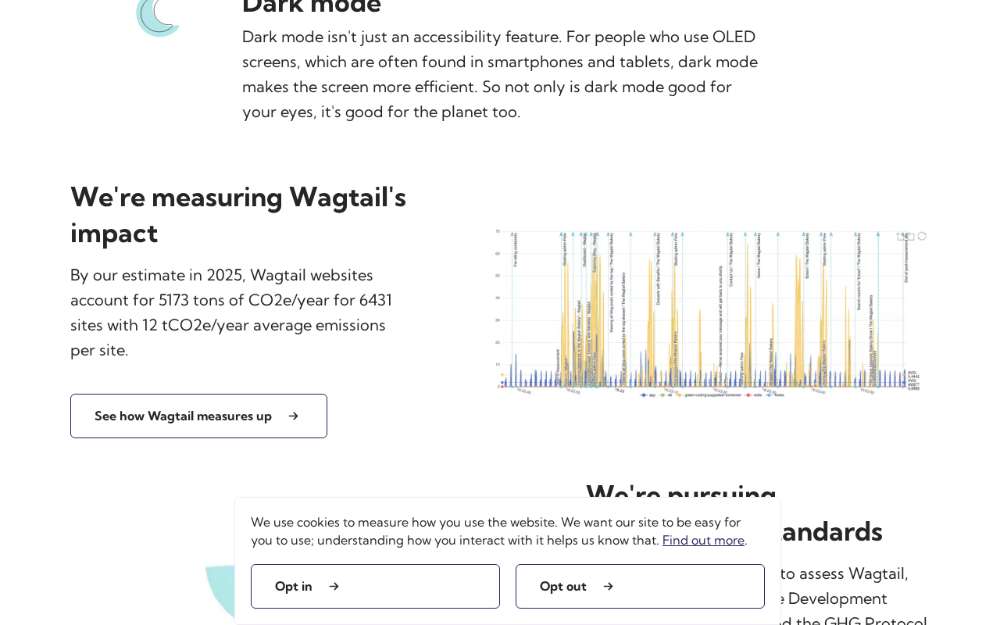

# wagtail.org: sustainability audit

Core reading works without JavaScript, and sampled text assets use compression. Correct the ecosystem emissions figures and make open pages follow device-theme changes. Investigate overflow, image readability and monitoring thresholds before choosing fixes. The score covers selected checks on three pages and reflects missing evidence as well as problems. Some transferred data could not be measured, so page sizes are incomplete and carbon ratings were not calculated. The supplied source has not been matched to the live deployment.

## At a glance

- **40.6/100** — scoped audit score 13 passing, 2 with problems, 17 needing more evidence.
- **3 pages** reviewed 1 visitor journey and 13 selected source files.
- **32 of 71 guideline groups** attempted 39 not assessed. Tests cover selected aspects of each guideline.

!!! info "What the score means"

    13 of 32 attempted guideline groups passed this audit's selected checks. Unknowns stay in the denominator, so missing evidence lowers the score without becoming a site defect. This is not a full WSG conformance grade or a ranking against other sites.

## First-load page sizes

Data downloaded when a visitor first opens the page, before clicking a cookie banner or scrolling. **kB = 1,000 bytes; MB = 1,000,000 bytes.** Ranges show separate visits, not a modeled average.

<table>
<caption>First-load page sizes</caption>
<thead><tr><th scope="col">Page</th><th scope="col">First load</th><th scope="col">Measurement completeness</th></tr></thead>
<tbody>
<tr><th scope="row"><a href="https://wagtail.org/">Homepage</a></th><td>944.2 kB–945.3 kB</td><td>Some data could not be measured</td></tr>
<tr><th scope="row"><a href="https://wagtail.org/sustainability/">Sustainability</a></th><td>590.4 kB–590.7 kB</td><td>Some data could not be measured</td></tr>
<tr><th scope="row"><a href="https://wagtail.org/digital-emissions/">Digital emissions</a></th><td>464.5 kB–465.2 kB</td><td>Some data could not be measured</td></tr>
</tbody></table>

Some requests failed or did not finish in the observation window. Their transferred size is uncertain, so these figures are incomplete and a Digital Carbon Rating is withheld. The audit measures the site as it behaved; a failed analytics request is context, not automatically a priority fix.

## Priorities

### 1. Reconcile the ecosystem emissions figures

**High priority** · Problem found · [WSG 2.7](https://www.w3.org/TR/web-sustainability-guidelines/#make-deliverables-understandable-and-reusable)

**What we found.** The Sustainability page reports 5,173 tons of CO2e a year across 6,431 sites alongside an average of 12 tons per site a year. These figures cannot describe the same population and average. The separate homepage estimate has a clearer date and method.

**Why it matters.** Readers cannot reliably interpret the ecosystem estimate when its total, site count and average contradict one another.

**Next step.** Check the underlying analysis and correct or explain the population, statistic and period for each figure. Keep ecosystem estimates clearly separate from this website's estimate.

<figure class="audit-illustration" markdown="1">

<figcaption>The published paragraph places the total, site count and per-site average together. This later screenshot illustrates why those figures need a clearer explanation; it does not verify the underlying emissions estimate. Captured 2026-11-04, 1280 × 800 pixels. This later illustration is separate from the scored measurements.</figcaption>
</figure>

[How we checked this: Reconcile the ecosystem emissions figures](#evidence-comprehension)

### 2. Follow device-theme changes while pages are open

**Medium priority** · Problem found · [WSG 3.9](https://www.w3.org/TR/web-sustainability-guidelines/#use-media-queries-that-support-sustainability-goals)

**What we found.** All three pages open with a dark palette when the device already uses dark mode. Changing the device to dark mode while a page is open leaves its light palette in place. Reading content remains available.

**Why it matters.** Visitors who change their device theme do not receive the same response as visitors who open the page with that preference already set.

**Next step.** Confirm how manual theme choices should take precedence, then correct device-theme handling when no manual override exists. Verify changes in both directions on all three pages, keeping initial dark mode and the manual switch working.

[How we checked this: Follow device-theme changes while pages are open](#evidence-preference-behavior)

### 3. Check whether overflow affects reading and navigation

**Medium priority** · Needs investigation · [WSG 3.10](https://www.w3.org/TR/web-sustainability-guidelines/#ensure-layouts-work-for-different-devices-and-requirements)

**What we found.** Every sampled page extends 10 pixels beyond both the 1,280-pixel and 360-pixel viewport widths. Reading text remains available, but the effect of that overflow is unresolved and mobile controls were not exercised.

**Why it matters.** If useful content extends off-screen, visitors may need horizontal scrolling to read or reach controls.

**Next step.** Locate the element causing the extra width and complete the Sustainability footer journey at 360 pixels. Establish whether content or controls are affected before choosing a fix.

[How we checked this: Check whether overflow affects reading and navigation](#evidence-layout)

### 4. Check image readability before changing sizes

**Low priority** · Needs investigation · [WSG 2.9](https://www.w3.org/TR/web-sustainability-guidelines/#optimize-media-to-reduce-resource-use)

**What we found.** The Sustainability chart is a 1,300-pixel-wide WebP displayed at 660 pixels on desktop, while some smaller images are enlarged. Dimensions alone do not establish excessive delivery or adequate readability.

**Why it matters.** Image size decisions need to balance transferred data with readable chart labels and useful detail.

**Next step.** Compare the chart and enlarged images at narrow and desktop widths, including intended pixel densities. Assess smaller versions only where they retain useful detail. Test video activation before proposing changes to when it loads.

[How we checked this: Check image readability before changing sizes](#evidence-media-delivery)

### 5. Check the page-size alert threshold and response

**Low priority** · Needs investigation · [WSG 5.24](https://www.w3.org/TR/web-sustainability-guidelines/#define-performance-environmental-and-human-budgets)

**What we found.** Digital emissions describes weekly monitoring and page-size alerts. The supplied page and project files do not state the threshold or what happens when it is exceeded; this does not establish that either is missing.

**Why it matters.** A concrete limit and response procedure let maintainers verify that monitoring catches unwanted page growth.

**Next step.** Obtain the configured threshold and document who responds to an alert and what they do. Verify the alert behavior. If no limit exists, agree one based on the pages visitors need and test its enforcement.

[How we checked this: Check the page-size alert threshold and response](#evidence-source-budgets)

## After cookie choices and scrolling

Each cookie choice starts a separate fresh visit. The sizes below are **cumulative totals**, including the first load. They help locate later downloads; they are not additional amounts to add together or guaranteed savings.

??? note "Compare the interaction measurements"

    

    <table>
    <caption>Cumulative data after cookie choices and scrolling</caption>
    <thead><tr><th scope="col">Page</th><th scope="col">Cookie choice tested</th><th scope="col">After cookie choice</th><th scope="col">After scrolling to the bottom</th></tr></thead>
    <tbody>
    <tr><th scope="row"><a href="https://wagtail.org/">Homepage</a></th><td>Accept cookies</td><td>944.2 kB</td><td>1.107 MB</td></tr>
    <tr><th scope="row"><a href="https://wagtail.org/">Homepage</a></th><td>Reject optional cookies</td><td>945.3 kB</td><td>1.109 MB</td></tr>
    <tr><th scope="row"><a href="https://wagtail.org/sustainability/">Sustainability</a></th><td>Accept cookies</td><td>590.4 kB</td><td>633.4 kB</td></tr>
    <tr><th scope="row"><a href="https://wagtail.org/sustainability/">Sustainability</a></th><td>Reject optional cookies</td><td>590.7 kB</td><td>633.5 kB</td></tr>
    <tr><th scope="row"><a href="https://wagtail.org/digital-emissions/">Digital emissions</a></th><td>Accept cookies</td><td>464.5 kB</td><td>464.5 kB</td></tr>
    <tr><th scope="row"><a href="https://wagtail.org/digital-emissions/">Digital emissions</a></th><td>Reject optional cookies</td><td>465.2 kB</td><td>465.2 kB</td></tr>
    </tbody></table>

## Further checks

These outcomes apply to the selected checks and sample. Open a check's explanation for the observation, limitations and useful follow-up.

??? note "Browse all check outcomes"

    

    <table>
    <caption>All selected check outcomes</caption>
    <thead><tr><th scope="col">Check</th><th scope="col">Outcome</th></tr></thead>
    <tbody>
    <tr><th scope="row"><a href="#evidence-distraction">Check whether prompts interrupt reading</a></th><td>Needs investigation</td></tr>
    <tr><th scope="row"><a href="#evidence-choice">Check that cookie choices work as presented</a></th><td>Needs investigation</td></tr>
    <tr><th scope="row"><a href="#evidence-comprehension">Correct the contradictory emissions wording</a></th><td>Problem found</td></tr>
    <tr><th scope="row"><a href="#evidence-consistency">Keep navigation names consistent</a></th><td>Passed this check</td></tr>
    <tr><th scope="row"><a href="#evidence-motion">Check animation behavior with reduced motion</a></th><td>Needs investigation</td></tr>
    <tr><th scope="row"><a href="#evidence-notifications">Keep notifications under visitor control</a></th><td>Passed this check</td></tr>
    <tr><th scope="row"><a href="#evidence-documents">Check printed pages for usable output</a></th><td>Needs investigation</td></tr>
    <tr><th scope="row"><a href="#evidence-unused-code">Check code use beyond the first load</a></th><td>Needs investigation</td></tr>
    <tr><th scope="row"><a href="#evidence-components">Check whether search code can load later</a></th><td>Needs investigation</td></tr>
    <tr><th scope="row"><a href="#evidence-layout">Investigate the extra page width</a></th><td>Needs investigation</td></tr>
    <tr><th scope="row"><a href="#evidence-impact-choice">Check information offered before video playback</a></th><td>Needs investigation</td></tr>
    <tr><th scope="row"><a href="#evidence-journeys">Keep the footer route to Sustainability working</a></th><td>Passed this check</td></tr>
    <tr><th scope="row"><a href="#evidence-media-delivery">Check chart and image quality at intended sizes</a></th><td>Needs investigation</td></tr>
    <tr><th scope="row"><a href="#evidence-font-delivery">Check readability when fonts cannot load</a></th><td>Needs investigation</td></tr>
    <tr><th scope="row"><a href="#evidence-semantic-forms">Check primary headings and control names</a></th><td>Needs investigation</td></tr>
    <tr><th scope="row"><a href="#evidence-metadata">Keep page titles and canonical links useful</a></th><td>Passed this check</td></tr>
    <tr><th scope="row"><a href="#evidence-preference-behavior">Update the theme when device preferences change</a></th><td>Problem found</td></tr>
    <tr><th scope="row"><a href="#evidence-no-js-content">Keep core reading available without JavaScript</a></th><td>Passed this check</td></tr>
    <tr><th scope="row"><a href="#evidence-api-requests">Check the purpose of repeated analytics requests</a></th><td>Needs investigation</td></tr>
    <tr><th scope="row"><a href="#evidence-public-cache-policy">Verify that repeat visits reuse static files</a></th><td>Passed this check</td></tr>
    <tr><th scope="row"><a href="#evidence-text-compression">Keep text compression enabled</a></th><td>Passed this check</td></tr>
    <tr><th scope="row"><a href="#evidence-keyboard-path">Check that keyboard focus is easy to see</a></th><td>Needs investigation</td></tr>
    <tr><th scope="row"><a href="#evidence-disclosure-scope">Support the published sustainability account</a></th><td>Passed this check</td></tr>
    <tr><th scope="row"><a href="#evidence-carbon-discovery">Keep carbon.txt declarations usable and current</a></th><td>Passed this check</td></tr>
    <tr><th scope="row"><a href="#evidence-hosting-evidence">Check evidence behind hosting claims</a></th><td>Needs investigation</td></tr>
    <tr><th scope="row"><a href="#evidence-source-reuse">Retain shared navigation and interface components</a></th><td>Passed this check</td></tr>
    <tr><th scope="row"><a href="#evidence-source-dependencies">Check that dependency versions can be reproduced</a></th><td>Needs investigation</td></tr>
    <tr><th scope="row"><a href="#evidence-source-runtime">Keep runtime declarations aligned</a></th><td>Passed this check</td></tr>
    <tr><th scope="row"><a href="#evidence-source-automation">Verify cancellation of superseded test runs</a></th><td>Passed this check</td></tr>
    <tr><th scope="row"><a href="#evidence-source-maintenance">Keep maintenance instructions usable</a></th><td>Passed this check</td></tr>
    <tr><th scope="row"><a href="#evidence-source-change-docs">Locate useful change information for users</a></th><td>Needs investigation</td></tr>
    <tr><th scope="row"><a href="#evidence-source-budgets">Identify the monitoring limit and response</a></th><td>Needs investigation</td></tr>
    <tr><th scope="row"><a href="#evidence-source-open-source">Clarify reuse terms and contribution guidance</a></th><td>Needs investigation</td></tr>
    </tbody></table>

## Next steps for auditing

1. Trace the ecosystem emissions figures to their source and reconcile the total, site count, average and reporting period.
2. Retest device-theme changes on all three pages, both with and without a manual theme choice.
3. Complete the Sustainability footer journey at 360 pixels wide and using only the keyboard; inspect overflow and focus visibility.
4. Verify stored cookie choices and subsequent tracking, then inspect print previews and image readability.
5. Obtain the deployed revision, lockfile contents, monitoring threshold and response procedure, release notes, and licensing and contribution guidance.
6. Repeat first-load measurements with unresolved transfers accounted for before calculating carbon ratings.

Future audits normally sample 5–10 representative pages, including the homepage, selected from the site's navigation, sitemap and important visitor tasks. This report retains its original smaller sample; its findings have not been relabeled as a wider audit.

## How we checked this

This appendix explains the evidence in ordinary language. Local source files help identify possible fixes, but we have not confirmed that the live site uses the same code revision. A missing selected file or document does not mean the organization has none.

<h3 id="evidence-distraction">Check whether prompts interrupt reading</h3>

**Needs investigation** · [WSG 2.5](https://www.w3.org/TR/web-sustainability-guidelines/#design-to-assist-and-not-to-distract)

An event promotion and cookie prompt accompany the reading content. Recorded dialogs are hidden and the homepage video does not autoplay, but the prompts' visual disruption remains unclear.

**Next step:** Inspect the initial view and dismiss prompts while completing the sustainability reading task.

**Where we looked:**

- Browser observations for [Homepage](https://wagtail.org/).
- Browser observations for [Sustainability](https://wagtail.org/sustainability/).
- Browser observations for [Digital emissions](https://wagtail.org/digital-emissions/).

<h3 id="evidence-choice">Check that cookie choices work as presented</h3>

**Needs investigation** · [WSG 2.6](https://www.w3.org/TR/web-sustainability-guidelines/#avoid-being-manipulative-or-deceptive)

The prompt explains measurement and offers equally sized Opt in and Opt out buttons. Both choices were clicked on all three pages, but visual prominence, saved choices and subsequent tracking remain unverified.

**Next step:** Compare button appearance, reload after each choice, and verify stored consent and tracking behavior.

**Where we looked:**

- Browser observations for [Homepage](https://wagtail.org/).
- Captured public evidence for [Homepage](https://wagtail.org/).
- Captured public evidence for [Sustainability](https://wagtail.org/sustainability/).
- Captured public evidence for [Digital emissions](https://wagtail.org/digital-emissions/).

<h3 id="evidence-comprehension">Correct the contradictory emissions wording</h3>

**Problem found** · [WSG 2.7](https://www.w3.org/TR/web-sustainability-guidelines/#make-deliverables-understandable-and-reusable)

The Sustainability page's annual total, site count and stated average cannot describe the same population. Digital emissions more clearly separates the homepage estimate, its April 2026 date and its method.

**Next step:** Trace the ecosystem figures to their source and reconcile their population, statistic and period.

**Where we looked:**

- Browser observations for [Sustainability](https://wagtail.org/sustainability/).
- Browser observations for [Digital emissions](https://wagtail.org/digital-emissions/).

<h3 id="evidence-consistency">Keep navigation names consistent</h3>

**Passed this check** · [WSG 2.8](https://www.w3.org/TR/web-sustainability-guidelines/#use-a-design-system-for-interface-consistency)

The three pages repeat the same main navigation names, Get started label and search-control name. This supports consistency in the sampled controls.

**Next step:** Open the navigation controls on each page and compare their labels and behavior.

**Where we looked:**

- Browser observations for [Homepage](https://wagtail.org/).
- Browser observations for [Sustainability](https://wagtail.org/sustainability/).
- Browser observations for [Digital emissions](https://wagtail.org/digital-emissions/).

<h3 id="evidence-motion">Check animation behavior with reduced motion</h3>

**Needs investigation** · [WSG 2.10](https://www.w3.org/TR/web-sustainability-guidelines/#ensure-animation-is-proportionate-and-easy-to-control)

Animations were recorded on the homepage and Sustainability page with reduced motion enabled, but their purpose and visible effect are unknown. The homepage video has playback controls and does not autoplay.

**Next step:** Identify which properties animate and observe whether their reduced-motion behavior suits their purpose.

**Where we looked:**

- Browser observations for [Homepage](https://wagtail.org/).
- Browser observations for [Sustainability](https://wagtail.org/sustainability/).
- Browser observations for [Digital emissions](https://wagtail.org/digital-emissions/).

<h3 id="evidence-notifications">Keep notifications under visitor control</h3>

**Passed this check** · [WSG 2.12](https://www.w3.org/TR/web-sustainability-guidelines/#avoid-unwanted-notifications)

No notification permission requests were recorded, and newsletter signup is optional. Browser notification permission was already denied, so behavior before a visitor makes that choice remains unchecked.

**Next step:** Repeat the reading journey with notification permission unset.

**Where we looked:**

- Browser observations for [Homepage](https://wagtail.org/).
- Browser observations for [Sustainability](https://wagtail.org/sustainability/).
- Browser observations for [Digital emissions](https://wagtail.org/digital-emissions/).

<h3 id="evidence-documents">Check printed pages for usable output</h3>

**Needs investigation** · [WSG 2.13](https://www.w3.org/TR/web-sustainability-guidelines/#reduce-the-impact-of-downloadable-and-physical-documents)

Print emulation retains reading text and hides navigation. Page breaks and chart clipping have not been checked, and no downloadable document was inspected.

**Next step:** Inspect print previews of Sustainability and Digital emissions for readable content, intact charts and sensible pagination.

**Where we looked:**

- Browser observations for [Homepage](https://wagtail.org/).
- Browser observations for [Sustainability](https://wagtail.org/sustainability/).
- Browser observations for [Digital emissions](https://wagtail.org/digital-emissions/).

<h3 id="evidence-unused-code">Check code use beyond the first load</h3>

**Needs investigation** · [WSG 3.2](https://www.w3.org/TR/web-sustainability-guidelines/#minify-and-remove-unused-code)

The brief first-load recording includes code that had not run. That does not establish it can be removed: navigation, search, cookie choices and media may need it later.

**Next step:** Extend code-use recording through those interactions before selecting anything for removal.

**Where we looked:**

- Browser observations for [Homepage](https://wagtail.org/).
- Browser observations for [Sustainability](https://wagtail.org/sustainability/).
- Browser observations for [Digital emissions](https://wagtail.org/digital-emissions/).
- Selected local file `webpack.config.js` at revision `9fa65385f27c`.

<h3 id="evidence-components">Check whether search code can load later</h3>

**Needs investigation** · [WSG 3.3](https://www.w3.org/TR/web-sustainability-guidelines/#modularize-bandwidth-heavy-components)

The main script loads initially, and the supplied search code opens a dialog on click. Its contribution to the live script and its behavior when loaded later have not been established.

**Next step:** Identify the search code within the delivered script, exercise search, then compare a version that loads it on demand.

**Where we looked:**

- Browser observations for [Homepage](https://wagtail.org/).
- Selected local file `wagtailio/project_styleguide/templates/patterns/base.html` at revision `9fa65385f27c`.
- Selected local file `wagtailio/static/js/components/site-search-desktop.js` at revision `9fa65385f27c`.

<h3 id="evidence-layout">Investigate the extra page width</h3>

**Needs investigation** · [WSG 3.10](https://www.w3.org/TR/web-sustainability-guidelines/#ensure-layouts-work-for-different-devices-and-requirements)

All three pages exceed desktop and narrow viewport widths by 10 pixels. Narrow views retain reading text and expose mobile controls, but their usability and the overflow's effect remain unresolved.

**Next step:** Find the overflowing element and complete the Sustainability footer journey at 360 pixels wide.

**Where we looked:**

- Browser observations for [Homepage](https://wagtail.org/).
- Browser observations for [Sustainability](https://wagtail.org/sustainability/).
- Browser observations for [Digital emissions](https://wagtail.org/digital-emissions/).

<h3 id="evidence-impact-choice">Check information offered before video playback</h3>

**Needs investigation** · [WSG 5.4](https://www.w3.org/TR/web-sustainability-guidelines/#communicate-the-environmental-impact-of-user-choices)

The homepage offers optional video and a theme switch, and Sustainability explains an OLED-related dark-mode benefit. Whether visitors receive useful information when deciding to play the video remains unclear.

**Next step:** Inspect the playback context for duration, data expectations and a useful reading alternative.

**Where we looked:**

- Browser observations for [Homepage](https://wagtail.org/).
- Browser observations for [Sustainability](https://wagtail.org/sustainability/).
- Browser observations for [Digital emissions](https://wagtail.org/digital-emissions/).

<h3 id="evidence-journeys">Keep the footer route to Sustainability working</h3>

**Passed this check** · [WSG 2.4](https://www.w3.org/TR/web-sustainability-guidelines/#design-efficient-and-streamlined-user-journeys)

Clicking the homepage footer's Sustainability link successfully opened the expected page and heading. This confirms the tested route works.

**Next step:** Complete the same journey using only the keyboard.

**Where we looked:**

- Browser observations for [Homepage](https://wagtail.org/).

<h3 id="evidence-media-delivery">Check chart and image quality at intended sizes</h3>

**Needs investigation** · [WSG 2.9](https://www.w3.org/TR/web-sustainability-guidelines/#optimize-media-to-reduce-resource-use)

The Sustainability chart is delivered as a 1,300-pixel WebP and displayed at 660 pixels on desktop; some smaller images are enlarged. Readability and suitable delivery sizes remain unverified.

**Next step:** Compare chart labels and image detail at narrow and desktop sizes and intended pixel densities.

**Where we looked:**

- Browser observations for [Homepage](https://wagtail.org/).
- Browser observations for [Sustainability](https://wagtail.org/sustainability/).

<h3 id="evidence-font-delivery">Check readability when fonts cannot load</h3>

**Needs investigation** · [WSG 2.11](https://www.w3.org/TR/web-sustainability-guidelines/#use-optimized-web-typography)

Two Kumbh Sans weights load, and a generic sans-serif fallback is declared. Readability during delayed or failed font loading and support for required languages remain unchecked.

**Next step:** Delay or block font responses and verify that task text stays readable, including required language characters.

**Where we looked:**

- Browser observations for [Homepage](https://wagtail.org/).
- Browser observations for [Sustainability](https://wagtail.org/sustainability/).
- Browser observations for [Digital emissions](https://wagtail.org/digital-emissions/).

<h3 id="evidence-semantic-forms">Check primary headings and control names</h3>

**Needs investigation** · [WSG 3.6](https://www.w3.org/TR/web-sustainability-guidelines/#ensure-code-follows-good-semantic-practices)

Each page declares English, one main content area and one primary heading, and recorded controls have naming information. The captured heading lists stop before the primary heading, leaving its wording and meaning unverified.

**Next step:** Inspect each primary heading and main content area, then verify names for dialogs after opening them.

**Where we looked:**

- Browser observations for [Homepage](https://wagtail.org/).
- Browser observations for [Sustainability](https://wagtail.org/sustainability/).
- Browser observations for [Digital emissions](https://wagtail.org/digital-emissions/).

<h3 id="evidence-metadata">Keep page titles and canonical links useful</h3>

**Passed this check** · [WSG 3.8](https://www.w3.org/TR/web-sustainability-guidelines/#structure-metadata-for-machine-readability)

All three pages have descriptive titles and canonical links to their own HTTPS URLs. The homepage's structured data parses as JSON; its vocabulary has not been validated.

**Next step:** Validate the homepage's structured data against its intended vocabulary if it will be reused.

**Where we looked:**

- Browser observations for [Homepage](https://wagtail.org/).
- Browser observations for [Sustainability](https://wagtail.org/sustainability/).
- Browser observations for [Digital emissions](https://wagtail.org/digital-emissions/).

<h3 id="evidence-preference-behavior">Update the theme when device preferences change</h3>

**Problem found** · [WSG 3.9](https://www.w3.org/TR/web-sustainability-guidelines/#use-media-queries-that-support-sustainability-goals)

Dark mode works when pages open with that device preference already set. Switching to dark mode while any sampled page is open leaves the light palette, although reading content remains available.

**Next step:** Correct and retest theme changes without a manual override, then verify that explicit visitor choices take precedence.

**Where we looked:**

- Browser observations for [Homepage](https://wagtail.org/).
- Browser observations for [Sustainability](https://wagtail.org/sustainability/).
- Browser observations for [Digital emissions](https://wagtail.org/digital-emissions/).

<h3 id="evidence-no-js-content">Keep core reading available without JavaScript</h3>

**Passed this check** · [WSG 2.17](https://www.w3.org/TR/web-sustainability-guidelines/#provide-cross-platform-compatibility-support)

The homepage introduction, sustainability commitments, emissions method and navigation text remain available with JavaScript disabled. Search and other interactive behavior were not established.

**Next step:** Follow the Sustainability link with JavaScript disabled to verify the reading journey.

**Where we looked:**

- Browser observations for [Homepage](https://wagtail.org/).
- Browser observations for [Sustainability](https://wagtail.org/sustainability/).
- Browser observations for [Digital emissions](https://wagtail.org/digital-emissions/).

<h3 id="evidence-api-requests">Check the purpose of repeated analytics requests</h3>

**Needs investigation** · [WSG 3.11](https://www.w3.org/TR/web-sustainability-guidelines/#use-sustainable-javascript-and-apis)

First-load records include a site-alert request and several analytics pageview requests to different destinations. Their purposes and longer-term behavior are unclear; similar requests alone do not establish duplication.

**Next step:** Document each analytics destination's purpose and observe requests after cookie choices and while the page is idle.

**Where we looked:**

- Browser observations for [Homepage](https://wagtail.org/).
- Browser observations for [Sustainability](https://wagtail.org/sustainability/).
- Browser observations for [Digital emissions](https://wagtail.org/digital-emissions/).

<h3 id="evidence-public-cache-policy">Verify that repeat visits reuse static files</h3>

**Passed this check** · [WSG 4.2](https://www.w3.org/TR/web-sustainability-guidelines/#optimize-caching-and-support-offline-access)

Sampled versioned scripts, styles and fonts declare long-lived public caching with validation information. These settings support reuse, but actual browser reuse and offline operation were not measured.

**Next step:** Revisit the pages with a populated browser cache and verify that intended files are reused.

**Where we looked:**

- Browser observations for [Homepage](https://wagtail.org/).
- Browser observations for [Sustainability](https://wagtail.org/sustainability/).
- Browser observations for [Digital emissions](https://wagtail.org/digital-emissions/).

<h3 id="evidence-text-compression">Keep text compression enabled</h3>

**Passed this check** · [WSG 4.3](https://www.w3.org/TR/web-sustainability-guidelines/#reduce-data-transfer-with-compression)

Successful page HTML responses use Brotli compression, while the main stylesheet and scripts use gzip. The sampled substantial text assets therefore have compression enabled.

**Next step:** Verify that compression remains enabled after the next asset deployment.

**Where we looked:**

- Browser observations for [Homepage](https://wagtail.org/).
- Browser observations for [Sustainability](https://wagtail.org/sustainability/).
- Browser observations for [Digital emissions](https://wagtail.org/digital-emissions/).

<h3 id="evidence-keyboard-path">Check that keyboard focus is easy to see</h3>

**Needs investigation** · [WSG 3.6](https://www.w3.org/TR/web-sustainability-guidelines/#ensure-code-follows-good-semantic-practices)

The recorded Tab sequence reaches navigation, search and task links in a meaningful order and reports focus outlines. Whether those indicators are visually clear has not been established.

**Next step:** Observe focus on the skip link, navigation and search control, then complete the reading journey using the keyboard.

**Where we looked:**

- Browser observations for [Homepage](https://wagtail.org/).
- Browser observations for [Sustainability](https://wagtail.org/sustainability/).
- Browser observations for [Digital emissions](https://wagtail.org/digital-emissions/).

<h3 id="evidence-disclosure-scope">Support the published sustainability account</h3>

**Passed this check** · [WSG 2.1](https://www.w3.org/TR/web-sustainability-guidelines/#identify-assess-disclose-review-and-mitigate-sustainability-impacts)

Sustainability explicitly includes wagtail.org, and Digital emissions explains the homepage estimate's date, method and monitoring approach. The statements cover this website, but their reported quantities and implementation were not verified.

**Next step:** Obtain the underlying measurement and monitoring records supporting the published claims.

**Where we looked:**

- Captured public evidence for [Homepage](https://wagtail.org).
- Browser observations for [Sustainability](https://wagtail.org/sustainability/).
- Browser observations for [Digital emissions](https://wagtail.org/digital-emissions/).

<h3 id="evidence-carbon-discovery">Keep carbon.txt declarations usable and current</h3>

**Passed this check** · [WSG 3.13](https://www.w3.org/TR/web-sustainability-guidelines/#include-expected-and-beneficial-files)

The root carbon.txt was retrieved without redirects and parsed, with usable disclosure links. It declares version 0.4; schema validity remains unchecked, and the expired 2023 and 2024 declarations remain historical evidence.

**Next step:** Validate against the authoritative version-specific schema and review the historical declarations' validity annotations.

**Where we looked:**

- Captured public evidence for [Homepage](https://wagtail.org).

<h3 id="evidence-hosting-evidence">Check evidence behind hosting claims</h3>

**Needs investigation** · [WSG 4.1](https://www.w3.org/TR/web-sustainability-guidelines/#use-sustainable-hosting)

The site declares Cloudflare, Heroku, AWS and GitHub service relationships. Those declarations do not independently establish the current infrastructure serving wagtail.org or its environmental performance.

**Next step:** Obtain infrastructure records linking each service to this website and current provider energy evidence for those services.

**Where we looked:**

- Captured public evidence for [Homepage](https://wagtail.org).
- Selected local file `README.md` at revision `9fa65385f27c`.

<h3 id="evidence-source-reuse">Retain shared navigation and interface components</h3>

**Passed this check** · [WSG 3.4](https://www.w3.org/TR/web-sustainability-guidelines/#avoid-redundancy-and-duplication-in-code)

The supplied templates reuse the same navigation implementation for desktop and mobile, alongside shared skip-link, search and SVG components. This supports reuse in the inspected interface code.

**Next step:** Inspect the shared navigation implementation before proposing consolidation or replacement.

**Where we looked:**

- Selected local file `wagtailio/project_styleguide/templates/patterns/base.html` at revision `9fa65385f27c`.
- Selected local file `wagtailio/project_styleguide/templates/patterns/includes/header.html` at revision `9fa65385f27c`.

<h3 id="evidence-source-dependencies">Check that dependency versions can be reproduced</h3>

**Needs investigation** · [WSG 3.12](https://www.w3.org/TR/web-sustainability-guidelines/#use-dependencies-sparingly-and-maintain-them)

Dependency lists are available, but the captured lockfiles expose only file details rather than resolved versions. A compatible, repeatable installation has not been verified.

**Next step:** Inspect lockfile headers and resolved dependency entries, then verify an installation using the locked versions.

**Where we looked:**

- Selected local file `pyproject.toml` at revision `9fa65385f27c`.
- Selected local file `package.json` at revision `9fa65385f27c`.
- Selected local file `package-lock.json` at revision `9fa65385f27c` (metadata only).
- Selected local file `Dockerfile` at revision `9fa65385f27c`.
- Selected local file `poetry.lock` at revision `9fa65385f27c` (metadata only).

<h3 id="evidence-source-runtime">Keep runtime declarations aligned</h3>

**Passed this check** · [WSG 3.15](https://www.w3.org/TR/web-sustainability-guidelines/#use-the-latest-stable-language-version)

Python 3.14, Node 24 and Poetry 2.4.0 declarations agree across the relevant build and test files. This establishes declaration consistency without establishing latest-release status.

**Next step:** Compare the declarations with production runtime versions; obtain authoritative release references before making a latest-version claim.

**Where we looked:**

- Selected local file `pyproject.toml` at revision `9fa65385f27c`.
- Selected local file `Dockerfile` at revision `9fa65385f27c`.
- Selected local file `.nvmrc` at revision `9fa65385f27c`.
- Selected local file `.github/workflows/ci.yml` at revision `9fa65385f27c`.

<h3 id="evidence-source-automation">Verify cancellation of superseded test runs</h3>

**Passed this check** · [WSG 4.6](https://www.w3.org/TR/web-sustainability-guidelines/#use-automation-wisely)

The test workflow is configured to cancel superseded runs and reuse dependency caches, with test jobs following linting. These controls support the scoped automation check.

**Next step:** Inspect a superseded run to verify cancellation, and review lint configuration before proposing fewer validation steps.

**Where we looked:**

- Selected local file `.github/workflows/ci.yml` at revision `9fa65385f27c`.

<h3 id="evidence-source-maintenance">Keep maintenance instructions usable</h3>

**Passed this check** · [WSG 5.10](https://www.w3.org/TR/web-sustainability-guidelines/#follow-a-product-management-and-maintenance-strategy)

The project guide explains setup, migrations, caching, frontend builds, linting and deployment. The test configuration also documents application checks and tests.

**Next step:** Verify the documented commands against a current maintainer's setup and maintenance workflow.

**Where we looked:**

- Selected local file `README.md` at revision `9fa65385f27c`.
- Selected local file `.github/workflows/ci.yml` at revision `9fa65385f27c`.

<h3 id="evidence-source-change-docs">Locate useful change information for users</h3>

**Needs investigation** · [WSG 5.12](https://www.w3.org/TR/web-sustainability-guidelines/#document-updates-and-evolutions)

The requested changelog was unavailable, and the supplied project guide explains development rather than versioned user-facing changes. Release notes may exist elsewhere.

**Next step:** Provide the release notes or equivalent history that explains relevant changes to affected users.

**Where we looked:**

- Selected local file `CHANGELOG.md` (unavailable).
- Selected local file `README.md` at revision `9fa65385f27c`.

<h3 id="evidence-source-budgets">Identify the monitoring limit and response</h3>

**Needs investigation** · [WSG 5.24](https://www.w3.org/TR/web-sustainability-guidelines/#define-performance-environmental-and-human-budgets)

Digital emissions describes weekly monitoring and alerts, but the supplied page and build files do not identify a concrete page-size limit or response procedure. Their existence remains unresolved.

**Next step:** Provide the configured threshold, alert or build-failure behavior, and instructions for responding to an exceedance.

**Where we looked:**

- Selected local file `webpack.config.js` at revision `9fa65385f27c`.
- Selected local file `README.md` at revision `9fa65385f27c`.
- Browser observations for [Digital emissions](https://wagtail.org/digital-emissions/).

<h3 id="evidence-source-open-source">Clarify reuse terms and contribution guidance</h3>

**Needs investigation** · [WSG 5.25](https://www.w3.org/TR/web-sustainability-guidelines/#use-and-contribute-to-open-source)

The Python and JavaScript manifests name BSD-3-Clause and ISC licenses respectively. The supplied files do not resolve their scope or establish the contribution procedure.

**Next step:** Inspect the applicable license and contribution documents, clarifying which terms cover code and site content.

**Where we looked:**

- Selected local file `pyproject.toml` at revision `9fa65385f27c`.
- Selected local file `package.json` at revision `9fa65385f27c`.
- Selected local file `README.md` at revision `9fa65385f27c`.

## Methodology and reproducibility

The browser measurements were captured from **2026-11-04T13:41:32.488900+00:00** to **2026-11-04T13:43:02.719181+00:00**. Initial-load tests used a 1280 × 800 desktop viewport and a 3-second observation window. Cookie choices and scrolling were recorded afterward. Supplementary tests covered narrow layouts, color and motion preferences, print, JavaScript availability and bounded keyboard navigation.

**Audit judgments:** Codex CLI 0.166.0, gpt-6.1-sol, **low reasoning**. **Report wording:** Codex CLI 0.166.0, gpt-6.1-sol, **high reasoning**. The editorial pass changes explanations, not the original outcomes, priorities or calculated score.

The scoring method is `agent-breadth-v2`. A guideline group counts once even if it has several checks. Observed problems take precedence over unresolved checks in that group. 0 groups were excluded as not applicable; 39 were untested. No new annual footprint or measured energy result is inferred from this report.

Illustrations, when present, were captured separately and show their own date and viewport. They do not change the earlier transfer measurements or prove that an interaction, accessible name, or energy saving was tested.

??? note "Technical files for reproducing this report"

    The report above can be read without these files. They retain exact evidence, original judgments and calculation inputs for independent reproduction.

    - [Audit scope and tasks](assets/breadth-sessions/wagtail/plan.json)
    - [Collector commands and versions](assets/breadth-sessions/wagtail/receipt.json)
    - [Original judgments](assets/breadth-sessions/wagtail/review.json)
    - [Score calculation](assets/breadth-sessions/wagtail/scores.json)
    - [Evidence index](assets/breadth-sessions/wagtail/packet.json)
    - [Recorded transfers and disclosures](assets/breadth-sessions/wagtail/staged.json)
    - [Browser observations](assets/breadth-sessions/wagtail/probes.json)
    - [Selected source evidence](assets/breadth-sessions/wagtail/source.json)
    - [Publication hashes](assets/breadth-sessions/wagtail/manifest.json)
    - [Report wording and check explanations](assets/report-editions/wagtail/editorial.json)
    - [Editorial model and input provenance](assets/report-editions/wagtail/editorial-receipt.json)

    Original review SHA-256: `77b4c9dfbc1c3d785de59cb33048861b89332dcda957d5bfc3231de807624597`. Recalculate with `audit/assess.py` using the preserved reviews, rubric, weights and evidence. New collection or model review requires a new session; it can produce different results.
