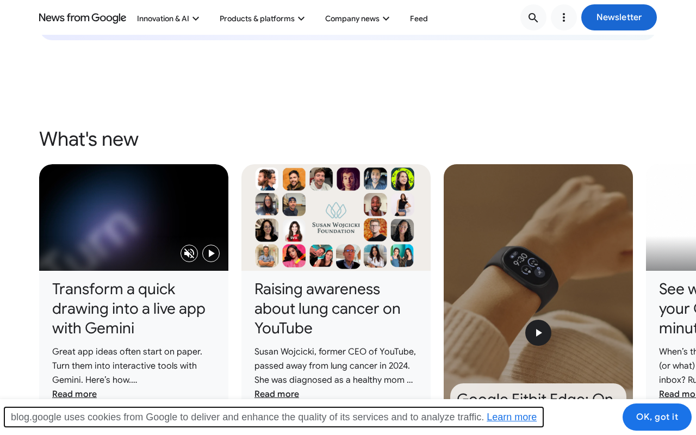

# blog.google: sustainability audit

## At a glance

- **33.3/100** — scoped audit score 9 passing, 4 with problems, 14 needing more evidence.
- **6 pages** reviewed 1 visitor journey; public-site evidence.
- **27 of 71 guideline groups** scored 44 untested; 0 not applicable. Tests cover selected aspects of each guideline.

The six-page sample supports an anonymous route from the sustainability listing to the complete Stegra announcement, and the article text remains readable without JavaScript. Two concrete priorities affect homepage visitors: active video tiles do not all stop when reduced motion is enabled during a visit, and core story discovery disappears without JavaScript. Investigate homepage media loading alongside those fixes: the first transfer records 49.38 MB with some data unmeasured. Corporate sustainability stories provide context about Google’s activities; they do not establish this publication’s footprint, hosting arrangements or progress against website goals.

## Results by WSG area

<table>
<caption>Selected checks by WSG area</caption>
<thead><tr><th scope="col">Area</th><th scope="col">Passing</th><th scope="col">Guideline groups checked</th><th scope="col">Needs evidence</th></tr></thead>
<tbody>
<tr><th scope="row"><a href="#findings-2">User experience design</a></th><td>42% (5/12)</td><td>12 of 17</td><td>5</td></tr>
<tr><th scope="row"><a href="#findings-3">Web development</a></th><td>12% (1/8)</td><td>8 of 16</td><td>5</td></tr>
<tr><th scope="row"><a href="#findings-4">Hosting, infrastructure and systems</a></th><td>67% (2/3)</td><td>3 of 12</td><td>1</td></tr>
<tr><th scope="row"><a href="#findings-5">Business strategy and product management</a></th><td>25% (1/4)</td><td>4 of 26</td><td>3</td></tr>
</tbody></table>

Passing percentages apply to the selected checks. Full-guideline conformance has not been established.

## Page measurements

<table>
<caption>Page measurements</caption>
<thead><tr><th scope="col">Page</th><th scope="col"><a href="#measure-first-load">First load</a></th><th scope="col"><a href="#measure-after-choice">After cookies</a></th><th scope="col"><a href="#measure-scroll">After scrolling</a></th><th scope="col"><a href="#measure-carbon">Estimated footprint</a></th><th scope="col"><a href="#measure-carbon">Carbon rating</a></th><th scope="col"><a href="#measure-energy">Browser energy</a></th><th scope="col"><a href="#measure-energy">Network energy</a></th></tr></thead>
<tbody>
<tr><th scope="row"><a href="https://blog.google/">Homepage</a></th><td>49.376 MB · <a href="#measure-completeness">partial</a></td><td>Acknowledge cookie notice: 50.399 MB · <a href="#measure-completeness">partial</a></td><td>Acknowledge cookie notice: 50.399 MB · <a href="#measure-completeness">partial</a></td><td>Withheld</td><td>Withheld</td><td>20.97 mWh</td><td>73.80 mWh</td></tr>
<tr><th scope="row"><a href="https://blog.google/company-news/outreach-and-initiatives/sustainability/">Sustainability</a></th><td>2.618 MB · <a href="#measure-completeness">partial</a></td><td>Acknowledge cookie notice: 2.618 MB · <a href="#measure-completeness">partial</a></td><td>Acknowledge cookie notice: 2.618 MB · <a href="#measure-completeness">partial</a></td><td>Withheld</td><td>Withheld</td><td>Not sampled</td><td>Not sampled</td></tr>
<tr><th scope="row"><a href="https://blog.google/company-news/outreach-and-initiatives/sustainability/google-stegra-green-steel/">Google announces new agreement for first-of-a-kind green steel plant</a></th><td>6.219 MB · <a href="#measure-completeness">partial</a></td><td>Acknowledge cookie notice: 6.219 MB · <a href="#measure-completeness">partial</a></td><td>Acknowledge cookie notice: 7.675 MB · <a href="#measure-completeness">partial</a></td><td>Withheld</td><td>Withheld</td><td>Not sampled</td><td>Not sampled</td></tr>
<tr><th scope="row"><a href="https://blog.google/products-and-platforms/devices/fitbit/google-fitbit-edge-on-shelves-now/">Google Fitbit Edge is now available</a></th><td>1.938 MB · <a href="#measure-completeness">partial</a></td><td>Acknowledge cookie notice: 1.938 MB · <a href="#measure-completeness">partial</a></td><td>Acknowledge cookie notice: 1.938 MB · <a href="#measure-completeness">partial</a></td><td>Withheld</td><td>Withheld</td><td>17.75 mWh</td><td>27.10 mWh</td></tr>
<tr><th scope="row"><a href="https://blog.google/newsletter-subscribe/">Newsletter</a></th><td>1.566 MB · <a href="#measure-completeness">partial</a></td><td>Acknowledge cookie notice: 1.566 MB · <a href="#measure-completeness">partial</a></td><td>Acknowledge cookie notice: 1.566 MB · <a href="#measure-completeness">partial</a></td><td>Withheld</td><td>Withheld</td><td>Not sampled</td><td>Not sampled</td></tr>
<tr><th scope="row"><a href="https://blog.google/about/">About News from Google</a></th><td>939.2 kB · <a href="#measure-completeness">partial</a></td><td>Acknowledge cookie notice: 939.2 kB · <a href="#measure-completeness">partial</a></td><td>Acknowledge cookie notice: 1.327 MB · <a href="#measure-completeness">partial</a></td><td>Withheld</td><td>Withheld</td><td>Not sampled</td><td>Not sampled</td></tr>
</tbody></table>

## Estimated annual footprint

A traffic scenario of **79,445,520 pageviews/year** gives the estimates below. These are alternative views of overlapping activity, so they should not be added together.

<table>
<caption>Annual footprint and improvement scale</caption>
<thead><tr><th scope="col">Scope</th><th scope="col"><a href="#measure-annual">Annual estimate</a></th><th scope="col"><a href="#measure-annual-savings">If per-view impact fell by 10%</a></th></tr></thead>
<tbody>
<tr><th scope="row">Site browsing · SWDM v4 · partial transfers</th><td>122,950.82 kgCO₂e/year</td><td>12,295.08 kgCO₂e/year less</td></tr>
<tr><th scope="row">Client electricity · GreenFrame scenarios</th><td>1,538.08 kWh/year</td><td>153.81 kWh/year less</td></tr>
<tr><th scope="row">Client operational emissions · assumed electricity mix</th><td>759.81 kgCO₂e/year</td><td>75.98 kgCO₂e/year less</td></tr>
</tbody></table>

The 10% column shows the scale of a hypothetical improvement, not a predicted saving from the findings below.

## Priorities

### 1. Stop autoplay tiles when reduced motion is switched on

**High priority** · Problem found · <a class="audit-guideline" href="https://www.w3.org/TR/web-sustainability-guidelines/#ensure-animation-is-proportionate-and-easy-to-control" title="Use animation sparingly and efficiently, only when it supports understanding, while limiting performance impact and giving users control over motion.">WSG 2.10: Ensure animation is proportionate and easy to control</a>

**What we found.** Two visible homepage videos continue playing when reduced motion is enabled during the visit. They are paused when the page is opened with that preference already active. Pause controls are present; the defect concerns the preference-change response.

**Why it matters.** A visitor who changes the device setting while reading still encounters movement the site already avoids at page opening. Responding consistently would honor that choice throughout the visit.

**Next step.** Apply the initial reduced-motion logic to live preference changes. Verify every active visible autoplay tile pauses, then confirm manual Play and Pause remain usable.

<figure class="audit-illustration" markdown="1">

<figcaption>Video cards appear among homepage story links.</figcaption>
</figure>

[How we checked this: Stop autoplay tiles when reduced motion is switched on](#evidence-motion)

### 2. Investigate video loading before readers choose playback

**High priority** · Needs investigation · <a class="audit-guideline" href="https://www.w3.org/TR/web-sustainability-guidelines/#modularize-bandwidth-heavy-components" title="Split large components into smaller, on-demand modules to improve loading efficiency while balancing maintainability and caching performance.">WSG 3.3: Modularize bandwidth-heavy components</a>

**What we found.** The first homepage visit records 49.38 MB before notice acknowledgement or scrolling, with some transfer unmeasured. Autoplay and preloaded media are present, including hidden or offscreen media. This loading question is separate from the demonstrated reduced-motion defect.

**Why it matters.** Homepage readers incur substantial media transfer before selecting a story or video. Deferring suitable media could be useful, but a safe activation strategy and achievable reduction have not been established.

**Next step.** Trace which elements initiate the largest requests. Test a bounded preload or on-demand candidate with thumbnails, story discovery and Play/Pause intact, then compare the same task before estimating any reduction.

[How we checked this: Investigate video loading before readers choose playback](#evidence-components)

### 3. Serve story-discovery links without JavaScript

**High priority** · Problem found · <a class="audit-guideline" href="https://www.w3.org/TR/web-sustainability-guidelines/#provide-cross-platform-compatibility-support" title="Document compatibility, avoid unnecessary obsolescence, and test across devices, systems, and network conditions.">WSG 2.17: Provide cross-platform compatibility support</a>

**What we found.** With JavaScript disabled, the homepage loses most feed content and the sustainability listing loses its featured and latest-story links. Article reading text remains available once the article URL is reached.

**Why it matters.** Readers cannot use the sampled collections to discover those stories when scripts are unavailable. The existing readable articles provide a useful destination for a lightweight discovery route.

**Next step.** Render core featured and latest-story links in HTML or add a clear index available without scripts. Verify the listing-to-Stegra reading task with JavaScript disabled.

[How we checked this: Serve story-discovery links without JavaScript](#evidence-no-js-content)

### 4. Compare story-card and author-photo renditions

**Low priority** · Needs investigation · <a class="audit-guideline" href="https://www.w3.org/TR/web-sustainability-guidelines/#optimize-media-to-reduce-resource-use" title="Include media only when it supports user needs. Manage, optimize, and load media efficiently. Ensure users have control over playback and data use.">WSG 2.9: Optimize media to reduce resource use</a>

**What we found.** The Stegra article loads a 2784-pixel related-story image at roughly 283 displayed pixels, while some 100-pixel author photos display at 240 pixels. The sample also includes responsive WebP delivery and lazy loading. Necessary detail and quality at intended densities remain unresolved.

**Why it matters.** The large card may offer a lighter rendition, while the small headshots may need a sharper one. Pixel counts alone cannot decide the right quality or establish savings.

**Next step.** Inspect the cited images at their actual display sizes on standard and high-density screens. Compare alternative renditions, retaining editorial detail and legibility, then measure any transfer change.

[How we checked this: Compare story-card and author-photo renditions](#evidence-media-delivery)

## Further checks

These outcomes apply to the selected checks and sample. Open a check's explanation for the observation, limitations and useful follow-up.

??? note "Browse all check outcomes"

    

    <table>
    <caption>All selected check outcomes</caption>
    <thead><tr><th scope="col">Check</th><th scope="col">Outcome</th></tr></thead>
    <tbody>
    <tr><th scope="row"><a href="#evidence-distraction">Check whether moving tiles compete with choosing a story</a></th><td>❓ Needs investigation</td></tr>
    <tr><th scope="row"><a href="#evidence-choice">Inspect the cookie notice’s actual choice route</a></th><td>❓ Needs investigation</td></tr>
    <tr><th scope="row"><a href="#evidence-comprehension">The sampled English tasks use clear wording</a></th><td>✅ Passed this check</td></tr>
    <tr><th scope="row"><a href="#evidence-consistency">Navigation labels repeat across templates</a></th><td>✅ Passed this check</td></tr>
    <tr><th scope="row"><a href="#evidence-motion">Stop active tiles when reduced motion is enabled</a></th><td>❌ Problem found</td></tr>
    <tr><th scope="row"><a href="#evidence-notifications">No unsolicited notification request was observed</a></th><td>✅ Passed this check</td></tr>
    <tr><th scope="row"><a href="#evidence-documents">Inspect print overflow and relevant downloads</a></th><td>❓ Needs investigation</td></tr>
    <tr><th scope="row"><a href="#evidence-unused-code">Check module use across complete journeys</a></th><td>❓ Needs investigation</td></tr>
    <tr><th scope="row"><a href="#evidence-components">Investigate the homepage’s early media loading</a></th><td>❓ Needs investigation</td></tr>
    <tr><th scope="row"><a href="#evidence-layout">Inspect homepage overflow and the narrow menu</a></th><td>❓ Needs investigation</td></tr>
    <tr><th scope="row"><a href="#evidence-impact-choice">Test useful alternatives before adding data-use guidance</a></th><td>❓ Needs investigation</td></tr>
    <tr><th scope="row"><a href="#evidence-journeys">Readers can reach the featured sustainability article</a></th><td>✅ Passed this check</td></tr>
    <tr><th scope="row"><a href="#evidence-media-delivery">Inspect large story cards and small author photos</a></th><td>❓ Needs investigation</td></tr>
    <tr><th scope="row"><a href="#evidence-font-delivery">Loaded fonts provide fallbacks for the sampled text</a></th><td>✅ Passed this check</td></tr>
    <tr><th scope="row"><a href="#evidence-semantic-forms">Task controls have naming relationships</a></th><td>✅ Passed this check</td></tr>
    <tr><th scope="row"><a href="#evidence-metadata">Titles and canonical addresses support page discovery</a></th><td>✅ Passed this check</td></tr>
    <tr><th scope="row"><a href="#evidence-preference-behavior">Apply reduced motion when the preference changes</a></th><td>❌ Problem found</td></tr>
    <tr><th scope="row"><a href="#evidence-no-js-content">Make core story links available without JavaScript</a></th><td>❌ Problem found</td></tr>
    <tr><th scope="row"><a href="#evidence-api-requests">Trace collection updates before removing requests</a></th><td>❓ Needs investigation</td></tr>
    <tr><th scope="row"><a href="#evidence-public-cache-policy">Reusable publication assets have cache lifetimes</a></th><td>✅ Passed this check</td></tr>
    <tr><th scope="row"><a href="#evidence-text-compression">Material text responses use compression</a></th><td>✅ Passed this check</td></tr>
    <tr><th scope="row"><a href="#evidence-keyboard-path">Inspect focus on the initial cookie controls</a></th><td>❓ Needs investigation</td></tr>
    <tr><th scope="row"><a href="#evidence-disclosure-scope">Provide an impact statement for the publication</a></th><td>❓ Needs investigation</td></tr>
    <tr><th scope="row"><a href="#evidence-carbon-discovery">Publish a useful, verifiable carbon.txt record</a></th><td>❌ Problem found</td></tr>
    <tr><th scope="row"><a href="#evidence-hosting-evidence">Connect operational hosting evidence to blog.google</a></th><td>❓ Needs investigation</td></tr>
    <tr><th scope="row"><a href="#evidence-access-barriers">The observed article route needs no account</a></th><td>✅ Passed this check</td></tr>
    <tr><th scope="row"><a href="#evidence-data-minimization">The newsletter form asks for an explained email purpose</a></th><td>✅ Passed this check</td></tr>
    <tr><th scope="row"><a href="#evidence-content-lifecycle">Show one applied editorial review decision</a></th><td>❓ Needs investigation</td></tr>
    <tr><th scope="row"><a href="#evidence-sustainability-goals">Set a publication-specific goal with comparable progress</a></th><td>❓ Needs investigation</td></tr>
    </tbody></table>

## Next steps for auditing

1. Make every active homepage autoplay tile respond when reduced motion is enabled during a visit. Verify this alongside opening the page with the preference already active, and retain working manual Play and Pause controls.
2. Trace homepage video and image requests, including hidden and offscreen media. Test a bounded preload or on-demand candidate with story discovery and playback intact, then compare the same loading task.
3. Provide core homepage and sustainability-listing story links in HTML, or a clear lightweight index. Verify an anonymous reader can find and read the featured story without JavaScript.
4. Inspect the related-story and author-image renditions, narrow navigation, keyboard focus and printed output. Obtain one publication-specific editorial decision and a website impact statement with a dated baseline and goal.

The sample covers selected pages and visitor tasks, not every page on the site. Expand it where the checks above identify an untested template, interaction or audience need.

## Detailed findings

This appendix explains the evidence in ordinary language. This audit used public-site evidence without a source checkout. Unavailable documents or internal records do not establish that the organization has none.

### User experience design {#findings-2}

<h4 id="evidence-distraction">Check whether moving tiles compete with choosing a story</h4>

**Needs investigation** · <a class="audit-guideline" href="https://www.w3.org/TR/web-sustainability-guidelines/#design-to-assist-and-not-to-distract" title="Give users control over notifications and focus, prioritize task-relevant content, and avoid designs that distract or unnecessarily extend engagement.">WSG 2.5: Design to assist and not to distract</a>

_Give users control over notifications and focus, prioritize task-relevant content, and avoid designs that distract or unnecessarily extend engagement._

The captured pages retain headings and recognizable tasks. The homepage has simultaneously playing muted videos and a rotating feature area, with pause controls identified but not exercised. The snapshots do not establish whether movement interrupts the browsing task.

**Next step:** Observe a complete homepage story-selection task, activate the pause controls and assess whether moving content competes with reading or navigation.

**Where we looked:**

- Browser observations for [Homepage](https://blog.google/).
- Browser observations for [Sustainability](https://blog.google/company-news/outreach-and-initiatives/sustainability/).
- Browser observations for [Google stegra green steel](https://blog.google/company-news/outreach-and-initiatives/sustainability/google-stegra-green-steel/).
- Browser observations for [Google fitbit edge on shelves now](https://blog.google/products-and-platforms/devices/fitbit/google-fitbit-edge-on-shelves-now/).
- Browser observations for [Newsletter subscribe](https://blog.google/newsletter-subscribe/).
- Browser observations for [About](https://blog.google/about/).

<h4 id="evidence-choice">Inspect the cookie notice’s actual choice route</h4>

**Needs investigation** · <a class="audit-guideline" href="https://www.w3.org/TR/web-sustainability-guidelines/#avoid-being-manipulative-or-deceptive" title="Avoid deceptive patterns, clearly label ads, respect consent for tracking, and ensure search, sharing, and discoverability practices prioritize user needs over optimization or manipulation.">WSG 2.6: Avoid being manipulative or deceptive</a>

_Avoid deceptive patterns, clearly label ads, respect consent for tracking, and ensure search, sharing, and discoverability practices prioritize user needs over optimization or manipulation._

The cookie control says OK, got it and acknowledges a notice. It is not a tested accept/reject pair. Newsletter signup is optional with clear opt-out wording, but visual steering, cookie defaults and a rejection route were not established.

**Next step:** Inspect the linked cookie controls and their actual behavior in the represented context. Capture appearance if judging prominence or steering.

**Where we looked:**

- Browser observations for [Homepage](https://blog.google/).
- Browser observations for [Sustainability](https://blog.google/company-news/outreach-and-initiatives/sustainability/).
- Browser observations for [Google stegra green steel](https://blog.google/company-news/outreach-and-initiatives/sustainability/google-stegra-green-steel/).
- Browser observations for [Google fitbit edge on shelves now](https://blog.google/products-and-platforms/devices/fitbit/google-fitbit-edge-on-shelves-now/).
- Browser observations for [Newsletter subscribe](https://blog.google/newsletter-subscribe/).
- Browser observations for [About](https://blog.google/about/).

<h4 id="evidence-comprehension">The sampled English tasks use clear wording</h4>

**Passed this check** · <a class="audit-guideline" href="https://www.w3.org/TR/web-sustainability-guidelines/#make-deliverables-understandable-and-reusable" title="Create discoverable, maintainable, and reusable documentation and code resources that support long-term understanding, reuse, and sustainability.">WSG 2.7: Make deliverables understandable and reusable</a>

_Create discoverable, maintainable, and reusable documentation and code resources that support long-term understanding, reuse, and sustainability._

Topic, article, newsletter and about headings identify their purposes. The Stegra announcement names authors and a date and explains its purchasing arrangement; newsletter copy describes weekly updates and opt-out. This reading judgment does not independently verify corporate claims.

**Next step:** Keep short task labels and explanations of specialist terms, and validate broader comprehension with the relevant audience.

**Where we looked:**

- Browser observations for [Homepage](https://blog.google/).
- Browser observations for [Sustainability](https://blog.google/company-news/outreach-and-initiatives/sustainability/).
- Browser observations for [Google stegra green steel](https://blog.google/company-news/outreach-and-initiatives/sustainability/google-stegra-green-steel/).
- Browser observations for [Google fitbit edge on shelves now](https://blog.google/products-and-platforms/devices/fitbit/google-fitbit-edge-on-shelves-now/).
- Browser observations for [Newsletter subscribe](https://blog.google/newsletter-subscribe/).
- Browser observations for [About](https://blog.google/about/).

<h4 id="evidence-consistency">Navigation labels repeat across templates</h4>

**Passed this check** · <a class="audit-guideline" href="https://www.w3.org/TR/web-sustainability-guidelines/#use-a-design-system-for-interface-consistency" title="Use design systems and established patterns to ensure consistent, efficient, and sustainable interfaces through reusable components and clear maintenance practices.">WSG 2.8: Use a design system for interface consistency</a>

_Use design systems and established patterns to ensure consistent, efficient, and sustainable interfaces through reusable components and clear maintenance practices._

The six pages keep the same Innovation &amp; AI, Products &amp; platforms, Company news, Feed and Newsletter labels, with consistent search and region controls. Article breadcrumbs and follow/share controls recur. A documented design system was not verified.

**Next step:** Keep these shared labels aligned when revising menus, article templates and topic pages.

**Where we looked:**

- Browser observations for [Homepage](https://blog.google/).
- Browser observations for [Sustainability](https://blog.google/company-news/outreach-and-initiatives/sustainability/).
- Browser observations for [Google stegra green steel](https://blog.google/company-news/outreach-and-initiatives/sustainability/google-stegra-green-steel/).
- Browser observations for [Google fitbit edge on shelves now](https://blog.google/products-and-platforms/devices/fitbit/google-fitbit-edge-on-shelves-now/).
- Browser observations for [Newsletter subscribe](https://blog.google/newsletter-subscribe/).
- Browser observations for [About](https://blog.google/about/).

<h4 id="evidence-motion">Stop active tiles when reduced motion is enabled</h4>

**Problem found** · <a class="audit-guideline" href="https://www.w3.org/TR/web-sustainability-guidelines/#ensure-animation-is-proportionate-and-easy-to-control" title="Use animation sparingly and efficiently, only when it supports understanding, while limiting performance impact and giving users control over motion.">WSG 2.10: Ensure animation is proportionate and easy to control</a>

_Use animation sparingly and efficiently, only when it supports understanding, while limiting performance impact and giving users control over motion._

Two visible homepage videos continue playing after reduced motion is enabled during the visit. Opening the page with that preference already active leaves them paused. Named pause controls are present; the demonstrated problem is the response to a preference change.

**Next step:** Apply the same preference logic to active videos as to initial page loading. Verify every visible autoplay tile pauses, with manual replay and pause still available.

**Where we looked:**

- Browser observations for [Homepage](https://blog.google/).

<h4 id="evidence-notifications">No unsolicited notification request was observed</h4>

**Passed this check** · <a class="audit-guideline" href="https://www.w3.org/TR/web-sustainability-guidelines/#avoid-unwanted-notifications" title="Send only user-requested notifications and provide clear, accessible controls for managing preferences, opt-in, and account and contact settings.">WSG 2.12: Avoid unwanted notifications</a>

_Send only user-requested notifications and provide clear, accessible controls for managing preferences, opt-in, and account and contact settings._

No notification-permission call appears in the six captured states. Newsletter entry is an explicit choice with opt-out wording, and no unsolicited notification dialog was observed. Permission was already denied and no signup was submitted.

**Next step:** Recheck any new notification feature in a fresh undecided-permission context; test subscription behavior separately if it enters scope.

**Where we looked:**

- Browser observations for [Homepage](https://blog.google/).
- Browser observations for [Sustainability](https://blog.google/company-news/outreach-and-initiatives/sustainability/).
- Browser observations for [Google stegra green steel](https://blog.google/company-news/outreach-and-initiatives/sustainability/google-stegra-green-steel/).
- Browser observations for [Google fitbit edge on shelves now](https://blog.google/products-and-platforms/devices/fitbit/google-fitbit-edge-on-shelves-now/).
- Browser observations for [Newsletter subscribe](https://blog.google/newsletter-subscribe/).
- Browser observations for [About](https://blog.google/about/).

<h4 id="evidence-documents">Inspect print overflow and relevant downloads</h4>

**Needs investigation** · <a class="audit-guideline" href="https://www.w3.org/TR/web-sustainability-guidelines/#reduce-the-impact-of-downloadable-and-physical-documents" title="Reduce paper use through digital-first workflows, optimize and reuse accessible downloadable documents, and provide clear, user-controlled document previews and formats.">WSG 2.13: Reduce the impact of downloadable and physical documents</a>

_Reduce paper use through digital-first workflows, optimize and reuse accessible downloadable documents, and provide clear, user-controlled document previews and formats._

Article and about pages load a print stylesheet and retain their main text in print emulation. The homepage retains horizontal overflow and some templates keep navigation. Download links include repeated PDF references and hidden video fallbacks, but their contents and physical pagination were not inspected.

**Next step:** Inspect actual homepage and article print output for overflow and page breaks. Open any task-relevant download before judging its quality or equivalence.

**Where we looked:**

- Browser observations for [Homepage](https://blog.google/).
- Browser observations for [Sustainability](https://blog.google/company-news/outreach-and-initiatives/sustainability/).
- Browser observations for [Google stegra green steel](https://blog.google/company-news/outreach-and-initiatives/sustainability/google-stegra-green-steel/).
- Browser observations for [Google fitbit edge on shelves now](https://blog.google/products-and-platforms/devices/fitbit/google-fitbit-edge-on-shelves-now/).
- Browser observations for [Newsletter subscribe](https://blog.google/newsletter-subscribe/).
- Browser observations for [About](https://blog.google/about/).

<h4 id="evidence-journeys">Readers can reach the featured sustainability article</h4>

**Passed this check** · <a class="audit-guideline" href="https://www.w3.org/TR/web-sustainability-guidelines/#design-efficient-and-streamlined-user-journeys" title="Design clear, efficient journeys that help users complete tasks and find content with minimal effort.">WSG 2.4: Design efficient and streamlined user journeys</a>

_Design clear, efficient journeys that help users complete tasks and find content with minimal effort._

The recorded pointer journey acknowledges the cookie notice, opens the featured Stegra story and reaches its canonical URL, full headline and readable main body without login. The result supports this route’s completion, without proving an optimal journey length.

**Next step:** Retain this route in navigation checks and test other audience constraints independently.

**Where we looked:**

- Browser observations for [Sustainability](https://blog.google/company-news/outreach-and-initiatives/sustainability/).
- Recorded visitor task starting at [Sustainability](https://blog.google/company-news/outreach-and-initiatives/sustainability/).

<h4 id="evidence-media-delivery">Inspect large story cards and small author photos</h4>

**Needs investigation** · <a class="audit-guideline" href="https://www.w3.org/TR/web-sustainability-guidelines/#optimize-media-to-reduce-resource-use" title="Include media only when it supports user needs. Manage, optimize, and load media efficiently. Ensure users have control over playback and data use.">WSG 2.9: Optimize media to reduce resource use</a>

_Include media only when it supports user needs. Manage, optimize, and load media efficiently. Ensure users have control over playback and data use._

The sample includes responsive WebP cards and lazy loading, alongside large homepage assets and 100-pixel author photos displayed at 240 pixels. A related-story image on the Stegra article is 2784 pixels wide at roughly 283 displayed pixels. Acceptable quality at intended densities was not established.

**Next step:** Compare the cited card and author-image renditions at their actual display sizes and intended pixel densities before choosing a smaller or sharper version.

**Where we looked:**

- Browser observations for [Homepage](https://blog.google/).
- Browser observations for [Sustainability](https://blog.google/company-news/outreach-and-initiatives/sustainability/).
- Browser observations for [Google stegra green steel](https://blog.google/company-news/outreach-and-initiatives/sustainability/google-stegra-green-steel/).
- Browser observations for [Google fitbit edge on shelves now](https://blog.google/products-and-platforms/devices/fitbit/google-fitbit-edge-on-shelves-now/).
- Browser observations for [Newsletter subscribe](https://blog.google/newsletter-subscribe/).
- Browser observations for [About](https://blog.google/about/).

<h4 id="evidence-font-delivery">Loaded fonts provide fallbacks for the sampled text</h4>

**Passed this check** · <a class="audit-guideline" href="https://www.w3.org/TR/web-sustainability-guidelines/#use-optimized-web-typography" title="Use font strategies that minimize downloads and complexity while supporting required languages and dynamic content.">WSG 2.11: Use optimized web typography</a>

_Use font strategies that minimize downloads and complexity while supporting required languages and dynamic content._

Observed Google Sans regular and medium faces serve body and heading text with a swap loading policy and Roboto/Arial/Helvetica fallbacks. Many declared language-range faces are not loaded. Font declarations alone do not establish unnecessary downloads.

**Next step:** Retain usable fallbacks and test the required language coverage before removing or changing font files.

**Where we looked:**

- Browser observations for [Homepage](https://blog.google/).
- Browser observations for [Sustainability](https://blog.google/company-news/outreach-and-initiatives/sustainability/).
- Browser observations for [Google stegra green steel](https://blog.google/company-news/outreach-and-initiatives/sustainability/google-stegra-green-steel/).
- Browser observations for [Google fitbit edge on shelves now](https://blog.google/products-and-platforms/devices/fitbit/google-fitbit-edge-on-shelves-now/).
- Browser observations for [Newsletter subscribe](https://blog.google/newsletter-subscribe/).
- Browser observations for [About](https://blog.google/about/).

<h4 id="evidence-no-js-content">Make core story links available without JavaScript</h4>

**Problem found** · <a class="audit-guideline" href="https://www.w3.org/TR/web-sustainability-guidelines/#provide-cross-platform-compatibility-support" title="Document compatibility, avoid unnecessary obsolescence, and test across devices, systems, and network conditions.">WSG 2.17: Provide cross-platform compatibility support</a>

_Document compatibility, avoid unnecessary obsolescence, and test across devices, systems, and network conditions._

The Stegra and Fitbit article text, newsletter explanation and about page remain readable without scripts. The sustainability listing loses its featured and latest story links, and the homepage loses most feed content. No explicit alternative index supports that core discovery task.

**Next step:** Serve the core topic and story links in HTML or provide a discoverable lightweight index. Verify a reader can find the featured article without scripts.

**Where we looked:**

- Browser observations for [Homepage](https://blog.google/).
- Browser observations for [Sustainability](https://blog.google/company-news/outreach-and-initiatives/sustainability/).
- Browser observations for [Google stegra green steel](https://blog.google/company-news/outreach-and-initiatives/sustainability/google-stegra-green-steel/).
- Browser observations for [Google fitbit edge on shelves now](https://blog.google/products-and-platforms/devices/fitbit/google-fitbit-edge-on-shelves-now/).
- Browser observations for [Newsletter subscribe](https://blog.google/newsletter-subscribe/).
- Browser observations for [About](https://blog.google/about/).

<h4 id="evidence-disclosure-scope">Provide an impact statement for the publication</h4>

**Needs investigation** · <a class="audit-guideline" href="https://www.w3.org/TR/web-sustainability-guidelines/#identify-assess-disclose-review-and-mitigate-sustainability-impacts" title="Assess and report the planet, people, and prosperity impacts of digital projects, and plan measurable reductions to the real-world effects of their activity.">WSG 2.1: Identify, assess, disclose, review, and mitigate sustainability impacts</a>

_Assess and report the planet, people, and prosperity impacts of digital projects, and plan measurable reductions to the real-world effects of their activity._

The sustainability listing and Stegra announcement describe Google products, operations, industrial materials and partnerships. They do not identify resource use or mitigation for blog.google. The bounded search does not prove that a publication-specific statement is absent elsewhere.

**Next step:** Provide a public statement naming this publication and explaining its environmental impacts, boundary and mitigation.

**Where we looked:**

- Disclosure discovery for the origin `https://blog.google`.
- Captured public evidence for [About](https://blog.google/about/).
- Captured public evidence for [Sustainability](https://blog.google/company-news/outreach-and-initiatives/sustainability/).
- Captured public evidence for [Google stegra green steel](https://blog.google/company-news/outreach-and-initiatives/sustainability/google-stegra-green-steel/).

### Web development {#findings-3}

<h4 id="evidence-unused-code">Check module use across complete journeys</h4>

**Needs investigation** · <a class="audit-guideline" href="https://www.w3.org/TR/web-sustainability-guidelines/#minify-and-remove-unused-code" title="Minify code and data, and remove unused characters to reduce file size and improve loading efficiency and maintainability.">WSG 3.2: Minify and remove unused code</a>

_Minify code and data, and remove unused characters to reduce file size and improve loading efficiency and maintainability._

The brief initial coverage can nominate the common bundle, page chunks and player/carousel code for investigation. It omits complete search, menu, feed expansion, playback and signup tasks, and function samples are truncated. Unexecuted ranges do not establish safely removable code.

**Next step:** Record coverage across representative interactions and identify specific modules before deciding what can be removed.

**Where we looked:**

- Browser observations for [Homepage](https://blog.google/).
- Browser observations for [Sustainability](https://blog.google/company-news/outreach-and-initiatives/sustainability/).
- Browser observations for [Google stegra green steel](https://blog.google/company-news/outreach-and-initiatives/sustainability/google-stegra-green-steel/).
- Browser observations for [Google fitbit edge on shelves now](https://blog.google/products-and-platforms/devices/fitbit/google-fitbit-edge-on-shelves-now/).
- Browser observations for [Newsletter subscribe](https://blog.google/newsletter-subscribe/).
- Browser observations for [About](https://blog.google/about/).

<h4 id="evidence-components">Investigate the homepage’s early media loading</h4>

**Needs investigation** · <a class="audit-guideline" href="https://www.w3.org/TR/web-sustainability-guidelines/#modularize-bandwidth-heavy-components" title="Split large components into smaller, on-demand modules to improve loading efficiency while balancing maintainability and caching performance.">WSG 3.3: Modularize bandwidth-heavy components</a>

_Split large components into smaller, on-demand modules to improve loading efficiency while balancing maintainability and caching performance._

The publication already loads separate code chunks. The first homepage transfer records 49.38 MB with some data unmeasured, alongside autoplay and preloaded video. Optional players and widgets are identifiable, but a usable on-demand alternative and exact activation costs were not tested.

**Next step:** Trace media initiators and test a bounded preload or on-demand strategy for one expensive optional feature. Compare existing chunks and verify story discovery and playback before proposing further splitting.

**Where we looked:**

- Browser observations for [Homepage](https://blog.google/).
- Browser observations for [Sustainability](https://blog.google/company-news/outreach-and-initiatives/sustainability/).
- Browser observations for [Google stegra green steel](https://blog.google/company-news/outreach-and-initiatives/sustainability/google-stegra-green-steel/).
- Browser observations for [Google fitbit edge on shelves now](https://blog.google/products-and-platforms/devices/fitbit/google-fitbit-edge-on-shelves-now/).
- Browser observations for [Newsletter subscribe](https://blog.google/newsletter-subscribe/).
- Browser observations for [About](https://blog.google/about/).

<h4 id="evidence-layout">Inspect homepage overflow and the narrow menu</h4>

**Needs investigation** · <a class="audit-guideline" href="https://www.w3.org/TR/web-sustainability-guidelines/#ensure-layouts-work-for-different-devices-and-requirements" title="Use responsive, progressively enhanced, and carbon-aware design to ensure accessible, adaptable functionality across devices and interaction methods while managing resource use.">WSG 3.10: Ensure layouts work for different devices and requirements</a>

_Use responsive, progressively enhanced, and carbon-aware design to ensure accessible, adaptable functionality across devices and interaction methods while managing resource use._

Five templates retain task text without recorded horizontal overflow. The homepage measures 2368 pixels across in a 1280-pixel viewport, while narrow emulation removes that overflow. Carousel content could account for it; no captured image or control activation establishes a clipped task.

**Next step:** Inspect homepage horizontal scrolling and feature controls, then complete the article route through the narrow menu.

**Where we looked:**

- Browser observations for [Homepage](https://blog.google/).
- Browser observations for [Sustainability](https://blog.google/company-news/outreach-and-initiatives/sustainability/).
- Browser observations for [Google stegra green steel](https://blog.google/company-news/outreach-and-initiatives/sustainability/google-stegra-green-steel/).
- Browser observations for [Google fitbit edge on shelves now](https://blog.google/products-and-platforms/devices/fitbit/google-fitbit-edge-on-shelves-now/).
- Browser observations for [Newsletter subscribe](https://blog.google/newsletter-subscribe/).
- Browser observations for [About](https://blog.google/about/).

<h4 id="evidence-semantic-forms">Task controls have naming relationships</h4>

**Passed this check** · <a class="audit-guideline" href="https://www.w3.org/TR/web-sustainability-guidelines/#ensure-code-follows-good-semantic-practices" title="Use standards-compliant HTML and web platform features, and avoid unnecessary complexity or non-standard code.">WSG 3.6: Ensure code follows good semantic practices</a>

_Use standards-compliant HTML and web platform features, and avoid unnecessary complexity or non-standard code._

All six pages declare English and have a main region and meaningful task headings. Search, menu, media, region and newsletter controls have names, including the required email field. Multiple feature headings on the homepage do not by themselves fail this bounded check.

**Next step:** Keep labels and landmarks when updating templates; assess interactive states and full accessible names in a dedicated accessibility review.

**Where we looked:**

- Browser observations for [Homepage](https://blog.google/).
- Browser observations for [Sustainability](https://blog.google/company-news/outreach-and-initiatives/sustainability/).
- Browser observations for [Google stegra green steel](https://blog.google/company-news/outreach-and-initiatives/sustainability/google-stegra-green-steel/).
- Browser observations for [Google fitbit edge on shelves now](https://blog.google/products-and-platforms/devices/fitbit/google-fitbit-edge-on-shelves-now/).
- Browser observations for [Newsletter subscribe](https://blog.google/newsletter-subscribe/).
- Browser observations for [About](https://blog.google/about/).

<h4 id="evidence-metadata">Titles and canonical addresses support page discovery</h4>

**Passed this check** · <a class="audit-guideline" href="https://www.w3.org/TR/web-sustainability-guidelines/#structure-metadata-for-machine-readability" title="Include essential document metadata and structured data to improve usability, accessibility, and machine readability.">WSG 3.8: Structure metadata for machine readability</a>

_Include essential document metadata and structured data to improve usability, accessibility, and machine readability._

All six pages have task-descriptive titles and matching absolute canonicals. Declared structured data parses, including article and about-page data. The newsletter’s simple title/canonical meets this narrow check; schema validity and search eligibility were not assessed.

**Next step:** Keep metadata aligned with the page purpose when stories or topic routes change.

**Where we looked:**

- Browser observations for [Homepage](https://blog.google/).
- Browser observations for [Sustainability](https://blog.google/company-news/outreach-and-initiatives/sustainability/).
- Browser observations for [Google stegra green steel](https://blog.google/company-news/outreach-and-initiatives/sustainability/google-stegra-green-steel/).
- Browser observations for [Google fitbit edge on shelves now](https://blog.google/products-and-platforms/devices/fitbit/google-fitbit-edge-on-shelves-now/).
- Browser observations for [Newsletter subscribe](https://blog.google/newsletter-subscribe/).
- Browser observations for [About](https://blog.google/about/).

<h4 id="evidence-preference-behavior">Apply reduced motion when the preference changes</h4>

**Problem found** · <a class="audit-guideline" href="https://www.w3.org/TR/web-sustainability-guidelines/#use-media-queries-that-support-sustainability-goals" title="Support user preferences via media queries for color, motion, contrast, data use, and related settings to improve accessibility and efficiency.">WSG 3.9: Use media queries that support sustainability goals</a>

_Support user preferences via media queries for color, motion, contrast, data use, and related settings to improve accessibility and efficiency._

Enabling reduced motion during the homepage visit pauses one video but leaves two visible autoplay videos running. Opening with the preference already active leaves them paused. Text remains available; a light palette alone establishes no theme defect.

**Next step:** Reuse initial reduced-motion handling for live changes and verify all visible autoplay tiles stop while manual playback remains usable.

**Where we looked:**

- Browser observations for [Homepage](https://blog.google/).

<h4 id="evidence-api-requests">Trace collection updates before removing requests</h4>

**Needs investigation** · <a class="audit-guideline" href="https://www.w3.org/TR/web-sustainability-guidelines/#use-sustainable-javascript-and-apis" title="Write efficient JavaScript and use APIs that minimize processing, data use, and energy consumption.">WSG 3.11: Use sustainable JavaScript and APIs</a>

_Write efficient JavaScript and use APIs that minimize processing, data use, and energy consumption._

The pages make analytics and article-collection requests. The bounded capture does not distinguish every repeat from pagination or necessary updates and provides no backend cost. A completed article visit does not establish the necessity of every background call.

**Next step:** Group homepage and topic requests by initiator, parameters and update event, then investigate repeats with no changed content or task need.

**Where we looked:**

- Browser observations for [Homepage](https://blog.google/).
- Browser observations for [Sustainability](https://blog.google/company-news/outreach-and-initiatives/sustainability/).
- Browser observations for [Google stegra green steel](https://blog.google/company-news/outreach-and-initiatives/sustainability/google-stegra-green-steel/).
- Browser observations for [Google fitbit edge on shelves now](https://blog.google/products-and-platforms/devices/fitbit/google-fitbit-edge-on-shelves-now/).
- Browser observations for [Newsletter subscribe](https://blog.google/newsletter-subscribe/).
- Browser observations for [About](https://blog.google/about/).

<h4 id="evidence-keyboard-path">Inspect focus on the initial cookie controls</h4>

**Needs investigation** · <a class="audit-guideline" href="https://www.w3.org/TR/web-sustainability-guidelines/#ensure-code-follows-good-semantic-practices" title="Use standards-compliant HTML and web platform features, and avoid unnecessary complexity or non-standard code.">WSG 3.6: Ensure code follows good semantic practices</a>

_Use standards-compliant HTML and web platform features, and avoid unnecessary complexity or non-standard code._

Initial Tab traces reach meaningful cookie, skip, home and navigation controls. Skip and home have solid blue outlines; cookie outlines are transparent and other possible focus styling was not captured. The cookie controls’ visible focus remains unresolved.

**Next step:** Capture the focused cookie link and button, including background, border and shadow changes, then continue through the remaining initial controls.

**Where we looked:**

- Browser observations for [Homepage](https://blog.google/).
- Browser observations for [Sustainability](https://blog.google/company-news/outreach-and-initiatives/sustainability/).
- Browser observations for [Google stegra green steel](https://blog.google/company-news/outreach-and-initiatives/sustainability/google-stegra-green-steel/).
- Browser observations for [Google fitbit edge on shelves now](https://blog.google/products-and-platforms/devices/fitbit/google-fitbit-edge-on-shelves-now/).
- Browser observations for [Newsletter subscribe](https://blog.google/newsletter-subscribe/).
- Browser observations for [About](https://blog.google/about/).

<h4 id="evidence-carbon-discovery">Publish a useful, verifiable carbon.txt record</h4>

**Problem found** · <a class="audit-guideline" href="https://www.w3.org/TR/web-sustainability-guidelines/#include-expected-and-beneficial-files" title="Include standard website metadata and configuration files to support discoverability, transparency, and operational best practices.">WSG 3.13: Include expected and beneficial files</a>

_Include standard website metadata and configuration files to support discoverability, transparency, and operational best practices._

The tested root and well-known carbon.txt routes return 404, with no usable header or DNS route to a parsed document. This fails the narrow discovery expectation without establishing high publication emissions or the absence of corporate sustainability work.

**Next step:** If useful for evidence discovery, publish a parseable carbon.txt with verified relationships and confirm the advertised route resolves.

**Where we looked:**

- Disclosure discovery for the origin `https://blog.google`.

### Hosting, infrastructure and systems {#findings-4}

<h4 id="evidence-public-cache-policy">Reusable publication assets have cache lifetimes</h4>

**Passed this check** · <a class="audit-guideline" href="https://www.w3.org/TR/web-sustainability-guidelines/#optimize-caching-and-support-offline-access" title="Use caching and offline capabilities to reduce network load, improve resilience, and balance performance with sustainability.">WSG 4.2: Optimize caching and support offline access</a>

_Use caching and offline capabilities to reduce network load, improve resilience, and balance performance with sustainability._

Versioned scripts and styles have long public lifetimes; font styles and external helpers have shorter private lifetimes, and media exposes validators or lifetimes. These headers support a reuse policy. Actual warm-load reuse and offline support were not tested.

**Next step:** Retain suitable lifetimes and validators; measure a matched repeat visit before claiming a cache-performance improvement.

**Where we looked:**

- Browser observations for [Homepage](https://blog.google/).
- Browser observations for [Sustainability](https://blog.google/company-news/outreach-and-initiatives/sustainability/).
- Browser observations for [Google stegra green steel](https://blog.google/company-news/outreach-and-initiatives/sustainability/google-stegra-green-steel/).
- Browser observations for [Google fitbit edge on shelves now](https://blog.google/products-and-platforms/devices/fitbit/google-fitbit-edge-on-shelves-now/).
- Browser observations for [Newsletter subscribe](https://blog.google/newsletter-subscribe/).
- Browser observations for [About](https://blog.google/about/).

<h4 id="evidence-text-compression">Material text responses use compression</h4>

**Passed this check** · <a class="audit-guideline" href="https://www.w3.org/TR/web-sustainability-guidelines/#reduce-data-transfer-with-compression" title="Compress server responses and media files to reduce bandwidth, storage use, and delivery overhead while balancing processing costs.">WSG 4.3: Reduce data transfer with compression</a>

_Compress server responses and media files to reduce bandwidth, storage use, and delivery overhead while balancing processing costs._

The sampled successful HTML, scripts, styles and JSON/text responses use gzip or Brotli. No material successful uncompressed text response appears in the six bounded network records. Video, WebP and font files need separate delivery decisions.

**Next step:** Keep negotiated text compression enabled and recheck new material text endpoints when adding features.

**Where we looked:**

- Browser observations for [Homepage](https://blog.google/).
- Browser observations for [Sustainability](https://blog.google/company-news/outreach-and-initiatives/sustainability/).
- Browser observations for [Google stegra green steel](https://blog.google/company-news/outreach-and-initiatives/sustainability/google-stegra-green-steel/).
- Browser observations for [Google fitbit edge on shelves now](https://blog.google/products-and-platforms/devices/fitbit/google-fitbit-edge-on-shelves-now/).
- Browser observations for [Newsletter subscribe](https://blog.google/newsletter-subscribe/).
- Browser observations for [About](https://blog.google/about/).

<h4 id="evidence-hosting-evidence">Connect operational hosting evidence to blog.google</h4>

**Needs investigation** · <a class="audit-guideline" href="https://www.w3.org/TR/web-sustainability-guidelines/#use-sustainable-hosting" title="Select and manage infrastructure using sustainability metrics, prioritizing low-carbon energy use and low-impact hosting and domain choices in selection, and extending hardware lifespan and minimising emissions in management.">WSG 4.1: Use sustainable hosting</a>

_Select and manage infrastructure using sustainability metrics, prioritizing low-carbon energy use and low-impact hosting and domain choices in selection, and extending hardware lifespan and minimising emissions in management._

Google Cloud/storage hostnames and corporate energy statements do not by themselves identify this publication’s hosting boundary or independently substantiate its electricity sourcing. That chain of evidence remains unavailable.

**Next step:** Link this origin to its hosting service and provide dated, independently corroborated operational evidence before making a hosting sustainability claim.

**Where we looked:**

- Disclosure discovery for the origin `https://blog.google`.

### Business strategy and product management {#findings-5}

<h4 id="evidence-impact-choice">Test useful alternatives before adding data-use guidance</h4>

**Needs investigation** · <a class="audit-guideline" href="https://www.w3.org/TR/web-sustainability-guidelines/#communicate-the-environmental-impact-of-user-choices" title="Empower users, allowing them to make decisions when their choices can influence the environmental impact they have.">WSG 5.4: Communicate the environmental impact of user choices</a>

_Empower users, allowing them to make decisions when their choices can influence the environmental impact they have._

The Stegra article offers reading and optional audio, the Fitbit article offers a selected video, and some homepage media autoplays. Relative transfer, a working stop-all choice and transcript alternatives were not tested. Industrial steel claims do not describe the impact of reading the publication.

**Next step:** Exercise media controls and text alternatives, measure their relative transfer and use that evidence for any contextual data-use guidance.

**Where we looked:**

- Browser observations for [Homepage](https://blog.google/).
- Browser observations for [Google stegra green steel](https://blog.google/company-news/outreach-and-initiatives/sustainability/google-stegra-green-steel/).
- Browser observations for [Google fitbit edge on shelves now](https://blog.google/products-and-platforms/devices/fitbit/google-fitbit-edge-on-shelves-now/).

<h4 id="evidence-access-barriers">The observed article route needs no account</h4>

**Passed this check** · <a class="audit-guideline" href="https://www.w3.org/TR/web-sustainability-guidelines/#evaluate-if-a-digital-product-or-service-is-necessary" title="Assess alignment with sustainability goals, validate product need, and reduce barriers to access, usability, and fairness.">WSG 5.13: Evaluate if a digital product or service is necessary</a>

_Assess alignment with sustainability goals, validate product need, and reduce barriers to access, usability, and fairness._

The anonymous English desktop pointer journey reaches the complete Stegra article after acknowledging the notice, with no personal-data entry or account gate. Keyboard, geography and constrained-device success were outside the task.

**Next step:** Retain the anonymous reading route and test those excluded constraints separately before generalizing access findings.

**Assessed scope:** Anonymous English-language desktop readers (1440×1000, pointer and ordinary browser, no account): from the sustainability topic listing, acknowledge the visible cookie notice and open the featured Stegra article; completion requires the canonical article URL, its complete headline and readable main article content. Keyboard-only, constrained-device and geographic completion are not represented.

**Where we looked:**

- Browser observations for [Sustainability](https://blog.google/company-news/outreach-and-initiatives/sustainability/).
- Captured public evidence for [Google stegra green steel](https://blog.google/company-news/outreach-and-initiatives/sustainability/google-stegra-green-steel/).
- Recorded visitor task starting at [Sustainability](https://blog.google/company-news/outreach-and-initiatives/sustainability/).

<h4 id="evidence-data-minimization">The newsletter form asks for an explained email purpose</h4>

**Passed this check** · <a class="audit-guideline" href="https://www.w3.org/TR/web-sustainability-guidelines/#promote-responsible-data-practices" title="Respect user data rights and manage data lifecycle through minimized collection, user control, portability, deletion, and content archiving.">WSG 5.18: Promote responsible data practices</a>

_Respect user data rights and manage data lifecycle through minimized collection, user control, portability, deletion, and content archiving._

Before submission, the newsletter asks only for a required email address to deliver weekly news and stories, and states an opt-out choice. No email was entered and no signup, delivery, unsubscribe, retention or deletion behavior was verified. The broad privacy policy does not establish publication-specific processing.

**Next step:** Keep the email-only entry and clear purpose. Test delivery, unsubscribe and data handling separately if those later stages enter scope.

**Assessed scope:** The public News from Google newsletter sign-up task at /newsletter-subscribe/ as observed on 2026-11-06: inspect visible requested personal-data categories, mandatory/optional states, purpose and opt-out explanation before entering data or submitting. Retention, downstream deletion and all-system propagation are outside this boundary.

**Where we looked:**

- Browser observations for [Newsletter subscribe](https://blog.google/newsletter-subscribe/).
- Captured public evidence for [Newsletter subscribe](https://blog.google/newsletter-subscribe/).
- Captured public evidence for [Privacy](https://policies.google.com/privacy).

<h4 id="evidence-content-lifecycle">Show one applied editorial review decision</h4>

**Needs investigation** · <a class="audit-guideline" href="https://www.w3.org/TR/web-sustainability-guidelines/#promote-responsible-data-practices" title="Respect user data rights and manage data lifecycle through minimized collection, user control, portability, deletion, and content archiving.">WSG 5.18: Promote responsible data practices</a>

_Respect user data rights and manage data lifecycle through minimized collection, user control, portability, deletion, and content archiving._

Article dates, author attribution, the about page and current listing establish a functioning news collection. They do not show a review trigger or schedule and an executed update, archive or deletion decision. Historical announcements may retain reader value.

**Next step:** Provide a collection-specific review schedule or trigger and one dated decision with its rationale, keeping historical access where it remains useful.

**Assessed scope:** The English News from Google sustainability article collection, represented by its topic listing, the September 17, 2026 Stegra article and publication about page as available on 2026-11-06: assess public review/expiry scheduling and an applied update/archive/deletion example with useful historical access. No CMS history or organization-wide lifecycle is represented.

**Where we looked:**

- Captured public evidence for [About](https://blog.google/about/).
- Captured public evidence for [Sustainability](https://blog.google/company-news/outreach-and-initiatives/sustainability/).
- Captured public evidence for [Google stegra green steel](https://blog.google/company-news/outreach-and-initiatives/sustainability/google-stegra-green-steel/).

<h4 id="evidence-sustainability-goals">Set a publication-specific goal with comparable progress</h4>

**Needs investigation** · <a class="audit-guideline" href="https://www.w3.org/TR/web-sustainability-guidelines/#define-clear-organizational-sustainability-goals-and-metrics" title="Define measurable sustainability goals and metrics, and communicate progress over time.">WSG 5.6: Define clear organizational sustainability goals and metrics</a>

_Define measurable sustainability goals and metrics, and communicate progress over time._

The Stegra estimates and construction examples concern corporate materials procurement. Neither they nor the about page provide a resource metric, baseline, target and comparable progress for blog.google. This is an evidence gap for the publication, not a failed corporate target.

**Next step:** Provide a publication-specific resource or impact goal, its measurement boundary and a dated baseline and progress record measured on the same basis.

**Assessed scope:** News from Google web publication at https://blog.google, as publicly described on 2026-11-06: assess web-service-specific measurable sustainability goals and dated comparable progress. The sustainability topic listing and selected Stegra article are corporate context only and cannot establish the publication’s own goals or operational results.

**Where we looked:**

- Captured public evidence for [About](https://blog.google/about/).
- Captured public evidence for [Sustainability](https://blog.google/company-news/outreach-and-initiatives/sustainability/).
- Captured public evidence for [Google stegra green steel](https://blog.google/company-news/outreach-and-initiatives/sustainability/google-stegra-green-steel/).

## Methodology and reproducibility

The browser measurements were captured from **2026-11-06T08:48:24.437029+00:00** to **2026-11-06T08:49:46.903275+00:00**. Initial-load tests used a 1280 × 800 desktop viewport and a 3-second observation window. Cookie choices and scrolling were recorded afterward. Supplementary tests covered narrow layouts, color and motion preferences, print, JavaScript availability and bounded keyboard navigation.

**Audit judgments:** Codex native subagent, gpt-6.1-sol, **high reasoning**. **Report wording:** Codex native subagent, gpt-6.1-sol, **high reasoning**.

The scoring method is `agent-breadth-v3`. A guideline group counts once even if it has several checks. Observed problems take precedence over unresolved checks in that group. 0 groups were excluded as not applicable; 44 were untested. Unknowns remain in the passing-percentage denominator; untested and inapplicable groups do not. Area percentages use the same rule as the overall score.

### First load {#measure-first-load}

Data downloaded before clicking or scrolling, using the first recorded initial visit for each URL, including its completeness limit. Decimal kB = 1,000 bytes; MB = 1,000,000 bytes.

### Cookie choices and waiting {#measure-after-choice}

Each cookie choice starts a separate fresh visit. Accept and reject results stay separate; they are not combined into a median. The first-load column uses the first of those visits. Later columns show **cumulative totals**, including the initial load of that visit. They are not additional amounts to add together or guaranteed savings.

### Scrolling {#measure-scroll}

Cumulative downloads after scrolling to the bottom, following the cookie-choice or waiting checkpoint of the same visit. Compare accept and reject values within their own visit; do not subtract the first-load headline from a different visit.

### Partial measurements {#measure-completeness}

A partial result means some requests failed or did not finish in the observation window, so their transferred size is uncertain. The site is measured as it behaved; a failed analytics request is context, not automatically a priority fix. Failed document loads and HTTP error responses are shown as unavailable, since their bytes do not represent the requested page. Carbon estimates and ratings are withheld for failed or incomplete initial captures. Unmarked transfer figures are complete within the test conditions, not a measure of every possible download.

### Estimated footprint and Digital Carbon Rating {#measure-carbon}

Both use the same initial visit as the first-load column. Footprints are estimates in grams of carbon dioxide equivalent (gCO₂e) per first visit. They display two decimal places, with a minimum of 0.01 gCO₂e for positive estimates. Digital Carbon Ratings use unrounded estimates from the fixed comparison model. Recorded model: Sustainable Web Design Model version 4 through `@tgwf/co2@0.19.0`, assuming 100% first visits. The comparison gives no green-hosting credit. These are model assumptions, not verified electricity-supply facts. Ratings remain provisional because the capture protocol has not been independently validated; they do not establish whole-site sustainability.

### Browser and network energy {#measure-energy}

Energy is shown in milliwatt-hours (mWh = 0.001 Wh). Browser energy includes modeled CPU, memory, disk and display use. Not sampled means no energy experiment was supplied for that page; unavailable means a supplied experiment did not yield a usable result. Neither means zero energy.

**Energy method:** GreenFrame 2.0.1 uses separately recorded browser scenarios, with three fresh-context visits per page, page load followed by a three-second wait, and no cookie interaction or scrolling. The median client-device estimate and median network estimate are reported separately; their medians must not be added to derive a total. This is a resource-use model, not metered whole-device electricity. Browser startup and the collector warm-up are excluded; browser close is included.

The pinned container uses Chromium 110 and a fixed Chrome 89 user-agent, independently of the transfer collector. The model assumes a 14 W display; that assumption contributes substantially to these short visits. CPU, memory and disk estimates use the collection host's properties. Background activity on this shared workstation was not independently isolated. These figures support repeat experiments under the same conditions, not device-independent rankings. GreenFrame network energy and SWDM carbon estimates overlap in scope and are not added together.

Illustrations were captured separately from the transfer measurements. Their capture dates, viewports, URLs and file hashes are retained in the screenshot manifest. No source checkout was included in this audit.

### Annual footprint {#measure-annual}

**Traffic:** CrUX dataset month `2026-09`, exact origin `https://blog.google`, popularity bucket 50,000. The [CrUX popularity metric](https://developer.chrome.com/docs/crux/methodology/metrics#popularity) is a coarse navigation-based rank, not a pageview count. The [rank-to-pageviews mapping](https://github.com/thibaudcolas/ranking-to-pageviews) applies medians calibrated on US government sites using 2025 analytics and December 2025 ranks. This population and period differ from this site. No calibrated site-level uncertainty interval is available; these are scenarios, not measured analytics or a forecast.

**SWDM v4:** Annual pageviews × the arithmetic mean of unrounded emissions per sampled URL ÷ 1,000 = kgCO₂e/year. Use the first recorded initial visit per URL, equal page weights and 100% first visits. The actual mix of pages and returning visitors is unknown. [SWDM v4](https://sustainablewebdesign.org/estimating-digital-emissions/) covers modeled operational and embodied browsing emissions across devices, networks and data centers; it is not a complete inventory of this site's backend, builds or organization.

Partial transfer inputs can support this explicitly labeled scenario, but do not establish a complete footprint or qualify for a Digital Carbon Rating. Ratings remain withheld where initial captures are incomplete.

**Client-energy projection:** The 2 energy-sampled URLs out of 6 audited URLs receive equal weights. Take each URL's median of three matching GreenFrame runs, average those unrounded medians, and multiply by estimated pageviews ÷ 1,000 to convert Wh to annual kWh. This assumes every pageview repeats that initial-load desktop scenario; it does not cover later reading, scrolling, other devices, network energy, remote servers or embodied emissions.

Convert client kWh to operational kgCO₂e using **494 gCO₂e/kWh** ÷ 1,000. This is an explicit comparison assumption, using the SWDM v4 default unless overridden; the audience's electricity mix is unknown. GreenFrame estimates energy from observed resource use, not an electricity meter. Its fixed display/CPU coefficients and short laboratory duration can dominate these values. Do not add either client projection to SWDM or substitute it for SWDM's entire device segment.

### Potential improvement scale {#measure-annual-savings}

The illustrative reduction equals each annual estimate × 0.10 at unchanged traffic. It assumes that average per-view impact falls by 10% across the modeled population; it does not establish that any recommended fix will achieve this. A 10% byte reduction is not automatically a 10% reduction in measured client energy. Validate a change with matched before/after scenarios, then apply its measured difference only to the affected share of annual pageviews. Baseline device/display activity is not automatically removable by site changes.

All annual figures scale linearly with the traffic assumption: half as many pageviews halves them; twice as many doubles them. Replace the rank proxy with matching-origin analytics, page weights, repeat-visit proportions and audience device/electricity data to improve the estimate. Sample minimum/maximum intensities in the artifact are sensitivity cases, not confidence bounds.

??? note "Technical files for reproducing this report"

    The report above can be read without these files. They retain exact evidence, original judgments and calculation inputs for independent reproduction.

    - [Report settings and source links](assets/google-blog/supplements/presentation.json)
    - [Report reproduction command and input hashes](assets/google-blog/supplements/report-receipt.json)
    - [Energy protocol, samples and provenance](assets/google-blog/supplements/energy.json)
    - [Audit scope and tasks](assets/google-blog/plan.json)
    - [Collector commands and versions](assets/google-blog/receipt.json)
    - [Original judgments](assets/google-blog/review.json)
    - [Score calculation](assets/google-blog/scores.json)
    - [Scoring implementation and calculation provenance](assets/google-blog/score-receipt.json)
    - [Evidence index](assets/google-blog/packet.json)
    - [Recorded transfers and disclosures](assets/google-blog/staged.json)
    - [Browser observations](assets/google-blog/probes.json)
    - [Selected source evidence](assets/google-blog/source.json)
    - [Energy protocol, samples and provenance](assets/google-blog/energy/manifest.json)
    - [Specialist reviews and reconciliation](assets/google-blog/review-handoffs.json)
    - [Chart-ready measurements and scoring data](assets/google-blog/chart-data.json)
    - [Measurement table for charts](assets/google-blog/chart-data.csv)
    - [Frozen session, skill snapshots and reproduction instructions](assets/google-blog/session.zip)
    - [Publication hashes](assets/google-blog/manifest.json)
    - [Annual calculations and sensitivity assumptions](assets/google-blog/annual.json)
    - [CrUX rank lookup and traffic assumptions](assets/google-blog/traffic.json)
    - [Report wording and check explanations](assets/google-blog/editorial.json)
    - [Editorial model and input provenance](assets/google-blog/editorial-receipt.json)

    Original review SHA-256: `45a1408e38618fa826a6203561de9c0ef3c17e55994da2f2f90522d360da36ab`. Recalculate with `audit/assess.py` using the preserved reviews, rubric, weights and evidence. New collection or model review requires a new session; it can produce different results.
