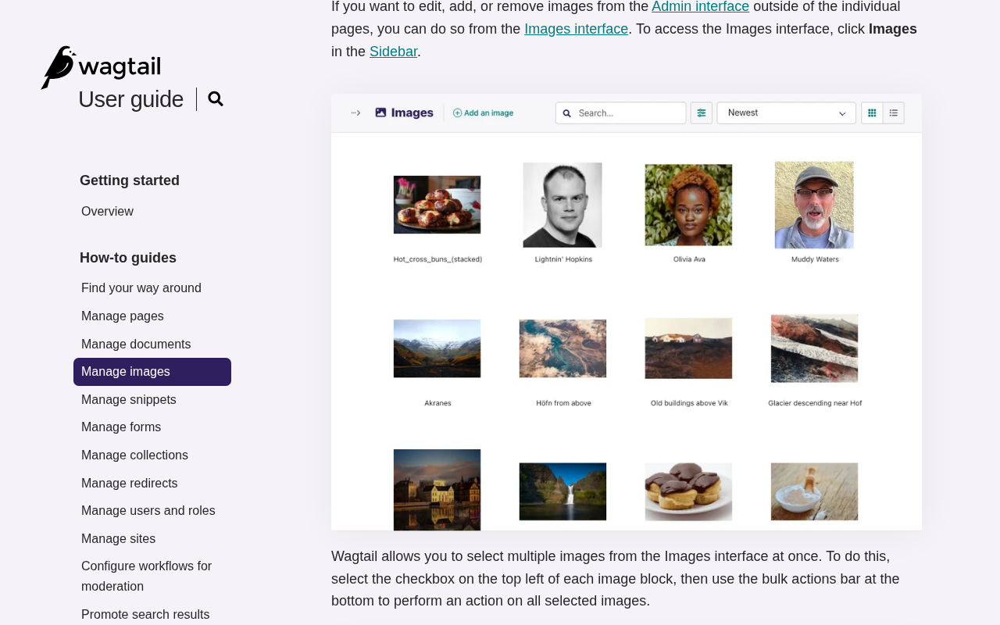
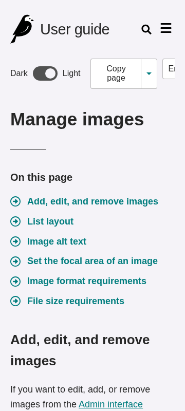

# guide.wagtail.org: sustainability audit

## At a glance

<div class="grid cards" markdown="1">

- **51.6/100** — scoped audit score<br>16 passing, 3 with problems, 12 needing more evidence.
- **6 pages** reviewed<br>1 visitor journey and 20 selected source files.
- **31 of 71 guideline groups** scored<br>39 untested; 1 not applicable. Tests cover selected aspects of each guideline.

</div>

## Results by WSG area

<div class="audit-table-scroll" tabindex="0" role="region" aria-label="Selected checks by WSG area">
<table>
<caption>Selected checks by WSG area</caption>
<thead><tr><th scope="col">Area</th><th scope="col">Passing</th><th scope="col">Guideline groups checked</th><th scope="col">Needs evidence</th></tr></thead>
<tbody>
<tr><th scope="row"><a href="#findings-2">User experience design</a></th><td>67% (8/12)</td><td>12 of 17</td><td>4</td></tr>
<tr><th scope="row"><a href="#findings-3">Web development</a></th><td>36% (4/11)</td><td>11 of 16</td><td>5</td></tr>
<tr><th scope="row"><a href="#findings-4">Hosting, infrastructure and systems</a></th><td>25% (1/4)</td><td>4 of 12</td><td>2</td></tr>
<tr><th scope="row"><a href="#findings-5">Business strategy and product management</a></th><td>75% (3/4)</td><td>4 of 26</td><td>1</td></tr>
</tbody></table></div>

Passing percentages apply to the selected checks. Full-guideline conformance has not been established.

## Page measurements

<div class="audit-table-scroll" tabindex="0" role="region" aria-label="Page measurements">
<table>
<caption>Page measurements</caption>
<thead><tr><th scope="col">Page</th><th scope="col"><a href="#measure-first-load">First load</a></th><th scope="col"><a href="#measure-after-choice">After waiting</a></th><th scope="col"><a href="#measure-scroll">After scrolling</a></th><th scope="col"><a href="#measure-carbon">Estimated footprint</a></th><th scope="col"><a href="#measure-carbon">Carbon rating</a></th><th scope="col"><a href="#measure-energy">Browser energy</a></th><th scope="col"><a href="#measure-energy">Network energy</a></th></tr></thead>
<tbody>
<tr><th scope="row"><a href="https://guide.wagtail.org/en/">Homepage</a></th><td>59.1 kB</td><td>59.1 kB</td><td>59.1 kB</td><td>0.01 gCO₂e</td><td>A+</td><td>12.00 mWh</td><td>0.76 mWh</td></tr>
<tr><th scope="row"><a href="https://guide.wagtail.org/en/getting-started/overview/">Overview</a></th><td>63.6 kB</td><td>63.6 kB</td><td>63.6 kB</td><td>0.01 gCO₂e</td><td>A+</td><td>Not sampled</td><td>Not sampled</td></tr>
<tr><th scope="row"><a href="https://guide.wagtail.org/en/how-to-guides/manage-images/">Manage images</a></th><td>233.1 kB</td><td>233.1 kB</td><td>233.1 kB</td><td>0.03 gCO₂e</td><td>A+</td><td>11.15 mWh</td><td>2.80 mWh</td></tr>
<tr><th scope="row"><a href="https://guide.wagtail.org/en/search/?query=images">Search results</a></th><td>50.6 kB</td><td>50.6 kB</td><td>50.6 kB</td><td>0.01 gCO₂e</td><td>A+</td><td>Not sampled</td><td>Not sampled</td></tr>
<tr><th scope="row"><a href="https://guide.wagtail.org/en/releases/new-in-wagtail-8-1/">New in Wagtail 8.1</a></th><td>354.3 kB</td><td>354.3 kB</td><td>354.3 kB</td><td>0.05 gCO₂e</td><td>A</td><td>10.72 mWh</td><td>4.19 mWh</td></tr>
<tr><th scope="row"><a href="https://guide.wagtail.org/en/about/">About</a></th><td>54.2 kB</td><td>54.2 kB</td><td>54.2 kB</td><td>0.01 gCO₂e</td><td>A+</td><td>Not sampled</td><td>Not sampled</td></tr>
</tbody></table></div>

## Estimated annual footprint

A traffic scenario of **244,734 pageviews/year** gives the estimates below. These are alternative views of overlapping activity, so they should not be added together.

<div class="audit-table-scroll" tabindex="0" role="region" aria-label="Annual footprint and improvement scale">
<table>
<caption>Annual footprint and improvement scale</caption>
<thead><tr><th scope="col">Scope</th><th scope="col"><a href="#measure-annual">Annual estimate</a></th><th scope="col"><a href="#measure-annual-savings">If per-view impact fell by 10%</a></th></tr></thead>
<tbody>
<tr><th scope="row">Site browsing · SWDM v4</th><td>4.93 kgCO₂e/year</td><td>0.49 kgCO₂e/year less</td></tr>
<tr><th scope="row">Client electricity · GreenFrame scenarios</th><td>2.76 kWh/year</td><td>0.28 kWh/year less</td></tr>
<tr><th scope="row">Client operational emissions · assumed electricity mix</th><td>1.36 kgCO₂e/year</td><td>0.14 kgCO₂e/year less</td></tr>
</tbody></table></div>

The 10% column shows the scale of a hypothetical improvement, not a predicted saving from the findings below.

## Priorities

The six-page sample supports focused reading: system fonts avoid font downloads, core content remains available without JavaScript, text compression works, and desktop search reaches the image guide. The clearest visitor-facing defect is that already-open pages do not follow a system theme change, although fresh dark-mode visits work. Priorities also include trials for eager article images, verification of a duplicate CI trigger path in supplied source, and a mobile navigation task. Several wider practices remain unresolved because the needed evidence was outside this sample.

### 1. Follow system theme changes while a page is open

<div class="audit-finding" markdown="1">

**Medium priority** · Problem found · <a class="audit-guideline" href="https://www.w3.org/TR/web-sustainability-guidelines/#use-media-queries-that-support-sustainability-goals" title="Support user preferences via media queries for color, motion, contrast, data use, and related settings to improve accessibility and efficiency.">WSG 3.9: Use media queries that support sustainability goals</a>

**What we found.** On all six sampled pages, a fresh dark-mode visit uses dark colors. Changing the device preference to dark while a page is already open leaves its light colors unchanged.

**Why it matters.** Visitors who change their device theme during a reading session do not receive the same adaptation as visitors who start in dark mode. The audit makes no energy claim from the theme colors.

**Next step.** First verify with no saved manual override, then update deployed theme preference handling. Test light-to-dark and dark-to-light changes without reloading, fresh dark loads and persistence of an explicit visitor choice.

[How we checked this: Follow system theme changes while a page is open](#evidence-preference-behavior)

</div>

### 2. Trial deferred images and readable responsive variants

<div class="audit-finding" markdown="1">

**Medium priority** · Needs investigation · <a class="audit-guideline" href="https://www.w3.org/TR/web-sustainability-guidelines/#optimize-media-to-reduce-resource-use" title="Include media only when it supports user needs. Manage, optimize, and load media efficiently. Ensure users have control over playback and data use.">WSG 2.9: Optimize media to reduce resource use</a>

**What we found.** Manage images and the 8.1 release page receive about 233 kB and 354 kB on first load; images account for about 177 kB and 298 kB. All article images are fetched before scrolling, including those below the viewport. WebP delivery already works. The images are 800–900 pixels wide and scale to 320 pixels in the narrow probe, but smaller alternatives have not been compared.

**Why it matters.** Readers download images for later parts of long articles even if they stop early. Deferring some requests or offering appropriate variants could reduce initial traffic, but the task images contain interface labels that must stay readable. These totals are measured traffic, not demonstrated avoidable bytes.

**Next step.** Trial native lazy loading below the first viewport while retaining dimensions and full-detail access. Compare responsive variants at intended pixel densities and inspect screenshot labels. Measure fresh narrow loads and subsequent scrolling before reporting a reduction.

<figure class="audit-illustration" markdown="1">

[](assets/fresh-guide/screenshots/manage-images-instruction.png)

<figcaption>Interface labels in the image guide need to stay readable in smaller image variants.</figcaption>
</figure>

[How we checked this: Trial deferred images and readable responsive variants](#evidence-media-delivery)

</div>

### 3. Complete the image-guide task through the mobile controls

<div class="audit-finding" markdown="1">

**Low priority** · Needs investigation · <a class="audit-guideline" href="https://www.w3.org/TR/web-sustainability-guidelines/#ensure-layouts-work-for-different-devices-and-requirements" title="Use responsive, progressively enhanced, and carbon-aware design to ensure accessible, adaptable functionality across devices and interaction methods while managing resource use.">WSG 3.10: Ensure layouts work for different devices and requirements</a>

**What we found.** All six pages fit the recorded 360-pixel width and retain task content. Their sidebar becomes hidden and a menu button appears, but the audit never opens that menu or narrow search. The completed search-to-guide journey is desktop only.

**Why it matters.** Content fitting the screen is useful, but visitors also need to reach it through the replacement controls. The missing interaction evidence leaves mobile navigation unresolved.

**Next step.** At 360 pixels, open and close navigation and search, follow a section link and find Manage images. Check keyboard traversal and touch interaction, then repeat on a representative real device.

<figure class="audit-illustration" markdown="1">

[](assets/fresh-guide/screenshots/manage-images-narrow.png)

<figcaption>The mobile layout replaces the sidebar with search and menu controls.</figcaption>
</figure>

[How we checked this: Complete the image-guide task through the mobile controls](#evidence-layout)

</div>

### 4. Check whether Renovate updates run CI twice

<div class="audit-finding" markdown="1">

**Low priority** · Problem found · <a class="audit-guideline" href="https://www.w3.org/TR/web-sustainability-guidelines/#use-automation-wisely" title="Automate and scale tasks and infrastructure efficiently, run processes only when needed, and control unwanted traffic.">WSG 4.6: Use automation wisely</a>

**What we found.** The selected workflow listens for both pushes to Renovate branches and pull requests. A Renovate update could trigger both, but this audit has not checked the actual workflow runs.

**Why it matters.** If both runs repeat the same work, one could be unnecessary. The frequency and resource cost are unknown, so this belongs below the visitor-facing findings.

**Next step.** Check a recent Renovate pull request in GitHub Actions. If two equivalent runs occur, keep the required checks and remove the redundant trigger.

**Source:** [ci.yml on main](https://github.com/wagtail/guide/blob/main/.github/workflows/ci.yml#L1-L8) · [Captured revision](https://github.com/wagtail/guide/blob/31a4547eb1f6de55baea84269723313784f6b544/.github/workflows/ci.yml#L1-L8)

```yaml
name: CI

on:
  push:
    branches:
      - main
      - "renovate/**"
  pull_request:
```

[How we checked this: Check whether Renovate updates run CI twice](#evidence-source-automation)

</div>

## Further checks

These outcomes apply to the selected checks and sample. Open a check's explanation for the observation, limitations and useful follow-up.

??? note "Browse all check outcomes"

    <div class="audit-table-scroll" tabindex="0" role="region" aria-label="All selected check outcomes">
    <table>
    <caption>All selected check outcomes</caption>
    <thead><tr><th scope="col">Check</th><th scope="col">Outcome</th></tr></thead>
    <tbody>
    <tr><th scope="row"><a href="#evidence-distraction">Reading stays focused</a></th><td><span aria-hidden="true">✅</span> Passed this check</td></tr>
    <tr><th scope="row"><a href="#evidence-choice">Inspect optional choices in their open states</a></th><td><span aria-hidden="true">❓</span> Needs investigation</td></tr>
    <tr><th scope="row"><a href="#evidence-comprehension">Instructions match the editor audience</a></th><td><span aria-hidden="true">✅</span> Passed this check</td></tr>
    <tr><th scope="row"><a href="#evidence-consistency">Navigation and control names repeat across pages</a></th><td><span aria-hidden="true">✅</span> Passed this check</td></tr>
    <tr><th scope="row"><a href="#evidence-motion">Observed reading states stay still</a></th><td><span aria-hidden="true">✅</span> Passed this check</td></tr>
    <tr><th scope="row"><a href="#evidence-notifications">Reading needs no notification opt-in</a></th><td><span aria-hidden="true">✅</span> Passed this check</td></tr>
    <tr><th scope="row"><a href="#evidence-documents">Check actual print output and text alternatives</a></th><td><span aria-hidden="true">❓</span> Needs investigation</td></tr>
    <tr><th scope="row"><a href="#evidence-unused-code">Measure interaction coverage before removing code</a></th><td><span aria-hidden="true">❓</span> Needs investigation</td></tr>
    <tr><th scope="row"><a href="#evidence-components">Check which components can load later</a></th><td><span aria-hidden="true">❓</span> Needs investigation</td></tr>
    <tr><th scope="row"><a href="#evidence-layout">Complete the task through the mobile controls</a></th><td><span aria-hidden="true">❓</span> Needs investigation</td></tr>
    <tr><th scope="row"><a href="#evidence-impact-choice">No consequential environmental choice was sampled</a></th><td><span aria-hidden="true">➖</span> Not relevant here</td></tr>
    <tr><th scope="row"><a href="#evidence-journeys">Desktop search reaches the requested guide</a></th><td><span aria-hidden="true">✅</span> Passed this check</td></tr>
    <tr><th scope="row"><a href="#evidence-media-delivery">Trial later image loading without losing useful detail</a></th><td><span aria-hidden="true">❓</span> Needs investigation</td></tr>
    <tr><th scope="row"><a href="#evidence-font-delivery">System fonts avoid extra font downloads</a></th><td><span aria-hidden="true">✅</span> Passed this check</td></tr>
    <tr><th scope="row"><a href="#evidence-semantic-forms">Core reading structure and named controls are present</a></th><td><span aria-hidden="true">✅</span> Passed this check</td></tr>
    <tr><th scope="row"><a href="#evidence-metadata">Content metadata reflects page purpose</a></th><td><span aria-hidden="true">✅</span> Passed this check</td></tr>
    <tr><th scope="row"><a href="#evidence-preference-behavior">Follow a system theme change while the page stays open</a></th><td><span aria-hidden="true">❌</span> Problem found</td></tr>
    <tr><th scope="row"><a href="#evidence-no-js-content">Core reading survives without JavaScript</a></th><td><span aria-hidden="true">✅</span> Passed this check</td></tr>
    <tr><th scope="row"><a href="#evidence-api-requests">Capture autocomplete before judging request efficiency</a></th><td><span aria-hidden="true">❓</span> Needs investigation</td></tr>
    <tr><th scope="row"><a href="#evidence-public-cache-policy">Verify repeat-visit reuse and catalog freshness</a></th><td><span aria-hidden="true">❓</span> Needs investigation</td></tr>
    <tr><th scope="row"><a href="#evidence-text-compression">Text delivery already uses compression</a></th><td><span aria-hidden="true">✅</span> Passed this check</td></tr>
    <tr><th scope="row"><a href="#evidence-keyboard-path">The initial Tab path has visible focus</a></th><td><span aria-hidden="true">✅</span> Passed this check</td></tr>
    <tr><th scope="row"><a href="#evidence-disclosure-scope">Review the parent policy against this guide origin</a></th><td><span aria-hidden="true">❓</span> Needs investigation</td></tr>
    <tr><th scope="row"><a href="#evidence-carbon-discovery">The tested carbon.txt locations return 404</a></th><td><span aria-hidden="true">❌</span> Problem found</td></tr>
    <tr><th scope="row"><a href="#evidence-hosting-evidence">Establish which hosting evidence covers this origin</a></th><td><span aria-hidden="true">❓</span> Needs investigation</td></tr>
    <tr><th scope="row"><a href="#evidence-source-reuse">Selected templates share repeated interface code</a></th><td><span aria-hidden="true">✅</span> Passed this check</td></tr>
    <tr><th scope="row"><a href="#evidence-source-dependencies">Verify lock contents or a clean frozen install</a></th><td><span aria-hidden="true">❓</span> Needs investigation</td></tr>
    <tr><th scope="row"><a href="#evidence-source-runtime">Selected runtime declarations agree</a></th><td><span aria-hidden="true">✅</span> Passed this check</td></tr>
    <tr><th scope="row"><a href="#evidence-source-automation">Verify duplicate Renovate runs before changing CI</a></th><td><span aria-hidden="true">❌</span> Problem found</td></tr>
    <tr><th scope="row"><a href="#evidence-source-maintenance">Contributors have development and maintenance guidance</a></th><td><span aria-hidden="true">✅</span> Passed this check</td></tr>
    <tr><th scope="row"><a href="#evidence-source-change-docs">Versioned release guidance explains user-facing changes</a></th><td><span aria-hidden="true">✅</span> Passed this check</td></tr>
    <tr><th scope="row"><a href="#evidence-source-budgets">Request the concrete limit and response procedure</a></th><td><span aria-hidden="true">❓</span> Needs investigation</td></tr>
    <tr><th scope="row"><a href="#evidence-source-open-source">Reuse terms and contribution routes are visible</a></th><td><span aria-hidden="true">✅</span> Passed this check</td></tr>
    </tbody></table></div>

## Next steps for auditing

1. Complete the 360-pixel menu/search task and extend keyboard checks to activation, reverse traversal and modal behavior. Include a representative real device.
2. Run controlled image-loading and rendition comparisons with screenshot readability at intended densities. Add independent cold narrow loads, warm repeat visits and autocomplete request traces; keep each measurement distinct.
3. Review the parent Wagtail sustainability policy against guide.wagtail.org, checking explicit service scope, impacts, mitigation and review date. The guide packet did not retrieve that policy; record this review separately before updating the unresolved disclosure result.
4. Obtain origin-to-hosting evidence and current provider disclosures. For advice based on supplied source, verify deployment identity, actual duplicate CI runs, lock resolution and the project’s concrete budget/enforcement procedure.
5. Broaden testing to translations and new editors when claiming wider usability. The current sample contains six English pages, one desktop journey and no authenticated CMS operations, direct energy measurement or traffic-weighted annual footprint.

### Broader checks to add next

These checks need additional evidence and are outside the current score. Missing records do not establish a site defect.

<div class="audit-table-scroll" tabindex="0" role="region" aria-label="Next contextual audit scope">
<table>
<caption>Next contextual audit scope</caption>
<thead><tr><th scope="col">Check</th><th scope="col">Evidence so far</th><th scope="col">Next step</th></tr></thead>
<tbody>
<tr><th scope="row"><a href="https://www.w3.org/TR/web-sustainability-guidelines/#promote-responsible-data-practices">Content lifecycle</a></th><td>A release-review procedure and an explanation of historical copies are present; completed reviews have not been verified.</td><td>Check one dated review decision and the corresponding live and archived pages.</td></tr>
<tr><th scope="row"><a href="https://www.w3.org/TR/web-sustainability-guidelines/#understand-user-requirements-or-constraints">Audience needs</a></th><td>The guide names its audiences and documentation framework; the influence of user research is unknown.</td><td>Find one audience research finding that informed a design or content decision.</td></tr>
<tr><th scope="row"><a href="https://www.w3.org/TR/web-sustainability-guidelines/#evaluate-if-a-digital-product-or-service-is-necessary">Access barriers</a></th><td>Desktop search reaches the image guide. Narrow layouts and no-JavaScript reading were inspected separately.</td><td>Complete the same task using keyboard-only input and a narrow screen.</td></tr>
</tbody></table></div>

The sample covers selected pages and visitor tasks, not every page on the site. Expand it where the checks above identify an untested template, interaction or audience need.

## Detailed findings

This appendix explains the evidence in ordinary language. Local source files help identify possible fixes, but we have not confirmed that the live site uses the same code revision. A missing selected file or document does not mean the organization has none.

### User experience design {#findings-2}

<h4 id="evidence-distraction">Reading stays focused</h4>

**Passed this check** · <a class="audit-guideline" href="https://www.w3.org/TR/web-sustainability-guidelines/#design-to-assist-and-not-to-distract" title="Give users control over notifications and focus, prioritize task-relevant content, and avoid designs that distract or unnecessarily extend engagement.">WSG 2.5: Design to assist and not to distract</a>

_Give users control over notifications and focus, prioritize task-relevant content, and avoid designs that distract or unnecessarily extend engagement._

Across the six sampled pages, the recorded reading states contain no overlays, playing media or active animations. Search, navigation and page contents support the documentation task; feedback follows the article. Static conference promotion appears on the home and release pages without an observed forced detour.

**Next step:** Observe longer reading sessions and optional controls before extending this finding to other interactions.

**Where we looked:**

- Browser observations for [Homepage](https://guide.wagtail.org/en/).
- Browser observations for [Overview](https://guide.wagtail.org/en/getting-started/overview/).
- Browser observations for [Manage images](https://guide.wagtail.org/en/how-to-guides/manage-images/).
- Browser observations for [Search results](https://guide.wagtail.org/en/search/?query=images).
- Browser observations for [New in wagtail 8 1](https://guide.wagtail.org/en/releases/new-in-wagtail-8-1/).
- Browser observations for [About](https://guide.wagtail.org/en/about/).

<h4 id="evidence-choice">Inspect optional choices in their open states</h4>

**Needs investigation** · <a class="audit-guideline" href="https://www.w3.org/TR/web-sustainability-guidelines/#avoid-being-manipulative-or-deceptive" title="Avoid deceptive patterns, clearly label ads, respect consent for tracking, and ensure search, sharing, and discoverability practices prioritize user needs over optimization or manipulation.">WSG 2.6: Avoid being manipulative or deceptive</a>

_Avoid deceptive patterns, clearly label ads, respect consent for tracking, and ensure search, sharing, and discoverability practices prioritize user needs over optimization or manipulation._

No consent banner, registration gate or transaction appears in the sample. Search, theme, language and feedback controls use direct wording, but their competing choices, defaults and visual prominence were not exercised. The audit does not establish a deceptive pattern or full choice parity.

**Next step:** Open the language, theme and feedback states and compare any competing options, defaults and visual prominence.

**Where we looked:**

- Browser observations for [Homepage](https://guide.wagtail.org/en/).
- Browser observations for [Overview](https://guide.wagtail.org/en/getting-started/overview/).
- Browser observations for [Manage images](https://guide.wagtail.org/en/how-to-guides/manage-images/).
- Browser observations for [Search results](https://guide.wagtail.org/en/search/?query=images).
- Browser observations for [New in wagtail 8 1](https://guide.wagtail.org/en/releases/new-in-wagtail-8-1/).
- Browser observations for [About](https://guide.wagtail.org/en/about/).
- Captured public evidence for [Homepage](https://guide.wagtail.org/en/).
- Captured public evidence for [Overview](https://guide.wagtail.org/en/getting-started/overview/).
- Captured public evidence for [Manage images](https://guide.wagtail.org/en/how-to-guides/manage-images/).
- Captured public evidence for [Search results](https://guide.wagtail.org/en/search/?query=images).
- Captured public evidence for [New in wagtail 8 1](https://guide.wagtail.org/en/releases/new-in-wagtail-8-1/).
- Captured public evidence for [About](https://guide.wagtail.org/en/about/).

<h4 id="evidence-comprehension">Instructions match the editor audience</h4>

**Passed this check** · <a class="audit-guideline" href="https://www.w3.org/TR/web-sustainability-guidelines/#make-deliverables-understandable-and-reusable" title="Create discoverable, maintainable, and reusable documentation and code resources that support long-term understanding, reuse, and sustainability.">WSG 2.7: Make deliverables understandable and reusable</a>

_Create discoverable, maintainable, and reusable documentation and code resources that support long-term understanding, reuse, and sustainability._

The home page distinguishes tutorials, how-to guides, concepts and reference. Overview introduces the CMS and administrator login; Manage images names interface controls, explains alt text and warns that replacing a shared image affects all pages using it. Search places the relevant guide first. This supports the sampled English tasks.

**Next step:** Test these tasks with new editors and people using translations or assistive technology to assess understanding more broadly.

**Where we looked:**

- Browser observations for [Homepage](https://guide.wagtail.org/en/).
- Browser observations for [Overview](https://guide.wagtail.org/en/getting-started/overview/).
- Browser observations for [Manage images](https://guide.wagtail.org/en/how-to-guides/manage-images/).
- Browser observations for [Search results](https://guide.wagtail.org/en/search/?query=images).
- Browser observations for [New in wagtail 8 1](https://guide.wagtail.org/en/releases/new-in-wagtail-8-1/).
- Browser observations for [About](https://guide.wagtail.org/en/about/).

<h4 id="evidence-consistency">Navigation and control names repeat across pages</h4>

**Passed this check** · <a class="audit-guideline" href="https://www.w3.org/TR/web-sustainability-guidelines/#use-a-design-system-for-interface-consistency" title="Use design systems and established patterns to ensure consistent, efficient, and sustainable interfaces through reusable components and clear maintenance practices.">WSG 2.8: Use a design system for interface consistency</a>

_Use design systems and established patterns to ensure consistent, efficient, and sustainable interfaces through reusable components and clear maintenance practices._

The six pages use the same documentation sections and search/theme controls. Content pages repeat page-copying, language, contents and feedback patterns where relevant. Selected templates also share a base, but a documented design system was not supplied.

**Next step:** Include additional languages and open menus in a wider consistency review.

**Where we looked:**

- Browser observations for [Homepage](https://guide.wagtail.org/en/).
- Browser observations for [Overview](https://guide.wagtail.org/en/getting-started/overview/).
- Browser observations for [Manage images](https://guide.wagtail.org/en/how-to-guides/manage-images/).
- Browser observations for [Search results](https://guide.wagtail.org/en/search/?query=images).
- Browser observations for [New in wagtail 8 1](https://guide.wagtail.org/en/releases/new-in-wagtail-8-1/).
- Browser observations for [About](https://guide.wagtail.org/en/about/).
- Selected local file `apps/core/templates/base.html` at revision `31a4547eb1f6`.
- Selected local file `apps/core/templates/core/home_page.html` at revision `31a4547eb1f6`.
- Selected local file `apps/search/templates/search/search.html` at revision `31a4547eb1f6`.

<h4 id="evidence-motion">Observed reading states stay still</h4>

**Passed this check** · <a class="audit-guideline" href="https://www.w3.org/TR/web-sustainability-guidelines/#ensure-animation-is-proportionate-and-easy-to-control" title="Use animation sparingly and efficiently, only when it supports understanding, while limiting performance impact and giving users control over motion.">WSG 2.10: Ensure animation is proportionate and easy to control</a>

_Use animation sparingly and efficiently, only when it supports understanding, while limiting performance impact and giving users control over motion._

No active animation or playing audio/video was recorded in the seven states tested on each page, including reduced-motion and fresh dark-mode loads. Supplied search code includes a later result transition, whose deployed behavior was not established.

**Next step:** Exercise autocomplete and menu transitions with reduced motion both on and off before judging those interactions.

**Where we looked:**

- Browser observations for [Homepage](https://guide.wagtail.org/en/).
- Browser observations for [Overview](https://guide.wagtail.org/en/getting-started/overview/).
- Browser observations for [Manage images](https://guide.wagtail.org/en/how-to-guides/manage-images/).
- Browser observations for [Search results](https://guide.wagtail.org/en/search/?query=images).
- Browser observations for [New in wagtail 8 1](https://guide.wagtail.org/en/releases/new-in-wagtail-8-1/).
- Browser observations for [About](https://guide.wagtail.org/en/about/).

<h4 id="evidence-notifications">Reading needs no notification opt-in</h4>

**Passed this check** · <a class="audit-guideline" href="https://www.w3.org/TR/web-sustainability-guidelines/#avoid-unwanted-notifications" title="Send only user-requested notifications and provide clear, accessible controls for managing preferences, opt-in, and account and contact settings.">WSG 2.12: Avoid unwanted notifications</a>

_Send only user-requested notifications and provide clear, accessible controls for managing preferences, opt-in, and account and contact settings._

The recorded page states show no notification permission requests, alert overlays or playing media. Browser notification permission was already denied, so the observation covers attempted requests in this session rather than all permission states.

**Next step:** If notification scope expands, use a fresh default-permission context and inspect any subscription journey.

**Where we looked:**

- Browser observations for [Homepage](https://guide.wagtail.org/en/).
- Browser observations for [Overview](https://guide.wagtail.org/en/getting-started/overview/).
- Browser observations for [Manage images](https://guide.wagtail.org/en/how-to-guides/manage-images/).
- Browser observations for [Search results](https://guide.wagtail.org/en/search/?query=images).
- Browser observations for [New in wagtail 8 1](https://guide.wagtail.org/en/releases/new-in-wagtail-8-1/).
- Browser observations for [About](https://guide.wagtail.org/en/about/).

<h4 id="evidence-documents">Check actual print output and text alternatives</h4>

**Needs investigation** · <a class="audit-guideline" href="https://www.w3.org/TR/web-sustainability-guidelines/#reduce-the-impact-of-downloadable-and-physical-documents" title="Reduce paper use through digital-first workflows, optimize and reuse accessible downloadable documents, and provide clear, user-controlled document previews and formats.">WSG 2.13: Reduce the impact of downloadable and physical documents</a>

_Reduce paper use through digital-first workflows, optimize and reuse accessible downloadable documents, and provide clear, user-controlled document previews and formats._

Print emulation hides global navigation while retaining article text and task images. About links Markdown, llms.txt, llms-full.txt and an agent skill with meaningful names, but their contents were not retrieved. Print emulation does not establish pagination, paper use or equivalent accessible documents.

**Next step:** Inspect an actual print preview or PDF of a long article and retrieve the linked text alternatives to compare content and size.

**Where we looked:**

- Browser observations for [Homepage](https://guide.wagtail.org/en/).
- Browser observations for [Overview](https://guide.wagtail.org/en/getting-started/overview/).
- Browser observations for [Manage images](https://guide.wagtail.org/en/how-to-guides/manage-images/).
- Browser observations for [Search results](https://guide.wagtail.org/en/search/?query=images).
- Browser observations for [New in wagtail 8 1](https://guide.wagtail.org/en/releases/new-in-wagtail-8-1/).
- Browser observations for [About](https://guide.wagtail.org/en/about/).

<h4 id="evidence-journeys">Desktop search reaches the requested guide</h4>

**Passed this check** · <a class="audit-guideline" href="https://www.w3.org/TR/web-sustainability-guidelines/#design-efficient-and-streamlined-user-journeys" title="Design clear, efficient journeys that help users complete tasks and find content with minimal effort.">WSG 2.4: Design efficient and streamlined user journeys</a>

_Design clear, efficient journeys that help users complete tasks and find content with minimal effort._

The recorded journey opens home-page search, enters images, submits and opens Manage images. All four actions completed without errors; the destination URL, heading and article content identify the intended guide. This establishes completion of the declared desktop task, without proving an optimal step count or success for every visitor.

**Next step:** Repeat with new editors, less direct search terms and narrow navigation to assess efficiency more broadly.

**Where we looked:**

- Browser observations for [Homepage](https://guide.wagtail.org/en/).
- Browser observations for [Manage images](https://guide.wagtail.org/en/how-to-guides/manage-images/).
- Browser observations for [Search results](https://guide.wagtail.org/en/search/?query=images).

<h4 id="evidence-media-delivery">Trial later image loading without losing useful detail</h4>

**Needs investigation** · <a class="audit-guideline" href="https://www.w3.org/TR/web-sustainability-guidelines/#optimize-media-to-reduce-resource-use" title="Include media only when it supports user needs. Manage, optimize, and load media efficiently. Ensure users have control over playback and data use.">WSG 2.9: Optimize media to reduce resource use</a>

_Include media only when it supports user needs. Manage, optimize, and load media efficiently. Ensure users have control over playback and data use._

The sampled articles contain eleven images: one in Overview, four in Manage images and six in the 8.1 release page. They are delivered as WebP despite .png URLs. Their natural widths are 800–900 pixels, compared with 756 pixels on desktop and 320 pixels in the resized narrow state; no responsive alternatives are declared. Manage images receives about 177 kB of images and the release page about 298 kB, all during first load. The images include instructional screenshots and a release-page event graphic. Smaller renditions have not been compared for readability.

**Next step:** Trial native lazy loading for images below the first viewport, keeping dimensions and full-detail access. Compare responsive variants at intended pixel densities, then measure independent fresh narrow loads and scrolling before claiming a reduction.

**Where we looked:**

- Browser observations for [Homepage](https://guide.wagtail.org/en/).
- Browser observations for [Overview](https://guide.wagtail.org/en/getting-started/overview/).
- Browser observations for [Manage images](https://guide.wagtail.org/en/how-to-guides/manage-images/).
- Browser observations for [Search results](https://guide.wagtail.org/en/search/?query=images).
- Browser observations for [New in wagtail 8 1](https://guide.wagtail.org/en/releases/new-in-wagtail-8-1/).
- Browser observations for [About](https://guide.wagtail.org/en/about/).
- Captured public evidence for [Homepage](https://guide.wagtail.org/en/).
- Captured public evidence for [Overview](https://guide.wagtail.org/en/getting-started/overview/).
- Captured public evidence for [Manage images](https://guide.wagtail.org/en/how-to-guides/manage-images/).
- Captured public evidence for [Search results](https://guide.wagtail.org/en/search/?query=images).
- Captured public evidence for [New in wagtail 8 1](https://guide.wagtail.org/en/releases/new-in-wagtail-8-1/).
- Captured public evidence for [About](https://guide.wagtail.org/en/about/).
- Selected local file `apps/frontend/static_src/scss/components/rich-text-image.scss` at revision `31a4547eb1f6`.

<h4 id="evidence-font-delivery">System fonts avoid extra font downloads</h4>

**Passed this check** · <a class="audit-guideline" href="https://www.w3.org/TR/web-sustainability-guidelines/#use-optimized-web-typography" title="Use font strategies that minimize downloads and complexity while supporting required languages and dynamic content.">WSG 2.11: Use optimized web typography</a>

_Use font strategies that minimize downloads and complexity while supporting required languages and dynamic content._

The six pages use a platform/system font stack with no recorded web-font entries or requests. English reading content remains present on desktop, at narrow width and without JavaScript. There is no sampled web-font payload to remove or subset.

**Next step:** When expanding coverage, check supported non-Latin languages and constrained devices for readable font fallbacks.

**Where we looked:**

- Browser observations for [Homepage](https://guide.wagtail.org/en/).
- Browser observations for [Overview](https://guide.wagtail.org/en/getting-started/overview/).
- Browser observations for [Manage images](https://guide.wagtail.org/en/how-to-guides/manage-images/).
- Browser observations for [Search results](https://guide.wagtail.org/en/search/?query=images).
- Browser observations for [New in wagtail 8 1](https://guide.wagtail.org/en/releases/new-in-wagtail-8-1/).
- Browser observations for [About](https://guide.wagtail.org/en/about/).
- Captured public evidence for [Homepage](https://guide.wagtail.org/en/).
- Captured public evidence for [Overview](https://guide.wagtail.org/en/getting-started/overview/).
- Captured public evidence for [Manage images](https://guide.wagtail.org/en/how-to-guides/manage-images/).
- Captured public evidence for [Search results](https://guide.wagtail.org/en/search/?query=images).
- Captured public evidence for [New in wagtail 8 1](https://guide.wagtail.org/en/releases/new-in-wagtail-8-1/).
- Captured public evidence for [About](https://guide.wagtail.org/en/about/).

<h4 id="evidence-no-js-content">Core reading survives without JavaScript</h4>

**Passed this check** · <a class="audit-guideline" href="https://www.w3.org/TR/web-sustainability-guidelines/#provide-cross-platform-compatibility-support" title="Document compatibility, avoid unnecessary obsolescence, and test across devices, systems, and network conditions.">WSG 2.17: Provide cross-platform compatibility support</a>

_Document compatibility, avoid unnecessary obsolescence, and test across devices, systems, and network conditions._

Fresh contexts with JavaScript disabled retain the same recorded text, headings and navigation as desktop across all six pages. This includes the directly loaded search results and Manage images instructions. Modal search, copying, mobile toggles and other interactive features were not established without scripts.

**Next step:** Execute a no-JavaScript navigation journey and check the narrow-screen fallback before extending the claim beyond core reading.

**Where we looked:**

- Browser observations for [Homepage](https://guide.wagtail.org/en/).
- Browser observations for [Overview](https://guide.wagtail.org/en/getting-started/overview/).
- Browser observations for [Manage images](https://guide.wagtail.org/en/how-to-guides/manage-images/).
- Browser observations for [Search results](https://guide.wagtail.org/en/search/?query=images).
- Browser observations for [New in wagtail 8 1](https://guide.wagtail.org/en/releases/new-in-wagtail-8-1/).
- Browser observations for [About](https://guide.wagtail.org/en/about/).

<h4 id="evidence-disclosure-scope">Review the parent policy against this guide origin</h4>

**Needs investigation** · <a class="audit-guideline" href="https://www.w3.org/TR/web-sustainability-guidelines/#identify-assess-disclose-review-and-mitigate-sustainability-impacts" title="Assess and report the planet, people, and prosperity impacts of digital projects, and plan measurable reductions to the real-world effects of their activity.">WSG 2.1: Identify, assess, disclose, review, and mitigate sustainability impacts</a>

_Assess and report the planet, people, and prosperity impacts of digital projects, and plan measurable reductions to the real-world effects of their activity._

The guide packet’s bounded discovery found no usable sustainability statement: two common document paths ended at localized 404 pages, and About describes the guide and contribution routes. That does not establish that no policy exists elsewhere or that a parent policy applies to this origin.

**Next step:** Review the parent Wagtail sustainability policy against guide.wagtail.org, checking named service scope, impacts, mitigation and review date. Record that relationship as new evidence before changing this unresolved judgment.

**Where we looked:**

- Captured public evidence for [Homepage](https://guide.wagtail.org).
- Browser observations for [About](https://guide.wagtail.org/en/about/).

### Web development {#findings-3}

<h4 id="evidence-unused-code">Measure interaction coverage before removing code</h4>

**Needs investigation** · <a class="audit-guideline" href="https://www.w3.org/TR/web-sustainability-guidelines/#minify-and-remove-unused-code" title="Minify code and data, and remove unused characters to reduce file size and improve loading efficiency and maintainability.">WSG 3.2: Minify and remove unused code</a>

_Minify code and data, and remove unused characters to reduce file size and improve loading efficiency and maintainability._

Every sampled page loads the shared main script and stylesheet. Many JavaScript functions were not executed in the initial half-second observation; supplied source also contains search, feedback, navigation and copying behavior used later. CSS observations list used rules rather than an unused-byte total. These records do not establish safely removable code.

**Next step:** Record coverage through autocomplete, mobile menus, feedback, copying, language and theme use; match the deployed build before selecting code to remove.

**Where we looked:**

- Browser observations for [Homepage](https://guide.wagtail.org/en/).
- Browser observations for [Overview](https://guide.wagtail.org/en/getting-started/overview/).
- Browser observations for [Manage images](https://guide.wagtail.org/en/how-to-guides/manage-images/).
- Browser observations for [Search results](https://guide.wagtail.org/en/search/?query=images).
- Browser observations for [New in wagtail 8 1](https://guide.wagtail.org/en/releases/new-in-wagtail-8-1/).
- Browser observations for [About](https://guide.wagtail.org/en/about/).
- Selected local file `apps/core/templates/base.html` at revision `31a4547eb1f6`.
- Selected local file `apps/frontend/static_src/js/main.js` at revision `31a4547eb1f6`.
- Selected local file `apps/frontend/static_src/js/mobile-menu/index.js` at revision `31a4547eb1f6`.
- Selected local file `apps/frontend/static_src/js/theme-detect/index.js` at revision `31a4547eb1f6`.

<h4 id="evidence-components">Check which components can load later</h4>

**Needs investigation** · <a class="audit-guideline" href="https://www.w3.org/TR/web-sustainability-guidelines/#modularize-bandwidth-heavy-components" title="Split large components into smaller, on-demand modules to improve loading efficiency while balancing maintainability and caching performance.">WSG 3.3: Modularize bandwidth-heavy components</a>

_Split large components into smaller, on-demand modules to improve loading efficiency while balancing maintainability and caching performance._

All six pages load the same main bundle, whose compressed response body is about 26 kB. Supplied source initializes several interactions, and search is used in the executed journey. The audit does not identify a deployed component that can safely be deferred.

**Next step:** Attribute the deployed bundle to its modules, then test a deferred component prototype through activation, caching and slow-network use.

**Where we looked:**

- Browser observations for [Homepage](https://guide.wagtail.org/en/).
- Browser observations for [Overview](https://guide.wagtail.org/en/getting-started/overview/).
- Browser observations for [Manage images](https://guide.wagtail.org/en/how-to-guides/manage-images/).
- Browser observations for [Search results](https://guide.wagtail.org/en/search/?query=images).
- Browser observations for [New in wagtail 8 1](https://guide.wagtail.org/en/releases/new-in-wagtail-8-1/).
- Browser observations for [About](https://guide.wagtail.org/en/about/).
- Selected local file `apps/core/templates/base.html` at revision `31a4547eb1f6`.
- Selected local file `apps/frontend/static_src/js/main.js` at revision `31a4547eb1f6`.

<h4 id="evidence-layout">Complete the task through the mobile controls</h4>

**Needs investigation** · <a class="audit-guideline" href="https://www.w3.org/TR/web-sustainability-guidelines/#ensure-layouts-work-for-different-devices-and-requirements" title="Use responsive, progressively enhanced, and carbon-aware design to ensure accessible, adaptable functionality across devices and interaction methods while managing resource use.">WSG 3.10: Ensure layouts work for different devices and requirements</a>

_Use responsive, progressively enhanced, and carbon-aware design to ensure accessible, adaptable functionality across devices and interaction methods while managing resource use._

At 360 pixels wide, all six pages retain the recorded task text, headings and images without horizontal overflow. Images scale to 320 pixels; the sidebar disappears and a named menu button appears. Neither the mobile menu nor narrow search was activated, so the completed desktop journey does not resolve mobile navigation.

**Next step:** At 360 pixels, open and close the menu and search, follow a section link and find Manage images using keyboard and touch; repeat on a representative real device.

**Where we looked:**

- Browser observations for [Homepage](https://guide.wagtail.org/en/).
- Browser observations for [Overview](https://guide.wagtail.org/en/getting-started/overview/).
- Browser observations for [Manage images](https://guide.wagtail.org/en/how-to-guides/manage-images/).
- Browser observations for [Search results](https://guide.wagtail.org/en/search/?query=images).
- Browser observations for [New in wagtail 8 1](https://guide.wagtail.org/en/releases/new-in-wagtail-8-1/).
- Browser observations for [About](https://guide.wagtail.org/en/about/).
- Selected local file `apps/frontend/static_src/js/mobile-menu/index.js` at revision `31a4547eb1f6`.

<h4 id="evidence-semantic-forms">Core reading structure and named controls are present</h4>

**Passed this check** · <a class="audit-guideline" href="https://www.w3.org/TR/web-sustainability-guidelines/#ensure-code-follows-good-semantic-practices" title="Use standards-compliant HTML and web platform features, and avoid unnecessary complexity or non-standard code.">WSG 3.6: Ensure code follows good semantic practices</a>

_Use standards-compliant HTML and web platform features, and avoid unnecessary complexity or non-standard code._

Each page declares English, has one main region and a meaningful primary heading. Search and feedback have labeling relationships, and icon controls have explicit names. Search results also show skipped heading levels and duplicate search labels; this bounded pass does not establish a correct heading hierarchy, unique IDs or full accessibility.

**Next step:** Audit the live search modal, result headings and duplicate search IDs with a screen-reader task.

**Where we looked:**

- Browser observations for [Homepage](https://guide.wagtail.org/en/).
- Browser observations for [Overview](https://guide.wagtail.org/en/getting-started/overview/).
- Browser observations for [Manage images](https://guide.wagtail.org/en/how-to-guides/manage-images/).
- Browser observations for [Search results](https://guide.wagtail.org/en/search/?query=images).
- Browser observations for [New in wagtail 8 1](https://guide.wagtail.org/en/releases/new-in-wagtail-8-1/).
- Browser observations for [About](https://guide.wagtail.org/en/about/).

<h4 id="evidence-metadata">Content metadata reflects page purpose</h4>

**Passed this check** · <a class="audit-guideline" href="https://www.w3.org/TR/web-sustainability-guidelines/#structure-metadata-for-machine-readability" title="Include essential document metadata and structured data to improve usability, accessibility, and machine readability.">WSG 3.8: Structure metadata for machine readability</a>

_Include essential document metadata and structured data to improve usability, accessibility, and machine readability._

The five content pages have descriptive titles, descriptions and self-referencing HTTPS canonical URLs. Search has a descriptive title and deliberate noindex directive; it does not need the same canonical or description as an article. Each page has a structured-data block that parses as JSON, which does not establish schema validity.

**Next step:** Retrieve and validate the deployed structured-data meaning if schema quality becomes part of the audit.

**Where we looked:**

- Browser observations for [Homepage](https://guide.wagtail.org/en/).
- Browser observations for [Overview](https://guide.wagtail.org/en/getting-started/overview/).
- Browser observations for [Manage images](https://guide.wagtail.org/en/how-to-guides/manage-images/).
- Browser observations for [Search results](https://guide.wagtail.org/en/search/?query=images).
- Browser observations for [New in wagtail 8 1](https://guide.wagtail.org/en/releases/new-in-wagtail-8-1/).
- Browser observations for [About](https://guide.wagtail.org/en/about/).

<h4 id="evidence-preference-behavior">Follow a system theme change while the page stays open</h4>

**Problem found** · <a class="audit-guideline" href="https://www.w3.org/TR/web-sustainability-guidelines/#use-media-queries-that-support-sustainability-goals" title="Support user preferences via media queries for color, motion, contrast, data use, and related settings to improve accessibility and efficiency.">WSG 3.9: Use media queries that support sustainability goals</a>

_Support user preferences via media queries for color, motion, contrast, data use, and related settings to improve accessibility and efficiency._

All six pages open in dark colors when dark mode is already selected before navigation. When the device preference changes to dark while a page is open, the preference query changes but the recorded light text/background colors remain unchanged. Reading content stays available in both cases. Manual theme activation was not tested, and no energy saving follows from these colors.

**Next step:** Verify the behavior with no saved manual override, then update deployed preference handling. Retest light-to-dark and dark-to-light changes without reload, saved choices and fresh loads; keep an explicit visitor choice in control.

**Where we looked:**

- Browser observations for [Homepage](https://guide.wagtail.org/en/).
- Browser observations for [Overview](https://guide.wagtail.org/en/getting-started/overview/).
- Browser observations for [Manage images](https://guide.wagtail.org/en/how-to-guides/manage-images/).
- Browser observations for [Search results](https://guide.wagtail.org/en/search/?query=images).
- Browser observations for [New in wagtail 8 1](https://guide.wagtail.org/en/releases/new-in-wagtail-8-1/).
- Browser observations for [About](https://guide.wagtail.org/en/about/).

<h4 id="evidence-api-requests">Capture autocomplete before judging request efficiency</h4>

**Needs investigation** · <a class="audit-guideline" href="https://www.w3.org/TR/web-sustainability-guidelines/#use-sustainable-javascript-and-apis" title="Write efficient JavaScript and use APIs that minimize processing, data use, and energy consumption.">WSG 3.11: Use sustainable JavaScript and APIs</a>

_Write efficient JavaScript and use APIs that minimize processing, data use, and energy consumption._

Initial network windows show no duplicate URL requests or Fetch/XHR polling, and scrolling adds no requests. Supplied code uses debounced search input, but the executed journey submits quickly and lacks a complete intermediate request trace. Autocomplete payloads, cancellation and stale results remain unresolved.

**Next step:** Record typing, pauses, clearing and repeated searches with request/response timings, payloads and cache/cancellation behavior; relate freshness to finding documentation.

**Where we looked:**

- Browser observations for [Homepage](https://guide.wagtail.org/en/).
- Browser observations for [Overview](https://guide.wagtail.org/en/getting-started/overview/).
- Browser observations for [Manage images](https://guide.wagtail.org/en/how-to-guides/manage-images/).
- Browser observations for [Search results](https://guide.wagtail.org/en/search/?query=images).
- Browser observations for [New in wagtail 8 1](https://guide.wagtail.org/en/releases/new-in-wagtail-8-1/).
- Browser observations for [About](https://guide.wagtail.org/en/about/).
- Captured public evidence for [Homepage](https://guide.wagtail.org/en/).
- Captured public evidence for [Overview](https://guide.wagtail.org/en/getting-started/overview/).
- Captured public evidence for [Manage images](https://guide.wagtail.org/en/how-to-guides/manage-images/).
- Captured public evidence for [Search results](https://guide.wagtail.org/en/search/?query=images).
- Captured public evidence for [New in wagtail 8 1](https://guide.wagtail.org/en/releases/new-in-wagtail-8-1/).
- Captured public evidence for [About](https://guide.wagtail.org/en/about/).
- Selected local file `apps/search/views.py` at revision `31a4547eb1f6`.
- Selected local file `apps/frontend/static_src/js/main.js` at revision `31a4547eb1f6`.

<h4 id="evidence-keyboard-path">The initial Tab path has visible focus</h4>

**Passed this check** · <a class="audit-guideline" href="https://www.w3.org/TR/web-sustainability-guidelines/#ensure-code-follows-good-semantic-practices" title="Use standards-compliant HTML and web platform features, and avoid unnecessary complexity or non-standard code.">WSG 3.6: Ensure code follows good semantic practices</a>

_Use standards-compliant HTML and web platform features, and avoid unnecessary complexity or non-standard code._

Each twelve-Tab trace starts with the skip link, home link and search control, then reaches named documentation links. Every recorded focused element is visible and has a solid two-pixel blue outline against the light background. Activation, reverse traversal, modal traps and all controls were outside this bounded path.

**Next step:** Activate the skip link and menus, test reverse traversal, and inspect focus in dark and narrow states before claiming complete keyboard access.

**Where we looked:**

- Browser observations for [Homepage](https://guide.wagtail.org/en/).
- Browser observations for [Overview](https://guide.wagtail.org/en/getting-started/overview/).
- Browser observations for [Manage images](https://guide.wagtail.org/en/how-to-guides/manage-images/).
- Browser observations for [Search results](https://guide.wagtail.org/en/search/?query=images).
- Browser observations for [New in wagtail 8 1](https://guide.wagtail.org/en/releases/new-in-wagtail-8-1/).
- Browser observations for [About](https://guide.wagtail.org/en/about/).

<h4 id="evidence-carbon-discovery">The tested carbon.txt locations return 404</h4>

**Problem found** · <a class="audit-guideline" href="https://www.w3.org/TR/web-sustainability-guidelines/#include-expected-and-beneficial-files" title="Include standard website metadata and configuration files to support discoverability, transparency, and operational best practices.">WSG 3.13: Include expected and beneficial files</a>

_Include standard website metadata and configuration files to support discoverability, transparency, and operational best practices._

Both /carbon.txt and /.well-known/carbon.txt returned 404 HTML. The recorded discovery found no supported header/DNS delegation or usable carbon records. This fails the declared optional-file discovery check; it does not establish high emissions or absent sustainability work.

**Next step:** If useful for transparency, publish a valid carbon.txt or supported delegation with clear service/provider relationships, inspect its linked evidence and retest the declared discovery profile.

**Where we looked:**

- Captured public evidence for [Homepage](https://guide.wagtail.org).

<h4 id="evidence-source-reuse">Selected templates share repeated interface code</h4>

**Passed this check** · <a class="audit-guideline" href="https://www.w3.org/TR/web-sustainability-guidelines/#avoid-redundancy-and-duplication-in-code" title="Reduce code duplication through refactoring and reuse, ensure maintainability, and favor evolving existing solutions over rebuilding them.">WSG 3.4: Avoid redundancy and duplication in code</a>

_Reduce code duplication through refactoring and reuse, ensure maintainability, and favor evolving existing solutions over rebuilding them._

The selected supplied source has home and search templates extending a shared base, which includes common skip, theme, copy and search components. Mobile menu and copy controls use shared initialization. Similar modal and full-page search fields serve different contexts; they do not establish a harmful duplicate path.

**Next step:** Broaden concrete component call-site review only if assessing more of the project; the selected source is not verified as deployed.

**Where we looked:**

- Selected local file `apps/core/templates/base.html` at revision `31a4547eb1f6`.
- Selected local file `apps/core/templates/core/home_page.html` at revision `31a4547eb1f6`.
- Selected local file `apps/core/templates/components/search_modal.html` at revision `31a4547eb1f6`.
- Selected local file `apps/search/templates/search/search.html` at revision `31a4547eb1f6`.
- Selected local file `apps/frontend/static_src/js/main.js` at revision `31a4547eb1f6`.
- Selected local file `apps/frontend/static_src/js/mobile-menu/index.js` at revision `31a4547eb1f6`.

<h4 id="evidence-source-dependencies">Verify lock contents or a clean frozen install</h4>

**Needs investigation** · <a class="audit-guideline" href="https://www.w3.org/TR/web-sustainability-guidelines/#use-dependencies-sparingly-and-maintain-them" title="Regularly review dependencies, remove unused or unnecessary libraries and frameworks, and keep required packages up to date. Opt for minimal, secure, and modular solutions.">WSG 3.12: Use dependencies sparingly and maintain them</a>

_Regularly review dependencies, remove unused or unnecessary libraries and frameworks, and keep required packages up to date. Opt for minimal, secure, and modular solutions._

The supplied manifests list direct Python and npm dependencies. Dockerfile and CI use npm ci and uv sync --frozen, but the captured lockfiles contain metadata only. Their resolved contents, consistency and successful installation were not reviewed, so repeatable resolution remains unresolved.

**Next step:** Capture bounded lockfile resolution evidence or a clean frozen-install receipt at the same revision. Verify deployed inventory separately before making version, vulnerability or removal claims.

**Where we looked:**

- Selected local file `pyproject.toml` at revision `31a4547eb1f6`.
- Selected local file `package.json` at revision `31a4547eb1f6`.
- Selected local file `uv.lock` at revision `31a4547eb1f6` (metadata only).
- Selected local file `package-lock.json` at revision `31a4547eb1f6` (metadata only).
- Selected local file `Dockerfile` at revision `31a4547eb1f6`.
- Selected local file `.github/workflows/ci.yml` at revision `31a4547eb1f6`.

<h4 id="evidence-source-runtime">Selected runtime declarations agree</h4>

**Passed this check** · <a class="audit-guideline" href="https://www.w3.org/TR/web-sustainability-guidelines/#use-the-latest-stable-language-version" title="Use up-to-date technologies and select the most suitable programming language for each task to ensure efficiency and maintainability.">WSG 3.15: Use the latest stable language version</a>

_Use up-to-date technologies and select the most suitable programming language for each task to ensure efficiency and maintainability._

The selected supplied declarations consistently specify Python 3.14 through the manifest, version file, Dockerfile and README. Node 26 appears in the version file and frontend Docker image, and CI reads that version file. This checks declared consistency, without establishing deployed versions or latest stable releases.

**Next step:** Capture the unselected development Dockerfile and actual runtime attestations if extending the check beyond these declarations.

**Where we looked:**

- Selected local file `pyproject.toml` at revision `31a4547eb1f6`.
- Selected local file `package.json` at revision `31a4547eb1f6`.
- Selected local file `Dockerfile` at revision `31a4547eb1f6`.
- Selected local file `.python-version` at revision `31a4547eb1f6`.
- Selected local file `.nvmrc` at revision `31a4547eb1f6`.
- Selected local file `.github/workflows/ci.yml` at revision `31a4547eb1f6`.
- Selected local file `README.md` at revision `31a4547eb1f6`.

### Hosting, infrastructure and systems {#findings-4}

<h4 id="evidence-public-cache-policy">Verify repeat-visit reuse and catalog freshness</h4>

**Needs investigation** · <a class="audit-guideline" href="https://www.w3.org/TR/web-sustainability-guidelines/#optimize-caching-and-support-offline-access" title="Use caching and offline capabilities to reduce network load, improve resilience, and balance performance with sustainability.">WSG 4.2: Optimize caching and support offline access</a>

_Use caching and offline capabilities to reduce network load, improve resilience, and balance performance with sustainability._

Hashed CSS and JavaScript declare long-lived immutable caching and validators. Images expose ETag and Last-Modified. Translation-catalog cache/validation headers vary across sampled responses; the intended freshness policy is unresolved. These headers do not measure warm-cache reuse or offline access.

**Next step:** Confirm translation-catalog update and invalidation needs, then compare repeat visits and navigation using observed cache hits, revalidation and response bytes.

**Where we looked:**

- Browser observations for [Homepage](https://guide.wagtail.org/en/).
- Browser observations for [Overview](https://guide.wagtail.org/en/getting-started/overview/).
- Browser observations for [Manage images](https://guide.wagtail.org/en/how-to-guides/manage-images/).
- Browser observations for [Search results](https://guide.wagtail.org/en/search/?query=images).
- Browser observations for [New in wagtail 8 1](https://guide.wagtail.org/en/releases/new-in-wagtail-8-1/).
- Browser observations for [About](https://guide.wagtail.org/en/about/).
- Captured public evidence for [Homepage](https://guide.wagtail.org/en/).
- Captured public evidence for [Overview](https://guide.wagtail.org/en/getting-started/overview/).
- Captured public evidence for [Manage images](https://guide.wagtail.org/en/how-to-guides/manage-images/).
- Captured public evidence for [Search results](https://guide.wagtail.org/en/search/?query=images).
- Captured public evidence for [New in wagtail 8 1](https://guide.wagtail.org/en/releases/new-in-wagtail-8-1/).
- Captured public evidence for [About](https://guide.wagtail.org/en/about/).

<h4 id="evidence-text-compression">Text delivery already uses compression</h4>

**Passed this check** · <a class="audit-guideline" href="https://www.w3.org/TR/web-sustainability-guidelines/#reduce-data-transfer-with-compression" title="Compress server responses and media files to reduce bandwidth, storage use, and delivery overhead while balancing processing costs.">WSG 4.3: Reduce data transfer with compression</a>

_Compress server responses and media files to reduce bandwidth, storage use, and delivery overhead while balancing processing costs._

Across the six sampled pages, HTML and translation catalogs use Brotli; shared scripts and styles use gzip. The main script and stylesheet have compressed body sizes of about 26 kB and 8 kB, compared with decoded sizes of about 90 kB and 44 kB. This is an observed delivery strength.

**Next step:** Retain compression for these material text assets; the sampled WebP images need no additional text-style compression.

**Where we looked:**

- Browser observations for [Homepage](https://guide.wagtail.org/en/).
- Browser observations for [Overview](https://guide.wagtail.org/en/getting-started/overview/).
- Browser observations for [Manage images](https://guide.wagtail.org/en/how-to-guides/manage-images/).
- Browser observations for [Search results](https://guide.wagtail.org/en/search/?query=images).
- Browser observations for [New in wagtail 8 1](https://guide.wagtail.org/en/releases/new-in-wagtail-8-1/).
- Browser observations for [About](https://guide.wagtail.org/en/about/).
- Captured public evidence for [Homepage](https://guide.wagtail.org/en/).
- Captured public evidence for [Overview](https://guide.wagtail.org/en/getting-started/overview/).
- Captured public evidence for [Manage images](https://guide.wagtail.org/en/how-to-guides/manage-images/).
- Captured public evidence for [Search results](https://guide.wagtail.org/en/search/?query=images).
- Captured public evidence for [New in wagtail 8 1](https://guide.wagtail.org/en/releases/new-in-wagtail-8-1/).
- Captured public evidence for [About](https://guide.wagtail.org/en/about/).

<h4 id="evidence-hosting-evidence">Establish which hosting evidence covers this origin</h4>

**Needs investigation** · <a class="audit-guideline" href="https://www.w3.org/TR/web-sustainability-guidelines/#use-sustainable-hosting" title="Select and manage infrastructure using sustainability metrics, prioritizing low-carbon energy use and low-impact hosting and domain choices in selection, and extending hardware lifespan and minimising emissions in management.">WSG 4.1: Use sustainable hosting</a>

_Select and manage infrastructure using sustainability metrics, prioritizing low-carbon energy use and low-impact hosting and domain choices in selection, and extending hardware lifespan and minimising emissions in management._

The guide packet does not identify independently corroborated hosting scope for this origin. A supplied Dockerfile refers to Heroku production, but it is not deployment-verified. Cloudflare detection identifies neither the origin provider nor its electricity supply.

**Next step:** Obtain evidence linking this origin to its current provider and region, then inspect current operational disclosures or independently verified hosting evidence.

**Where we looked:**

- Captured public evidence for [Homepage](https://guide.wagtail.org).
- Selected local file `Dockerfile` at revision `31a4547eb1f6`.

<h4 id="evidence-source-automation">Verify duplicate Renovate runs before changing CI</h4>

**Problem found** · <a class="audit-guideline" href="https://www.w3.org/TR/web-sustainability-guidelines/#use-automation-wisely" title="Automate and scale tasks and infrastructure efficiently, run processes only when needed, and control unwanted traffic.">WSG 4.6: Use automation wisely</a>

_Automate and scale tasks and infrastructure efficiently, run processes only when needed, and control unwanted traffic._

The selected supplied workflow triggers for renovate/** pushes and all pull requests. Updating an open Renovate pull request therefore matches both events, with no filtering or cancellation in the captured workflow. This demonstrates a duplicate-trigger path in supplied source; current deployment, actual paired runs and energy use were not established.

**Next step:** First verify actual duplicate runs for the same Renovate commit and required-check names. If confirmed, filter duplicate events or cancel superseded runs while keeping necessary build, lint and test coverage; verify the resulting checks still complete.

**Where we looked:**

- Selected local file `.github/workflows/ci.yml` at revision `31a4547eb1f6`.

### Business strategy and product management {#findings-5}

<h4 id="evidence-impact-choice">No consequential environmental choice was sampled</h4>

**Not relevant here** · <a class="audit-guideline" href="https://www.w3.org/TR/web-sustainability-guidelines/#communicate-the-environmental-impact-of-user-choices" title="Empower users, allowing them to make decisions when their choices can influence the environmental impact they have.">WSG 5.4: Communicate the environmental impact of user choices</a>

_Empower users, allowing them to make decisions when their choices can influence the environmental impact they have._

The audited tasks are finding and reading public documentation. They contain no demonstrated purchase, transport, media-quality or compute-intensive choice for which an impact comparison would help. Instructions about CMS image uploads describe a separate workflow.

**Next step:** Reassess contextual impact information if the scope later includes actual uploads, media playback or another resource-intensive task.

**Where we looked:**

- Browser observations for [Homepage](https://guide.wagtail.org/en/).
- Browser observations for [Overview](https://guide.wagtail.org/en/getting-started/overview/).
- Browser observations for [Manage images](https://guide.wagtail.org/en/how-to-guides/manage-images/).
- Browser observations for [Search results](https://guide.wagtail.org/en/search/?query=images).
- Browser observations for [New in wagtail 8 1](https://guide.wagtail.org/en/releases/new-in-wagtail-8-1/).
- Browser observations for [About](https://guide.wagtail.org/en/about/).

<h4 id="evidence-source-maintenance">Contributors have development and maintenance guidance</h4>

**Passed this check** · <a class="audit-guideline" href="https://www.w3.org/TR/web-sustainability-guidelines/#follow-a-product-management-and-maintenance-strategy" title="Maintain clear documentation, resourcing, and measurement practices for long-term product support, including security, sustainability, and early detection of failure risks.">WSG 5.10: Follow a product management and maintenance strategy</a>

_Maintain clear documentation, resourcing, and measurement practices for long-term product support, including security, sustainability, and early detection of failure risks._

The supplied README and contributor instructions cover dependencies, local/container setup, linting, testing, content and translation coordination, releases and screenshot updates. CI declares lint and test commands. These are useful disclosures; they do not prove staffing, maintenance cadence or regular execution.

**Next step:** For broader operational claims, obtain the owner’s maintenance cadence, responsibility assignments and execution records.

**Where we looked:**

- Selected local file `README.md` at revision `31a4547eb1f6`.
- Selected local file `CONTRIBUTING.md` at revision `31a4547eb1f6`.
- Selected local file `.github/workflows/ci.yml` at revision `31a4547eb1f6`.

<h4 id="evidence-source-change-docs">Versioned release guidance explains user-facing changes</h4>

**Passed this check** · <a class="audit-guideline" href="https://www.w3.org/TR/web-sustainability-guidelines/#document-updates-and-evolutions" title="Provide documentation to help users find their way whenever functionality changes.">WSG 5.12: Document updates and evolutions</a>

_Provide documentation to help users find their way whenever functionality changes._

The live New in Wagtail 8.1 page describes changes and their practical effects, links technical release notes and is dated November 3, 2026. Navigation includes earlier releases, and About links historical guide copies. Supplied contributor instructions explain release-specific documentation and screenshot copying. This is product guidance, not a deployment log.

**Next step:** Expand the sample to translated and older releases when assessing change-history coverage.

**Where we looked:**

- Browser observations for [New in wagtail 8 1](https://guide.wagtail.org/en/releases/new-in-wagtail-8-1/).
- Browser observations for [About](https://guide.wagtail.org/en/about/).
- Selected local file `CONTRIBUTING.md` at revision `31a4547eb1f6`.

<h4 id="evidence-source-budgets">Request the concrete limit and response procedure</h4>

**Needs investigation** · <a class="audit-guideline" href="https://www.w3.org/TR/web-sustainability-guidelines/#define-performance-environmental-and-human-budgets" title="Define and apply lifecycle sustainability and performance budgets, set evidence-based KPIs, and track measurable improvements over time.">WSG 5.24: Define performance, environmental, and human budgets</a>

_Define and apply lifecycle sustainability and performance budgets, set evidence-based KPIs, and track measurable improvements over time._

The selected manifests, Dockerfile, CI and contributor documentation do not expose a concrete asset/performance threshold with an exceedance response. Referenced build configuration was not captured. This is a limit of the selected evidence, leaving project budgets unresolved.

**Next step:** Provide build-budget configuration or the project budget document, including limits, warning/failure behavior, rationale and who responds when a limit is exceeded.

**Where we looked:**

- Selected local file `pyproject.toml` at revision `31a4547eb1f6`.
- Selected local file `package.json` at revision `31a4547eb1f6`.
- Selected local file `Dockerfile` at revision `31a4547eb1f6`.
- Selected local file `.github/workflows/ci.yml` at revision `31a4547eb1f6`.
- Selected local file `README.md` at revision `31a4547eb1f6`.
- Selected local file `CONTRIBUTING.md` at revision `31a4547eb1f6`.

<h4 id="evidence-source-open-source">Reuse terms and contribution routes are visible</h4>

**Passed this check** · <a class="audit-guideline" href="https://www.w3.org/TR/web-sustainability-guidelines/#use-and-contribute-to-open-source" title="Define and maintain an open-source policy and actively contribute to open-source communities through code, time, and financial or in-kind support.">WSG 5.25: Use and contribute to open source</a>

_Define and maintain an open-source policy and actively contribute to open-source communities through code, time, and financial or in-kind support._

The selected supplied license permits source and binary redistribution with stated conditions; project documentation explains code, issue, documentation and translation participation. Independently, the live footer declares CC0 for content and About links the repository and contribution routes. Ongoing upstream activity was not assessed.

**Next step:** No follow-up is needed for these selected disclosures. Review contribution history only if making a broader claim about ongoing upstream work.

**Where we looked:**

- Selected local file `README.md` at revision `31a4547eb1f6`.
- Selected local file `CONTRIBUTING.md` at revision `31a4547eb1f6`.
- Selected local file `LICENSE` at revision `31a4547eb1f6`.
- Browser observations for [About](https://guide.wagtail.org/en/about/).

## Methodology and reproducibility

The browser measurements were captured from **2026-11-04T19:22:46.209106+00:00** to **2026-11-04T19:23:43.617823+00:00**. Initial-load tests used a 1280 × 800 desktop viewport and a 3-second observation window. Cookie choices and scrolling were recorded afterward. Supplementary tests covered narrow layouts, color and motion preferences, print, JavaScript availability and bounded keyboard navigation.

**Audit judgments:** Codex native subagent, gpt-6.1-sol, **high reasoning**. **Report wording:** Codex native subagent, gpt-6.1-sol, **high reasoning**.

The scoring method is `agent-breadth-v2`. A guideline group counts once even if it has several checks. Observed problems take precedence over unresolved checks in that group. 1 groups were excluded as not applicable; 39 were untested. Unknowns remain in the passing-percentage denominator; untested and inapplicable groups do not. Area percentages use the same rule as the overall score.

### First load {#measure-first-load}

Data downloaded before clicking or scrolling, using the first recorded initial visit for each URL, including its completeness limit. Decimal kB = 1,000 bytes; MB = 1,000,000 bytes.

### Cookie choices and waiting {#measure-after-choice}

No cookie banner was observed in this sample. The intermediate checkpoint waits without clicking. Later columns show **cumulative totals**, including the initial load of that visit. They are not additional amounts to add together or guaranteed savings.

### Scrolling {#measure-scroll}

Cumulative downloads after scrolling to the bottom, following the cookie-choice or waiting checkpoint of the same visit. Compare accept and reject values within their own visit; do not subtract the first-load headline from a different visit.

### Partial measurements {#measure-completeness}

A partial result means some requests failed or did not finish in the observation window, so their transferred size is uncertain. The site is measured as it behaved; a failed analytics request is context, not automatically a priority fix. Carbon estimates and ratings are withheld for incomplete initial captures. Unmarked transfer figures are complete within the test conditions, not a measure of every possible download.

### Estimated footprint and Digital Carbon Rating {#measure-carbon}

Both use the same initial visit as the first-load column. Footprints are estimates in grams of carbon dioxide equivalent (gCO₂e) per first visit. They display two decimal places, with a minimum of 0.01 gCO₂e for positive estimates. Digital Carbon Ratings use unrounded estimates from the fixed comparison model. Recorded model: Sustainable Web Design Model version 4 through `@tgwf/co2@0.19.0`, assuming 100% first visits. The comparison gives no green-hosting credit. These are model assumptions, not verified electricity-supply facts. Ratings remain provisional because the capture protocol has not been independently validated; they do not establish whole-site sustainability.

### Browser and network energy {#measure-energy}

Energy is shown in milliwatt-hours (mWh = 0.001 Wh). Browser energy includes modeled CPU, memory, disk and display use. Not sampled means no energy experiment was supplied for that page; unavailable means a supplied experiment did not yield a usable result. Neither means zero energy.

**Energy method:** GreenFrame 2.0.1 uses separately recorded browser scenarios, with three fresh-context visits per page, page load followed by a three-second wait, and no cookie interaction or scrolling. The median client-device estimate and median network estimate are reported separately; their medians must not be added to derive a total. This is a resource-use model, not metered whole-device electricity. Browser startup and the collector warm-up are excluded; browser close is included.

The pinned container uses Chromium 110 and a fixed Chrome 89 user-agent, independently of the transfer collector. The model assumes a 14 W display; that assumption contributes substantially to these short visits. CPU, memory and disk estimates use the collection host's properties. Background activity on this shared workstation was not independently isolated. These figures support repeat experiments under the same conditions, not device-independent rankings. GreenFrame network energy and SWDM carbon estimates overlap in scope and are not added together.

Illustrations were captured separately from the transfer measurements. Their capture dates, viewports, URLs and file hashes are retained in the screenshot manifest. Source excerpts reproduce captured text; branch links target the checked-out branch. Captured-revision links remain stable if that branch moves.

### Annual footprint {#measure-annual}

**Traffic:** CrUX dataset month `2026-09`, exact origin `https://guide.wagtail.org`, popularity bucket 10,000,000. The [CrUX popularity metric](https://developer.chrome.com/docs/crux/methodology/metrics#popularity) is a coarse navigation-based rank, not a pageview count. The [rank-to-pageviews mapping](https://github.com/thibaudcolas/ranking-to-pageviews) applies medians calibrated on US government sites using 2025 analytics and December 2025 ranks. This population and period differ from this site. No calibrated site-level uncertainty interval is available; these are scenarios, not measured analytics or a forecast.

**SWDM v4:** Annual pageviews × the arithmetic mean of unrounded emissions per sampled URL ÷ 1,000 = kgCO₂e/year. Use the first recorded initial visit per URL, equal page weights and 100% first visits. The actual mix of pages and returning visitors is unknown. [SWDM v4](https://sustainablewebdesign.org/estimating-digital-emissions/) covers modeled operational and embodied browsing emissions across devices, networks and data centers; it is not a complete inventory of this site's backend, builds or organization.

Partial transfer inputs can support this explicitly labeled scenario, but do not establish a complete footprint or qualify for a Digital Carbon Rating. Ratings remain withheld where initial captures are incomplete.

**Client-energy projection:** The 3 energy-sampled URLs out of 6 audited URLs receive equal weights. Take each URL's median of three matching GreenFrame runs, average those unrounded medians, and multiply by estimated pageviews ÷ 1,000 to convert Wh to annual kWh. This assumes every pageview repeats that initial-load desktop scenario; it does not cover later reading, scrolling, other devices, network energy, remote servers or embodied emissions.

Convert client kWh to operational kgCO₂e using **494 gCO₂e/kWh** ÷ 1,000. This is an explicit comparison assumption, using the SWDM v4 default unless overridden; the audience's electricity mix is unknown. GreenFrame estimates energy from observed resource use, not an electricity meter. Its fixed display/CPU coefficients and short laboratory duration can dominate these values. Do not add either client projection to SWDM or substitute it for SWDM's entire device segment.

### Potential improvement scale {#measure-annual-savings}

The illustrative reduction equals each annual estimate × 0.10 at unchanged traffic. It assumes that average per-view impact falls by 10% across the modeled population; it does not establish that any recommended fix will achieve this. A 10% byte reduction is not automatically a 10% reduction in measured client energy. Validate a change with matched before/after scenarios, then apply its measured difference only to the affected share of annual pageviews. Baseline device/display activity is not automatically removable by site changes.

All annual figures scale linearly with the traffic assumption: half as many pageviews halves them; twice as many doubles them. Replace the rank proxy with matching-origin analytics, page weights, repeat-visit proportions and audience device/electricity data to improve the estimate. Sample minimum/maximum intensities in the artifact are sensitivity cases, not confidence bounds.

??? note "Technical files for reproducing this report"

    The report above can be read without these files. They retain exact evidence, original judgments and calculation inputs for independent reproduction.

    - [Report settings and source links](assets/report-refinement/guide/presentation.json)
    - [Report reproduction command and input hashes](assets/report-refinement/guide/report-receipt.json)
    - [Energy protocol, samples and provenance](assets/report-refinement/guide/energy.json)
    - [Audit scope and tasks](assets/fresh-guide/plan.json)
    - [Collector commands and versions](assets/fresh-guide/receipt.json)
    - [Original judgments](assets/fresh-guide/review.json)
    - [Score calculation](assets/fresh-guide/scores.json)
    - [Evidence index](assets/fresh-guide/packet.json)
    - [Recorded transfers and disclosures](assets/fresh-guide/staged.json)
    - [Browser observations](assets/fresh-guide/probes.json)
    - [Selected source evidence](assets/fresh-guide/source.json)
    - [Specialist reviews and reconciliation](assets/fresh-guide/review-handoffs.json)
    - [Chart-ready measurements and scoring data](assets/fresh-guide/chart-data.json)
    - [Measurement table for charts](assets/fresh-guide/chart-data.csv)
    - [Frozen session, skill snapshots and reproduction instructions](assets/fresh-guide/session.zip)
    - [Publication hashes](assets/fresh-guide/manifest.json)
    - [Annual calculations and sensitivity assumptions](assets/report-refinement/guide/annual.json)
    - [CrUX rank lookup and traffic assumptions](assets/report-refinement/traffic.json)
    - [Report wording and check explanations](assets/fresh-guide/editorial.json)
    - [Editorial model and input provenance](assets/fresh-guide/editorial-receipt.json)

    Original review SHA-256: `81b9b340955150748c990d2b225405e1d50a48e1d75ce91d26e73137bd511bcd`. Recalculate with `audit/assess.py` using the preserved reviews, rubric, weights and evidence. New collection or model review requires a new session; it can produce different results.
