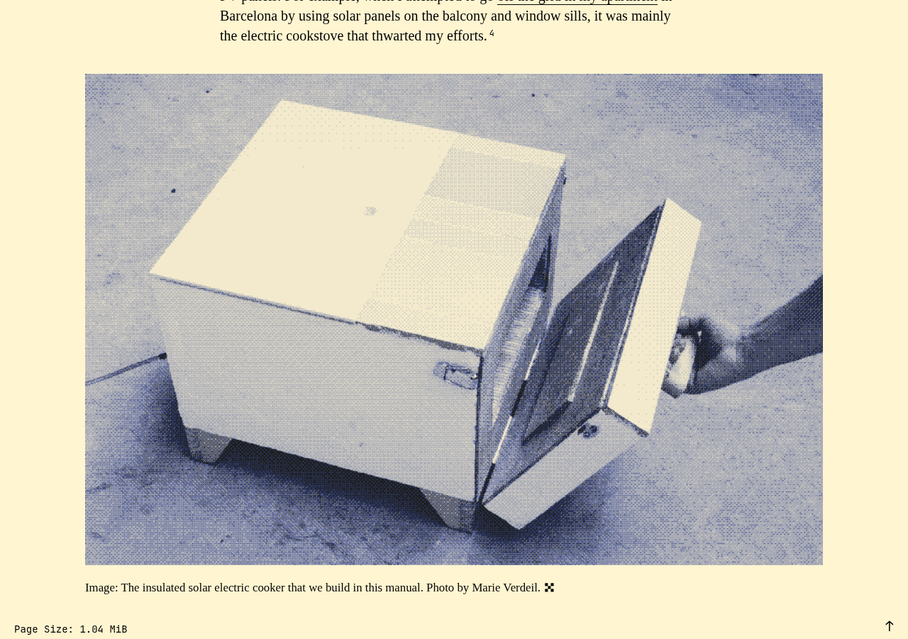

# solar.lowtechmagazine.com: sustainability audit

## At a glance

- **63.0/100** — scoped audit score 17 passing, 1 with problems, 9 needing more evidence.
- **7 pages** reviewed 1 visitor journey; public-site evidence.
- **27 of 71 guideline groups** scored 43 untested; 1 not applicable. Tests cover selected aspects of each guideline.

Low-tech Magazine combines a restrained reading interface with useful public explanations of its resource choices. The seven-page sample uses system fonts, compressed text, direct navigation and no recorded moving media; the oven guide remains illustrated as the reader scrolls. Historical publisher records also connect monitoring to concrete service decisions in 2018–2020. The two priorities are low-priority investigations into instructional image detail and shared-asset freshness. Independent current hosting evidence and several wider practices remain unresolved, so the scoped score should be read alongside those evidence limits.

## Results by WSG area

<table>
<caption>Selected checks by WSG area</caption>
<thead><tr><th scope="col">Area</th><th scope="col">Passing</th><th scope="col">Guideline groups checked</th><th scope="col">Needs evidence</th></tr></thead>
<tbody>
<tr><th scope="row"><a href="#findings-2">User experience design</a></th><td>82% (9/11)</td><td>11 of 17</td><td>2</td></tr>
<tr><th scope="row"><a href="#findings-3">Web development</a></th><td>38% (3/8)</td><td>8 of 16</td><td>4</td></tr>
<tr><th scope="row"><a href="#findings-4">Hosting, infrastructure and systems</a></th><td>33% (1/3)</td><td>3 of 12</td><td>2</td></tr>
<tr><th scope="row"><a href="#findings-5">Business strategy and product management</a></th><td>80% (4/5)</td><td>5 of 26</td><td>1</td></tr>
</tbody></table>

Passing percentages apply to the selected checks. Full-guideline conformance has not been established.

## Page measurements

<table>
<caption>Page measurements</caption>
<thead><tr><th scope="col">Page</th><th scope="col"><a href="#measure-first-load">First load</a></th><th scope="col"><a href="#measure-after-choice">After waiting</a></th><th scope="col"><a href="#measure-scroll">After scrolling</a></th><th scope="col"><a href="#measure-carbon">Estimated footprint</a></th><th scope="col"><a href="#measure-carbon">Carbon rating</a></th><th scope="col"><a href="#measure-energy">Browser energy</a></th><th scope="col"><a href="#measure-energy">Network energy</a></th></tr></thead>
<tbody>
<tr><th scope="row"><a href="https://solar.lowtechmagazine.com/">Homepage</a></th><td>485.0 kB</td><td>485.0 kB</td><td>485.0 kB</td><td>0.07 gCO₂e</td><td>A</td><td>11.03 mWh</td><td>5.84 mWh</td></tr>
<tr><th scope="row"><a href="https://solar.lowtechmagazine.com/archives/">Archive</a></th><td>36.5 kB</td><td>36.5 kB</td><td>36.5 kB</td><td>0.01 gCO₂e</td><td>A+</td><td>Not sampled</td><td>Not sampled</td></tr>
<tr><th scope="row"><a href="https://solar.lowtechmagazine.com/about/the-solar-website/">About the Solar Powered Website</a></th><td>129.8 kB</td><td>129.8 kB</td><td>373.7 kB</td><td>0.02 gCO₂e</td><td>A+</td><td>Not sampled</td><td>Not sampled</td></tr>
<tr><th scope="row"><a href="https://solar.lowtechmagazine.com/power/">Power</a></th><td>40.2 kB</td><td>40.2 kB</td><td>40.2 kB</td><td>0.01 gCO₂e</td><td>A+</td><td>Not sampled</td><td>Not sampled</td></tr>
<tr><th scope="row"><a href="https://solar.lowtechmagazine.com/offline-reading/">Offline Reading</a></th><td>391.2 kB</td><td>391.2 kB</td><td>391.2 kB</td><td>0.06 gCO₂e</td><td>A</td><td>Not sampled</td><td>Not sampled</td></tr>
<tr><th scope="row"><a href="https://solar.lowtechmagazine.com/2025/10/how-to-build-a-solar-powered-electric-oven/">How to Build a Solar Powered Electric Oven</a></th><td>277.8 kB</td><td>277.8 kB</td><td>982.1 kB</td><td>0.04 gCO₂e</td><td>A</td><td>11.38 mWh</td><td>3.44 mWh</td></tr>
<tr><th scope="row"><a href="https://solar.lowtechmagazine.com/privacy/">Privacy</a></th><td>18.8 kB</td><td>18.8 kB</td><td>18.8 kB</td><td>0.01 gCO₂e</td><td>A+</td><td>Not sampled</td><td>Not sampled</td></tr>
</tbody></table>

## Estimated annual footprint

A traffic scenario of **572,851 pageviews/year** gives the estimates below. These are alternative views of overlapping activity, so they should not be added together.

<table>
<caption>Annual footprint and improvement scale</caption>
<thead><tr><th scope="col">Scope</th><th scope="col"><a href="#measure-annual">Annual estimate</a></th><th scope="col"><a href="#measure-annual-savings">If per-view impact fell by 10%</a></th></tr></thead>
<tbody>
<tr><th scope="row">Site browsing · SWDM v4</th><td>16.73 kgCO₂e/year</td><td>1.67 kgCO₂e/year less</td></tr>
<tr><th scope="row">Client electricity · GreenFrame scenarios</th><td>6.42 kWh/year</td><td>0.64 kWh/year less</td></tr>
<tr><th scope="row">Client operational emissions · assumed electricity mix</th><td>3.17 kgCO₂e/year</td><td>0.32 kgCO₂e/year less</td></tr>
</tbody></table>

The 10% column shows the scale of a hypothetical improvement, not a predicted saving from the findings below.

## Priorities

### 1. Check that compact illustrations retain the detail readers need

**Low priority** · Needs investigation · <a class="audit-guideline" href="https://www.w3.org/TR/web-sustainability-guidelines/#optimize-media-to-reduce-resource-use" title="Include media only when it supports user needs. Manage, optimize, and load media efficiently. Ensure users have control over playback and data use.">WSG 2.9: Optimize media to reduce resource use</a>

**What we found.** The oven guide loads its 22 illustrations during the completed scroll rather than requiring every image on first load. Several 800-pixel photos or diagrams are displayed at 1040 pixels on desktop. The frozen measurements establish image availability, but do not establish whether every construction detail is legible.

**Why it matters.** The images explain a practical assembly task, so readers need enough detail to follow the instructions. A comparison can establish whether an improvement is needed; the current evidence does not demonstrate an image defect.

**Next step.** Compare a small representative set of construction photos and diagrams at desktop and narrow screen densities, alongside any original-image option. Keep the illustrated guide and lazy loading, and adjust an image only where the comparison shows a reader needs more detail.

<figure class="audit-illustration" markdown="1">

<figcaption>The oven guide uses dithered photographs to explain its construction.</figcaption>
</figure>

[How we checked this: Check that compact illustrations retain the detail readers need](#evidence-media-delivery)

### 2. Verify that shared asset updates reach returning readers

**Low priority** · Needs investigation · <a class="audit-guideline" href="https://www.w3.org/TR/web-sustainability-guidelines/#optimize-caching-and-support-offline-access" title="Use caching and offline capabilities to reduce network load, improve resilience, and balance performance with sustainability.">WSG 4.2: Optimize caching and support offline access</a>

**What we found.** The shared stylesheet and script have roughly ten-year client freshness at unversioned URLs. Long caching can avoid repeat downloads, but the captured headers do not show how a reader with a cached version receives a changed asset.

**Why it matters.** Returning readers need current page behavior and styling when an update matters. No stale-page incident was observed; this is a small verification task for an unusually long freshness policy.

**Next step.** Demonstrate the deployment versioning or invalidation process for /css/style.css and /js/script.js using both fresh and previously cached clients. Confirm both receive the intended update while stable images and other unchanged assets retain useful caching.

[How we checked this: Verify that shared asset updates reach returning readers](#evidence-public-cache-policy)

## Further checks

These outcomes apply to the selected checks and sample. Open a check's explanation for the observation, limitations and useful follow-up.

??? note "Browse all check outcomes"

    

    <table>
    <caption>All selected check outcomes</caption>
    <thead><tr><th scope="col">Check</th><th scope="col">Outcome</th></tr></thead>
    <tbody>
    <tr><th scope="row"><a href="#evidence-distraction">Reading stays the main task</a></th><td>✅ Passed this check</td></tr>
    <tr><th scope="row"><a href="#evidence-choice">No consequential choice was exercised</a></th><td>➖ Not relevant here</td></tr>
    <tr><th scope="row"><a href="#evidence-comprehension">Headings explain the reading task and availability</a></th><td>✅ Passed this check</td></tr>
    <tr><th scope="row"><a href="#evidence-consistency">Navigation names stay consistent across the sample</a></th><td>✅ Passed this check</td></tr>
    <tr><th scope="row"><a href="#evidence-motion">Observed page states remain quiet</a></th><td>✅ Passed this check</td></tr>
    <tr><th scope="row"><a href="#evidence-notifications">No unsolicited alerts interrupted reading</a></th><td>✅ Passed this check</td></tr>
    <tr><th scope="row"><a href="#evidence-documents">Offline formats are described, but their usability is untested</a></th><td>❓ Needs investigation</td></tr>
    <tr><th scope="row"><a href="#evidence-unused-code">Small scripts are not evidence of removable code</a></th><td>❓ Needs investigation</td></tr>
    <tr><th scope="row"><a href="#evidence-components">No useful component split has been established</a></th><td>❓ Needs investigation</td></tr>
    <tr><th scope="row"><a href="#evidence-layout">Reading content fits desktop and narrow layouts</a></th><td>✅ Passed this check</td></tr>
    <tr><th scope="row"><a href="#evidence-impact-choice">Readers can understand availability and offline alternatives</a></th><td>✅ Passed this check</td></tr>
    <tr><th scope="row"><a href="#evidence-journeys">The archive route reaches the illustrated oven guide</a></th><td>✅ Passed this check</td></tr>
    <tr><th scope="row"><a href="#evidence-media-delivery">Check instructional detail before reducing image bytes</a></th><td>❓ Needs investigation</td></tr>
    <tr><th scope="row"><a href="#evidence-font-delivery">Reading uses available system typography</a></th><td>✅ Passed this check</td></tr>
    <tr><th scope="row"><a href="#evidence-semantic-forms">The sampled documents have meaningful reading structure</a></th><td>✅ Passed this check</td></tr>
    <tr><th scope="row"><a href="#evidence-metadata">Confirm the intended article URL policy</a></th><td>❓ Needs investigation</td></tr>
    <tr><th scope="row"><a href="#evidence-preference-behavior">Preference changes preserve the reading task</a></th><td>✅ Passed this check</td></tr>
    <tr><th scope="row"><a href="#evidence-no-js-content">Core reading remains available without JavaScript</a></th><td>✅ Passed this check</td></tr>
    <tr><th scope="row"><a href="#evidence-api-requests">The status request has a purpose; longer behavior is unknown</a></th><td>❓ Needs investigation</td></tr>
    <tr><th scope="row"><a href="#evidence-public-cache-policy">Check how long-cached shared assets receive updates</a></th><td>❓ Needs investigation</td></tr>
    <tr><th scope="row"><a href="#evidence-text-compression">Sampled text resources arrive compressed</a></th><td>✅ Passed this check</td></tr>
    <tr><th scope="row"><a href="#evidence-keyboard-path">The initial keyboard route shows visible focus</a></th><td>✅ Passed this check</td></tr>
    <tr><th scope="row"><a href="#evidence-disclosure-scope">The publisher explains the service and its tradeoffs</a></th><td>✅ Passed this check</td></tr>
    <tr><th scope="row"><a href="#evidence-carbon-discovery">A machine-readable carbon disclosure file was not found</a></th><td>❌ Problem found</td></tr>
    <tr><th scope="row"><a href="#evidence-hosting-evidence">Independent operational hosting evidence is still missing</a></th><td>❓ Needs investigation</td></tr>
    <tr><th scope="row"><a href="#evidence-governance-practice">Historical monitoring led to documented decisions</a></th><td>✅ Passed this check</td></tr>
    <tr><th scope="row"><a href="#evidence-service-necessity">The historical service decision considered credible alternatives</a></th><td>✅ Passed this check</td></tr>
    <tr><th scope="row"><a href="#evidence-access-barriers">The sampled anonymous reading route completes without signup</a></th><td>✅ Passed this check</td></tr>
    <tr><th scope="row"><a href="#evidence-content-lifecycle">Book revisions do not establish the online review schedule</a></th><td>❓ Needs investigation</td></tr>
    <tr><th scope="row"><a href="#evidence-sustainability-goals">Historical goals and progress have explicit boundaries</a></th><td>✅ Passed this check</td></tr>
    </tbody></table>

## Next steps for auditing

1. Check representative oven assembly images at desktop and narrow screen densities, including any original-image option. Make an image change only when the comparison identifies detail readers need.
2. Demonstrate how an updated shared stylesheet or script reaches a client that already cached its ten-year-fresh URL. Keep useful caching for stable resources.
3. For a present-day organizational or hosting assessment, provide current accountable monitoring/decision records and independent evidence for the server and electricity boundary. Retain the 2018–2020 records as historical evidence.
4. Broaden evidence only where it supports a real decision: inspect important offline documents, exercise keyboard and real-device reading routes, and document an applied online content review. The separate annual and client-energy figures are model scenarios using a rank-derived traffic proxy, not measured annual emissions or demonstrated savings.

The sample covers selected pages and visitor tasks, not every page on the site. Expand it where the checks above identify an untested template, interaction or audience need.

## Detailed findings

This appendix explains the evidence in ordinary language. This audit used public-site evidence without a source checkout. Unavailable documents or internal records do not establish that the organization has none.

### User experience design {#findings-2}

<h4 id="evidence-distraction">Reading stays the main task</h4>

**Passed this check** · <a class="audit-guideline" href="https://www.w3.org/TR/web-sustainability-guidelines/#design-to-assist-and-not-to-distract" title="Give users control over notifications and focus, prioritize task-relevant content, and avoid designs that distract or unnecessarily extend engagement.">WSG 2.5: Design to assist and not to distract</a>

_Give users control over notifications and focus, prioritize task-relevant content, and avoid designs that distract or unnecessarily extend engagement._

The seven sampled pages keep articles, archive listings and service explanations in view without recorded moving media or blocking prompts. Newsletter, donation and book links offer identifiable, optional support routes; the solar-status notice explains an access constraint.

**Next step:** Retain the direct reading experience when changing support links or availability notices.

**Where we looked:**

- Browser observations for [Homepage](https://solar.lowtechmagazine.com/).
- Browser observations for [Archives](https://solar.lowtechmagazine.com/archives/).
- Browser observations for [The solar website](https://solar.lowtechmagazine.com/about/the-solar-website/).
- Browser observations for [Power](https://solar.lowtechmagazine.com/power/).
- Browser observations for [Offline reading](https://solar.lowtechmagazine.com/offline-reading/).
- Browser observations for [How to build a solar powered electric oven](https://solar.lowtechmagazine.com/2025/10/how-to-build-a-solar-powered-electric-oven/).
- Browser observations for [Privacy](https://solar.lowtechmagazine.com/privacy/).

<h4 id="evidence-choice">No consequential choice was exercised</h4>

**Not relevant here** · <a class="audit-guideline" href="https://www.w3.org/TR/web-sustainability-guidelines/#avoid-being-manipulative-or-deceptive" title="Avoid deceptive patterns, clearly label ads, respect consent for tracking, and ensure search, sharing, and discoverability practices prioritize user needs over optimization or manipulation.">WSG 2.6: Avoid being manipulative or deceptive</a>

_Avoid deceptive patterns, clearly label ads, respect consent for tracking, and ensure search, sharing, and discoverability practices prioritize user needs over optimization or manipulation._

The public reading sample contains no cookie accept/reject pair, submitted signup or purchase. The publisher describes cookieless analytics, but that statement does not prove that no data processing occurs. Choice parity is inapplicable to these bounded tasks.

**Next step:** Include the actual signup, donation or purchase flow if a later audit needs to assess consequential choices.

**Where we looked:**

- Browser observations for [Homepage](https://solar.lowtechmagazine.com/).
- Browser observations for [Archives](https://solar.lowtechmagazine.com/archives/).
- Browser observations for [The solar website](https://solar.lowtechmagazine.com/about/the-solar-website/).
- Browser observations for [Power](https://solar.lowtechmagazine.com/power/).
- Browser observations for [Offline reading](https://solar.lowtechmagazine.com/offline-reading/).
- Browser observations for [How to build a solar powered electric oven](https://solar.lowtechmagazine.com/2025/10/how-to-build-a-solar-powered-electric-oven/).
- Browser observations for [Privacy](https://solar.lowtechmagazine.com/privacy/).

<h4 id="evidence-comprehension">Headings explain the reading task and availability</h4>

**Passed this check** · <a class="audit-guideline" href="https://www.w3.org/TR/web-sustainability-guidelines/#make-deliverables-understandable-and-reusable" title="Create discoverable, maintainable, and reusable documentation and code resources that support long-term understanding, reuse, and sustainability.">WSG 2.7: Make deliverables understandable and reusable</a>

_Create discoverable, maintainable, and reusable documentation and code resources that support long-term understanding, reuse, and sustainability._

Article titles, dates, summaries and references make the English reading tasks identifiable. The oven guide uses sequential illustrated instructions, while the methodology and Power page explain server availability and battery-indicator limits. The audit did not validate the engineering advice.

**Next step:** Keep availability limits and instructional structure clear as the content changes.

**Where we looked:**

- Browser observations for [Homepage](https://solar.lowtechmagazine.com/).
- Browser observations for [Archives](https://solar.lowtechmagazine.com/archives/).
- Browser observations for [The solar website](https://solar.lowtechmagazine.com/about/the-solar-website/).
- Browser observations for [Power](https://solar.lowtechmagazine.com/power/).
- Browser observations for [Offline reading](https://solar.lowtechmagazine.com/offline-reading/).
- Browser observations for [How to build a solar powered electric oven](https://solar.lowtechmagazine.com/2025/10/how-to-build-a-solar-powered-electric-oven/).
- Browser observations for [Privacy](https://solar.lowtechmagazine.com/privacy/).

<h4 id="evidence-consistency">Navigation names stay consistent across the sample</h4>

**Passed this check** · <a class="audit-guideline" href="https://www.w3.org/TR/web-sustainability-guidelines/#use-a-design-system-for-interface-consistency" title="Use design systems and established patterns to ensure consistent, efficient, and sustainable interfaces through reusable components and clear maintenance practices.">WSG 2.8: Use a design system for interface consistency</a>

_Use design systems and established patterns to ensure consistent, efficient, and sustainable interfaces through reusable components and clear maintenance practices._

The seven pages repeat named navigation and the solar-status route. Article and archive titles, translation links and support routes use recognizable patterns. This observed consistency does not establish a documented design system.

**Next step:** Retain familiar navigation names across new articles and service pages.

**Where we looked:**

- Browser observations for [Homepage](https://solar.lowtechmagazine.com/).
- Browser observations for [Archives](https://solar.lowtechmagazine.com/archives/).
- Browser observations for [The solar website](https://solar.lowtechmagazine.com/about/the-solar-website/).
- Browser observations for [Power](https://solar.lowtechmagazine.com/power/).
- Browser observations for [Offline reading](https://solar.lowtechmagazine.com/offline-reading/).
- Browser observations for [How to build a solar powered electric oven](https://solar.lowtechmagazine.com/2025/10/how-to-build-a-solar-powered-electric-oven/).
- Browser observations for [Privacy](https://solar.lowtechmagazine.com/privacy/).

<h4 id="evidence-motion">Observed page states remain quiet</h4>

**Passed this check** · <a class="audit-guideline" href="https://www.w3.org/TR/web-sustainability-guidelines/#ensure-animation-is-proportionate-and-easy-to-control" title="Use animation sparingly and efficiently, only when it supports understanding, while limiting performance impact and giving users control over motion.">WSG 2.10: Ensure animation is proportionate and easy to control</a>

_Use animation sparingly and efficiently, only when it supports understanding, while limiting performance impact and giving users control over motion._

The sampled desktop, narrow, reduced-motion, dark-preference and print states record no animation, audio or video. The solar-status presentation provides contextual information. These observations cover the tested states, rather than every possible interaction.

**Next step:** Recheck motion controls and reduced-motion behavior if animated content is introduced.

**Where we looked:**

- Browser observations for [Homepage](https://solar.lowtechmagazine.com/).
- Browser observations for [Archives](https://solar.lowtechmagazine.com/archives/).
- Browser observations for [The solar website](https://solar.lowtechmagazine.com/about/the-solar-website/).
- Browser observations for [Power](https://solar.lowtechmagazine.com/power/).
- Browser observations for [Offline reading](https://solar.lowtechmagazine.com/offline-reading/).
- Browser observations for [How to build a solar powered electric oven](https://solar.lowtechmagazine.com/2025/10/how-to-build-a-solar-powered-electric-oven/).
- Browser observations for [Privacy](https://solar.lowtechmagazine.com/privacy/).

<h4 id="evidence-notifications">No unsolicited alerts interrupted reading</h4>

**Passed this check** · <a class="audit-guideline" href="https://www.w3.org/TR/web-sustainability-guidelines/#avoid-unwanted-notifications" title="Send only user-requested notifications and provide clear, accessible controls for managing preferences, opt-in, and account and contact settings.">WSG 2.12: Avoid unwanted notifications</a>

_Send only user-requested notifications and provide clear, accessible controls for managing preferences, opt-in, and account and contact settings._

No notification prompts or visible unsolicited alerts were recorded on the seven pages. Newsletter links did not subscribe the reader during the task. Browser notification permission was denied, so the finding is limited to behavior observed under that setting.

**Next step:** Keep newsletter subscriptions and any future notification requests tied to an explicit reader action.

**Where we looked:**

- Browser observations for [Homepage](https://solar.lowtechmagazine.com/).
- Browser observations for [Archives](https://solar.lowtechmagazine.com/archives/).
- Browser observations for [The solar website](https://solar.lowtechmagazine.com/about/the-solar-website/).
- Browser observations for [Power](https://solar.lowtechmagazine.com/power/).
- Browser observations for [Offline reading](https://solar.lowtechmagazine.com/offline-reading/).
- Browser observations for [How to build a solar powered electric oven](https://solar.lowtechmagazine.com/2025/10/how-to-build-a-solar-powered-electric-oven/).
- Browser observations for [Privacy](https://solar.lowtechmagazine.com/privacy/).

<h4 id="evidence-documents">Offline formats are described, but their usability is untested</h4>

**Needs investigation** · <a class="audit-guideline" href="https://www.w3.org/TR/web-sustainability-guidelines/#reduce-the-impact-of-downloadable-and-physical-documents" title="Reduce paper use through digital-first workflows, optimize and reuse accessible downloadable documents, and provide clear, user-controlled document previews and formats.">WSG 2.13: Reduce the impact of downloadable and physical documents</a>

_Reduce paper use through digital-first workflows, optimize and reuse accessible downloadable documents, and provide clear, user-controlled document previews and formats._

Print states retain main text and suppress navigation. Offline Reading distinguishes paperback, hardcover and e-book editions and describes a compressed edition. Linked reference PDFs and book samples were not inspected; some PDF links lack visible format or size labels, and print pagination remains untested.

**Next step:** Inspect the reference documents and representative book/e-book samples before judging format equivalence, accessibility or print-resource use.

**Where we looked:**

- Browser observations for [Homepage](https://solar.lowtechmagazine.com/).
- Browser observations for [Archives](https://solar.lowtechmagazine.com/archives/).
- Browser observations for [The solar website](https://solar.lowtechmagazine.com/about/the-solar-website/).
- Browser observations for [Power](https://solar.lowtechmagazine.com/power/).
- Browser observations for [Offline reading](https://solar.lowtechmagazine.com/offline-reading/).
- Browser observations for [How to build a solar powered electric oven](https://solar.lowtechmagazine.com/2025/10/how-to-build-a-solar-powered-electric-oven/).
- Browser observations for [Privacy](https://solar.lowtechmagazine.com/privacy/).

<h4 id="evidence-journeys">The archive route reaches the illustrated oven guide</h4>

**Passed this check** · <a class="audit-guideline" href="https://www.w3.org/TR/web-sustainability-guidelines/#design-efficient-and-streamlined-user-journeys" title="Design clear, efficient journeys that help users complete tasks and find content with minimal effort.">WSG 2.4: Design efficient and streamlined user journeys</a>

_Design clear, efficient journeys that help users complete tasks and find content with minimal effort._

Following Archive from the homepage and selecting the named oven article reached the declared URL and full article title. A separate completed scroll recorded all 22 article images available by the bottom of the guide. This supports the anonymous desktop pointer reading task; it does not validate the construction advice, illustration detail or offline downloads.

**Next step:** Retain the discoverable article route and image loading as the archive grows.

**Where we looked:**

- Browser observations for [Homepage](https://solar.lowtechmagazine.com/).
- Captured public evidence for [How to build a solar powered electric oven](https://solar.lowtechmagazine.com/2025/10/how-to-build-a-solar-powered-electric-oven/).
- Recorded visitor task starting at [Homepage](https://solar.lowtechmagazine.com/).

<h4 id="evidence-media-delivery">Check instructional detail before reducing image bytes</h4>

**Needs investigation** · <a class="audit-guideline" href="https://www.w3.org/TR/web-sustainability-guidelines/#optimize-media-to-reduce-resource-use" title="Include media only when it supports user needs. Manage, optimize, and load media efficiently. Ensure users have control over playback and data use.">WSG 2.9: Optimize media to reduce resource use</a>

_Include media only when it supports user needs. Manage, optimize, and load media efficiently. Ensure users have control over playback and data use._

The oven guide combines compact dithered images with lazy loading. The completed scroll recorded all 22 images and 982.13 kB cumulatively, showing that later image loading supports the long reading task. Several 800-pixel instructional images are displayed at 1040 pixels on desktop; the frozen evidence does not establish whether all required detail remains legible.

**Next step:** Compare representative assembly photos and diagrams at desktop and narrow screen densities, including any original-image alternative. Change delivery only where readers need better detail.

**Where we looked:**

- Browser observations for [Homepage](https://solar.lowtechmagazine.com/).
- Browser observations for [Archives](https://solar.lowtechmagazine.com/archives/).
- Browser observations for [The solar website](https://solar.lowtechmagazine.com/about/the-solar-website/).
- Browser observations for [Power](https://solar.lowtechmagazine.com/power/).
- Browser observations for [Offline reading](https://solar.lowtechmagazine.com/offline-reading/).
- Browser observations for [How to build a solar powered electric oven](https://solar.lowtechmagazine.com/2025/10/how-to-build-a-solar-powered-electric-oven/).
- Browser observations for [Privacy](https://solar.lowtechmagazine.com/privacy/).

<h4 id="evidence-font-delivery">Reading uses available system typography</h4>

**Passed this check** · <a class="audit-guideline" href="https://www.w3.org/TR/web-sustainability-guidelines/#use-optimized-web-typography" title="Use font strategies that minimize downloads and complexity while supporting required languages and dynamic content.">WSG 2.11: Use optimized web typography</a>

_Use font strategies that minimize downloads and complexity while supporting required languages and dynamic content._

All seven pages use the browser serif font and declare no downloadable webfont faces or font responses. Headings and reading content remain available in the sampled preference and no-JavaScript states. This avoids a font download for the bounded reading sample.

**Next step:** Keep the existing readable fallback behavior when adjusting typography.

**Where we looked:**

- Browser observations for [Homepage](https://solar.lowtechmagazine.com/).
- Browser observations for [Archives](https://solar.lowtechmagazine.com/archives/).
- Browser observations for [The solar website](https://solar.lowtechmagazine.com/about/the-solar-website/).
- Browser observations for [Power](https://solar.lowtechmagazine.com/power/).
- Browser observations for [Offline reading](https://solar.lowtechmagazine.com/offline-reading/).
- Browser observations for [How to build a solar powered electric oven](https://solar.lowtechmagazine.com/2025/10/how-to-build-a-solar-powered-electric-oven/).
- Browser observations for [Privacy](https://solar.lowtechmagazine.com/privacy/).

<h4 id="evidence-no-js-content">Core reading remains available without JavaScript</h4>

**Passed this check** · <a class="audit-guideline" href="https://www.w3.org/TR/web-sustainability-guidelines/#provide-cross-platform-compatibility-support" title="Document compatibility, avoid unnecessary obsolescence, and test across devices, systems, and network conditions.">WSG 2.17: Provide cross-platform compatibility support</a>

_Document compatibility, avoid unnecessary obsolescence, and test across devices, systems, and network conditions._

Fresh visits with JavaScript disabled retain sampled article text, archive titles, navigation, lazy-image markup, methodology, privacy content and offline-format links. Power still explains availability even though live numbers are absent. Long text snapshots are capped, so this supports core reading availability rather than every paragraph or interaction.

**Next step:** Retain the reading fallback; separately test sorting, live telemetry or other enhancements only if they become essential to the task.

**Where we looked:**

- Browser observations for [Homepage](https://solar.lowtechmagazine.com/).
- Browser observations for [Archives](https://solar.lowtechmagazine.com/archives/).
- Browser observations for [The solar website](https://solar.lowtechmagazine.com/about/the-solar-website/).
- Browser observations for [Power](https://solar.lowtechmagazine.com/power/).
- Browser observations for [Offline reading](https://solar.lowtechmagazine.com/offline-reading/).
- Browser observations for [How to build a solar powered electric oven](https://solar.lowtechmagazine.com/2025/10/how-to-build-a-solar-powered-electric-oven/).
- Browser observations for [Privacy](https://solar.lowtechmagazine.com/privacy/).

<h4 id="evidence-disclosure-scope">The publisher explains the service and its tradeoffs</h4>

**Passed this check** · <a class="audit-guideline" href="https://www.w3.org/TR/web-sustainability-guidelines/#identify-assess-disclose-review-and-mitigate-sustainability-impacts" title="Assess and report the planet, people, and prosperity impacts of digital projects, and plan measurable reductions to the real-world effects of their activity.">WSG 2.1: Identify, assess, disclose, review, and mitigate sustainability impacts</a>

_Assess and report the planet, people, and prosperity impacts of digital projects, and plan measurable reductions to the real-world effects of their activity._

The public solar methodology identifies this website and describes its static design, image and font choices, hardware, availability and grid-powered router limitation. Its historical evaluation discusses operational and embodied impacts with period and location limits. This is substantive attributed disclosure, rather than independent verification of present operation.

**Next step:** Keep historical measurement periods and system boundaries visible when updating the methodology.

**Where we looked:**

- Browser observations for [The solar website](https://solar.lowtechmagazine.com/about/the-solar-website/).
- Browser observations for [Power](https://solar.lowtechmagazine.com/power/).
- Captured public evidence for [The solar website](https://solar.lowtechmagazine.com/about/the-solar-website/).
- Captured public evidence for [How sustainable is a solar powered website](https://solar.lowtechmagazine.com/2020/01/how-sustainable-is-a-solar-powered-website/).

### Web development {#findings-3}

<h4 id="evidence-unused-code">Small scripts are not evidence of removable code</h4>

**Needs investigation** · <a class="audit-guideline" href="https://www.w3.org/TR/web-sustainability-guidelines/#minify-and-remove-unused-code" title="Minify code and data, and remove unused characters to reduce file size and improve loading efficiency and maintainability.">WSG 3.2: Minify and remove unused code</a>

_Minify code and data, and remove unused characters to reduce file size and improve loading efficiency and maintainability._

The initial observations contain small shared site and Plausible scripts, plus a separate archive-sorting module. Functions not executed during that short window may support status displays, sorting or later actions. No representative execution coverage or source review establishes dead code.

**Next step:** Exercise the archive and status functions before deciding whether any code can be removed.

**Where we looked:**

- Browser observations for [Homepage](https://solar.lowtechmagazine.com/).
- Browser observations for [Archives](https://solar.lowtechmagazine.com/archives/).
- Browser observations for [The solar website](https://solar.lowtechmagazine.com/about/the-solar-website/).
- Browser observations for [Power](https://solar.lowtechmagazine.com/power/).
- Browser observations for [Offline reading](https://solar.lowtechmagazine.com/offline-reading/).
- Browser observations for [How to build a solar powered electric oven](https://solar.lowtechmagazine.com/2025/10/how-to-build-a-solar-powered-electric-oven/).
- Browser observations for [Privacy](https://solar.lowtechmagazine.com/privacy/).

<h4 id="evidence-components">No useful component split has been established</h4>

**Needs investigation** · <a class="audit-guideline" href="https://www.w3.org/TR/web-sustainability-guidelines/#modularize-bandwidth-heavy-components" title="Split large components into smaller, on-demand modules to improve loading efficiency while balancing maintainability and caching performance.">WSG 3.3: Modularize bandwidth-heavy components</a>

_Split large components into smaller, on-demand modules to improve loading efficiency while balancing maintainability and caching performance._

The sample contains no observed heavyweight player or widget, and archive sorting is already loaded separately. The shared script supports solar-status behavior. The evidence identifies no later-use component whose deferral would bring a demonstrated benefit.

**Next step:** Identify a specific substantial component and verify its later activation before proposing additional splitting.

**Where we looked:**

- Browser observations for [Homepage](https://solar.lowtechmagazine.com/).
- Browser observations for [Archives](https://solar.lowtechmagazine.com/archives/).
- Browser observations for [The solar website](https://solar.lowtechmagazine.com/about/the-solar-website/).
- Browser observations for [Power](https://solar.lowtechmagazine.com/power/).
- Browser observations for [Offline reading](https://solar.lowtechmagazine.com/offline-reading/).
- Browser observations for [How to build a solar powered electric oven](https://solar.lowtechmagazine.com/2025/10/how-to-build-a-solar-powered-electric-oven/).
- Browser observations for [Privacy](https://solar.lowtechmagazine.com/privacy/).

<h4 id="evidence-layout">Reading content fits desktop and narrow layouts</h4>

**Passed this check** · <a class="audit-guideline" href="https://www.w3.org/TR/web-sustainability-guidelines/#ensure-layouts-work-for-different-devices-and-requirements" title="Use responsive, progressively enhanced, and carbon-aware design to ensure accessible, adaptable functionality across devices and interaction methods while managing resource use.">WSG 3.10: Ensure layouts work for different devices and requirements</a>

_Use responsive, progressively enhanced, and carbon-aware design to ensure accessible, adaptable functionality across devices and interaction methods while managing resource use._

At desktop and 360 CSS-pixel width, all seven pages retain task headings, navigation and core content without horizontal overflow. Navigation stays as direct links. The archive route was exercised on desktop; width emulation does not establish compatibility on real devices.

**Next step:** Include representative real devices and narrow-screen task completion if broader compatibility evidence is needed.

**Where we looked:**

- Browser observations for [Homepage](https://solar.lowtechmagazine.com/).
- Browser observations for [Archives](https://solar.lowtechmagazine.com/archives/).
- Browser observations for [The solar website](https://solar.lowtechmagazine.com/about/the-solar-website/).
- Browser observations for [Power](https://solar.lowtechmagazine.com/power/).
- Browser observations for [Offline reading](https://solar.lowtechmagazine.com/offline-reading/).
- Browser observations for [How to build a solar powered electric oven](https://solar.lowtechmagazine.com/2025/10/how-to-build-a-solar-powered-electric-oven/).
- Browser observations for [Privacy](https://solar.lowtechmagazine.com/privacy/).

<h4 id="evidence-semantic-forms">The sampled documents have meaningful reading structure</h4>

**Passed this check** · <a class="audit-guideline" href="https://www.w3.org/TR/web-sustainability-guidelines/#ensure-code-follows-good-semantic-practices" title="Use standards-compliant HTML and web platform features, and avoid unnecessary complexity or non-standard code.">WSG 3.6: Ensure code follows good semantic practices</a>

_Use standards-compliant HTML and web platform features, and avoid unnecessary complexity or non-standard code._

Each document declares English, a main region and meaningful page or article headings. Task navigation uses named links and no unnamed form controls were sampled. Publication and article headings can both use H1; that count alone does not establish a defect. This is a bounded structural check, not a full accessibility assessment.

**Next step:** Recheck heading meaning and control names when adding templates or interactive forms.

**Where we looked:**

- Browser observations for [Homepage](https://solar.lowtechmagazine.com/).
- Browser observations for [Archives](https://solar.lowtechmagazine.com/archives/).
- Browser observations for [The solar website](https://solar.lowtechmagazine.com/about/the-solar-website/).
- Browser observations for [Power](https://solar.lowtechmagazine.com/power/).
- Browser observations for [Offline reading](https://solar.lowtechmagazine.com/offline-reading/).
- Browser observations for [How to build a solar powered electric oven](https://solar.lowtechmagazine.com/2025/10/how-to-build-a-solar-powered-electric-oven/).
- Browser observations for [Privacy](https://solar.lowtechmagazine.com/privacy/).

<h4 id="evidence-metadata">Confirm the intended article URL policy</h4>

**Needs investigation** · <a class="audit-guideline" href="https://www.w3.org/TR/web-sustainability-guidelines/#structure-metadata-for-machine-readability" title="Include essential document metadata and structured data to improve usability, accessibility, and machine readability.">WSG 3.8: Structure metadata for machine readability</a>

_Include essential document metadata and structured data to improve usability, accessibility, and machine readability._

The sampled page titles describe their content. Canonical metadata is absent, and some legacy .html article routes redirect to slash URLs; the intended indexing and alternative-URL policy is unknown. No structured-data blocks are declared, which alone is not a defect.

**Next step:** Confirm the preferred URLs and any duplicate routes before prescribing canonical or other metadata changes.

**Where we looked:**

- Browser observations for [Homepage](https://solar.lowtechmagazine.com/).
- Browser observations for [Archives](https://solar.lowtechmagazine.com/archives/).
- Browser observations for [The solar website](https://solar.lowtechmagazine.com/about/the-solar-website/).
- Browser observations for [Power](https://solar.lowtechmagazine.com/power/).
- Browser observations for [Offline reading](https://solar.lowtechmagazine.com/offline-reading/).
- Browser observations for [How to build a solar powered electric oven](https://solar.lowtechmagazine.com/2025/10/how-to-build-a-solar-powered-electric-oven/).
- Browser observations for [Privacy](https://solar.lowtechmagazine.com/privacy/).

<h4 id="evidence-preference-behavior">Preference changes preserve the reading task</h4>

**Passed this check** · <a class="audit-guideline" href="https://www.w3.org/TR/web-sustainability-guidelines/#use-media-queries-that-support-sustainability-goals" title="Support user preferences via media queries for color, motion, contrast, data use, and related settings to improve accessibility and efficiency.">WSG 3.9: Use media queries that support sustainability goals</a>

_Support user preferences via media queries for color, motion, contrast, data use, and related settings to improve accessibility and efficiency._

The sampled content remains available before navigation and after dark or reduced-motion preference changes, with no recorded animation needing reduction. The light/yellow presentation has a battery-status role, and no promised dark-theme feature is established. The pass concerns applicable behavior and retained content, without an energy-saving theme claim.

**Next step:** Recheck applicable preferences if theme switching or motion is introduced.

**Where we looked:**

- Browser observations for [Homepage](https://solar.lowtechmagazine.com/).
- Browser observations for [Archives](https://solar.lowtechmagazine.com/archives/).
- Browser observations for [The solar website](https://solar.lowtechmagazine.com/about/the-solar-website/).
- Browser observations for [Power](https://solar.lowtechmagazine.com/power/).
- Browser observations for [Offline reading](https://solar.lowtechmagazine.com/offline-reading/).
- Browser observations for [How to build a solar powered electric oven](https://solar.lowtechmagazine.com/2025/10/how-to-build-a-solar-powered-electric-oven/).
- Browser observations for [Privacy](https://solar.lowtechmagazine.com/privacy/).

<h4 id="evidence-api-requests">The status request has a purpose; longer behavior is unknown</h4>

**Needs investigation** · <a class="audit-guideline" href="https://www.w3.org/TR/web-sustainability-guidelines/#use-sustainable-javascript-and-apis" title="Write efficient JavaScript and use APIs that minimize processing, data use, and energy consumption.">WSG 3.11: Use sustainable JavaScript and APIs</a>

_Write efficient JavaScript and use APIs that minimize processing, data use, and energy consumption._

Each bounded page observation records one stats request supporting the server, battery and weather display, alongside analytics loading. The short window does not establish later polling frequency, redundancy or backend cost.

**Next step:** If status updates are being optimized, observe a longer Power session and compare request frequency with the information readers need.

**Where we looked:**

- Browser observations for [Homepage](https://solar.lowtechmagazine.com/).
- Browser observations for [Archives](https://solar.lowtechmagazine.com/archives/).
- Browser observations for [The solar website](https://solar.lowtechmagazine.com/about/the-solar-website/).
- Browser observations for [Power](https://solar.lowtechmagazine.com/power/).
- Browser observations for [Offline reading](https://solar.lowtechmagazine.com/offline-reading/).
- Browser observations for [How to build a solar powered electric oven](https://solar.lowtechmagazine.com/2025/10/how-to-build-a-solar-powered-electric-oven/).
- Browser observations for [Privacy](https://solar.lowtechmagazine.com/privacy/).

<h4 id="evidence-keyboard-path">The initial keyboard route shows visible focus</h4>

**Passed this check** · <a class="audit-guideline" href="https://www.w3.org/TR/web-sustainability-guidelines/#ensure-code-follows-good-semantic-practices" title="Use standards-compliant HTML and web platform features, and avoid unnecessary complexity or non-standard code.">WSG 3.6: Ensure code follows good semantic practices</a>

_Use standards-compliant HTML and web platform features, and avoid unnecessary complexity or non-standard code._

The first 12 Tab steps on each page reach the status link, publication title, availability explanation and primary navigation in a meaningful order. Recorded focus is onscreen with a visible native outline. Activation, reverse navigation, traps and screen-reader use were outside this initial-path check.

**Next step:** Extend keyboard testing through article selection and any new controls when broader task coverage is needed.

**Where we looked:**

- Browser observations for [Homepage](https://solar.lowtechmagazine.com/).
- Browser observations for [Archives](https://solar.lowtechmagazine.com/archives/).
- Browser observations for [The solar website](https://solar.lowtechmagazine.com/about/the-solar-website/).
- Browser observations for [Power](https://solar.lowtechmagazine.com/power/).
- Browser observations for [Offline reading](https://solar.lowtechmagazine.com/offline-reading/).
- Browser observations for [How to build a solar powered electric oven](https://solar.lowtechmagazine.com/2025/10/how-to-build-a-solar-powered-electric-oven/).
- Browser observations for [Privacy](https://solar.lowtechmagazine.com/privacy/).

<h4 id="evidence-carbon-discovery">A machine-readable carbon disclosure file was not found</h4>

**Problem found** · <a class="audit-guideline" href="https://www.w3.org/TR/web-sustainability-guidelines/#include-expected-and-beneficial-files" title="Include standard website metadata and configuration files to support discoverability, transparency, and operational best practices.">WSG 3.13: Include expected and beneficial files</a>

_Include standard website metadata and configuration files to support discoverability, transparency, and operational best practices._

Both checked carbon.txt locations returned 404, with no usable delegation or parsed document established. This is a narrow discoverability failure. The substantial public solar methodology remains available and the missing file says nothing about whether emissions are high.

**Next step:** If machine-readable discovery is useful, publish a valid carbon.txt linking the existing methodology and supported relationships, with the same limits on hosting and lifecycle claims.

**Where we looked:**

- Disclosure discovery for the origin `https://solar.lowtechmagazine.com`.

### Hosting, infrastructure and systems {#findings-4}

<h4 id="evidence-public-cache-policy">Check how long-cached shared assets receive updates</h4>

**Needs investigation** · <a class="audit-guideline" href="https://www.w3.org/TR/web-sustainability-guidelines/#optimize-caching-and-support-offline-access" title="Use caching and offline capabilities to reduce network load, improve resilience, and balance performance with sustainability.">WSG 4.2: Optimize caching and support offline access</a>

_Use caching and offline capabilities to reduce network load, improve resilience, and balance performance with sustainability._

Images, scripts and styles expose long cache lifetimes and validators; current stats and the homepage use different policies. Shared /css/style.css and /js/script.js have roughly ten years of client freshness at unversioned URLs. The capture does not establish how an existing reader receives a changed version.

**Next step:** Demonstrate the update or invalidation process using both a fresh client and one that already cached the shared assets, while retaining useful caching for stable resources.

**Where we looked:**

- Browser observations for [Homepage](https://solar.lowtechmagazine.com/).
- Browser observations for [Archives](https://solar.lowtechmagazine.com/archives/).
- Browser observations for [The solar website](https://solar.lowtechmagazine.com/about/the-solar-website/).
- Browser observations for [Power](https://solar.lowtechmagazine.com/power/).
- Browser observations for [Offline reading](https://solar.lowtechmagazine.com/offline-reading/).
- Browser observations for [How to build a solar powered electric oven](https://solar.lowtechmagazine.com/2025/10/how-to-build-a-solar-powered-electric-oven/).
- Browser observations for [Privacy](https://solar.lowtechmagazine.com/privacy/).

<h4 id="evidence-text-compression">Sampled text resources arrive compressed</h4>

**Passed this check** · <a class="audit-guideline" href="https://www.w3.org/TR/web-sustainability-guidelines/#reduce-data-transfer-with-compression" title="Compress server responses and media files to reduce bandwidth, storage use, and delivery overhead while balancing processing costs.">WSG 4.3: Reduce data transfer with compression</a>

_Compress server responses and media files to reduce bandwidth, storage use, and delivery overhead while balancing processing costs._

Successful sampled HTML, styles, scripts and stats JSON use gzip or zstd compression. The dithered PNGs and small SVG sprite do not establish a material missing-text-compression problem.

**Next step:** Retain beneficial text compression when changing the server configuration.

**Where we looked:**

- Browser observations for [Homepage](https://solar.lowtechmagazine.com/).
- Browser observations for [Archives](https://solar.lowtechmagazine.com/archives/).
- Browser observations for [The solar website](https://solar.lowtechmagazine.com/about/the-solar-website/).
- Browser observations for [Power](https://solar.lowtechmagazine.com/power/).
- Browser observations for [Offline reading](https://solar.lowtechmagazine.com/offline-reading/).
- Browser observations for [How to build a solar powered electric oven](https://solar.lowtechmagazine.com/2025/10/how-to-build-a-solar-powered-electric-oven/).
- Browser observations for [Privacy](https://solar.lowtechmagazine.com/privacy/).

<h4 id="evidence-hosting-evidence">Independent operational hosting evidence is still missing</h4>

**Needs investigation** · <a class="audit-guideline" href="https://www.w3.org/TR/web-sustainability-guidelines/#use-sustainable-hosting" title="Select and manage infrastructure using sustainability metrics, prioritizing low-carbon energy use and low-impact hosting and domain choices in selection, and extending hardware lifespan and minimising emissions in management.">WSG 4.1: Use sustainable hosting</a>

_Select and manage infrastructure using sustainability metrics, prioritizing low-carbon energy use and low-impact hosting and domain choices in selection, and extending hardware lifespan and minimising emissions in management._

The publisher explicitly connects this origin with a Barcelona server, solar panels and batteries, supported by historical measurements and an acknowledged grid-powered networking boundary. These records are useful self-report. Independent corroboration of the operational hosting scope is absent, so hosting remains unknown and does not enable a green-hosting model assumption.

**Next step:** Provide independent corroboration of the relevant service and electricity boundary if the operational sustainable-hosting claim needs verification.

**Where we looked:**

- Captured public evidence for [The solar website](https://solar.lowtechmagazine.com/about/the-solar-website/).
- Captured public evidence for [How sustainable is a solar powered website](https://solar.lowtechmagazine.com/2020/01/how-sustainable-is-a-solar-powered-website/).
- Disclosure discovery for the origin `https://solar.lowtechmagazine.com`.

### Business strategy and product management {#findings-5}

<h4 id="evidence-impact-choice">Readers can understand availability and offline alternatives</h4>

**Passed this check** · <a class="audit-guideline" href="https://www.w3.org/TR/web-sustainability-guidelines/#communicate-the-environmental-impact-of-user-choices" title="Empower users, allowing them to make decisions when their choices can influence the environmental impact they have.">WSG 5.4: Communicate the environmental impact of user choices</a>

_Empower users, allowing them to make decisions when their choices can influence the environmental impact they have._

The methodology and Power page explain weather-dependent access, battery limitations and the distinction between server and network energy. Offline Reading identifies book and e-book alternatives for unavailable periods. The publisher also discusses embodied hardware impacts, providing useful context without measured savings for individual controls.

**Next step:** Keep the availability explanation, offline options and stated energy boundaries together and easy to find.

**Where we looked:**

- Browser observations for [The solar website](https://solar.lowtechmagazine.com/about/the-solar-website/).
- Browser observations for [Power](https://solar.lowtechmagazine.com/power/).
- Browser observations for [Offline reading](https://solar.lowtechmagazine.com/offline-reading/).
- Captured public evidence for [The solar website](https://solar.lowtechmagazine.com/about/the-solar-website/).
- Captured public evidence for [How sustainable is a solar powered website](https://solar.lowtechmagazine.com/2020/01/how-sustainable-is-a-solar-powered-website/).
- Captured public evidence for [Offline reading](https://solar.lowtechmagazine.com/offline-reading/).

<h4 id="evidence-governance-practice">Historical monitoring led to documented decisions</h4>

**Passed this check** · <a class="audit-guideline" href="https://www.w3.org/TR/web-sustainability-guidelines/#have-an-ethical-and-sustainable-product-strategy" title="Implement organizational practices around ethics, sustainability, and responsible data use. Publish and maintain policies that demonstrate their implementation.">WSG 5.1: Have an ethical and sustainable product strategy</a>

_Implement organizational practices around ethics, sustainability, and responsible data use. Publish and maintain policies that demonstrate their implementation._

For December 2018 through September 2020, the publisher identifies design, hardware, solar and maintenance roles and reports power and uptime monitoring. It describes software fixes, battery and panel experiments, and a reasoned change to a 30 W panel with 168 Wh storage. This pass applies to those attributed historical review and action records; it establishes neither current governance nor independent hardware verification.

**Next step:** Use dated accountable decisions and monitored results from the current operating period if a present-day governance assessment is required.

**Assessed scope:** The solar Low-tech Magazine server commitment to balance low energy use with uptime during the documented December 2018-September 2020 evaluation and configuration decisions. Inspect accountable publisher roles, monitored power/uptime results and resulting solar-panel/battery or software-related decisions. Current operating governance, 2021-2026 execution and independent hardware verification are outside this historical assessment.

**Where we looked:**

- Captured public evidence for [The solar website](https://solar.lowtechmagazine.com/about/the-solar-website/).
- Captured public evidence for [How sustainable is a solar powered website](https://solar.lowtechmagazine.com/2020/01/how-sustainable-is-a-solar-powered-website/).

<h4 id="evidence-service-necessity">The historical service decision considered credible alternatives</h4>

**Passed this check** · <a class="audit-guideline" href="https://www.w3.org/TR/web-sustainability-guidelines/#evaluate-if-a-digital-product-or-service-is-necessary" title="Assess alignment with sustainability goals, validate product need, and reduce barriers to access, usability, and fairness.">WSG 5.13: Evaluate if a digital product or service is necessary</a>

_Assess alignment with sustainability goals, validate product need, and reduce barriers to access, usability, and fairness._

The 2018 launch decision and evaluation through September 2020 discuss readers with older computers or poor connections, static versus dynamic publishing, offline formats and energy/storage/uptime alternatives. Reader locations, space, cost, maintenance and funding informed the continuation rationale. This historical pass does not establish representative reader research or present-day viability.

**Next step:** For a current continuation or major feature decision, record the contemporary reader need, alternatives and operating constraints.

**Assessed scope:** The 2018 decision to create the low-resource, self-hosted solar website and its documented continuation/configuration evaluation through September 2020: assess the reader problem, static-versus-dynamic and availability/battery alternatives, user desirability, technical feasibility and continuing viability. Public publisher rationale and experiments may inform the bounded judgment; representative reader research and present-day viability are not presumed.

**Where we looked:**

- Captured public evidence for [The solar website](https://solar.lowtechmagazine.com/about/the-solar-website/).
- Captured public evidence for [How sustainable is a solar powered website](https://solar.lowtechmagazine.com/2020/01/how-sustainable-is-a-solar-powered-website/).

<h4 id="evidence-access-barriers">The sampled anonymous reading route completes without signup</h4>

**Passed this check** · <a class="audit-guideline" href="https://www.w3.org/TR/web-sustainability-guidelines/#evaluate-if-a-digital-product-or-service-is-necessary" title="Assess alignment with sustainability goals, validate product need, and reduce barriers to access, usability, and fairness.">WSG 5.13: Evaluate if a digital product or service is necessary</a>

_Assess alignment with sustainability goals, validate product need, and reduce barriers to access, usability, and fairness._

The declared desktop pointer route from homepage to Archive to the oven guide reached the exact URL and visible title without an account, purchase or personal-data submission. The separate completed scroll records all 22 article images available. Actual offline reading, keyboard-only completion, mobile devices, impaired networks and geographic constraints were not represented.

**Next step:** Retain anonymous access and expand task testing to the readers and access conditions relevant to future decisions.

**Assessed scope:** Anonymous English desktop readers with JavaScript enabled, a pointer and ordinary network access at 1365x900: start at https://solar.lowtechmagazine.com/, open Archive and follow its solar-powered-electric-oven article link. Completion requires the full illustrated guide at the exact declared URL and its visible article title, without account, purchase or personal-data submission. Offline-reading guidance is contextual only; keyboard-only, mobile, impaired-network, actual offline-download completion and geographic access are not represented.

**Where we looked:**

- Browser observations for [Homepage](https://solar.lowtechmagazine.com/).
- Captured public evidence for [How to build a solar powered electric oven](https://solar.lowtechmagazine.com/2025/10/how-to-build-a-solar-powered-electric-oven/).
- Recorded visitor task starting at [Homepage](https://solar.lowtechmagazine.com/).

<h4 id="evidence-content-lifecycle">Book revisions do not establish the online review schedule</h4>

**Needs investigation** · <a class="audit-guideline" href="https://www.w3.org/TR/web-sustainability-guidelines/#promote-responsible-data-practices" title="Respect user data rights and manage data lifecycle through minimized collection, user control, portability, deletion, and content archiving.">WSG 5.18: Promote responsible data practices</a>

_Respect user data rights and manage data lifecycle through minimized collection, user control, portability, deletion, and content archiving._

The archive retains historical articles, while Offline Reading describes reference rewrites, image improvements, a 2025 compressed edition and 2026 book changes. These are concrete editorial examples. They do not establish a review or expiry schedule for the live English article collection, whose lifecycle remains unresolved.

**Next step:** Provide the live collection review cadence and one dated applied online update or archive decision, retaining useful historical articles.

**Assessed scope:** English Low-tech Magazine historical article collection represented by the public archive and offline chronological book series, 2007-2026 as described at the 2026-11-06 capture. Inspect a stated review schedule and applied editing/update/archive decision while retaining valuable historical online access. Book publication is a related documented update example, not proof that the live article corpus follows a site-wide review schedule.

**Where we looked:**

- Captured public evidence for [Offline reading](https://solar.lowtechmagazine.com/offline-reading/).
- Captured public evidence for [Archives](https://solar.lowtechmagazine.com/archives/).

<h4 id="evidence-sustainability-goals">Historical goals and progress have explicit boundaries</h4>

**Passed this check** · <a class="audit-guideline" href="https://www.w3.org/TR/web-sustainability-guidelines/#define-clear-organizational-sustainability-goals-and-metrics" title="Define measurable sustainability goals and metrics, and communicate progress over time.">WSG 5.6: Define clear organizational sustainability goals and metrics</a>

_Define measurable sustainability goals and metrics, and communicate progress over time._

The publisher reports a lower-resource design direction, average pages below 0.5 MB relative to the previous design, and dated energy/uptime results from 2018–2020. Reported server electricity of 9.53 kWh is distinguished from 18.10 kWh at the charge controller, and later uptime involves changed hardware. This pass covers attributed historical goals and progress, not current performance or lifecycle zero emissions.

**Next step:** If reporting current progress, publish comparable dated measurements with the same configuration, period and electricity boundary made explicit.

**Assessed scope:** Solar-powered Low-tech Magazine web-service design introduced in 2018, the 2018-2020 energy/uptime evaluation and the methodology last labeled updated October 21, 2024, as publicly available on 2026-11-06. Assess stated reduction direction, page-weight and server-energy/uptime metrics, baseline and progress with their own periods and boundaries. Do not treat these historical figures as current measured performance, equate solar hosting with lifecycle zero emissions, or include the rest of the internet in the server boundary.

**Where we looked:**

- Captured public evidence for [The solar website](https://solar.lowtechmagazine.com/about/the-solar-website/).
- Captured public evidence for [How sustainable is a solar powered website](https://solar.lowtechmagazine.com/2020/01/how-sustainable-is-a-solar-powered-website/).

## Methodology and reproducibility

The browser measurements were captured from **2026-11-06T08:50:58.728169+00:00** to **2026-11-06T08:52:19.123607+00:00**. Initial-load tests used a 1280 × 800 desktop viewport and a 3-second observation window. Cookie choices and scrolling were recorded afterward. Supplementary tests covered narrow layouts, color and motion preferences, print, JavaScript availability and bounded keyboard navigation.

**Audit judgments:** Codex native subagent, gpt-6.1-sol, **high reasoning**. **Report wording:** Codex native subagent, gpt-6.1-sol, **high reasoning**.

The scoring method is `agent-breadth-v3`. A guideline group counts once even if it has several checks. Observed problems take precedence over unresolved checks in that group. 1 groups were excluded as not applicable; 43 were untested. Unknowns remain in the passing-percentage denominator; untested and inapplicable groups do not. Area percentages use the same rule as the overall score.

### First load {#measure-first-load}

Data downloaded before clicking or scrolling, using the first recorded initial visit for each URL, including its completeness limit. Decimal kB = 1,000 bytes; MB = 1,000,000 bytes.

### Cookie choices and waiting {#measure-after-choice}

No cookie banner was observed in this sample. The intermediate checkpoint waits without clicking. Later columns show **cumulative totals**, including the initial load of that visit. They are not additional amounts to add together or guaranteed savings.

### Scrolling {#measure-scroll}

Cumulative downloads after scrolling to the bottom, following the cookie-choice or waiting checkpoint of the same visit. Compare accept and reject values within their own visit; do not subtract the first-load headline from a different visit.

### Partial measurements {#measure-completeness}

A partial result means some requests failed or did not finish in the observation window, so their transferred size is uncertain. The site is measured as it behaved; a failed analytics request is context, not automatically a priority fix. Failed document loads and HTTP error responses are shown as unavailable, since their bytes do not represent the requested page. Carbon estimates and ratings are withheld for failed or incomplete initial captures. Unmarked transfer figures are complete within the test conditions, not a measure of every possible download.

### Estimated footprint and Digital Carbon Rating {#measure-carbon}

Both use the same initial visit as the first-load column. Footprints are estimates in grams of carbon dioxide equivalent (gCO₂e) per first visit. They display two decimal places, with a minimum of 0.01 gCO₂e for positive estimates. Digital Carbon Ratings use unrounded estimates from the fixed comparison model. Recorded model: Sustainable Web Design Model version 4 through `@tgwf/co2@0.19.0`, assuming 100% first visits. The comparison gives no green-hosting credit. These are model assumptions, not verified electricity-supply facts. Ratings remain provisional because the capture protocol has not been independently validated; they do not establish whole-site sustainability.

### Browser and network energy {#measure-energy}

Energy is shown in milliwatt-hours (mWh = 0.001 Wh). Browser energy includes modeled CPU, memory, disk and display use. Not sampled means no energy experiment was supplied for that page; unavailable means a supplied experiment did not yield a usable result. Neither means zero energy.

**Energy method:** GreenFrame 2.0.1 uses separately recorded browser scenarios, with three fresh-context visits per page, page load followed by a three-second wait, and no cookie interaction or scrolling. The median client-device estimate and median network estimate are reported separately; their medians must not be added to derive a total. This is a resource-use model, not metered whole-device electricity. Browser startup and the collector warm-up are excluded; browser close is included.

The pinned container uses Chromium 110 and a fixed Chrome 89 user-agent, independently of the transfer collector. The model assumes a 14 W display; that assumption contributes substantially to these short visits. CPU, memory and disk estimates use the collection host's properties. Background activity on this shared workstation was not independently isolated. These figures support repeat experiments under the same conditions, not device-independent rankings. GreenFrame network energy and SWDM carbon estimates overlap in scope and are not added together.

Illustrations were captured separately from the transfer measurements. Their capture dates, viewports, URLs and file hashes are retained in the screenshot manifest. No source checkout was included in this audit.

### Annual footprint {#measure-annual}

**Traffic:** CrUX dataset month `2026-09`, exact origin `https://solar.lowtechmagazine.com`, popularity bucket 5,000,000. The [CrUX popularity metric](https://developer.chrome.com/docs/crux/methodology/metrics#popularity) is a coarse navigation-based rank, not a pageview count. The [rank-to-pageviews mapping](https://github.com/thibaudcolas/ranking-to-pageviews) applies medians calibrated on US government sites using 2025 analytics and December 2025 ranks. This population and period differ from this site. No calibrated site-level uncertainty interval is available; these are scenarios, not measured analytics or a forecast.

**SWDM v4:** Annual pageviews × the arithmetic mean of unrounded emissions per sampled URL ÷ 1,000 = kgCO₂e/year. Use the first recorded initial visit per URL, equal page weights and 100% first visits. The actual mix of pages and returning visitors is unknown. [SWDM v4](https://sustainablewebdesign.org/estimating-digital-emissions/) covers modeled operational and embodied browsing emissions across devices, networks and data centers; it is not a complete inventory of this site's backend, builds or organization.

Partial transfer inputs can support this explicitly labeled scenario, but do not establish a complete footprint or qualify for a Digital Carbon Rating. Ratings remain withheld where initial captures are incomplete.

**Client-energy projection:** The 2 energy-sampled URLs out of 7 audited URLs receive equal weights. Take each URL's median of three matching GreenFrame runs, average those unrounded medians, and multiply by estimated pageviews ÷ 1,000 to convert Wh to annual kWh. This assumes every pageview repeats that initial-load desktop scenario; it does not cover later reading, scrolling, other devices, network energy, remote servers or embodied emissions.

Convert client kWh to operational kgCO₂e using **494 gCO₂e/kWh** ÷ 1,000. This is an explicit comparison assumption, using the SWDM v4 default unless overridden; the audience's electricity mix is unknown. GreenFrame estimates energy from observed resource use, not an electricity meter. Its fixed display/CPU coefficients and short laboratory duration can dominate these values. Do not add either client projection to SWDM or substitute it for SWDM's entire device segment.

### Potential improvement scale {#measure-annual-savings}

The illustrative reduction equals each annual estimate × 0.10 at unchanged traffic. It assumes that average per-view impact falls by 10% across the modeled population; it does not establish that any recommended fix will achieve this. A 10% byte reduction is not automatically a 10% reduction in measured client energy. Validate a change with matched before/after scenarios, then apply its measured difference only to the affected share of annual pageviews. Baseline device/display activity is not automatically removable by site changes.

All annual figures scale linearly with the traffic assumption: half as many pageviews halves them; twice as many doubles them. Replace the rank proxy with matching-origin analytics, page weights, repeat-visit proportions and audience device/electricity data to improve the estimate. Sample minimum/maximum intensities in the artifact are sensitivity cases, not confidence bounds.

??? note "Technical files for reproducing this report"

    The report above can be read without these files. They retain exact evidence, original judgments and calculation inputs for independent reproduction.

    - [Report settings and source links](assets/lowtech/supplements/presentation.json)
    - [Report reproduction command and input hashes](assets/lowtech/supplements/report-receipt.json)
    - [Energy protocol, samples and provenance](assets/lowtech/supplements/energy.json)
    - [Audit scope and tasks](assets/lowtech/plan.json)
    - [Collector commands and versions](assets/lowtech/receipt.json)
    - [Original judgments](assets/lowtech/review.json)
    - [Score calculation](assets/lowtech/scores.json)
    - [Scoring implementation and calculation provenance](assets/lowtech/score-receipt.json)
    - [Evidence index](assets/lowtech/packet.json)
    - [Recorded transfers and disclosures](assets/lowtech/staged.json)
    - [Browser observations](assets/lowtech/probes.json)
    - [Selected source evidence](assets/lowtech/source.json)
    - [Energy protocol, samples and provenance](assets/lowtech/energy/manifest.json)
    - [Specialist reviews and reconciliation](assets/lowtech/review-handoffs.json)
    - [Chart-ready measurements and scoring data](assets/lowtech/chart-data.json)
    - [Measurement table for charts](assets/lowtech/chart-data.csv)
    - [Frozen session, skill snapshots and reproduction instructions](assets/lowtech/session.zip)
    - [Publication hashes](assets/lowtech/manifest.json)
    - [Annual calculations and sensitivity assumptions](assets/lowtech/annual.json)
    - [CrUX rank lookup and traffic assumptions](assets/lowtech/traffic.json)
    - [Report wording and check explanations](assets/lowtech/editorial.json)
    - [Editorial model and input provenance](assets/lowtech/editorial-receipt.json)

    Original review SHA-256: `3d7f5194de6e931ff31aa35c19df8bf2902ccb868c9d93d0a9043df84a50f656`. Recalculate with `audit/assess.py` using the preserved reviews, rubric, weights and evidence. New collection or model review requires a new session; it can produce different results.
