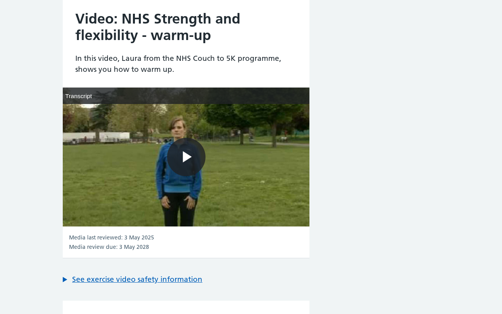

# www.nhs.uk: sustainability audit

## At a glance

- **42.3/100** — scoped audit score 11 passing, 2 with problems, 13 needing more evidence.
- **7 pages** reviewed 1 visitor journey; public-site evidence.
- **26 of 71 guideline groups** scored 45 untested; 0 not applicable. Tests cover selected aspects of each guideline.

The seven-page sample supports a useful, readable NHS exercise journey: Walking for health is reachable after rejecting analytics, and core reading remains available without JavaScript. The largest resource question is the Strength and Flex video collection, where all 15 paused players initialize and video segments arrive before anyone selects playback. Investigate that loading behavior first, then the homepage background image and a small set of delivery and editorial questions. The video transfer is incomplete, and several checks need further observation; these uncertainties are separate from the two demonstrated problems in compression and carbon.txt discovery.

## Results by WSG area

<table>
<caption>Selected checks by WSG area</caption>
<thead><tr><th scope="col">Area</th><th scope="col">Passing</th><th scope="col">Guideline groups checked</th><th scope="col">Needs evidence</th></tr></thead>
<tbody>
<tr><th scope="row"><a href="#findings-2">User experience design</a></th><td>67% (8/12)</td><td>12 of 17</td><td>4</td></tr>
<tr><th scope="row"><a href="#findings-3">Web development</a></th><td>12% (1/8)</td><td>8 of 16</td><td>6</td></tr>
<tr><th scope="row"><a href="#findings-4">Hosting, infrastructure and systems</a></th><td>33% (1/3)</td><td>3 of 12</td><td>1</td></tr>
<tr><th scope="row"><a href="#findings-5">Business strategy and product management</a></th><td>33% (1/3)</td><td>3 of 26</td><td>2</td></tr>
</tbody></table>

Passing percentages apply to the selected checks. Full-guideline conformance has not been established.

## Page measurements

<table>
<caption>Page measurements</caption>
<thead><tr><th scope="col">Page</th><th scope="col"><a href="#measure-first-load">First load</a></th><th scope="col"><a href="#measure-after-choice">After cookies</a></th><th scope="col"><a href="#measure-scroll">After scrolling</a></th><th scope="col"><a href="#measure-carbon">Estimated footprint</a></th><th scope="col"><a href="#measure-carbon">Carbon rating</a></th><th scope="col"><a href="#measure-energy">Browser energy</a></th><th scope="col"><a href="#measure-energy">Network energy</a></th></tr></thead>
<tbody>
<tr><th scope="row"><a href="https://www.nhs.uk/">Homepage</a></th><td>628.8 kB</td><td>Reject analytics: 628.9 kB Accept analytics: 919.8 kB</td><td>Reject analytics: 628.9 kB Accept analytics: 919.8 kB</td><td>0.09 gCO₂e</td><td>B</td><td>10.92 mWh</td><td>7.52 mWh</td></tr>
<tr><th scope="row"><a href="https://www.nhs.uk/live-well/">Healthy living</a></th><td>152.4 kB</td><td>Reject analytics: 152.5 kB Accept analytics: 443.4 kB</td><td>Reject analytics: 152.5 kB Accept analytics: 443.4 kB</td><td>0.02 gCO₂e</td><td>A+</td><td>Not sampled</td><td>Not sampled</td></tr>
<tr><th scope="row"><a href="https://www.nhs.uk/live-well/exercise/">Exercise</a></th><td>152.1 kB</td><td>Reject analytics: 152.2 kB Accept analytics: 443.2 kB</td><td>Reject analytics: 152.2 kB Accept analytics: 443.2 kB</td><td>0.02 gCO₂e</td><td>A+</td><td>Not sampled</td><td>Not sampled</td></tr>
<tr><th scope="row"><a href="https://www.nhs.uk/live-well/exercise/walking-for-health/">Walking for health</a></th><td>154.7 kB</td><td>Reject analytics: 154.8 kB Accept analytics: 445.8 kB</td><td>Reject analytics: 154.8 kB Accept analytics: 445.8 kB</td><td>0.02 gCO₂e</td><td>A+</td><td>Not sampled</td><td>Not sampled</td></tr>
<tr><th scope="row"><a href="https://www.nhs.uk/live-well/exercise/strength-and-flex-exercise-plan-how-to-videos/">Strength and Flex exercise plan: How-to videos</a></th><td>21.825 MB · <a href="#measure-completeness">partial</a></td><td>Reject analytics: 21.825 MB · <a href="#measure-completeness">partial</a> Accept analytics: 22.117 MB · <a href="#measure-completeness">partial</a></td><td>Reject analytics: 21.825 MB · <a href="#measure-completeness">partial</a> Accept analytics: 22.117 MB · <a href="#measure-completeness">partial</a></td><td>Withheld</td><td>Withheld</td><td>26.64 mWh</td><td>266.29 mWh</td></tr>
<tr><th scope="row"><a href="https://www.nhs.uk/our-policies/choose-your-cookie-settings/">Choose your cookie settings on the NHS website</a></th><td>146.2 kB</td><td>Reject analytics (action failed): 146.2 kB Accept analytics (action failed): 146.2 kB</td><td>Reject analytics (action failed): 146.2 kB Accept analytics (action failed): 146.2 kB</td><td>0.02 gCO₂e</td><td>A+</td><td>Not sampled</td><td>Not sampled</td></tr>
<tr><th scope="row"><a href="https://www.nhs.uk/our-policies/content-policy/">Content policy</a></th><td>155.9 kB</td><td>Reject analytics: 156.0 kB Accept analytics: 446.9 kB</td><td>Reject analytics: 156.0 kB Accept analytics: 446.9 kB</td><td>0.02 gCO₂e</td><td>A+</td><td>Not sampled</td><td>Not sampled</td></tr>
</tbody></table>

## Estimated annual footprint

A traffic scenario of **455,186,749 pageviews/year** gives the estimates below. These are alternative views of overlapping activity, so they should not be added together.

<table>
<caption>Annual footprint and improvement scale</caption>
<thead><tr><th scope="col">Scope</th><th scope="col"><a href="#measure-annual">Annual estimate</a></th><th scope="col"><a href="#measure-annual-savings">If per-view impact fell by 10%</a></th></tr></thead>
<tbody>
<tr><th scope="row">Site browsing · SWDM v4 · partial transfers</th><td>223,721.27 kgCO₂e/year</td><td>22,372.13 kgCO₂e/year less</td></tr>
<tr><th scope="row">Client electricity · GreenFrame scenarios</th><td>8,547.88 kWh/year</td><td>854.79 kWh/year less</td></tr>
<tr><th scope="row">Client operational emissions · assumed electricity mix</th><td>4,222.65 kgCO₂e/year</td><td>422.27 kgCO₂e/year less</td></tr>
</tbody></table>

The 10% column shows the scale of a hypothetical improvement, not a predicted saving from the findings below.

## Priorities

### 1. Investigate loading exercise videos only when selected

**High priority** · Needs investigation · <a class="audit-guideline" href="https://www.w3.org/TR/web-sustainability-guidelines/#modularize-bandwidth-heavy-components" title="Split large components into smaller, on-demand modules to improve loading efficiency while balancing maintainability and caching performance.">WSG 3.3: Modularize bandwidth-heavy components</a>

**What we found.** The Strength and Flex page initializes all 15 players while they remain paused. Its first visit records 21.83 MB before cookie choice or playback, including streaming segments; some transfers are unmeasured. This is early loading, not evidence of autoplay.

**Why it matters.** Readers seeking an exercise summary encounter substantial media transfer before choosing a video. A lighter activation path is worth testing, but its usability and potential savings are unresolved.

**Next step.** Prototype initializing only the chosen player. Keep summaries, safety information, transcripts and captions usable, verify Play and Pause, then compare matched loading and activation tasks before estimating a reduction.

<figure class="audit-illustration" markdown="1">

<figcaption>Exercise information surrounds the paused warm-up player.</figcaption>
</figure>

[How we checked this: Investigate loading exercise videos only when selected](#evidence-components)

### 2. Check the homepage background image’s role

**Medium priority** · Needs investigation · <a class="audit-guideline" href="https://www.w3.org/TR/web-sustainability-guidelines/#optimize-media-to-reduce-resource-use" title="Include media only when it supports user needs. Manage, optimize, and load media efficiently. Ensure users have control over playback and data use.">WSG 2.9: Optimize media to reduce resource use</a>

**What we found.** The homepage downloads a 475.9 kB CSS background PNG. It is absent from the image-element inventory, and the scored capture does not establish its rendered dimensions, purpose or necessary detail.

**Why it matters.** The background accounts for a substantial part of the observed homepage transfer. Its size makes it a useful investigation target; useful visual content and display density must guide any replacement.

**Next step.** Locate the background in the homepage and inspect its visible contribution. Compare suitable renditions at desktop and narrow widths, including high-density displays, before resizing or removing it.

[How we checked this: Check the homepage background image’s role](#evidence-media-delivery)

### 3. Ask the video provider to compress playback JSON

**Low priority** · Problem found · <a class="audit-guideline" href="https://www.w3.org/TR/web-sustainability-guidelines/#reduce-data-transfer-with-compression" title="Compress server responses and media files to reduce bandwidth, storage use, and delivery overhead while balancing processing costs.">WSG 4.3: Reduce data transfer with compression</a>

**What we found.** Fifteen successful Brightcove playback metadata responses, each about 8.6 kB, arrive without a compression header. The NHS page assets and player script already use gzip or Brotli.

**Why it matters.** These material text responses can be reviewed independently of the video files. Beneficial negotiated compression would reduce their transfer, although the achievable reduction has not been measured.

**Next step.** Ask Brightcove or the media delivery owner to check content negotiation for playback JSON. Verify compression headers and transferred sizes on the same exercise task after a change.

[How we checked this: Ask the video provider to compress playback JSON](#evidence-text-compression)

### 4. Confirm the Walking article’s current review status

**Medium priority** · Needs investigation · <a class="audit-guideline" href="https://www.w3.org/TR/web-sustainability-guidelines/#promote-responsible-data-practices" title="Respect user data rights and manage data lifecycle through minimized collection, user control, portability, deletion, and content archiving.">WSG 5.18: Promote responsible data practices</a>

**What we found.** Walking for health shows a review due on December 15, 2025, which was past at capture. NHS policy describes review at least every three years, but the evidence does not show whether this review occurred or what decision was made.

**Why it matters.** A stale public review label makes the content’s current status harder to judge. The date alone does not establish a clinical problem or a reason to delete the article.

**Next step.** Ask the editorial owner whether the review was completed, update the public label accurately, and retain one dated review or retention decision for the exercise collection with its rationale.

[How we checked this: Confirm the Walking article’s current review status](#evidence-content-lifecycle)

## Further checks

These outcomes apply to the selected checks and sample. Open a check's explanation for the observation, limitations and useful follow-up.

??? note "Browse all check outcomes"

    

    <table>
    <caption>All selected check outcomes</caption>
    <thead><tr><th scope="col">Check</th><th scope="col">Outcome</th></tr></thead>
    <tbody>
    <tr><th scope="row"><a href="#evidence-distraction">Reading stays in view during the sampled tasks</a></th><td>✅ Passed this check</td></tr>
    <tr><th scope="row"><a href="#evidence-choice">Check the appearance and focus of both cookie choices</a></th><td>❓ Needs investigation</td></tr>
    <tr><th scope="row"><a href="#evidence-comprehension">Exercise information uses clear task headings</a></th><td>✅ Passed this check</td></tr>
    <tr><th scope="row"><a href="#evidence-consistency">Navigation names remain consistent</a></th><td>✅ Passed this check</td></tr>
    <tr><th scope="row"><a href="#evidence-motion">Check video effects and playback controls</a></th><td>❓ Needs investigation</td></tr>
    <tr><th scope="row"><a href="#evidence-notifications">No unsolicited notification request was observed</a></th><td>✅ Passed this check</td></tr>
    <tr><th scope="row"><a href="#evidence-documents">Core exercise text remains in print views</a></th><td>✅ Passed this check</td></tr>
    <tr><th scope="row"><a href="#evidence-unused-code">Check code use across real interactions</a></th><td>❓ Needs investigation</td></tr>
    <tr><th scope="row"><a href="#evidence-components">Investigate loading only the selected exercise player</a></th><td>❓ Needs investigation</td></tr>
    <tr><th scope="row"><a href="#evidence-layout">Complete the narrow navigation route</a></th><td>❓ Needs investigation</td></tr>
    <tr><th scope="row"><a href="#evidence-impact-choice">Check whether text offers a useful lower-data route</a></th><td>❓ Needs investigation</td></tr>
    <tr><th scope="row"><a href="#evidence-journeys">The Walking article is reachable after rejecting analytics</a></th><td>✅ Passed this check</td></tr>
    <tr><th scope="row"><a href="#evidence-media-delivery">Inspect the homepage background and exercise posters</a></th><td>❓ Needs investigation</td></tr>
    <tr><th scope="row"><a href="#evidence-font-delivery">Two small font faces support the sampled text</a></th><td>✅ Passed this check</td></tr>
    <tr><th scope="row"><a href="#evidence-semantic-forms">Task headings and controls have meaningful names</a></th><td>✅ Passed this check</td></tr>
    <tr><th scope="row"><a href="#evidence-metadata">Page titles and canonical addresses match their tasks</a></th><td>✅ Passed this check</td></tr>
    <tr><th scope="row"><a href="#evidence-preference-behavior">Check the unresolved video preference effects</a></th><td>❓ Needs investigation</td></tr>
    <tr><th scope="row"><a href="#evidence-no-js-content">Exercise reading survives without JavaScript</a></th><td>✅ Passed this check</td></tr>
    <tr><th scope="row"><a href="#evidence-api-requests">Trace what each player requests before playback</a></th><td>❓ Needs investigation</td></tr>
    <tr><th scope="row"><a href="#evidence-public-cache-policy">Reusable resources provide cache information</a></th><td>✅ Passed this check</td></tr>
    <tr><th scope="row"><a href="#evidence-text-compression">Compress the player metadata responses</a></th><td>❌ Problem found</td></tr>
    <tr><th scope="row"><a href="#evidence-keyboard-path">Inspect the visible keyboard-focus treatment</a></th><td>❓ Needs investigation</td></tr>
    <tr><th scope="row"><a href="#evidence-disclosure-scope">Find a sustainability statement for the NHS website</a></th><td>❓ Needs investigation</td></tr>
    <tr><th scope="row"><a href="#evidence-carbon-discovery">Publish a verifiable carbon.txt record if useful</a></th><td>❌ Problem found</td></tr>
    <tr><th scope="row"><a href="#evidence-hosting-evidence">Connect hosting evidence to this website</a></th><td>❓ Needs investigation</td></tr>
    <tr><th scope="row"><a href="#evidence-access-barriers">Anonymous desktop readers can reach the Walking article</a></th><td>✅ Passed this check</td></tr>
    <tr><th scope="row"><a href="#evidence-data-minimization">Analytics choices have an explained purpose</a></th><td>✅ Passed this check</td></tr>
    <tr><th scope="row"><a href="#evidence-content-lifecycle">Resolve the Walking review-date discrepancy</a></th><td>❓ Needs investigation</td></tr>
    </tbody></table>

## Next steps for auditing

1. Prototype loading one selected exercise player on demand. Test Play, Pause, captions, transcripts and safety information with pointer and keyboard input, then repeat the same initial-load measurement before estimating any reduction.
2. Locate the homepage CSS background and compare useful image renditions at desktop and narrow widths, including high-density screens. Inspect exercise posters alongside it before choosing changes.
3. Complete the narrow Browse/More route and inspect visible keyboard focus, cookie-choice appearance and the video animation effects. The cookie-settings page uses radio controls; the failed banner-button actions there need a corrected test, not a consent-defect diagnosis.
4. Resolve the Walking review-date discrepancy with the editorial owner and obtain one dated exercise-content decision. Request service-specific sustainability and hosting evidence to resolve the remaining disclosure questions.

The sample covers selected pages and visitor tasks, not every page on the site. Expand it where the checks above identify an untested template, interaction or audience need.

## Detailed findings

This appendix explains the evidence in ordinary language. This audit used public-site evidence without a source checkout. Unavailable documents or internal records do not establish that the organization has none.

### User experience design {#findings-2}

<h4 id="evidence-distraction">Reading stays in view during the sampled tasks</h4>

**Passed this check** · <a class="audit-guideline" href="https://www.w3.org/TR/web-sustainability-guidelines/#design-to-assist-and-not-to-distract" title="Give users control over notifications and focus, prioritize task-relevant content, and avoid designs that distract or unnecessarily extend engagement.">WSG 2.5: Design to assist and not to distract</a>

_Give users control over notifications and focus, prioritize task-relevant content, and avoid designs that distract or unnecessarily extend engagement._

Headings and navigation remain available across all seven pages. The cookie notice supports a privacy choice and is dismissed during the walking journey; exercise videos are paused until selected. Hidden player dialogs were not observed interrupting reading.

**Next step:** Recheck the reading journey after changes to prompts or video players, including any dialog introduced during playback.

**Where we looked:**

- Browser observations for [Homepage](https://www.nhs.uk/).
- Browser observations for [Live well](https://www.nhs.uk/live-well/).
- Browser observations for [Exercise](https://www.nhs.uk/live-well/exercise/).
- Browser observations for [Walking for health](https://www.nhs.uk/live-well/exercise/walking-for-health/).
- Browser observations for [Strength and flex exercise plan how to videos](https://www.nhs.uk/live-well/exercise/strength-and-flex-exercise-plan-how-to-videos/).
- Browser observations for [Choose your cookie settings](https://www.nhs.uk/our-policies/choose-your-cookie-settings/).
- Browser observations for [Content policy](https://www.nhs.uk/our-policies/content-policy/).

<h4 id="evidence-choice">Check the appearance and focus of both cookie choices</h4>

**Needs investigation** · <a class="audit-guideline" href="https://www.w3.org/TR/web-sustainability-guidelines/#avoid-being-manipulative-or-deceptive" title="Avoid deceptive patterns, clearly label ads, respect consent for tracking, and ensure search, sharing, and discoverability practices prioritize user needs over optimization or manipulation.">WSG 2.6: Avoid being manipulative or deceptive</a>

_Avoid deceptive patterns, clearly label ads, respect consent for tracking, and ensure search, sharing, and discoverability practices prioritize user needs over optimization or manipulation._

The homepage presents plainly worded, adjacent accept and reject buttons, and both actions complete in the recorded visits. Optional categories start off. The evidence does not establish equal visual prominence or default-focus behavior. Banner-button actions on the separate cookie-settings page failed because those buttons were absent; that page exposes radio settings.

**Next step:** Compare both banner choices at desktop and narrow widths, including default focus, contrast and prominence. Test the actual radio settings separately and verify the saved choice.

**Where we looked:**

- Browser observations for [Homepage](https://www.nhs.uk/).
- Browser observations for [Live well](https://www.nhs.uk/live-well/).
- Browser observations for [Exercise](https://www.nhs.uk/live-well/exercise/).
- Browser observations for [Walking for health](https://www.nhs.uk/live-well/exercise/walking-for-health/).
- Browser observations for [Strength and flex exercise plan how to videos](https://www.nhs.uk/live-well/exercise/strength-and-flex-exercise-plan-how-to-videos/).
- Browser observations for [Choose your cookie settings](https://www.nhs.uk/our-policies/choose-your-cookie-settings/).
- Browser observations for [Content policy](https://www.nhs.uk/our-policies/content-policy/).
- Captured public evidence for [Homepage](https://www.nhs.uk/).

<h4 id="evidence-comprehension">Exercise information uses clear task headings</h4>

**Passed this check** · <a class="audit-guideline" href="https://www.w3.org/TR/web-sustainability-guidelines/#make-deliverables-understandable-and-reusable" title="Create discoverable, maintainable, and reusable documentation and code resources that support long-term understanding, reuse, and sustainability.">WSG 2.7: Make deliverables understandable and reusable</a>

_Create discoverable, maintainable, and reusable documentation and code resources that support long-term understanding, reuse, and sustainability._

The sampled pages use descriptive headings, familiar navigation and practical explanations. Walking uses questions and examples; the videos have exercise names, summaries and safety links. This is a judgment of the captured English wording, without representative-user or clinical validation.

**Next step:** Retain the descriptive headings and short exercise explanations when revising content; use audience research for broader comprehension claims.

**Where we looked:**

- Browser observations for [Homepage](https://www.nhs.uk/).
- Browser observations for [Live well](https://www.nhs.uk/live-well/).
- Browser observations for [Exercise](https://www.nhs.uk/live-well/exercise/).
- Browser observations for [Walking for health](https://www.nhs.uk/live-well/exercise/walking-for-health/).
- Browser observations for [Strength and flex exercise plan how to videos](https://www.nhs.uk/live-well/exercise/strength-and-flex-exercise-plan-how-to-videos/).
- Browser observations for [Choose your cookie settings](https://www.nhs.uk/our-policies/choose-your-cookie-settings/).
- Browser observations for [Content policy](https://www.nhs.uk/our-policies/content-policy/).

<h4 id="evidence-consistency">Navigation names remain consistent</h4>

**Passed this check** · <a class="audit-guideline" href="https://www.w3.org/TR/web-sustainability-guidelines/#use-a-design-system-for-interface-consistency" title="Use design systems and established patterns to ensure consistent, efficient, and sustainable interfaces through reusable components and clear maintenance practices.">WSG 2.8: Use a design system for interface consistency</a>

_Use design systems and established patterns to ensure consistent, efficient, and sustainable interfaces through reusable components and clear maintenance practices._

The seven pages repeat the NHS home link, labeled search and primary navigation names. Content pages use familiar breadcrumbs and topic links. This consistency in the sample does not establish a documented design system.

**Next step:** Check these shared labels when adding templates or changing the Healthy living navigation.

**Where we looked:**

- Browser observations for [Homepage](https://www.nhs.uk/).
- Browser observations for [Live well](https://www.nhs.uk/live-well/).
- Browser observations for [Exercise](https://www.nhs.uk/live-well/exercise/).
- Browser observations for [Walking for health](https://www.nhs.uk/live-well/exercise/walking-for-health/).
- Browser observations for [Strength and flex exercise plan how to videos](https://www.nhs.uk/live-well/exercise/strength-and-flex-exercise-plan-how-to-videos/).
- Browser observations for [Choose your cookie settings](https://www.nhs.uk/our-policies/choose-your-cookie-settings/).
- Browser observations for [Content policy](https://www.nhs.uk/our-policies/content-policy/).

<h4 id="evidence-motion">Check video effects and playback controls</h4>

**Needs investigation** · <a class="audit-guideline" href="https://www.w3.org/TR/web-sustainability-guidelines/#ensure-animation-is-proportionate-and-easy-to-control" title="Use animation sparingly and efficiently, only when it supports understanding, while limiting performance impact and giving users control over motion.">WSG 2.10: Ensure animation is proportionate and easy to control</a>

_Use animation sparingly and efficiently, only when it supports understanding, while limiting performance impact and giving users control over motion._

All 15 instructional videos are paused with autoplay off, and the screen observations record no running animations. A later print state records short DIV animations whose purpose and visibility are unresolved. Playback controls were identified but not activated in this task.

**Next step:** Inspect those effects under reduced motion and print emulation, then play and pause one representative exercise video to verify the controls.

**Where we looked:**

- Browser observations for [Homepage](https://www.nhs.uk/).
- Browser observations for [Live well](https://www.nhs.uk/live-well/).
- Browser observations for [Exercise](https://www.nhs.uk/live-well/exercise/).
- Browser observations for [Walking for health](https://www.nhs.uk/live-well/exercise/walking-for-health/).
- Browser observations for [Strength and flex exercise plan how to videos](https://www.nhs.uk/live-well/exercise/strength-and-flex-exercise-plan-how-to-videos/).
- Browser observations for [Choose your cookie settings](https://www.nhs.uk/our-policies/choose-your-cookie-settings/).
- Browser observations for [Content policy](https://www.nhs.uk/our-policies/content-policy/).

<h4 id="evidence-notifications">No unsolicited notification request was observed</h4>

**Passed this check** · <a class="audit-guideline" href="https://www.w3.org/TR/web-sustainability-guidelines/#avoid-unwanted-notifications" title="Send only user-requested notifications and provide clear, accessible controls for managing preferences, opt-in, and account and contact settings.">WSG 2.12: Avoid unwanted notifications</a>

_Send only user-requested notifications and provide clear, accessible controls for managing preferences, opt-in, and account and contact settings._

No notification-permission request occurs in the seven captured page states. The cookie notice offers a relevant choice; player status regions and hidden dialogs do not establish an interruption. Browser notification permission was already denied, limiting what this observation can show.

**Next step:** Recheck any future notification feature in a fresh context where permission has not already been decided.

**Where we looked:**

- Browser observations for [Homepage](https://www.nhs.uk/).
- Browser observations for [Live well](https://www.nhs.uk/live-well/).
- Browser observations for [Exercise](https://www.nhs.uk/live-well/exercise/).
- Browser observations for [Walking for health](https://www.nhs.uk/live-well/exercise/walking-for-health/).
- Browser observations for [Strength and flex exercise plan how to videos](https://www.nhs.uk/live-well/exercise/strength-and-flex-exercise-plan-how-to-videos/).
- Browser observations for [Choose your cookie settings](https://www.nhs.uk/our-policies/choose-your-cookie-settings/).
- Browser observations for [Content policy](https://www.nhs.uk/our-policies/content-policy/).

<h4 id="evidence-documents">Core exercise text remains in print views</h4>

**Passed this check** · <a class="audit-guideline" href="https://www.w3.org/TR/web-sustainability-guidelines/#reduce-the-impact-of-downloadable-and-physical-documents" title="Reduce paper use through digital-first workflows, optimize and reuse accessible downloadable documents, and provide clear, user-controlled document previews and formats.">WSG 2.13: Reduce the impact of downloadable and physical documents</a>

_Reduce paper use through digital-first workflows, optimize and reuse accessible downloadable documents, and provide clear, user-controlled document previews and formats._

The sample lists no document downloads. Print emulation retains headings, Walking article text and exercise summaries, and removes primary navigation. It does not establish physical page counts or a complete text equivalent for every video.

**Next step:** Keep the print reading content when changing templates; inspect actual printed output if pagination or transcript equivalence becomes part of the task.

**Where we looked:**

- Browser observations for [Homepage](https://www.nhs.uk/).
- Browser observations for [Live well](https://www.nhs.uk/live-well/).
- Browser observations for [Exercise](https://www.nhs.uk/live-well/exercise/).
- Browser observations for [Walking for health](https://www.nhs.uk/live-well/exercise/walking-for-health/).
- Browser observations for [Strength and flex exercise plan how to videos](https://www.nhs.uk/live-well/exercise/strength-and-flex-exercise-plan-how-to-videos/).
- Browser observations for [Choose your cookie settings](https://www.nhs.uk/our-policies/choose-your-cookie-settings/).
- Browser observations for [Content policy](https://www.nhs.uk/our-policies/content-policy/).

<h4 id="evidence-journeys">The Walking article is reachable after rejecting analytics</h4>

**Passed this check** · <a class="audit-guideline" href="https://www.w3.org/TR/web-sustainability-guidelines/#design-efficient-and-streamlined-user-journeys" title="Design clear, efficient journeys that help users complete tasks and find content with minimal effort.">WSG 2.4: Design efficient and streamlined user journeys</a>

_Design clear, efficient journeys that help users complete tasks and find content with minimal effort._

The recorded pointer journey rejects analytics, follows Healthy living, Exercise and Walking for health, then reaches the correct URL, heading and full article. It establishes completion of that route, without proving the shortest route or success for other audiences.

**Next step:** Include this anonymous reading route in regression checks when navigation or cookie controls change.

**Where we looked:**

- Browser observations for [Homepage](https://www.nhs.uk/).
- Recorded visitor task starting at [Homepage](https://www.nhs.uk/).

<h4 id="evidence-media-delivery">Inspect the homepage background and exercise posters</h4>

**Needs investigation** · <a class="audit-guideline" href="https://www.w3.org/TR/web-sustainability-guidelines/#optimize-media-to-reduce-resource-use" title="Include media only when it supports user needs. Manage, optimize, and load media efficiently. Ensure users have control over playback and data use.">WSG 2.9: Optimize media to reduce resource use</a>

_Include media only when it supports user needs. Manage, optimize, and load media efficiently. Ensure users have control over playback and data use._

The homepage requests a CSS background PNG of 475.9 kB even though the image-element inventory is empty. Its visible role and necessary detail were not established. Exercise posters are near 1280 × 720, displayed at about 629 × 354 on desktop and 328 × 185 at narrow width; high-density desktop displays may justify the larger source.

**Next step:** Locate the background and inspect its task value. Compare poster and background renditions at intended display densities, choosing smaller versions only after checking useful detail and legibility.

**Where we looked:**

- Browser observations for [Homepage](https://www.nhs.uk/).
- Browser observations for [Live well](https://www.nhs.uk/live-well/).
- Browser observations for [Exercise](https://www.nhs.uk/live-well/exercise/).
- Browser observations for [Walking for health](https://www.nhs.uk/live-well/exercise/walking-for-health/).
- Browser observations for [Strength and flex exercise plan how to videos](https://www.nhs.uk/live-well/exercise/strength-and-flex-exercise-plan-how-to-videos/).
- Browser observations for [Choose your cookie settings](https://www.nhs.uk/our-policies/choose-your-cookie-settings/).
- Browser observations for [Content policy](https://www.nhs.uk/our-policies/content-policy/).

<h4 id="evidence-font-delivery">Two small font faces support the sampled text</h4>

**Passed this check** · <a class="audit-guideline" href="https://www.w3.org/TR/web-sustainability-guidelines/#use-optimized-web-typography" title="Use font strategies that minimize downloads and complexity while supporting required languages and dynamic content.">WSG 2.11: Use optimized web typography</a>

_Use font strategies that minimize downloads and complexity while supporting required languages and dynamic content._

The pages use regular and semibold Frutiger WOFF2 faces of about 17 kB each, with a fallback loading policy and Arial/sans-serif alternatives. The observed faces serve body text and headings and have cache information. Constrained-loading behavior was not tested.

**Next step:** Retain the fallback strategy and test readability before changing font variants or language coverage.

**Where we looked:**

- Browser observations for [Homepage](https://www.nhs.uk/).
- Browser observations for [Live well](https://www.nhs.uk/live-well/).
- Browser observations for [Exercise](https://www.nhs.uk/live-well/exercise/).
- Browser observations for [Walking for health](https://www.nhs.uk/live-well/exercise/walking-for-health/).
- Browser observations for [Strength and flex exercise plan how to videos](https://www.nhs.uk/live-well/exercise/strength-and-flex-exercise-plan-how-to-videos/).
- Browser observations for [Choose your cookie settings](https://www.nhs.uk/our-policies/choose-your-cookie-settings/).
- Browser observations for [Content policy](https://www.nhs.uk/our-policies/content-policy/).

<h4 id="evidence-no-js-content">Exercise reading survives without JavaScript</h4>

**Passed this check** · <a class="audit-guideline" href="https://www.w3.org/TR/web-sustainability-guidelines/#provide-cross-platform-compatibility-support" title="Document compatibility, avoid unnecessary obsolescence, and test across devices, systems, and network conditions.">WSG 2.17: Provide cross-platform compatibility support</a>

_Document compatibility, avoid unnecessary obsolescence, and test across devices, systems, and network conditions._

Fresh visits with JavaScript disabled preserve headings, reading text and navigation on all seven pages. Walking stays complete, and the video collection retains exercise summaries, review dates and safety links. Enhanced playback, account actions and settings submission were outside this reading check.

**Next step:** Keep this reading fallback when revising the video collection, and test player enhancements separately.

**Where we looked:**

- Browser observations for [Homepage](https://www.nhs.uk/).
- Browser observations for [Live well](https://www.nhs.uk/live-well/).
- Browser observations for [Exercise](https://www.nhs.uk/live-well/exercise/).
- Browser observations for [Walking for health](https://www.nhs.uk/live-well/exercise/walking-for-health/).
- Browser observations for [Strength and flex exercise plan how to videos](https://www.nhs.uk/live-well/exercise/strength-and-flex-exercise-plan-how-to-videos/).
- Browser observations for [Choose your cookie settings](https://www.nhs.uk/our-policies/choose-your-cookie-settings/).
- Browser observations for [Content policy](https://www.nhs.uk/our-policies/content-policy/).

<h4 id="evidence-disclosure-scope">Find a sustainability statement for the NHS website</h4>

**Needs investigation** · <a class="audit-guideline" href="https://www.w3.org/TR/web-sustainability-guidelines/#identify-assess-disclose-review-and-mitigate-sustainability-impacts" title="Assess and report the planet, people, and prosperity impacts of digital projects, and plan measurable reductions to the real-world effects of their activity.">WSG 2.1: Identify, assess, disclose, review, and mitigate sustainability impacts</a>

_Assess and report the planet, people, and prosperity impacts of digital projects, and plan measurable reductions to the real-world effects of their activity._

Two guessed sustainability URLs return 404 and the bounded search provides no usable statement for this service. That does not establish that the NHS lacks a statement elsewhere, or that organization-wide commitments describe this website.

**Next step:** Provide a public statement naming the NHS website and explaining its environmental impacts and mitigation.

**Where we looked:**

- Disclosure discovery for the origin `https://www.nhs.uk`.

### Web development {#findings-3}

<h4 id="evidence-unused-code">Check code use across real interactions</h4>

**Needs investigation** · <a class="audit-guideline" href="https://www.w3.org/TR/web-sustainability-guidelines/#minify-and-remove-unused-code" title="Minify code and data, and remove unused characters to reduce file size and improve loading efficiency and maintainability.">WSG 3.2: Minify and remove unused code</a>

_Minify code and data, and remove unused characters to reduce file size and improve loading efficiency and maintainability._

The initial-load coverage leaves parts of the consent, main and player scripts unexecuted. The brief capture does not cover search, account actions, settings updates or playback, and some function lists are truncated. These ranges do not identify safely removable downloads.

**Next step:** Record coverage while completing those interactions and identify specific unused modules before removing code.

**Where we looked:**

- Browser observations for [Homepage](https://www.nhs.uk/).
- Browser observations for [Live well](https://www.nhs.uk/live-well/).
- Browser observations for [Exercise](https://www.nhs.uk/live-well/exercise/).
- Browser observations for [Walking for health](https://www.nhs.uk/live-well/exercise/walking-for-health/).
- Browser observations for [Strength and flex exercise plan how to videos](https://www.nhs.uk/live-well/exercise/strength-and-flex-exercise-plan-how-to-videos/).
- Browser observations for [Choose your cookie settings](https://www.nhs.uk/our-policies/choose-your-cookie-settings/).
- Browser observations for [Content policy](https://www.nhs.uk/our-policies/content-policy/).

<h4 id="evidence-components">Investigate loading only the selected exercise player</h4>

**Needs investigation** · <a class="audit-guideline" href="https://www.w3.org/TR/web-sustainability-guidelines/#modularize-bandwidth-heavy-components" title="Split large components into smaller, on-demand modules to improve loading efficiency while balancing maintainability and caching performance.">WSG 3.3: Modularize bandwidth-heavy components</a>

_Split large components into smaller, on-demand modules to improve loading efficiency while balancing maintainability and caching performance._

All 15 paused players initialize before playback, loading a roughly 316.6 kB compressed player script, individual video metadata and streaming segments. The first video-page visit records 21.83 MB before consent or playback, with some transfer unmeasured. This supports testing deferral; a usable replacement and achievable reduction have not been demonstrated.

**Next step:** Prototype one player that initializes on request. Confirm summaries, safety information, transcripts, captions and playback remain usable, then compare the same initial-load and activation tasks.

**Where we looked:**

- Browser observations for [Strength and flex exercise plan how to videos](https://www.nhs.uk/live-well/exercise/strength-and-flex-exercise-plan-how-to-videos/).
- Captured public evidence for [Strength and flex exercise plan how to videos](https://www.nhs.uk/live-well/exercise/strength-and-flex-exercise-plan-how-to-videos/).

<h4 id="evidence-layout">Complete the narrow navigation route</h4>

**Needs investigation** · <a class="audit-guideline" href="https://www.w3.org/TR/web-sustainability-guidelines/#ensure-layouts-work-for-different-devices-and-requirements" title="Use responsive, progressively enhanced, and carbon-aware design to ensure accessible, adaptable functionality across devices and interaction methods while managing resource use.">WSG 3.10: Ensure layouts work for different devices and requirements</a>

_Use responsive, progressively enhanced, and carbon-aware design to ensure accessible, adaptable functionality across devices and interaction methods while managing resource use._

All seven pages keep their task headings and core text at desktop and 360 CSS pixels without recorded horizontal overflow. Narrow layouts replace primary navigation with Browse/More, which the collection did not open. Readable text alone does not establish that route works.

**Next step:** Open Browse/More on the sampled templates at narrow widths and follow the intended exercise link through to its full content.

**Where we looked:**

- Browser observations for [Homepage](https://www.nhs.uk/).
- Browser observations for [Live well](https://www.nhs.uk/live-well/).
- Browser observations for [Exercise](https://www.nhs.uk/live-well/exercise/).
- Browser observations for [Walking for health](https://www.nhs.uk/live-well/exercise/walking-for-health/).
- Browser observations for [Strength and flex exercise plan how to videos](https://www.nhs.uk/live-well/exercise/strength-and-flex-exercise-plan-how-to-videos/).
- Browser observations for [Choose your cookie settings](https://www.nhs.uk/our-policies/choose-your-cookie-settings/).
- Browser observations for [Content policy](https://www.nhs.uk/our-policies/content-policy/).

<h4 id="evidence-semantic-forms">Task headings and controls have meaningful names</h4>

**Passed this check** · <a class="audit-guideline" href="https://www.w3.org/TR/web-sustainability-guidelines/#ensure-code-follows-good-semantic-practices" title="Use standards-compliant HTML and web platform features, and avoid unnecessary complexity or non-standard code.">WSG 3.6: Ensure code follows good semantic practices</a>

_Use standards-compliant HTML and web platform features, and avoid unnecessary complexity or non-standard code._

Each initial document declares English, has one meaningful main heading and one main region. Search has its Search the NHS website label; cookie radios and visible Play and Transcript controls have naming relationships. This is a limited document/control check, not a full accessibility assessment.

**Next step:** Retain these document landmarks and labels when changing templates; verify interactive player states in a separate accessibility check.

**Where we looked:**

- Browser observations for [Homepage](https://www.nhs.uk/).
- Browser observations for [Live well](https://www.nhs.uk/live-well/).
- Browser observations for [Exercise](https://www.nhs.uk/live-well/exercise/).
- Browser observations for [Walking for health](https://www.nhs.uk/live-well/exercise/walking-for-health/).
- Browser observations for [Strength and flex exercise plan how to videos](https://www.nhs.uk/live-well/exercise/strength-and-flex-exercise-plan-how-to-videos/).
- Browser observations for [Choose your cookie settings](https://www.nhs.uk/our-policies/choose-your-cookie-settings/).
- Browser observations for [Content policy](https://www.nhs.uk/our-policies/content-policy/).

<h4 id="evidence-metadata">Page titles and canonical addresses match their tasks</h4>

**Passed this check** · <a class="audit-guideline" href="https://www.w3.org/TR/web-sustainability-guidelines/#structure-metadata-for-machine-readability" title="Include essential document metadata and structured data to improve usability, accessibility, and machine readability.">WSG 3.8: Structure metadata for machine readability</a>

_Include essential document metadata and structured data to improve usability, accessibility, and machine readability._

All seven pages provide descriptive titles, matching absolute canonical URLs and purpose-specific descriptions. Structured-data blocks parse where present; the homepage declares none. Search eligibility and schema correctness were outside the check.

**Next step:** Keep titles, descriptions and canonicals aligned when updating or moving exercise content.

**Where we looked:**

- Browser observations for [Homepage](https://www.nhs.uk/).
- Browser observations for [Live well](https://www.nhs.uk/live-well/).
- Browser observations for [Exercise](https://www.nhs.uk/live-well/exercise/).
- Browser observations for [Walking for health](https://www.nhs.uk/live-well/exercise/walking-for-health/).
- Browser observations for [Strength and flex exercise plan how to videos](https://www.nhs.uk/live-well/exercise/strength-and-flex-exercise-plan-how-to-videos/).
- Browser observations for [Choose your cookie settings](https://www.nhs.uk/our-policies/choose-your-cookie-settings/).
- Browser observations for [Content policy](https://www.nhs.uk/our-policies/content-policy/).

<h4 id="evidence-preference-behavior">Check the unresolved video preference effects</h4>

**Needs investigation** · <a class="audit-guideline" href="https://www.w3.org/TR/web-sustainability-guidelines/#use-media-queries-that-support-sustainability-goals" title="Support user preferences via media queries for color, motion, contrast, data use, and related settings to improve accessibility and efficiency.">WSG 3.9: Use media queries that support sustainability goals</a>

_Support user preferences via media queries for color, motion, contrast, data use, and related settings to improve accessibility and efficiency._

Task text remains available after device-preference changes and when preferences are active before opening the page. The NHS light palette alone establishes no theme defect. The video print state records running effects under reduced motion without enough detail to judge their purpose or response.

**Next step:** Inspect those animation effects with reduced motion active. Establish a relevant user need or intended theme behavior before prescribing a dark theme.

**Where we looked:**

- Browser observations for [Homepage](https://www.nhs.uk/).
- Browser observations for [Live well](https://www.nhs.uk/live-well/).
- Browser observations for [Exercise](https://www.nhs.uk/live-well/exercise/).
- Browser observations for [Walking for health](https://www.nhs.uk/live-well/exercise/walking-for-health/).
- Browser observations for [Strength and flex exercise plan how to videos](https://www.nhs.uk/live-well/exercise/strength-and-flex-exercise-plan-how-to-videos/).
- Browser observations for [Choose your cookie settings](https://www.nhs.uk/our-policies/choose-your-cookie-settings/).
- Browser observations for [Content policy](https://www.nhs.uk/our-policies/content-policy/).

<h4 id="evidence-api-requests">Trace what each player requests before playback</h4>

**Needs investigation** · <a class="audit-guideline" href="https://www.w3.org/TR/web-sustainability-guidelines/#use-sustainable-javascript-and-apis" title="Write efficient JavaScript and use APIs that minimize processing, data use, and energy consumption.">WSG 3.11: Use sustainable JavaScript and APIs</a>

_Write efficient JavaScript and use APIs that minimize processing, data use, and energy consumption._

Ordinary pages request a small emergency-banner update with a plausible safety purpose. The video page requests metadata for 15 distinct videos, streaming resources and tracking events before playback. Repeated endpoint names alone do not establish duplicate polling or safely removable work.

**Next step:** Trace one player from initialization to playback, recording initiators and timing. Separate necessary metadata and captions from any avoidable pre-play segments or analytics.

**Where we looked:**

- Browser observations for [Homepage](https://www.nhs.uk/).
- Browser observations for [Live well](https://www.nhs.uk/live-well/).
- Browser observations for [Exercise](https://www.nhs.uk/live-well/exercise/).
- Browser observations for [Walking for health](https://www.nhs.uk/live-well/exercise/walking-for-health/).
- Browser observations for [Strength and flex exercise plan how to videos](https://www.nhs.uk/live-well/exercise/strength-and-flex-exercise-plan-how-to-videos/).
- Browser observations for [Choose your cookie settings](https://www.nhs.uk/our-policies/choose-your-cookie-settings/).
- Browser observations for [Content policy](https://www.nhs.uk/our-policies/content-policy/).
- Captured public evidence for [Strength and flex exercise plan how to videos](https://www.nhs.uk/live-well/exercise/strength-and-flex-exercise-plan-how-to-videos/).

<h4 id="evidence-keyboard-path">Inspect the visible keyboard-focus treatment</h4>

**Needs investigation** · <a class="audit-guideline" href="https://www.w3.org/TR/web-sustainability-guidelines/#ensure-code-follows-good-semantic-practices" title="Use standards-compliant HTML and web platform features, and avoid unnecessary complexity or non-standard code.">WSG 3.6: Ensure code follows good semantic practices</a>

_Use standards-compliant HTML and web platform features, and avoid unnecessary complexity or non-standard code._

The initial Tab traces reach consent, skip, home, search, account and navigation controls in a meaningful order. Their recorded outlines are transparent, but other focus styling was not captured. This establishes neither an invisible indicator nor a sufficient one.

**Next step:** Capture focused links, buttons and search fields, including border, background and shadow changes. Confirm the current focus can be seen throughout the route.

**Where we looked:**

- Browser observations for [Homepage](https://www.nhs.uk/).
- Browser observations for [Live well](https://www.nhs.uk/live-well/).
- Browser observations for [Exercise](https://www.nhs.uk/live-well/exercise/).
- Browser observations for [Walking for health](https://www.nhs.uk/live-well/exercise/walking-for-health/).
- Browser observations for [Strength and flex exercise plan how to videos](https://www.nhs.uk/live-well/exercise/strength-and-flex-exercise-plan-how-to-videos/).
- Browser observations for [Choose your cookie settings](https://www.nhs.uk/our-policies/choose-your-cookie-settings/).
- Browser observations for [Content policy](https://www.nhs.uk/our-policies/content-policy/).

<h4 id="evidence-carbon-discovery">Publish a verifiable carbon.txt record if useful</h4>

**Problem found** · <a class="audit-guideline" href="https://www.w3.org/TR/web-sustainability-guidelines/#include-expected-and-beneficial-files" title="Include standard website metadata and configuration files to support discoverability, transparency, and operational best practices.">WSG 3.13: Include expected and beneficial files</a>

_Include standard website metadata and configuration files to support discoverability, transparency, and operational best practices._

The root and well-known carbon.txt routes return 404, with no header or DNS route to a usable document in the tested discovery. This is a missing-file result within that scope; it says nothing about the magnitude of website emissions.

**Next step:** If carbon.txt would help visitors discover service evidence, publish a valid record with verifiable relationships and check the advertised discovery route.

**Where we looked:**

- Disclosure discovery for the origin `https://www.nhs.uk`.

### Hosting, infrastructure and systems {#findings-4}

<h4 id="evidence-public-cache-policy">Reusable resources provide cache information</h4>

**Passed this check** · <a class="audit-guideline" href="https://www.w3.org/TR/web-sustainability-guidelines/#optimize-caching-and-support-offline-access" title="Use caching and offline capabilities to reduce network load, improve resilience, and balance performance with sustainability.">WSG 4.2: Optimize caching and support offline access</a>

_Use caching and offline capabilities to reduce network load, improve resilience, and balance performance with sustainability._

Sampled scripts, styles, fonts and posters expose cache lifetimes or validators. Fingerprinted assets have long public lifetimes; player metadata and tracking responses serve different purposes. The headers support reuse policy, while actual repeat-visit reuse and offline availability remain unmeasured.

**Next step:** Retain appropriate cache lifetimes and validators; use a matched repeat visit to assess reuse if changing delivery policy.

**Where we looked:**

- Browser observations for [Homepage](https://www.nhs.uk/).
- Browser observations for [Live well](https://www.nhs.uk/live-well/).
- Browser observations for [Exercise](https://www.nhs.uk/live-well/exercise/).
- Browser observations for [Walking for health](https://www.nhs.uk/live-well/exercise/walking-for-health/).
- Browser observations for [Strength and flex exercise plan how to videos](https://www.nhs.uk/live-well/exercise/strength-and-flex-exercise-plan-how-to-videos/).
- Browser observations for [Choose your cookie settings](https://www.nhs.uk/our-policies/choose-your-cookie-settings/).
- Browser observations for [Content policy](https://www.nhs.uk/our-policies/content-policy/).

<h4 id="evidence-text-compression">Compress the player metadata responses</h4>

**Problem found** · <a class="audit-guideline" href="https://www.w3.org/TR/web-sustainability-guidelines/#reduce-data-transfer-with-compression" title="Compress server responses and media files to reduce bandwidth, storage use, and delivery overhead while balancing processing costs.">WSG 4.3: Reduce data transfer with compression</a>

_Compress server responses and media files to reduce bandwidth, storage use, and delivery overhead while balancing processing costs._

NHS text assets and the player script use gzip or Brotli, but 15 successful Brightcove playback JSON responses of about 8.6 kB each have no compression header. The uncompressed text is corroborated in the transfer record; achievable byte or energy savings were not measured.

**Next step:** Ask the media provider to verify content negotiation and enable beneficial compression for playback JSON. Confirm response headers and transferred sizes afterward.

**Where we looked:**

- Browser observations for [Strength and flex exercise plan how to videos](https://www.nhs.uk/live-well/exercise/strength-and-flex-exercise-plan-how-to-videos/).
- Captured public evidence for [Strength and flex exercise plan how to videos](https://www.nhs.uk/live-well/exercise/strength-and-flex-exercise-plan-how-to-videos/).

<h4 id="evidence-hosting-evidence">Connect hosting evidence to this website</h4>

**Needs investigation** · <a class="audit-guideline" href="https://www.w3.org/TR/web-sustainability-guidelines/#use-sustainable-hosting" title="Select and manage infrastructure using sustainability metrics, prioritizing low-carbon energy use and low-impact hosting and domain choices in selection, and extending hardware lifespan and minimising emissions in management.">WSG 4.1: Use sustainable hosting</a>

_Select and manage infrastructure using sustainability metrics, prioritizing low-carbon energy use and low-impact hosting and domain choices in selection, and extending hardware lifespan and minimising emissions in management._

No captured evidence links this origin to a hosting service and independently supports that service’s sustainability claims. CDN or asset-host names do not establish operational electricity sourcing.

**Next step:** Document the origin-to-provider relationship and provide dated, independently corroborated operational evidence for the hosting service.

**Where we looked:**

- Disclosure discovery for the origin `https://www.nhs.uk`.

### Business strategy and product management {#findings-5}

<h4 id="evidence-impact-choice">Check whether text offers a useful lower-data route</h4>

**Needs investigation** · <a class="audit-guideline" href="https://www.w3.org/TR/web-sustainability-guidelines/#communicate-the-environmental-impact-of-user-choices" title="Empower users, allowing them to make decisions when their choices can influence the environmental impact they have.">WSG 5.4: Communicate the environmental impact of user choices</a>

_Empower users, allowing them to make decisions when their choices can influence the environmental impact they have._

An exercise-video choice may benefit from useful data-use guidance or a text alternative. The players already initialize before selection, and transcript controls were not exercised, so a working lower-data alternative is unresolved.

**Next step:** Open a transcript and compare it with the chosen exercise video, then measure each route before adding a supported data-use cue.

**Where we looked:**

- Browser observations for [Strength and flex exercise plan how to videos](https://www.nhs.uk/live-well/exercise/strength-and-flex-exercise-plan-how-to-videos/).
- Captured public evidence for [Strength and flex exercise plan how to videos](https://www.nhs.uk/live-well/exercise/strength-and-flex-exercise-plan-how-to-videos/).

<h4 id="evidence-access-barriers">Anonymous desktop readers can reach the Walking article</h4>

**Passed this check** · <a class="audit-guideline" href="https://www.w3.org/TR/web-sustainability-guidelines/#evaluate-if-a-digital-product-or-service-is-necessary" title="Assess alignment with sustainability goals, validate product need, and reduce barriers to access, usability, and fairness.">WSG 5.13: Evaluate if a digital product or service is necessary</a>

_Assess alignment with sustainability goals, validate product need, and reduce barriers to access, usability, and fairness._

The complete desktop pointer walkthrough rejects analytics and reaches the full English Walking article without login, health-data entry or an access gate. Keyboard-only, assistive-technology and constrained-device completion were outside this task.

**Next step:** Retain anonymous access and assess excluded audience constraints through dedicated tasks before extending the conclusion.

**Assessed scope:** Anonymous English readers using a desktop browser with pointer input and JavaScript, 1440 by 1000 CSS pixels: start at https://www.nhs.uk/, reject analytics cookies, follow Healthy living &gt; Exercise &gt; Walking for health, and reach the article heading and full reading content. No account, symptom input, booking or submitted health data. Keyboard-only, assistive-technology and constrained-device completion are outside this assessment scope.

**Where we looked:**

- Recorded visitor task starting at [Homepage](https://www.nhs.uk/).
- Browser observations for [Homepage](https://www.nhs.uk/).
- Captured public evidence for [Accessibility statement](https://www.nhs.uk/accessibility-statement/).

<h4 id="evidence-data-minimization">Analytics choices have an explained purpose</h4>

**Passed this check** · <a class="audit-guideline" href="https://www.w3.org/TR/web-sustainability-guidelines/#promote-responsible-data-practices" title="Respect user data rights and manage data lifecycle through minimized collection, user control, portability, deletion, and content archiving.">WSG 5.18: Promote responsible data practices</a>

_Respect user data rights and manage data lifecycle through minimized collection, user control, portability, deletion, and content archiving._

The observed settings start optional analytics, pop-up and campaign categories off. Public cookie information explains purposes and durations, and rejecting analytics leaves reading available. The successful homepage accept visit adds analytics resources; settings-page banner actions did not succeed, and cross-service propagation or retention enforcement was not verified.

**Next step:** Keep direct choices and purpose explanations. Test saved radio settings on the settings page and verify downstream retention or cross-service behavior before making stronger claims.

**Assessed scope:** Anonymous visitor analytics-cookie choice on the public NHS website on 2026-11-06: inspect accept/reject and settings choices, analytics-data categories and stated purpose across the homepage banner, cookie details and public privacy notice. No health-data task, identity form submission, NHS login or NHS App processing. Retention enforcement and cross-service propagation cannot be established by this observation.

**Where we looked:**

- Captured public evidence for [Choose your cookie settings](https://www.nhs.uk/our-policies/choose-your-cookie-settings/).
- Captured public evidence for [Details about cookies on the nhs website](https://www.nhs.uk/our-policies/choose-your-cookie-settings/details-about-cookies-on-the-nhs-website/).
- Captured public evidence for [Privacy policy](https://www.nhs.uk/our-policies/privacy-policy/).
- Browser observations for [Choose your cookie settings](https://www.nhs.uk/our-policies/choose-your-cookie-settings/).
- Captured public evidence for [Homepage](https://www.nhs.uk/).

<h4 id="evidence-content-lifecycle">Resolve the Walking review-date discrepancy</h4>

**Needs investigation** · <a class="audit-guideline" href="https://www.w3.org/TR/web-sustainability-guidelines/#promote-responsible-data-practices" title="Respect user data rights and manage data lifecycle through minimized collection, user control, portability, deletion, and content archiving.">WSG 5.18: Promote responsible data practices</a>

_Respect user data rights and manage data lifecycle through minimized collection, user control, portability, deletion, and content archiving._

The content policy describes review at least every three years and editorial/clinical responsibilities. Walking still shows December 15, 2022 as last reviewed and December 15, 2025 as next due, while the video collection has newer review labels. The labels do not establish whether an actual review occurred or justify removing useful health information.

**Next step:** Confirm the Walking review status with its owner, correct the public dates accurately, and provide one dated exercise-content update or retention decision with its rationale.

**Assessed scope:** NHS Healthy living exercise editorial collection, specifically Walking for health and Strength and Flex how-to videos, as publicly presented on 2026-11-06: assess the published review schedule, responsible editorial/clinical roles and evidence of an applied review/update/archive decision; retain historical material when it has continuing user value. No CMS history or backend deletion scope.

**Where we looked:**

- Captured public evidence for [Content policy](https://www.nhs.uk/our-policies/content-policy/).
- Captured public evidence for [Walking for health](https://www.nhs.uk/live-well/exercise/walking-for-health/).
- Captured public evidence for [Strength and flex exercise plan how to videos](https://www.nhs.uk/live-well/exercise/strength-and-flex-exercise-plan-how-to-videos/).

## Methodology and reproducibility

The browser measurements were captured from **2026-11-06T08:45:30.070348+00:00** to **2026-11-06T08:48:16.687737+00:00**. Initial-load tests used a 1280 × 800 desktop viewport and a 3-second observation window. Cookie choices and scrolling were recorded afterward. Supplementary tests covered narrow layouts, color and motion preferences, print, JavaScript availability and bounded keyboard navigation.

**Audit judgments:** Codex native subagent, gpt-6.1-sol, **high reasoning**. **Report wording:** Codex native subagent, gpt-6.1-sol, **high reasoning**.

The scoring method is `agent-breadth-v3`. A guideline group counts once even if it has several checks. Observed problems take precedence over unresolved checks in that group. 0 groups were excluded as not applicable; 45 were untested. Unknowns remain in the passing-percentage denominator; untested and inapplicable groups do not. Area percentages use the same rule as the overall score.

### First load {#measure-first-load}

Data downloaded before clicking or scrolling, using the first recorded initial visit for each URL, including its completeness limit. Decimal kB = 1,000 bytes; MB = 1,000,000 bytes.

### Cookie choices and waiting {#measure-after-choice}

Each cookie choice starts a separate fresh visit. Accept and reject results stay separate; they are not combined into a median. The first-load column uses the first of those visits. Later columns show **cumulative totals**, including the initial load of that visit. They are not additional amounts to add together or guaranteed savings.

### Scrolling {#measure-scroll}

Cumulative downloads after scrolling to the bottom, following the cookie-choice or waiting checkpoint of the same visit. Compare accept and reject values within their own visit; do not subtract the first-load headline from a different visit.

### Partial measurements {#measure-completeness}

A partial result means some requests failed or did not finish in the observation window, so their transferred size is uncertain. The site is measured as it behaved; a failed analytics request is context, not automatically a priority fix. Failed document loads and HTTP error responses are shown as unavailable, since their bytes do not represent the requested page. Carbon estimates and ratings are withheld for failed or incomplete initial captures. Unmarked transfer figures are complete within the test conditions, not a measure of every possible download.

### Estimated footprint and Digital Carbon Rating {#measure-carbon}

Both use the same initial visit as the first-load column. Footprints are estimates in grams of carbon dioxide equivalent (gCO₂e) per first visit. They display two decimal places, with a minimum of 0.01 gCO₂e for positive estimates. Digital Carbon Ratings use unrounded estimates from the fixed comparison model. Recorded model: Sustainable Web Design Model version 4 through `@tgwf/co2@0.19.0`, assuming 100% first visits. The comparison gives no green-hosting credit. These are model assumptions, not verified electricity-supply facts. Ratings remain provisional because the capture protocol has not been independently validated; they do not establish whole-site sustainability.

### Browser and network energy {#measure-energy}

Energy is shown in milliwatt-hours (mWh = 0.001 Wh). Browser energy includes modeled CPU, memory, disk and display use. Not sampled means no energy experiment was supplied for that page; unavailable means a supplied experiment did not yield a usable result. Neither means zero energy.

**Energy method:** GreenFrame 2.0.1 uses separately recorded browser scenarios, with three fresh-context visits per page, page load followed by a three-second wait, and no cookie interaction or scrolling. The median client-device estimate and median network estimate are reported separately; their medians must not be added to derive a total. This is a resource-use model, not metered whole-device electricity. Browser startup and the collector warm-up are excluded; browser close is included.

The pinned container uses Chromium 110 and a fixed Chrome 89 user-agent, independently of the transfer collector. The model assumes a 14 W display; that assumption contributes substantially to these short visits. CPU, memory and disk estimates use the collection host's properties. Background activity on this shared workstation was not independently isolated. These figures support repeat experiments under the same conditions, not device-independent rankings. GreenFrame network energy and SWDM carbon estimates overlap in scope and are not added together.

Illustrations were captured separately from the transfer measurements. Their capture dates, viewports, URLs and file hashes are retained in the screenshot manifest. No source checkout was included in this audit.

### Annual footprint {#measure-annual}

**Traffic:** CrUX dataset month `2026-09`, exact origin `https://www.nhs.uk`, popularity bucket 5,000. The [CrUX popularity metric](https://developer.chrome.com/docs/crux/methodology/metrics#popularity) is a coarse navigation-based rank, not a pageview count. The [rank-to-pageviews mapping](https://github.com/thibaudcolas/ranking-to-pageviews) applies medians calibrated on US government sites using 2025 analytics and December 2025 ranks. This population and period differ from this site. No calibrated site-level uncertainty interval is available; these are scenarios, not measured analytics or a forecast.

**SWDM v4:** Annual pageviews × the arithmetic mean of unrounded emissions per sampled URL ÷ 1,000 = kgCO₂e/year. Use the first recorded initial visit per URL, equal page weights and 100% first visits. The actual mix of pages and returning visitors is unknown. [SWDM v4](https://sustainablewebdesign.org/estimating-digital-emissions/) covers modeled operational and embodied browsing emissions across devices, networks and data centers; it is not a complete inventory of this site's backend, builds or organization.

Partial transfer inputs can support this explicitly labeled scenario, but do not establish a complete footprint or qualify for a Digital Carbon Rating. Ratings remain withheld where initial captures are incomplete.

**Client-energy projection:** The 2 energy-sampled URLs out of 7 audited URLs receive equal weights. Take each URL's median of three matching GreenFrame runs, average those unrounded medians, and multiply by estimated pageviews ÷ 1,000 to convert Wh to annual kWh. This assumes every pageview repeats that initial-load desktop scenario; it does not cover later reading, scrolling, other devices, network energy, remote servers or embodied emissions.

Convert client kWh to operational kgCO₂e using **494 gCO₂e/kWh** ÷ 1,000. This is an explicit comparison assumption, using the SWDM v4 default unless overridden; the audience's electricity mix is unknown. GreenFrame estimates energy from observed resource use, not an electricity meter. Its fixed display/CPU coefficients and short laboratory duration can dominate these values. Do not add either client projection to SWDM or substitute it for SWDM's entire device segment.

### Potential improvement scale {#measure-annual-savings}

The illustrative reduction equals each annual estimate × 0.10 at unchanged traffic. It assumes that average per-view impact falls by 10% across the modeled population; it does not establish that any recommended fix will achieve this. A 10% byte reduction is not automatically a 10% reduction in measured client energy. Validate a change with matched before/after scenarios, then apply its measured difference only to the affected share of annual pageviews. Baseline device/display activity is not automatically removable by site changes.

All annual figures scale linearly with the traffic assumption: half as many pageviews halves them; twice as many doubles them. Replace the rank proxy with matching-origin analytics, page weights, repeat-visit proportions and audience device/electricity data to improve the estimate. Sample minimum/maximum intensities in the artifact are sensitivity cases, not confidence bounds.

??? note "Technical files for reproducing this report"

    The report above can be read without these files. They retain exact evidence, original judgments and calculation inputs for independent reproduction.

    - [Report settings and source links](assets/nhs/supplements/presentation.json)
    - [Report reproduction command and input hashes](assets/nhs/supplements/report-receipt.json)
    - [Energy protocol, samples and provenance](assets/nhs/supplements/energy.json)
    - [Audit scope and tasks](assets/nhs/plan.json)
    - [Collector commands and versions](assets/nhs/receipt.json)
    - [Original judgments](assets/nhs/review.json)
    - [Score calculation](assets/nhs/scores.json)
    - [Scoring implementation and calculation provenance](assets/nhs/score-receipt.json)
    - [Evidence index](assets/nhs/packet.json)
    - [Recorded transfers and disclosures](assets/nhs/staged.json)
    - [Browser observations](assets/nhs/probes.json)
    - [Selected source evidence](assets/nhs/source.json)
    - [Energy protocol, samples and provenance](assets/nhs/energy/manifest.json)
    - [Specialist reviews and reconciliation](assets/nhs/review-handoffs.json)
    - [Chart-ready measurements and scoring data](assets/nhs/chart-data.json)
    - [Measurement table for charts](assets/nhs/chart-data.csv)
    - [Frozen session, skill snapshots and reproduction instructions](assets/nhs/session.zip)
    - [Publication hashes](assets/nhs/manifest.json)
    - [Annual calculations and sensitivity assumptions](assets/nhs/annual.json)
    - [CrUX rank lookup and traffic assumptions](assets/nhs/traffic.json)
    - [Report wording and check explanations](assets/nhs/editorial.json)
    - [Editorial model and input provenance](assets/nhs/editorial-receipt.json)

    Original review SHA-256: `64a65ac5a60fae947376cc7ed558dda20f586c68b9d85f262d90802b2063e0e5`. Recalculate with `audit/assess.py` using the preserved reviews, rubric, weights and evidence. New collection or model review requires a new session; it can produce different results.
