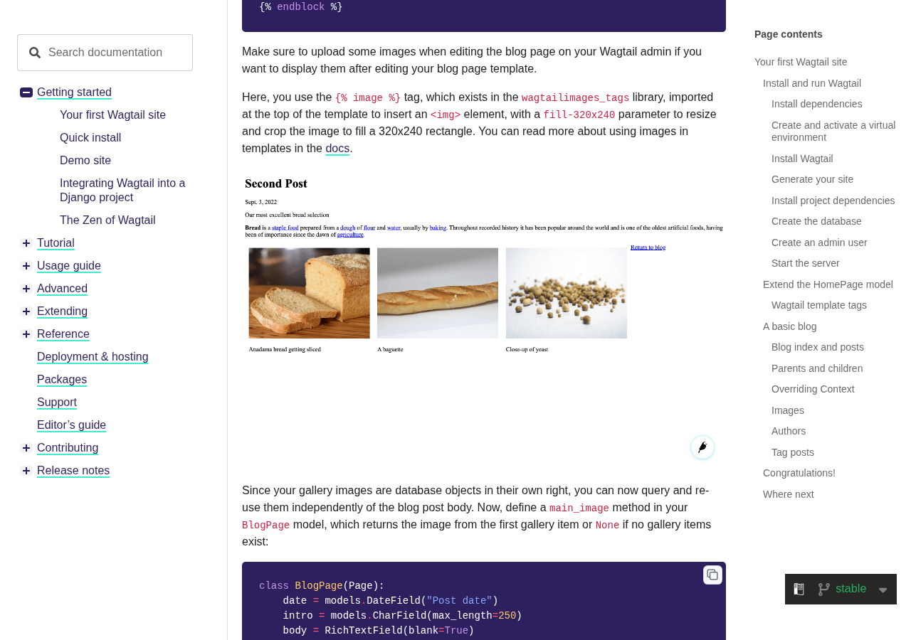

# docs.wagtail.org: sustainability audit

## At a glance

- **15.4/100** — scoped audit score 4 passing, 2 with problems, 20 needing more evidence.
- **9 pages** reviewed 1 visitor journey; public-site evidence.
- **26 of 71 guideline groups** scored 43 untested; 2 not applicable. Tests cover selected aspects of each guideline.

This audit sampled nine public English pages in Wagtail’s stable documentation and a responsive-image search task. Strengths include consistent navigation, compression, caching and release-linked maintenance: Wagtail 8.0 notes report removing deprecated USE_L10N guidance. The clearest repair is theme handling: the homepage and tutorial honor an existing device dark-mode preference when opened, but do not follow a change while already open.

Network interruptions and security challenges limit conclusions. Eight initial visits reached intended pages; one returned HTTP 429, and all transfer totals are incomplete. The low scoped score includes unknowns and is not an overall quality grade. Four contextual checks cover selected public evidence about documentation structure, anonymous access, release maintenance and host goals.

## Results by WSG area

<table>
<caption>Selected checks by WSG area</caption>
<thead><tr><th scope="col">Area</th><th scope="col">Passing</th><th scope="col">Guideline groups checked</th><th scope="col">Needs evidence</th></tr></thead>
<tbody>
<tr><th scope="row"><a href="#findings-2">User experience design</a></th><td>8% (1/12)</td><td>12 of 17</td><td>11</td></tr>
<tr><th scope="row"><a href="#findings-3">Web development</a></th><td>0% (0/8)</td><td>8 of 16</td><td>6</td></tr>
<tr><th scope="row"><a href="#findings-4">Hosting, infrastructure and systems</a></th><td>67% (2/3)</td><td>3 of 12</td><td>1</td></tr>
<tr><th scope="row"><a href="#findings-5">Business strategy and product management</a></th><td>33% (1/3)</td><td>3 of 26</td><td>2</td></tr>
</tbody></table>

Passing percentages apply to the selected checks. Full-guideline conformance has not been established.

## Page measurements

<table>
<caption>Page measurements</caption>
<thead><tr><th scope="col">Page</th><th scope="col"><a href="#measure-first-load">First load</a></th><th scope="col"><a href="#measure-after-choice">After waiting</a></th><th scope="col"><a href="#measure-scroll">After scrolling</a></th><th scope="col"><a href="#measure-carbon">Estimated footprint</a></th><th scope="col"><a href="#measure-carbon">Carbon rating</a></th><th scope="col"><a href="#measure-energy">Browser energy</a></th><th scope="col"><a href="#measure-energy">Network energy</a></th></tr></thead>
<tbody>
<tr><th scope="row"><a href="https://docs.wagtail.org/en/stable/">Welcome to Wagtail’s documentation</a></th><td>660.8 kB · <a href="#measure-completeness">partial</a></td><td>660.8 kB · <a href="#measure-completeness">partial</a></td><td>660.8 kB · <a href="#measure-completeness">partial</a></td><td>Withheld</td><td>Withheld</td><td>14.11 mWh</td><td>8.08 mWh</td></tr>
<tr><th scope="row"><a href="https://docs.wagtail.org/en/stable/getting_started/tutorial.html">Your first Wagtail site</a></th><td>1.282 MB · <a href="#measure-completeness">partial</a></td><td>1.282 MB · <a href="#measure-completeness">partial</a></td><td>1.282 MB · <a href="#measure-completeness">partial</a></td><td>Withheld</td><td>Withheld</td><td>15.07 mWh</td><td>15.24 mWh</td></tr>
<tr><th scope="row"><a href="https://docs.wagtail.org/en/stable/topics/images.html">How to use images in templates</a></th><td>2.155 MB · <a href="#measure-completeness">partial</a></td><td>2.155 MB · <a href="#measure-completeness">partial</a></td><td>2.155 MB · <a href="#measure-completeness">partial</a></td><td>Withheld</td><td>Withheld</td><td>13.02 mWh</td><td>25.43 mWh</td></tr>
<tr><th scope="row"><a href="https://docs.wagtail.org/en/stable/reference/pages/queryset_reference.html">Page QuerySet reference</a></th><td>663.3 kB · <a href="#measure-completeness">partial</a></td><td>663.3 kB · <a href="#measure-completeness">partial</a></td><td>663.3 kB · <a href="#measure-completeness">partial</a></td><td>Withheld</td><td>Withheld</td><td>Not sampled</td><td>Not sampled</td></tr>
<tr><th scope="row"><a href="https://docs.wagtail.org/en/stable/search.html?q=images">Search</a></th><td>3.257 MB · <a href="#measure-completeness">partial</a></td><td>3.257 MB · <a href="#measure-completeness">partial</a></td><td>3.257 MB · <a href="#measure-completeness">partial</a></td><td>Withheld</td><td>Withheld</td><td>Not sampled</td><td>Not sampled</td></tr>
<tr><th scope="row"><a href="https://docs.wagtail.org/en/stable/advanced_topics/performance.html">Performance</a></th><td>269.1 kB · <a href="#measure-completeness">partial</a></td><td>269.1 kB · <a href="#measure-completeness">partial</a></td><td>269.1 kB · <a href="#measure-completeness">partial</a></td><td>Withheld</td><td>Withheld</td><td>Not sampled</td><td>Not sampled</td></tr>
<tr><th scope="row"><a href="https://docs.wagtail.org/en/stable/advanced_topics/sustainability_considerations.html">Sustainability considerations</a></th><td>75.0 kB · <a href="#measure-completeness">partial</a></td><td>75.0 kB · <a href="#measure-completeness">partial</a></td><td>75.0 kB · <a href="#measure-completeness">partial</a></td><td>Withheld</td><td>Withheld</td><td>Not sampled</td><td>Not sampled</td></tr>
<tr><th scope="row"><a href="https://docs.wagtail.org/en/stable/contributing/documentation_guidelines.html">Just a moment...</a></th><td>Unavailable (HTTP 429)</td><td>Unavailable (HTTP 429)</td><td>Unavailable (HTTP 429)</td><td>Withheld</td><td>Withheld</td><td>Not sampled</td><td>Not sampled</td></tr>
<tr><th scope="row"><a href="https://docs.wagtail.org/en/stable/releases/8.0.html">Wagtail 8.0 release notes</a></th><td>666.3 kB · <a href="#measure-completeness">partial</a></td><td>666.3 kB · <a href="#measure-completeness">partial</a></td><td>666.3 kB · <a href="#measure-completeness">partial</a></td><td>Withheld</td><td>Withheld</td><td>Not sampled</td><td>Not sampled</td></tr>
</tbody></table>

## Estimated annual footprint

The SWDM scenario uses **8 successfully loaded pages**. Failed page loads were excluded from this estimate; [the methodology lists the exclusions](#measure-annual).

A traffic scenario of **572,851 pageviews/year** gives the estimates below. These are alternative views of overlapping activity, so they should not be added together.

<table>
<caption>Annual footprint and improvement scale</caption>
<thead><tr><th scope="col">Scope</th><th scope="col"><a href="#measure-annual">Annual estimate</a></th><th scope="col"><a href="#measure-annual-savings">If per-view impact fell by 10%</a></th></tr></thead>
<tbody>
<tr><th scope="row">Site browsing · SWDM v4 · partial transfers</th><td>95.81 kgCO₂e/year</td><td>9.58 kgCO₂e/year less</td></tr>
<tr><th scope="row">Client electricity · GreenFrame scenarios</th><td>8.06 kWh/year</td><td>0.81 kWh/year less</td></tr>
<tr><th scope="row">Client operational emissions · assumed electricity mix</th><td>3.98 kgCO₂e/year</td><td>0.40 kgCO₂e/year less</td></tr>
</tbody></table>

The 10% column shows the scale of a hypothetical improvement, not a predicted saving from the findings below.

## Priorities

### 1. Apply device theme changes while documentation stays open

**Medium priority** · Problem found · <a class="audit-guideline" href="https://www.w3.org/TR/web-sustainability-guidelines/#use-media-queries-that-support-sustainability-goals" title="Support user preferences via media queries for color, motion, contrast, data use, and related settings to improve accessibility and efficiency.">WSG 3.9: Use media queries that support sustainability goals</a>

**What we found.** The homepage and tutorial open in dark mode when the device already uses it. Changing the device from light to dark while either page is open leaves the page background white in the observed tests.

**Why it matters.** Readers who change their device theme during a session do not get the same behavior as readers who open the page afterward. The finding establishes a preference mismatch, without quantifying an energy saving.

**Next step.** Update theme handling so an open page follows device changes unless the reader has made a manual choice. Verify both directions without reloading, preserving readable text and the reader’s manual setting.

[How we checked this: Apply device theme changes while documentation stays open](#evidence-preference-behavior)

### 2. Resolve the differing search outcomes before choosing a fix

**Medium priority** · Needs investigation · <a class="audit-guideline" href="https://www.w3.org/TR/web-sustainability-guidelines/#design-efficient-and-streamlined-user-journeys" title="Design clear, efficient journeys that help users complete tasks and find content with minimal effort.">WSG 2.4: Design efficient and streamlined user journeys</a>

**What we found.** The setup walkthrough used embedded search to reach the responsive-image guide. The later measured attempt reached the separate search page and ended at a Cloudflare security challenge. A separate search-page visit succeeded; the reason for the different routes is unknown.

**Why it matters.** Finding the right guide is a central documentation task. These observations leave its reliability and normal resource use unresolved, rather than establishing a persistent search defect.

**Next step.** Repeat the same anonymous desktop task after search is ready, recording the results panel, any separate search page and any challenge. Use the observed cause and repeatable completion to decide whether a site change is needed.

[How we checked this: Resolve the differing search outcomes before choosing a fix](#evidence-journeys)

### 3. Validate smaller or deferred tutorial screenshots

**Medium priority** · Needs investigation · <a class="audit-guideline" href="https://www.w3.org/TR/web-sustainability-guidelines/#optimize-media-to-reduce-resource-use" title="Include media only when it supports user needs. Manage, optimize, and load media efficiently. Ensure users have control over playback and data use.">WSG 2.9: Optimize media to reduce resource use</a>

**What we found.** The tutorial’s detailed screenshots explain the task and are already served as WebP despite .png filenames. Several 1280-pixel screenshots display at about 680 pixels on desktop, with later examples below the first screenful and no explicit deferred loading. The largest observed screenshot transfer was about 205 kB.

**Why it matters.** Images contribute to the tutorial’s downloads, but smaller versions must still show the interface details readers need. The audit has not established safe size reductions or savings from loading later images on demand.

**Next step.** Compare the largest examples at desktop and narrow sizes and intended screen densities. Only if the details remain legible, test responsive image sizes and deferred loading below the first screenful, then measure transfer through the full reading task.

<figure class="audit-illustration" markdown="1">

<figcaption>The tutorial illustrates image renditions with a detailed example page.</figcaption>
</figure>

[How we checked this: Validate smaller or deferred tutorial screenshots](#evidence-media-delivery)

### 4. Separate documentation-host goals from CMS sustainability advice

**Low priority** · Needs investigation · <a class="audit-guideline" href="https://www.w3.org/TR/web-sustainability-guidelines/#define-clear-organizational-sustainability-goals-and-metrics" title="Define measurable sustainability goals and metrics, and communicate progress over time.">WSG 5.6: Define clear organizational sustainability goals and metrics</a>

**What we found.** The public sustainability guide gives useful methods for Wagtail-powered projects and describes CMS work. It does not establish docs.wagtail.org-specific goals, a comparable baseline or dated progress within the captured scope.

**Why it matters.** Readers need a clear service boundary to understand what a sustainability claim covers. Advice about websites built with Wagtail cannot establish the documentation host’s own results.

**Next step.** If publishing host performance, state a documentation-service metric, boundary and target period, with a dated baseline and comparable progress. Explain method changes and link supporting evidence.

[How we checked this: Separate documentation-host goals from CMS sustainability advice](#evidence-sustainability-goals)

## Further checks

These outcomes apply to the selected checks and sample. Open a check's explanation for the observation, limitations and useful follow-up.

??? note "Browse all check outcomes"

    

    <table>
    <caption>All selected check outcomes</caption>
    <thead><tr><th scope="col">Check</th><th scope="col">Outcome</th></tr></thead>
    <tbody>
    <tr><th scope="row"><a href="#evidence-distraction">Check interruptions on the remaining pages</a></th><td>❓ Needs investigation</td></tr>
    <tr><th scope="row"><a href="#evidence-choice">No consequential accept or reject choice was observed</a></th><td>➖ Not relevant here</td></tr>
    <tr><th scope="row"><a href="#evidence-comprehension">Check the remaining articles with their intended readers</a></th><td>❓ Needs investigation</td></tr>
    <tr><th scope="row"><a href="#evidence-consistency">Keep navigation names consistent as the documentation grows</a></th><td>✅ Passed this check</td></tr>
    <tr><th scope="row"><a href="#evidence-motion">Check motion during complete reading tasks</a></th><td>❓ Needs investigation</td></tr>
    <tr><th scope="row"><a href="#evidence-notifications">Check alerts beyond the captured reading states</a></th><td>❓ Needs investigation</td></tr>
    <tr><th scope="row"><a href="#evidence-documents">Inspect a complete tutorial print preview</a></th><td>❓ Needs investigation</td></tr>
    <tr><th scope="row"><a href="#evidence-unused-code">Check script use through search and navigation before removing code</a></th><td>❓ Needs investigation</td></tr>
    <tr><th scope="row"><a href="#evidence-components">Check which documentation tools can load later</a></th><td>❓ Needs investigation</td></tr>
    <tr><th scope="row"><a href="#evidence-layout">Exercise the narrow-screen menu and reading content</a></th><td>❓ Needs investigation</td></tr>
    <tr><th scope="row"><a href="#evidence-impact-choice">No resource-intensive visitor choice was established</a></th><td>➖ Not relevant here</td></tr>
    <tr><th scope="row"><a href="#evidence-journeys">Check why the two search visits took different routes</a></th><td>❓ Needs investigation</td></tr>
    <tr><th scope="row"><a href="#evidence-media-delivery">Test smaller or deferred tutorial screenshots for readability</a></th><td>❓ Needs investigation</td></tr>
    <tr><th scope="row"><a href="#evidence-font-delivery">Check whether icon controls remain clear when fonts fail</a></th><td>❓ Needs investigation</td></tr>
    <tr><th scope="row"><a href="#evidence-semantic-forms">Check names and structure on the remaining normal pages</a></th><td>❓ Needs investigation</td></tr>
    <tr><th scope="row"><a href="#evidence-metadata">Clarify which versioned page should be preferred in search results</a></th><td>❓ Needs investigation</td></tr>
    <tr><th scope="row"><a href="#evidence-preference-behavior">Apply device theme changes while the page stays open</a></th><td>❌ Problem found</td></tr>
    <tr><th scope="row"><a href="#evidence-no-js-content">Complete the reading check with JavaScript disabled</a></th><td>❓ Needs investigation</td></tr>
    <tr><th scope="row"><a href="#evidence-api-requests">Check background requests through a successful search task</a></th><td>❓ Needs investigation</td></tr>
    <tr><th scope="row"><a href="#evidence-public-cache-policy">Retain the sampled public caching policies</a></th><td>✅ Passed this check</td></tr>
    <tr><th scope="row"><a href="#evidence-text-compression">Retain compressed delivery of text assets</a></th><td>✅ Passed this check</td></tr>
    <tr><th scope="row"><a href="#evidence-keyboard-path">Verify the visible focus path through embedded search</a></th><td>❓ Needs investigation</td></tr>
    <tr><th scope="row"><a href="#evidence-disclosure-scope">Connect sustainability information to this documentation service</a></th><td>❓ Needs investigation</td></tr>
    <tr><th scope="row"><a href="#evidence-carbon-discovery">Consider a discoverable carbon.txt for the documentation host</a></th><td>❌ Problem found</td></tr>
    <tr><th scope="row"><a href="#evidence-hosting-evidence">Verify hosting evidence before making a green-hosting claim</a></th><td>❓ Needs investigation</td></tr>
    <tr><th scope="row"><a href="#evidence-audience-needs">Connect the four documentation modes to a reader-research example</a></th><td>❓ Needs investigation</td></tr>
    <tr><th scope="row"><a href="#evidence-access-barriers">Confirm repeatable anonymous access to the image guide</a></th><td>❓ Needs investigation</td></tr>
    <tr><th scope="row"><a href="#evidence-content-lifecycle">Keep release-linked maintenance and useful historical guidance</a></th><td>✅ Passed this check</td></tr>
    <tr><th scope="row"><a href="#evidence-sustainability-goals">Distinguish host goals from advice for Wagtail projects</a></th><td>❓ Needs investigation</td></tr>
    </tbody></table>

## Next steps for auditing

1. Coverage comprises selected aspects of 26 of 71 WSG guideline groups, without establishing full criteria or STAR conformance. Extend it first through the missing public tasks below, then through further contextual records.
2. First verify and repair live theme changes on the homepage and tutorial, including both device-theme directions and a reader’s manual choice.
3. Next repeat the public search-to-image-guide task after search is ready. Capture the different search routes and any security challenge, then revisit interrupted pages for complete initial transfers and matching feature comparisons.
4. Complete public keyboard and narrow-screen tasks, no-JavaScript reading comparisons and a tutorial print preview. Test screenshot legibility before trying smaller responsive images or deferred loading; measure the resulting complete task.
5. Follow successful search and version navigation before investigating script removal, later component loading or background-request changes. Initial activity alone does not show what can safely be removed.
6. Then review public documentation-service disclosures and hosting evidence. Optional owner records can resolve the selected reader-research decision, wider editorial review practice or host goals and progress; source access is not required to begin these follow-ups.

The sample covers selected pages and visitor tasks, not every page on the site. Expand it where the checks above identify an untested template, interaction or audience need.

## Detailed findings

This appendix explains the evidence in ordinary language. This audit used public-site evidence without a source checkout. Unavailable documents or internal records do not establish that the organization has none.

### User experience design {#findings-2}

<h4 id="evidence-distraction">Check interruptions on the remaining pages</h4>

**Needs investigation** · <a class="audit-guideline" href="https://www.w3.org/TR/web-sustainability-guidelines/#design-to-assist-and-not-to-distract" title="Give users control over notifications and focus, prioritize task-relevant content, and avoid designs that distract or unnecessarily extend engagement.">WSG 2.5: Design to assist and not to distract</a>

_Give users control over notifications and focus, prioritize task-relevant content, and avoid designs that distract or unnecessarily extend engagement._

The homepage, tutorial and sustainability page allowed quiet reading in the observed states, without overlays or autoplay. Other sampled pages could not all be checked in their normal reading state.

**Next step:** Revisit the missing normal pages and follow their reading and search tasks, recording any interruption and whether it helps the reader.

**Where we looked:**

- Browser observations for [Stable](https://docs.wagtail.org/en/stable/).
- Browser observations for [Tutorial.html](https://docs.wagtail.org/en/stable/getting_started/tutorial.html).
- Browser observations for [Sustainability_considerations.html](https://docs.wagtail.org/en/stable/advanced_topics/sustainability_considerations.html).
- Recorded visitor task starting at [Stable](https://docs.wagtail.org/en/stable/).

<h4 id="evidence-choice">No consequential accept or reject choice was observed</h4>

**Not relevant here** · <a class="audit-guideline" href="https://www.w3.org/TR/web-sustainability-guidelines/#avoid-being-manipulative-or-deceptive" title="Avoid deceptive patterns, clearly label ads, respect consent for tracking, and ensure search, sharing, and discoverability practices prioritize user needs over optimization or manipulation.">WSG 2.6: Avoid being manipulative or deceptive</a>

_Avoid deceptive patterns, clearly label ads, respect consent for tracking, and ensure search, sharing, and discoverability practices prioritize user needs over optimization or manipulation._

The captured reading and search route did not present consent, purchase or subscription decisions. Navigation and the theme control do not make this check applicable.

**Next step:** Review wording, defaults and visual prominence if a consequential choice is added to this route.

**Where we looked:**

- Browser observations for [Stable](https://docs.wagtail.org/en/stable/).
- Browser observations for [Tutorial.html](https://docs.wagtail.org/en/stable/getting_started/tutorial.html).
- Recorded visitor task starting at [Stable](https://docs.wagtail.org/en/stable/).

<h4 id="evidence-comprehension">Check the remaining articles with their intended readers</h4>

**Needs investigation** · <a class="audit-guideline" href="https://www.w3.org/TR/web-sustainability-guidelines/#make-deliverables-understandable-and-reusable" title="Create discoverable, maintainable, and reusable documentation and code resources that support long-term understanding, reuse, and sustainability.">WSG 2.7: Make deliverables understandable and reusable</a>

_Create discoverable, maintainable, and reusable documentation and code resources that support long-term understanding, reuse, and sustainability._

The homepage names useful starting points, the tutorial gives ordered steps, and the responsive-image guide explains its examples. Several other article observations were missing or interrupted, and no reader study was supplied.

**Next step:** First read the remaining sampled articles in normal conditions. For a broader comprehension judgment, ask newcomers to complete a documentation task and explain the result in their own words.

**Where we looked:**

- Browser observations for [Stable](https://docs.wagtail.org/en/stable/).
- Browser observations for [Tutorial.html](https://docs.wagtail.org/en/stable/getting_started/tutorial.html).
- Recorded visitor task starting at [Stable](https://docs.wagtail.org/en/stable/).
- Captured public evidence for [Documentation_modes.html](https://docs.wagtail.org/en/stable/contributing/documentation_modes.html).

<h4 id="evidence-consistency">Keep navigation names consistent as the documentation grows</h4>

**Passed this check** · <a class="audit-guideline" href="https://www.w3.org/TR/web-sustainability-guidelines/#use-a-design-system-for-interface-consistency" title="Use design systems and established patterns to ensure consistent, efficient, and sustainable interfaces through reusable components and clear maintenance practices.">WSG 2.8: Use a design system for interface consistency</a>

_Use design systems and established patterns to ensure consistent, efficient, and sustainable interfaces through reusable components and clear maintenance practices._

The sampled documentation repeats names such as Getting started, Tutorial, Usage guide and Reference, alongside consistent breadcrumb, theme and source controls. This supports naming consistency in the sample.

**Next step:** Use these established names when adding a new section or interactive control, and compare it with the existing navigation.

**Where we looked:**

- Browser observations for [Stable](https://docs.wagtail.org/en/stable/).
- Browser observations for [Tutorial.html](https://docs.wagtail.org/en/stable/getting_started/tutorial.html).
- Browser observations for [Sustainability_considerations.html](https://docs.wagtail.org/en/stable/advanced_topics/sustainability_considerations.html).
- Captured public evidence for [Images.html](https://docs.wagtail.org/en/stable/topics/images.html).
- Captured public evidence for [Queryset_reference.html](https://docs.wagtail.org/en/stable/reference/pages/queryset_reference.html).
- Captured public evidence for [Performance.html](https://docs.wagtail.org/en/stable/advanced_topics/performance.html).
- Browser observations for [Documentation_guidelines.html](https://docs.wagtail.org/en/stable/contributing/documentation_guidelines.html).
- Captured public evidence for [Search.html](https://docs.wagtail.org/en/stable/search.html?q=images).
- Captured public evidence for [8.0.html](https://docs.wagtail.org/en/stable/releases/8.0.html).

<h4 id="evidence-motion">Check motion during complete reading tasks</h4>

**Needs investigation** · <a class="audit-guideline" href="https://www.w3.org/TR/web-sustainability-guidelines/#ensure-animation-is-proportionate-and-easy-to-control" title="Use animation sparingly and efficiently, only when it supports understanding, while limiting performance impact and giving users control over motion.">WSG 2.10: Ensure animation is proportionate and easy to control</a>

_Use animation sparingly and efficiently, only when it supports understanding, while limiting performance impact and giving users control over motion._

No active animation or media playback appeared in the normal homepage, tutorial and sustainability observations, including reduced-motion settings. Missing normal states and later interactions leave the wider sample unresolved.

**Next step:** Complete the missing page observations and exercise any moving content. Check its purpose and controls, including with the device set to reduce motion.

**Where we looked:**

- Browser observations for [Stable](https://docs.wagtail.org/en/stable/).
- Browser observations for [Tutorial.html](https://docs.wagtail.org/en/stable/getting_started/tutorial.html).
- Browser observations for [Sustainability_considerations.html](https://docs.wagtail.org/en/stable/advanced_topics/sustainability_considerations.html).

<h4 id="evidence-notifications">Check alerts beyond the captured reading states</h4>

**Needs investigation** · <a class="audit-guideline" href="https://www.w3.org/TR/web-sustainability-guidelines/#avoid-unwanted-notifications" title="Send only user-requested notifications and provide clear, accessible controls for managing preferences, opt-in, and account and contact settings.">WSG 2.12: Avoid unwanted notifications</a>

_Send only user-requested notifications and provide clear, accessible controls for managing preferences, opt-in, and account and contact settings._

No notification permission request or unsolicited alert was recorded on the clean reading pages. Browser permission was already denied, and several other page states were unavailable.

**Next step:** Check the remaining normal pages and complete tasks with notification permission initially undecided, recording any request and its value to the reader.

**Where we looked:**

- Browser observations for [Stable](https://docs.wagtail.org/en/stable/).
- Browser observations for [Tutorial.html](https://docs.wagtail.org/en/stable/getting_started/tutorial.html).
- Browser observations for [Sustainability_considerations.html](https://docs.wagtail.org/en/stable/advanced_topics/sustainability_considerations.html).

<h4 id="evidence-documents">Inspect a complete tutorial print preview</h4>

**Needs investigation** · <a class="audit-guideline" href="https://www.w3.org/TR/web-sustainability-guidelines/#reduce-the-impact-of-downloadable-and-physical-documents" title="Reduce paper use through digital-first workflows, optimize and reuse accessible downloadable documents, and provide clear, user-controlled document previews and formats.">WSG 2.13: Reduce the impact of downloadable and physical documents</a>

_Reduce paper use through digital-first workflows, optimize and reuse accessible downloadable documents, and provide clear, user-controlled document previews and formats._

Print observations retained the reading text and tutorial illustrations, with several navigation regions still visible. Without a paginated preview, the audit cannot judge clipping or avoidable printed pages.

**Next step:** Preview the full tutorial for printing and check page count, repeated navigation, code clipping and illustration readability before changing print styles.

**Where we looked:**

- Browser observations for [Stable](https://docs.wagtail.org/en/stable/).
- Browser observations for [Tutorial.html](https://docs.wagtail.org/en/stable/getting_started/tutorial.html).
- Browser observations for [Sustainability_considerations.html](https://docs.wagtail.org/en/stable/advanced_topics/sustainability_considerations.html).

<h4 id="evidence-journeys">Check why the two search visits took different routes</h4>

**Needs investigation** · <a class="audit-guideline" href="https://www.w3.org/TR/web-sustainability-guidelines/#design-efficient-and-streamlined-user-journeys" title="Design clear, efficient journeys that help users complete tasks and find content with minimal effort.">WSG 2.4: Design efficient and streamlined user journeys</a>

_Design clear, efficient journeys that help users complete tasks and find content with minimal effort._

The setup walkthrough reached the responsive-image guide through embedded search. The later measured attempt instead reached the separate search page and ended at a security challenge; a separately loaded search page also succeeded. The cause remains unknown.

**Next step:** Repeat the same search after its controls are ready. Record embedded results, any separate search page and security challenge, then establish reliable completion before prescribing a site change.

**Where we looked:**

- Browser observations for [Stable](https://docs.wagtail.org/en/stable/).
- Recorded visitor task starting at [Stable](https://docs.wagtail.org/en/stable/).
- Captured public evidence for [Search.html](https://docs.wagtail.org/en/stable/search.html?q=images).

<h4 id="evidence-media-delivery">Test smaller or deferred tutorial screenshots for readability</h4>

**Needs investigation** · <a class="audit-guideline" href="https://www.w3.org/TR/web-sustainability-guidelines/#optimize-media-to-reduce-resource-use" title="Include media only when it supports user needs. Manage, optimize, and load media efficiently. Ensure users have control over playback and data use.">WSG 2.9: Optimize media to reduce resource use</a>

_Include media only when it supports user needs. Manage, optimize, and load media efficiently. Ensure users have control over playback and data use._

The tutorial uses useful screenshots with descriptive alternative text. They are already delivered as WebP, although their filenames end in .png. Several large screenshots appear below the first screenful without explicitly deferred loading; safe smaller versions and transfer savings have not been established.

**Next step:** Compare the largest screenshots at desktop and narrow sizes, including high-density screens. If details stay legible, test responsive image sizes and deferred loading for later examples, then measure the complete page again.

**Where we looked:**

- Browser observations for [Tutorial.html](https://docs.wagtail.org/en/stable/getting_started/tutorial.html).
- Captured public evidence for [Tutorial.html](https://docs.wagtail.org/en/stable/getting_started/tutorial.html).
- Captured public evidence for [Documentation_guidelines.html](https://docs.wagtail.org/en/stable/contributing/documentation_guidelines.html).

<h4 id="evidence-font-delivery">Check whether icon controls remain clear when fonts fail</h4>

**Needs investigation** · <a class="audit-guideline" href="https://www.w3.org/TR/web-sustainability-guidelines/#use-optimized-web-typography" title="Use font strategies that minimize downloads and complexity while supporting required languages and dynamic content.">WSG 2.11: Use optimized web typography</a>

_Use font strategies that minimize downloads and complexity while supporting required languages and dynamic content._

Reading text uses system fonts. Two downloaded icon-font variants also load, but the audit did not test whether search, theme, menu and source controls remain understandable if those fonts are unavailable.

**Next step:** Block the icon fonts and inspect those controls. Identify the icons actually needed before considering a smaller font or replacement.

**Where we looked:**

- Browser observations for [Stable](https://docs.wagtail.org/en/stable/).
- Browser observations for [Tutorial.html](https://docs.wagtail.org/en/stable/getting_started/tutorial.html).
- Captured public evidence for [Tutorial.html](https://docs.wagtail.org/en/stable/getting_started/tutorial.html).

<h4 id="evidence-no-js-content">Complete the reading check with JavaScript disabled</h4>

**Needs investigation** · <a class="audit-guideline" href="https://www.w3.org/TR/web-sustainability-guidelines/#provide-cross-platform-compatibility-support" title="Document compatibility, avoid unnecessary obsolescence, and test across devices, systems, and network conditions.">WSG 2.17: Provide cross-platform compatibility support</a>

_Document compatibility, avoid unnecessary obsolescence, and test across devices, systems, and network conditions._

Core text and navigation remained available without JavaScript on the homepage, tutorial, reference, documentation-guidelines and release pages. Security challenges and a failed image-guide visit prevented matching comparisons across the full sample.

**Next step:** Obtain normal reading pages with and without JavaScript for the unresolved articles, then compare their main content and navigation. Test search separately.

**Where we looked:**

- Browser observations for [Stable](https://docs.wagtail.org/en/stable/).
- Browser observations for [Tutorial.html](https://docs.wagtail.org/en/stable/getting_started/tutorial.html).
- Browser observations for [Queryset_reference.html](https://docs.wagtail.org/en/stable/reference/pages/queryset_reference.html).
- Browser observations for [Sustainability_considerations.html](https://docs.wagtail.org/en/stable/advanced_topics/sustainability_considerations.html).
- Browser observations for [Documentation_guidelines.html](https://docs.wagtail.org/en/stable/contributing/documentation_guidelines.html).
- Browser observations for [8.0.html](https://docs.wagtail.org/en/stable/releases/8.0.html).

<h4 id="evidence-disclosure-scope">Connect sustainability information to this documentation service</h4>

**Needs investigation** · <a class="audit-guideline" href="https://www.w3.org/TR/web-sustainability-guidelines/#identify-assess-disclose-review-and-mitigate-sustainability-impacts" title="Assess and report the planet, people, and prosperity impacts of digital projects, and plan measurable reductions to the real-world effects of their activity.">WSG 2.1: Identify, assess, disclose, review, and mitigate sustainability impacts</a>

_Assess and report the planet, people, and prosperity impacts of digital projects, and plan measurable reductions to the real-world effects of their activity._

The sustainability guide offers methods and advice for Wagtail-powered projects. The captured public information did not establish which impacts and mitigation apply specifically to docs.wagtail.org; it does not prove that no relevant policy exists elsewhere.

**Next step:** If communicating this service’s sustainability, link a statement that identifies the documentation host, the impacts it covers and the actions taken.

**Where we looked:**

- Captured public evidence for [Sustainability_considerations.html](https://docs.wagtail.org/en/stable/advanced_topics/sustainability_considerations.html).
- Disclosure discovery for the origin `https://docs.wagtail.org`.

<h4 id="evidence-audience-needs">Connect the four documentation modes to a reader-research example</h4>

**Needs investigation** · <a class="audit-guideline" href="https://www.w3.org/TR/web-sustainability-guidelines/#understand-user-requirements-or-constraints" title="Identify and involve users and affected communities, and research their needs.">WSG 2.2: Understand user requirements or constraints</a>

_Identify and involve users and affected communities, and research their needs._

The public policy explains tutorial, how-to, reference and explanation modes and their intended reader needs. Within this selected decision, no record showed how reader involvement informed or confirmed the structure; research may exist outside the sample.

**Next step:** Look for one public research-to-decision example. If none is public, an optional owner-supplied record can identify the readers, constraints, findings and resulting decision without requiring repository access.

**Assessed scope:** The current public decision to organize Wagtail developer documentation into tutorial, how-to, reference and explanation modes: inspect audience rationale and public evidence that user research informed or validated that decision. No internal research or representative-user testing records supplied.

**Where we looked:**

- Captured public evidence for [Documentation_modes.html](https://docs.wagtail.org/en/stable/contributing/documentation_modes.html).

### Web development {#findings-3}

<h4 id="evidence-unused-code">Check script use through search and navigation before removing code</h4>

**Needs investigation** · <a class="audit-guideline" href="https://www.w3.org/TR/web-sustainability-guidelines/#minify-and-remove-unused-code" title="Minify code and data, and remove unused characters to reduce file size and improve loading efficiency and maintainability.">WSG 3.2: Minify and remove unused code</a>

_Minify code and data, and remove unused characters to reduce file size and improve loading efficiency and maintainability._

Some script and style code was unused shortly after the homepage and tutorial opened. Search, version navigation and later interactions were not fully covered, so this does not identify code that is safe to remove.

**Next step:** Record script use through successful search, version selection, menus and copy controls. Investigate only code still unused across these tasks.

**Where we looked:**

- Browser observations for [Stable](https://docs.wagtail.org/en/stable/).
- Browser observations for [Tutorial.html](https://docs.wagtail.org/en/stable/getting_started/tutorial.html).
- Captured public evidence for [Stable](https://docs.wagtail.org/en/stable/).

<h4 id="evidence-components">Check which documentation tools can load later</h4>

**Needs investigation** · <a class="audit-guideline" href="https://www.w3.org/TR/web-sustainability-guidelines/#modularize-bandwidth-heavy-components" title="Split large components into smaller, on-demand modules to improve loading efficiency while balancing maintainability and caching performance.">WSG 3.3: Modularize bandwidth-heavy components</a>

_Split large components into smaller, on-demand modules to improve loading efficiency while balancing maintainability and caching performance._

Read the Docs tools load when the page opens, including search-related code. The audit did not establish which parts could safely wait until the reader needs them.

**Next step:** Follow search and version navigation to identify what each tool needs. Try loading a component later only when its controls remain available and usable.

**Where we looked:**

- Captured public evidence for [Stable](https://docs.wagtail.org/en/stable/).
- Captured public evidence for [Tutorial.html](https://docs.wagtail.org/en/stable/getting_started/tutorial.html).
- Browser observations for [Stable](https://docs.wagtail.org/en/stable/).
- Recorded visitor task starting at [Stable](https://docs.wagtail.org/en/stable/).

<h4 id="evidence-layout">Exercise the narrow-screen menu and reading content</h4>

**Needs investigation** · <a class="audit-guideline" href="https://www.w3.org/TR/web-sustainability-guidelines/#ensure-layouts-work-for-different-devices-and-requirements" title="Use responsive, progressively enhanced, and carbon-aware design to ensure accessible, adaptable functionality across devices and interaction methods while managing resource use.">WSG 3.10: Ensure layouts work for different devices and requirements</a>

_Use responsive, progressively enhanced, and carbon-aware design to ensure accessible, adaptable functionality across devices and interaction methods while managing resource use._

The homepage, tutorial and sustainability page retained their headings without horizontal page overflow at the observed desktop and narrow widths. The narrow menu was not exercised, and several other page observations met security challenges.

**Next step:** On clean pages, open the narrow menu, search, and read wide code examples and images. Complete one real mobile documentation task before extending the compatibility claim.

**Where we looked:**

- Browser observations for [Stable](https://docs.wagtail.org/en/stable/).
- Browser observations for [Tutorial.html](https://docs.wagtail.org/en/stable/getting_started/tutorial.html).
- Browser observations for [Sustainability_considerations.html](https://docs.wagtail.org/en/stable/advanced_topics/sustainability_considerations.html).

<h4 id="evidence-semantic-forms">Check names and structure on the remaining normal pages</h4>

**Needs investigation** · <a class="audit-guideline" href="https://www.w3.org/TR/web-sustainability-guidelines/#ensure-code-follows-good-semantic-practices" title="Use standards-compliant HTML and web platform features, and avoid unnecessary complexity or non-standard code.">WSG 3.6: Ensure code follows good semantic practices</a>

_Use standards-compliant HTML and web platform features, and avoid unnecessary complexity or non-standard code._

The clean homepage, tutorial and sustainability page declare English, use a main reading region and have descriptive headings. Search, menu and copy controls have names. Comparable checks were unavailable on several other pages; this is not a complete accessibility assessment.

**Next step:** Check the actual documentation pages that were interrupted, including the names of controls inside embedded search. Follow up with task-based accessibility testing.

**Where we looked:**

- Browser observations for [Stable](https://docs.wagtail.org/en/stable/).
- Browser observations for [Tutorial.html](https://docs.wagtail.org/en/stable/getting_started/tutorial.html).
- Browser observations for [Sustainability_considerations.html](https://docs.wagtail.org/en/stable/advanced_topics/sustainability_considerations.html).
- Browser observations for [Images.html](https://docs.wagtail.org/en/stable/topics/images.html).
- Browser observations for [Documentation_guidelines.html](https://docs.wagtail.org/en/stable/contributing/documentation_guidelines.html).

<h4 id="evidence-metadata">Clarify which versioned page should be preferred in search results</h4>

**Needs investigation** · <a class="audit-guideline" href="https://www.w3.org/TR/web-sustainability-guidelines/#structure-metadata-for-machine-readability" title="Include essential document metadata and structured data to improve usability, accessibility, and machine readability.">WSG 3.8: Structure metadata for machine readability</a>

_Include essential document metadata and structured data to improve usability, accessibility, and machine readability._

Clean pages have descriptive titles including the documentation version. No preferred-page URL was declared in the captured metadata, but the intended relationship between stable and numbered versions was not established.

**Next step:** Decide how stable and numbered versions should appear in search results. Add preferred-page metadata only where it correctly identifies equivalent content, and check the remaining clean pages.

**Where we looked:**

- Browser observations for [Stable](https://docs.wagtail.org/en/stable/).
- Browser observations for [Tutorial.html](https://docs.wagtail.org/en/stable/getting_started/tutorial.html).
- Browser observations for [Sustainability_considerations.html](https://docs.wagtail.org/en/stable/advanced_topics/sustainability_considerations.html).
- Browser observations for [Documentation_guidelines.html](https://docs.wagtail.org/en/stable/contributing/documentation_guidelines.html).

<h4 id="evidence-preference-behavior">Apply device theme changes while the page stays open</h4>

**Problem found** · <a class="audit-guideline" href="https://www.w3.org/TR/web-sustainability-guidelines/#use-media-queries-that-support-sustainability-goals" title="Support user preferences via media queries for color, motion, contrast, data use, and related settings to improve accessibility and efficiency.">WSG 3.9: Use media queries that support sustainability goals</a>

_Support user preferences via media queries for color, motion, contrast, data use, and related settings to improve accessibility and efficiency._

The homepage and tutorial open in dark mode when the device already requests it. When the device changes from light to dark while either page remains open, the observed page keeps its white background.

**Next step:** Make open pages follow device theme changes when the reader has not chosen a manual theme. Verify light-to-dark and dark-to-light changes without reloading, while retaining readable content and any manual choice.

**Where we looked:**

- Browser observations for [Stable](https://docs.wagtail.org/en/stable/).
- Browser observations for [Tutorial.html](https://docs.wagtail.org/en/stable/getting_started/tutorial.html).

<h4 id="evidence-api-requests">Check background requests through a successful search task</h4>

**Needs investigation** · <a class="audit-guideline" href="https://www.w3.org/TR/web-sustainability-guidelines/#use-sustainable-javascript-and-apis" title="Write efficient JavaScript and use APIs that minimize processing, data use, and energy consumption.">WSG 3.11: Use sustainable JavaScript and APIs</a>

_Write efficient JavaScript and use APIs that minimize processing, data use, and energy consumption._

The homepage and tutorial initially requested tool settings and page analytics, without an observed repeating polling loop. The short observation and incomplete search task do not establish redundant requests or their server cost.

**Next step:** Follow a successful reading and search task, followed by a short idle period. Identify each background request and its reuse needs before proposing removal.

**Where we looked:**

- Browser observations for [Stable](https://docs.wagtail.org/en/stable/).
- Browser observations for [Tutorial.html](https://docs.wagtail.org/en/stable/getting_started/tutorial.html).
- Captured public evidence for [Stable](https://docs.wagtail.org/en/stable/).

<h4 id="evidence-keyboard-path">Verify the visible focus path through embedded search</h4>

**Needs investigation** · <a class="audit-guideline" href="https://www.w3.org/TR/web-sustainability-guidelines/#ensure-code-follows-good-semantic-practices" title="Use standards-compliant HTML and web platform features, and avoid unnecessary complexity or non-standard code.">WSG 3.6: Ensure code follows good semantic practices</a>

_Use standards-compliant HTML and web platform features, and avoid unnecessary complexity or non-standard code._

The first keyboard steps recorded the skip link and documentation link with a focus outline. Later observations could not identify the active control inside embedded search, so they do not establish its visible focus path or a keyboard trap.

**Next step:** Watch forward and reverse keyboard navigation, including the skip link, search and menu. Confirm the focused control is visible, named and operable at each step.

**Where we looked:**

- Browser observations for [Stable](https://docs.wagtail.org/en/stable/).
- Browser observations for [Tutorial.html](https://docs.wagtail.org/en/stable/getting_started/tutorial.html).

<h4 id="evidence-carbon-discovery">Consider a discoverable carbon.txt for the documentation host</h4>

**Problem found** · <a class="audit-guideline" href="https://www.w3.org/TR/web-sustainability-guidelines/#include-expected-and-beneficial-files" title="Include standard website metadata and configuration files to support discoverability, transparency, and operational best practices.">WSG 3.13: Include expected and beneficial files</a>

_Include standard website metadata and configuration files to support discoverability, transparency, and operational best practices._

The two standard carbon.txt locations returned 404, with no alternative location or delegation discovered. This is a limited discovery finding and says nothing about the host’s emissions or energy mix.

**Next step:** If this discovery mechanism is useful for the service, publish a valid file with accurate organization and hosting relationships, then verify its linked records.

**Where we looked:**

- Disclosure discovery for the origin `https://docs.wagtail.org`.

### Hosting, infrastructure and systems {#findings-4}

<h4 id="evidence-public-cache-policy">Retain the sampled public caching policies</h4>

**Passed this check** · <a class="audit-guideline" href="https://www.w3.org/TR/web-sustainability-guidelines/#optimize-caching-and-support-offline-access" title="Use caching and offline capabilities to reduce network load, improve resilience, and balance performance with sustainability.">WSG 4.2: Optimize caching and support offline access</a>

_Use caching and offline capabilities to reduce network load, improve resilience, and balance performance with sustainability._

Successful documentation responses allow public reuse and provide validation information for styles, scripts and media. These policies support caching, but the audit did not measure a return visit or offline reading.

**Next step:** Measure a repeat visit before claiming saved transfer. Extend reuse periods only where content versioning and updates remain reliable.

**Where we looked:**

- Captured public evidence for [Stable](https://docs.wagtail.org/en/stable/).
- Captured public evidence for [Tutorial.html](https://docs.wagtail.org/en/stable/getting_started/tutorial.html).
- Captured public evidence for [Images.html](https://docs.wagtail.org/en/stable/topics/images.html).

<h4 id="evidence-text-compression">Retain compressed delivery of text assets</h4>

**Passed this check** · <a class="audit-guideline" href="https://www.w3.org/TR/web-sustainability-guidelines/#reduce-data-transfer-with-compression" title="Compress server responses and media files to reduce bandwidth, storage use, and delivery overhead while balancing processing costs.">WSG 4.3: Reduce data transfer with compression</a>

_Compress server responses and media files to reduce bandwidth, storage use, and delivery overhead while balancing processing costs._

The sampled successful HTML and styles use gzip compression, while core scripts use Brotli and the larger Read the Docs script uses gzip. No specific compression repair is supported by these responses.

**Next step:** Recheck representative HTML, styles and scripts after a hosting or delivery-configuration change.

**Where we looked:**

- Captured public evidence for [Stable](https://docs.wagtail.org/en/stable/).
- Captured public evidence for [Tutorial.html](https://docs.wagtail.org/en/stable/getting_started/tutorial.html).
- Captured public evidence for [Images.html](https://docs.wagtail.org/en/stable/topics/images.html).

<h4 id="evidence-hosting-evidence">Verify hosting evidence before making a green-hosting claim</h4>

**Needs investigation** · <a class="audit-guideline" href="https://www.w3.org/TR/web-sustainability-guidelines/#use-sustainable-hosting" title="Select and manage infrastructure using sustainability metrics, prioritizing low-carbon energy use and low-impact hosting and domain choices in selection, and extending hardware lifespan and minimising emissions in management.">WSG 4.1: Use sustainable hosting</a>

_Select and manage infrastructure using sustainability metrics, prioritizing low-carbon energy use and low-impact hosting and domain choices in selection, and extending hardware lifespan and minimising emissions in management._

The captured records did not connect this origin to independently corroborated operational energy or emissions evidence. Read the Docs resource addresses and references to sustainability partnerships do not establish the hosting energy mix.

**Next step:** First look for public provider and service evidence tied to this origin. If needed, ask the owner for the service relationship and dated supporting operational evidence.

**Where we looked:**

- Disclosure discovery for the origin `https://docs.wagtail.org`.
- Captured public evidence for [Sustainability_considerations.html](https://docs.wagtail.org/en/stable/advanced_topics/sustainability_considerations.html).

### Business strategy and product management {#findings-5}

<h4 id="evidence-impact-choice">No resource-intensive visitor choice was established</h4>

**Not relevant here** · <a class="audit-guideline" href="https://www.w3.org/TR/web-sustainability-guidelines/#communicate-the-environmental-impact-of-user-choices" title="Empower users, allowing them to make decisions when their choices can influence the environmental impact they have.">WSG 5.4: Communicate the environmental impact of user choices</a>

_Empower users, allowing them to make decisions when their choices can influence the environmental impact they have._

Reading documentation and locating image guidance did not expose a choice such as media quality or a bulk download. The sample therefore does not establish a need for impact labels on visitor controls.

**Next step:** Reassess if a future task includes a consequential download, media-quality setting or hosted-environment activation.

**Where we looked:**

- Browser observations for [Stable](https://docs.wagtail.org/en/stable/).
- Browser observations for [Tutorial.html](https://docs.wagtail.org/en/stable/getting_started/tutorial.html).
- Recorded visitor task starting at [Stable](https://docs.wagtail.org/en/stable/).

<h4 id="evidence-access-barriers">Confirm repeatable anonymous access to the image guide</h4>

**Needs investigation** · <a class="audit-guideline" href="https://www.w3.org/TR/web-sustainability-guidelines/#evaluate-if-a-digital-product-or-service-is-necessary" title="Assess alignment with sustainability goals, validate product need, and reduce barriers to access, usability, and fairness.">WSG 5.13: Evaluate if a digital product or service is necessary</a>

_Assess alignment with sustainability goals, validate product need, and reduce barriers to access, usability, and fairness._

An English desktop walkthrough reached the responsive-image guide without login or personal-data submission, using pointer interaction and text entry. A later measured attempt met a security challenge, leaving reliable completion unresolved within that scope.

**Next step:** Repeat this public route and record whether a challenge can be completed or a usable alternative reaches the guide. Assess keyboard, assistive-technology, constrained-network and other-language access as separate tasks.

**Assessed scope:** Anonymous English desktop readers with JavaScript enabled, using pointer interaction and text entry: search from the stable homepage for images and reach complete responsive-image documentation without authentication or personal-data submission. Keyboard-only, assistive-technology, constrained-network and non-English completion are outside this task.

**Where we looked:**

- Recorded visitor task starting at [Stable](https://docs.wagtail.org/en/stable/).
- Browser observations for [Stable](https://docs.wagtail.org/en/stable/).
- Captured public evidence for [Search.html](https://docs.wagtail.org/en/stable/search.html?q=images).

<h4 id="evidence-content-lifecycle">Keep release-linked maintenance and useful historical guidance</h4>

**Passed this check** · <a class="audit-guideline" href="https://www.w3.org/TR/web-sustainability-guidelines/#promote-responsible-data-practices" title="Respect user data rights and manage data lifecycle through minimized collection, user control, portability, deletion, and content archiving.">WSG 5.18: Promote responsible data practices</a>

_Respect user data rights and manage data lifecycle through minimized collection, user control, portability, deletion, and content archiving._

Public guidance calls for removing short-lived version notes after two releases and describes release responsibilities. Wagtail 8.0 notes report removing deprecated USE_L10N setting guidance, while the v7.0 image guide remains accessible. This supports the selected release-linked example, rather than a claim about every page.

**Next step:** Continue updating current guidance while retaining useful versioned access. To assess wider editorial effectiveness, choose a specific article and connect its review date to an applied update, archive or retention decision.

**Assessed scope:** English Wagtail developer documentation through the publicly documented Wagtail 8.0 release: assess release-linked maintenance policy, a documented applied update/removal, and continued discoverability of v7.0 historical image guidance. Judge lifecycle rather than whether old supported documentation should be deleted.

**Where we looked:**

- Captured public evidence for [Documentation_guidelines.html](https://docs.wagtail.org/en/stable/contributing/documentation_guidelines.html).
- Captured public evidence for [Release_process.html](https://docs.wagtail.org/en/stable/releases/release_process.html).
- Captured public evidence for [8.0.html](https://docs.wagtail.org/en/stable/releases/8.0.html).
- Captured public evidence for [Images.html](https://docs.wagtail.org/en/v7.0/topics/images.html).
- Captured public evidence for [Stable](https://docs.wagtail.org/en/stable/).

<h4 id="evidence-sustainability-goals">Distinguish host goals from advice for Wagtail projects</h4>

**Needs investigation** · <a class="audit-guideline" href="https://www.w3.org/TR/web-sustainability-guidelines/#define-clear-organizational-sustainability-goals-and-metrics" title="Define measurable sustainability goals and metrics, and communicate progress over time.">WSG 5.6: Define clear organizational sustainability goals and metrics</a>

_Define measurable sustainability goals and metrics, and communicate progress over time._

The sustainability page recommends methods for Wagtail-powered websites and describes CMS work. The sampled records do not establish a docs.wagtail.org target, comparable baseline or dated progress; internal goals may exist outside this sample.

**Next step:** If reporting documentation-host performance, identify one service-specific metric, boundary and target period, with dated baseline and progress measured on a comparable basis.

**Assessed scope:** Published goals and progress specifically for docs.wagtail.org as available in its current sustainability-considerations page and disclosure collection. Distinguish advice for Wagtail-powered websites and CMS-wide work from documentation-host-specific targets, boundaries and comparable results.

**Where we looked:**

- Captured public evidence for [Sustainability_considerations.html](https://docs.wagtail.org/en/stable/advanced_topics/sustainability_considerations.html).
- Disclosure discovery for the origin `https://docs.wagtail.org`.

## Methodology and reproducibility

The browser measurements were captured from **2026-11-05T07:41:34.300191+00:00** to **2026-11-05T07:43:29.138487+00:00**. Initial-load tests used a 1280 × 800 desktop viewport and a 3-second observation window. Cookie choices and scrolling were recorded afterward. Supplementary tests covered narrow layouts, color and motion preferences, print, JavaScript availability and bounded keyboard navigation.

**Audit judgments:** Codex native subagent, gpt-6.1-sol, **high reasoning**. **Report wording:** Codex native subagent, gpt-6.1-sol, **high reasoning**.

The scoring method is `agent-breadth-v3`. A guideline group counts once even if it has several checks. Observed problems take precedence over unresolved checks in that group. 2 groups were excluded as not applicable; 43 were untested. Unknowns remain in the passing-percentage denominator; untested and inapplicable groups do not. Area percentages use the same rule as the overall score.

### First load {#measure-first-load}

Data downloaded before clicking or scrolling, using the first recorded initial visit for each URL, including its completeness limit. Decimal kB = 1,000 bytes; MB = 1,000,000 bytes.

### Cookie choices and waiting {#measure-after-choice}

No cookie banner was observed in this sample. The intermediate checkpoint waits without clicking. Later columns show **cumulative totals**, including the initial load of that visit. They are not additional amounts to add together or guaranteed savings.

### Scrolling {#measure-scroll}

Cumulative downloads after scrolling to the bottom, following the cookie-choice or waiting checkpoint of the same visit. Compare accept and reject values within their own visit; do not subtract the first-load headline from a different visit.

### Partial measurements {#measure-completeness}

A partial result means some requests failed or did not finish in the observation window, so their transferred size is uncertain. The site is measured as it behaved; a failed analytics request is context, not automatically a priority fix. Failed document loads and HTTP error responses are shown as unavailable, since their bytes do not represent the requested page. Carbon estimates and ratings are withheld for failed or incomplete initial captures. Unmarked transfer figures are complete within the test conditions, not a measure of every possible download.

### Estimated footprint and Digital Carbon Rating {#measure-carbon}

Both use the same initial visit as the first-load column. Footprints are estimates in grams of carbon dioxide equivalent (gCO₂e) per first visit. They display two decimal places, with a minimum of 0.01 gCO₂e for positive estimates. Digital Carbon Ratings use unrounded estimates from the fixed comparison model. Recorded model: Sustainable Web Design Model version 4 through `@tgwf/co2@0.19.0`, assuming 100% first visits. The comparison gives no green-hosting credit. These are model assumptions, not verified electricity-supply facts. Ratings remain provisional because the capture protocol has not been independently validated; they do not establish whole-site sustainability.

### Browser and network energy {#measure-energy}

Energy is shown in milliwatt-hours (mWh = 0.001 Wh). Browser energy includes modeled CPU, memory, disk and display use. Not sampled means no energy experiment was supplied for that page; unavailable means a supplied experiment did not yield a usable result. Neither means zero energy.

**Energy method:** GreenFrame 2.0.1 uses separately recorded browser scenarios, with three fresh-context visits per page, page load followed by a three-second wait, and no cookie interaction or scrolling. The median client-device estimate and median network estimate are reported separately; their medians must not be added to derive a total. This is a resource-use model, not metered whole-device electricity. Browser startup and the collector warm-up are excluded; browser close is included.

The pinned container uses Chromium 110 and a fixed Chrome 89 user-agent, independently of the transfer collector. The model assumes a 14 W display; that assumption contributes substantially to these short visits. CPU, memory and disk estimates use the collection host's properties. Background activity on this shared workstation was not independently isolated. These figures support repeat experiments under the same conditions, not device-independent rankings. GreenFrame network energy and SWDM carbon estimates overlap in scope and are not added together.

Illustrations were captured separately from the transfer measurements. Their capture dates, viewports, URLs and file hashes are retained in the screenshot manifest. No source checkout was included in this audit.

### Annual footprint {#measure-annual}

**Traffic:** CrUX dataset month `2026-09`, exact origin `https://docs.wagtail.org`, popularity bucket 5,000,000. The [CrUX popularity metric](https://developer.chrome.com/docs/crux/methodology/metrics#popularity) is a coarse navigation-based rank, not a pageview count. The [rank-to-pageviews mapping](https://github.com/thibaudcolas/ranking-to-pageviews) applies medians calibrated on US government sites using 2025 analytics and December 2025 ranks. This population and period differ from this site. No calibrated site-level uncertainty interval is available; these are scenarios, not measured analytics or a forecast.

**SWDM v4:** Annual pageviews × the arithmetic mean of unrounded emissions per sampled URL ÷ 1,000 = kgCO₂e/year. Use the first recorded initial visit per URL, equal page weights and 100% first visits. The actual mix of pages and returning visitors is unknown. [SWDM v4](https://sustainablewebdesign.org/estimating-digital-emissions/) covers modeled operational and embodied browsing emissions across devices, networks and data centers; it is not a complete inventory of this site's backend, builds or organization.

Partial transfer inputs can support this explicitly labeled scenario, but do not establish a complete footprint or qualify for a Digital Carbon Rating. Ratings remain withheld where initial captures are incomplete.

**Smaller SWDM sample:** The annual estimate gives equal weight to 8 successfully loaded URLs. The failed visits below were explicitly excluded; their response bytes are not treated as normal page loads. This sample may underrepresent blocked or failing page types. The original measurements and their file hash are retained, and the client-energy sample is assessed separately against all audited URLs.

- [https://docs.wagtail.org/en/stable/contributing/documentation_guidelines.html](https://docs.wagtail.org/en/stable/contributing/documentation_guidelines.html): HTTP 429; document navigation did not succeed.

**Client-energy projection:** The 3 energy-sampled URLs out of 9 audited URLs receive equal weights. Take each URL's median of three matching GreenFrame runs, average those unrounded medians, and multiply by estimated pageviews ÷ 1,000 to convert Wh to annual kWh. This assumes every pageview repeats that initial-load desktop scenario; it does not cover later reading, scrolling, other devices, network energy, remote servers or embodied emissions.

Convert client kWh to operational kgCO₂e using **494 gCO₂e/kWh** ÷ 1,000. This is an explicit comparison assumption, using the SWDM v4 default unless overridden; the audience's electricity mix is unknown. GreenFrame estimates energy from observed resource use, not an electricity meter. Its fixed display/CPU coefficients and short laboratory duration can dominate these values. Do not add either client projection to SWDM or substitute it for SWDM's entire device segment.

### Potential improvement scale {#measure-annual-savings}

The illustrative reduction equals each annual estimate × 0.10 at unchanged traffic. It assumes that average per-view impact falls by 10% across the modeled population; it does not establish that any recommended fix will achieve this. A 10% byte reduction is not automatically a 10% reduction in measured client energy. Validate a change with matched before/after scenarios, then apply its measured difference only to the affected share of annual pageviews. Baseline device/display activity is not automatically removable by site changes.

All annual figures scale linearly with the traffic assumption: half as many pageviews halves them; twice as many doubles them. Replace the rank proxy with matching-origin analytics, page weights, repeat-visit proportions and audience device/electricity data to improve the estimate. Sample minimum/maximum intensities in the artifact are sensitivity cases, not confidence bounds.

??? note "Technical files for reproducing this report"

    The report above can be read without these files. They retain exact evidence, original judgments and calculation inputs for independent reproduction.

    - [Audit scope and tasks](assets/docs-wagtail/plan.json)
    - [Collector commands and versions](assets/docs-wagtail/receipt.json)
    - [Original judgments](assets/docs-wagtail/review.json)
    - [Score calculation](assets/docs-wagtail/scores.json)
    - [Scoring implementation and calculation provenance](assets/docs-wagtail/score-receipt.json)
    - [Evidence index](assets/docs-wagtail/packet.json)
    - [Recorded transfers and disclosures](assets/docs-wagtail/staged.json)
    - [Browser observations](assets/docs-wagtail/probes.json)
    - [Selected source evidence](assets/docs-wagtail/source.json)
    - [Energy protocol, samples and provenance](assets/docs-wagtail/energy/manifest.json)
    - [Specialist reviews and reconciliation](assets/docs-wagtail/review-handoffs.json)
    - [Chart-ready measurements and scoring data](assets/docs-wagtail/chart-data.json)
    - [Measurement table for charts](assets/docs-wagtail/chart-data.csv)
    - [Frozen session, skill snapshots and reproduction instructions](assets/docs-wagtail/session.zip)
    - [Publication hashes](assets/docs-wagtail/manifest.json)
    - [Annual calculations and sensitivity assumptions](assets/docs-wagtail/annual.json)
    - [CrUX rank lookup and traffic assumptions](assets/docs-wagtail/traffic.json)
    - [Report wording and check explanations](assets/docs-wagtail/editorial.json)
    - [Editorial model and input provenance](assets/docs-wagtail/editorial-receipt.json)

    Original review SHA-256: `a96a6275fe1d814a5b22b83c4690b577a71390cd77d5ba61c9579c23878aa281`. Recalculate with `audit/assess.py` using the preserved reviews, rubric, weights and evidence. New collection or model review requires a new session; it can produce different results.
