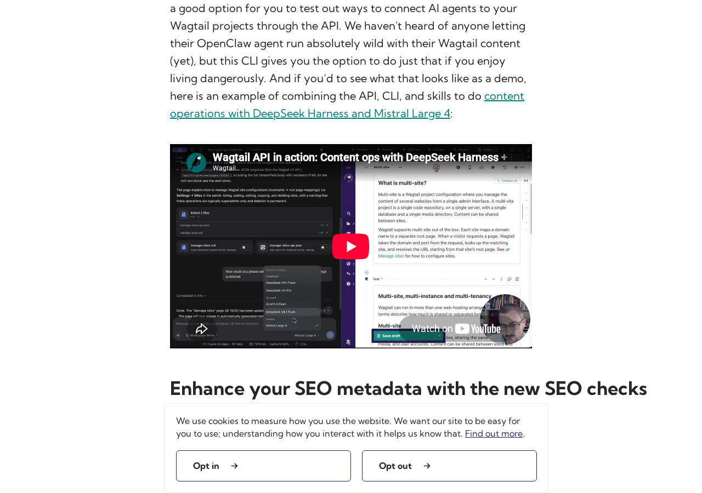
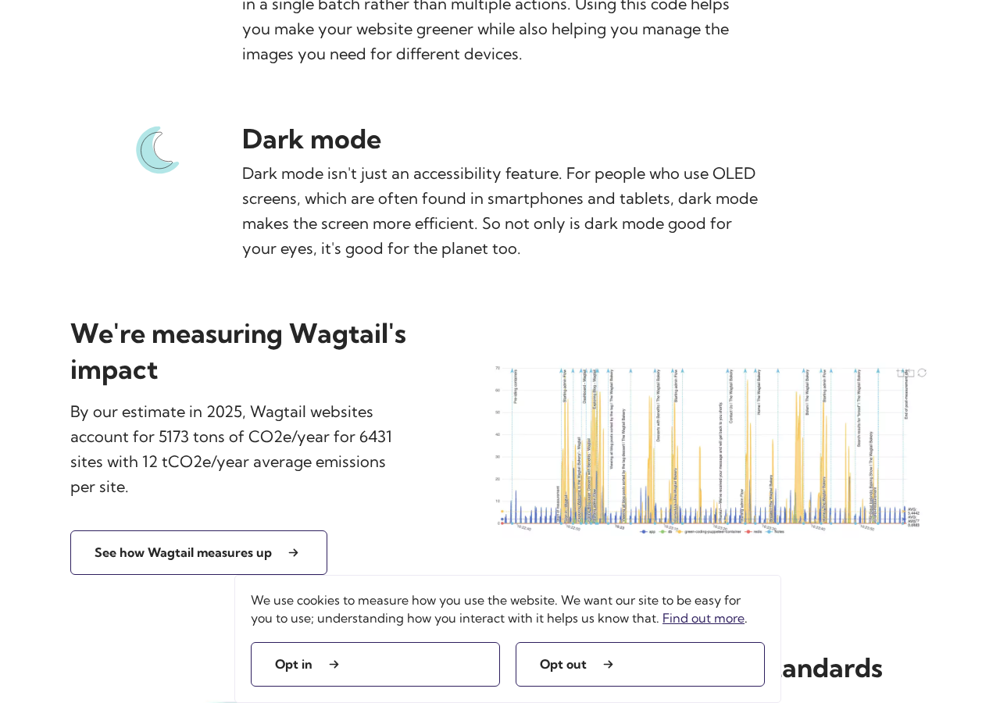

# wagtail.org: sustainability audit

## At a glance

- **46.9/100** — scoped audit score 15 passing, 4 with problems, 13 needing more evidence.
- **7 pages** reviewed 1 visitor journey and 18 selected source files.
- **32 of 71 guideline groups** scored 39 untested; 0 not applicable. Tests cover selected aspects of each guideline.

!!! info "What the score means"

    15 of 32 scored guideline groups passed this audit's selected checks. Unknowns stay in the denominator, so missing evidence lowers the score without becoming a site defect. This is not a full WSG conformance grade or a ranking against other sites.

## First-load page sizes

Data downloaded when a visitor first opens the page, before clicking or scrolling. **kB = 1,000 bytes; MB = 1,000,000 bytes.** Ranges show separate visits, not a modeled average.

<table>
<caption>First-load page sizes</caption>
<thead><tr><th scope="col">Page</th><th scope="col">First load</th><th scope="col">Measurement completeness</th></tr></thead>
<tbody>
<tr><th scope="row"><a href="https://wagtail.org/">Homepage</a></th><td>944.4 kB–945.6 kB</td><td>Some data could not be measured</td></tr>
<tr><th scope="row"><a href="https://wagtail.org/features/">Wagtail Features</a></th><td>638.0 kB–639.0 kB</td><td>Some data could not be measured</td></tr>
<tr><th scope="row"><a href="https://wagtail.org/blog/wagtail-8-1/">Wagtail 8.1: automate more with an improved API and agent-ready tools</a></th><td>2.026 MB–2.032 MB</td><td>Some data could not be measured</td></tr>
<tr><th scope="row"><a href="https://wagtail.org/search/?query=sustainability">Search results</a></th><td>464.7 kB–465.5 kB</td><td>Some data could not be measured</td></tr>
<tr><th scope="row"><a href="https://wagtail.org/sustainability/">Sustainability</a></th><td>590.3 kB–592.3 kB</td><td>Some data could not be measured</td></tr>
<tr><th scope="row"><a href="https://wagtail.org/privacy/">Wagtail Privacy policy</a></th><td>464.4 kB–465.0 kB</td><td>Some data could not be measured</td></tr>
<tr><th scope="row"><a href="https://wagtail.org/contact/">Contact Us</a></th><td>464.9 kB–465.7 kB</td><td>Some data could not be measured</td></tr>
</tbody></table>

Some requests failed or did not finish in the observation window. Their transferred size is uncertain, so these figures are incomplete and a Digital Carbon Rating is withheld. The audit measures the site as it behaved; a failed analytics request is context, not automatically a priority fix.

## Priorities

Wagtail.org already delivers compressed text, long-lived public assets, many WebP images and a home video that waits for playback. The clearest fixes are analytics requests sent before the stated measurement choice, contact email that disappears without JavaScript, inconsistent footprint quantities and live theme changes. Test an accessible on-demand YouTube player as the main transfer-reduction experiment. All fourteen measured visits have incomplete transfer measurements: the sizes below show captured data, not complete page weights. This report does not calculate a new emissions estimate or assign a Digital Carbon Rating from those partial measurements.

### 1. Make the measurement choice work before analytics starts

**High priority** · Problem found · [WSG 2.6](https://www.w3.org/TR/web-sustainability-guidelines/#avoid-being-manipulative-or-deceptive)

**What we found.** All seven sampled pages send Google Analytics page-view requests before the visitor chooses Opt in or Opt out. The analytics scripts also load before the choice in all fourteen separate visits. Both buttons work, but hiding the prompt does not demonstrate that optional measurement was prevented.

**Why it matters.** Visitors are offered a choice about measuring website use after the observed measurement requests have begun. This finding concerns the request sequence; cookie storage, all collection semantics and legal compliance were not established.

**Next step.** Review the deployed tag/container configuration and the purpose of each analytics destination. Gate optional measurement as declared, then verify fresh no-choice, reject, accept, reload and withdrawal states using requests and storage. Align the banner and privacy wording with the resulting behavior.

[How we checked this: Make the measurement choice work before analytics starts](#evidence-choice)

### 2. Test an accessible on-demand player for the release article

**High priority** · Needs investigation · [WSG 3.3](https://www.w3.org/TR/web-sustainability-guidelines/#modularize-bandwidth-heavy-components)

**What we found.** The Wagtail 8.1 article initializes YouTube before a play action, loading player scripts, fonts, thumbnail and ad/log requests. The initial reject visit captures 1.328 MB of associated traffic within 2.026 MB of recorded page traffic. These are incomplete observations with unresolved transfers and frame gaps, not a complete player footprint or a guaranteed saving.

**Why it matters.** A visitor reading the article currently initializes the third-party player without choosing playback. The home native video already avoids preloading, showing a useful existing pattern; an equally usable article alternative still needs validation.

**Next step.** Prototype a clearly named thumbnail/play control that loads the existing player on request. Verify keyboard activation, captions, transcript or reading fallback and successful playback, then compare fresh-load transfers before quantifying savings.

<figure class="audit-illustration" markdown="1">

<figcaption>Later illustration of the release article&#x27;s optional video. This image does not measure player traffic or validate a replacement. Captured 2026-11-04, 1280 × 900 pixels. This later illustration is separate from the scored measurements.</figcaption>
</figure>

[How we checked this: Test an accessible on-demand player for the release article](#evidence-components)

### 3. Keep contact and security email available without scripts

**Medium priority** · Problem found · [WSG 2.17](https://www.w3.org/TR/web-sustainability-guidelines/#provide-cross-platform-compatibility-support)

**What we found.** In the fresh no-JavaScript Contact state, hello@wagtail.org and security@wagtail.org become [email protected] with Cloudflare decoder links. General/conduct and security visitors lose the readable email routes; FAQ and Slack links remain.

**Why it matters.** Someone finding a contact or security-reporting route needs a usable destination even when scripts are unavailable. The other six sampled reading pages retain their core content, so the demonstrated problem is specific to these contact routes.

**Next step.** Render readable addresses and working mailto targets in baseline HTML, or provide an explicit equivalent that works without JavaScript. Verify each general, conduct and security route with scripts disabled.

[How we checked this: Keep contact and security email available without scripts](#evidence-no-js-content)

### 4. Reconcile the footprint figures and clarify privacy scope

**Medium priority** · Problem found · [WSG 2.7](https://www.w3.org/TR/web-sustainability-guidelines/#make-deliverables-understandable-and-reusable)

**What we found.** The policy gives 5,173 tCO2e/year across 6,431 sites and an average of 12 tCO2e/year per site. The displayed total divided by the count gives about 0.8044, so these cannot be the same mean and population. Separately, the privacy page describes the Torchbox website/company while being presented as the wagtail.org policy.

**Why it matters.** Readers need matching populations, units and periods to interpret an ecosystem footprint, and a clear service/controller scope to understand this website’s data handling. Differing 2024 baseline totals and median page weights in linked reports need explanation; a sample, method or data revision may account for them, so they are not established errors or proof of changed efficiency.

**Next step.** Check the underlying 2025 dataset before changing the summary: about 0.80 tCO2e/site/year applies only if the displayed total/count define the intended mean. Label any different statistic explicitly, reconcile baseline versions and clarify wagtail.org privacy coverage and actual services. Keep ecosystem and website estimates separate.

<figure class="audit-illustration" markdown="1">

<figcaption>Later illustration of the public footprint summary; the numerical finding uses the frozen audit text. The website estimate and the ecosystem estimate have separate scopes. Captured 2026-11-04, 1280 × 900 pixels. This later illustration is separate from the scored measurements.</figcaption>
</figure>

[How we checked this: Reconcile the footprint figures and clarify privacy scope](#evidence-comprehension)

### 5. Update the theme when the device preference changes

**Medium priority** · Problem found · [WSG 3.9](https://www.w3.org/TR/web-sustainability-guidelines/#use-media-queries-that-support-sustainability-goals)

**What we found.** Fresh loads with a dark device preference work and preserve task text. Changing that preference while any of the seven pages is already open leaves the light colors unchanged.

**Why it matters.** Visitors whose device changes theme should receive the expected presentation without reloading, subject to their explicit website choice. The audit does not infer energy savings from dark colors or establish a separate motion failure.

**Next step.** Confirm the manual-choice policy and deployed listener, then respond to system-theme changes when no override applies. Test both directions, persisted explicit choices and fresh loads.

[How we checked this: Update the theme when the device preference changes](#evidence-preference-behavior)

## After cookie choices and scrolling

Each cookie choice starts a separate fresh visit. The sizes below are **cumulative totals**, including the first load. They help locate later downloads; they are not additional amounts to add together or guaranteed savings.

??? note "Compare the interaction measurements"

    

    <table>
    <caption>Cumulative data after cookie choices and scrolling</caption>
    <thead><tr><th scope="col">Page</th><th scope="col">Cookie choice tested</th><th scope="col">After cookie choice</th><th scope="col">After scrolling to the bottom</th></tr></thead>
    <tbody>
    <tr><th scope="row"><a href="https://wagtail.org/">Homepage</a></th><td>Reject optional cookies</td><td>944.4 kB</td><td>1.108 MB</td></tr>
    <tr><th scope="row"><a href="https://wagtail.org/">Homepage</a></th><td>Accept cookies</td><td>945.6 kB</td><td>1.109 MB</td></tr>
    <tr><th scope="row"><a href="https://wagtail.org/features/">Wagtail Features</a></th><td>Reject optional cookies</td><td>639.0 kB</td><td>719.6 kB</td></tr>
    <tr><th scope="row"><a href="https://wagtail.org/features/">Wagtail Features</a></th><td>Accept cookies</td><td>638.0 kB</td><td>718.5 kB</td></tr>
    <tr><th scope="row"><a href="https://wagtail.org/blog/wagtail-8-1/">Wagtail 8.1: automate more with an improved API and agent-ready tools</a></th><td>Reject optional cookies</td><td>2.026 MB</td><td>2.028 MB</td></tr>
    <tr><th scope="row"><a href="https://wagtail.org/blog/wagtail-8-1/">Wagtail 8.1: automate more with an improved API and agent-ready tools</a></th><td>Accept cookies</td><td>2.032 MB</td><td>2.034 MB</td></tr>
    <tr><th scope="row"><a href="https://wagtail.org/search/?query=sustainability">Search results</a></th><td>Reject optional cookies</td><td>465.5 kB</td><td>465.5 kB</td></tr>
    <tr><th scope="row"><a href="https://wagtail.org/search/?query=sustainability">Search results</a></th><td>Accept cookies</td><td>464.7 kB</td><td>464.7 kB</td></tr>
    <tr><th scope="row"><a href="https://wagtail.org/sustainability/">Sustainability</a></th><td>Reject optional cookies</td><td>592.3 kB</td><td>635.2 kB</td></tr>
    <tr><th scope="row"><a href="https://wagtail.org/sustainability/">Sustainability</a></th><td>Accept cookies</td><td>590.3 kB</td><td>633.3 kB</td></tr>
    <tr><th scope="row"><a href="https://wagtail.org/privacy/">Wagtail Privacy policy</a></th><td>Reject optional cookies</td><td>465.0 kB</td><td>465.0 kB</td></tr>
    <tr><th scope="row"><a href="https://wagtail.org/privacy/">Wagtail Privacy policy</a></th><td>Accept cookies</td><td>464.4 kB</td><td>464.4 kB</td></tr>
    <tr><th scope="row"><a href="https://wagtail.org/contact/">Contact Us</a></th><td>Reject optional cookies</td><td>465.7 kB</td><td>465.7 kB</td></tr>
    <tr><th scope="row"><a href="https://wagtail.org/contact/">Contact Us</a></th><td>Accept cookies</td><td>464.9 kB</td><td>464.9 kB</td></tr>
    </tbody></table>

## Further checks

These outcomes apply to the selected checks and sample. Open a check's explanation for the observation, limitations and useful follow-up.

??? note "Browse all check outcomes"

    

    <table>
    <caption>All selected check outcomes</caption>
    <thead><tr><th scope="col">Check</th><th scope="col">Outcome</th></tr></thead>
    <tbody>
    <tr><th scope="row"><a href="#evidence-distraction">Reading without unsolicited interruptions</a></th><td>Passed this check</td></tr>
    <tr><th scope="row"><a href="#evidence-choice">Make the analytics choice effective</a></th><td>Problem found</td></tr>
    <tr><th scope="row"><a href="#evidence-comprehension">Reconcile the footprint summary and privacy scope</a></th><td>Problem found</td></tr>
    <tr><th scope="row"><a href="#evidence-consistency">Keep the familiar navigation and control names</a></th><td>Passed this check</td></tr>
    <tr><th scope="row"><a href="#evidence-motion">Investigate transient motion before changing it</a></th><td>Needs investigation</td></tr>
    <tr><th scope="row"><a href="#evidence-notifications">No notification request during the reading tasks</a></th><td>Passed this check</td></tr>
    <tr><th scope="row"><a href="#evidence-documents">Readable HTML and a simpler print view</a></th><td>Passed this check</td></tr>
    <tr><th scope="row"><a href="#evidence-unused-code">Measure code across the interactions visitors use</a></th><td>Needs investigation</td></tr>
    <tr><th scope="row"><a href="#evidence-components">Test loading the release player only on request</a></th><td>Needs investigation</td></tr>
    <tr><th scope="row"><a href="#evidence-layout">Find the shared horizontal overflow</a></th><td>Needs investigation</td></tr>
    <tr><th scope="row"><a href="#evidence-impact-choice">Check useful context for optional video</a></th><td>Needs investigation</td></tr>
    <tr><th scope="row"><a href="#evidence-journeys">The opt-out and policy-search task completes</a></th><td>Passed this check</td></tr>
    <tr><th scope="row"><a href="#evidence-media-delivery">Compare responsive images while keeping readable detail</a></th><td>Needs investigation</td></tr>
    <tr><th scope="row"><a href="#evidence-font-delivery">Test font fallback before trimming variants</a></th><td>Needs investigation</td></tr>
    <tr><th scope="row"><a href="#evidence-semantic-forms">Inspect visible headings and activated forms</a></th><td>Needs investigation</td></tr>
    <tr><th scope="row"><a href="#evidence-metadata">Useful page metadata matches the task</a></th><td>Passed this check</td></tr>
    <tr><th scope="row"><a href="#evidence-preference-behavior">Follow system theme changes on an open page</a></th><td>Problem found</td></tr>
    <tr><th scope="row"><a href="#evidence-no-js-content">Keep contact email readable without JavaScript</a></th><td>Problem found</td></tr>
    <tr><th scope="row"><a href="#evidence-api-requests">Confirm which analytics and player requests are needed</a></th><td>Needs investigation</td></tr>
    <tr><th scope="row"><a href="#evidence-public-cache-policy">Keep the explicit public-asset cache policies</a></th><td>Passed this check</td></tr>
    <tr><th scope="row"><a href="#evidence-text-compression">Material text responses already use compression</a></th><td>Passed this check</td></tr>
    <tr><th scope="row"><a href="#evidence-keyboard-path">Initial keyboard focus is visible</a></th><td>Passed this check</td></tr>
    <tr><th scope="row"><a href="#evidence-disclosure-scope">Public disclosures identify services and mitigation</a></th><td>Passed this check</td></tr>
    <tr><th scope="row"><a href="#evidence-carbon-discovery">carbon.txt is present and usable for discovery</a></th><td>Passed this check</td></tr>
    <tr><th scope="row"><a href="#evidence-hosting-evidence">Verify hosting claims beyond provider names</a></th><td>Needs investigation</td></tr>
    <tr><th scope="row"><a href="#evidence-source-reuse">Selected local components share common behavior</a></th><td>Passed this check</td></tr>
    <tr><th scope="row"><a href="#evidence-source-dependencies">Verify lockfile contents or a repeatable build</a></th><td>Needs investigation</td></tr>
    <tr><th scope="row"><a href="#evidence-source-runtime">Local runtime declarations agree</a></th><td>Passed this check</td></tr>
    <tr><th scope="row"><a href="#evidence-source-automation">CI already cancels superseded runs</a></th><td>Passed this check</td></tr>
    <tr><th scope="row"><a href="#evidence-source-maintenance">Local documentation explains maintenance tasks</a></th><td>Passed this check</td></tr>
    <tr><th scope="row"><a href="#evidence-source-change-docs">The release article explains product changes</a></th><td>Passed this check</td></tr>
    <tr><th scope="row"><a href="#evidence-source-budgets">Make the stated monitoring target reviewable</a></th><td>Needs investigation</td></tr>
    <tr><th scope="row"><a href="#evidence-source-open-source">Clarify software and content reuse terms</a></th><td>Needs investigation</td></tr>
    </tbody></table>

## Next steps for auditing

1. Verify consent with fresh profiles across no choice, reject, accept, reload and withdrawal; inventory deployed analytics and align the privacy service/controller scope. Decide which measurements are needed before removing or repairing tags.
2. Test an accessible on-demand release player and legible responsive image variants. Compare complete fresh desktop and narrow visits at intended pixel densities; preserve existing WebP delivery, useful lazy loading and cache/compression policies.
3. Confirm contact/security email without scripts, live and fresh theme behavior, and narrow navigation/search. Diagnose the shared 10 px overflow and inspect motion properties rather than assuming content loss or uncontrolled animation.
4. Reconcile ecosystem quantities and baseline versions with their underlying datasets. Validate carbon.txt against its declared version if formal conformance is needed, and obtain independent hosting evidence before applying green-hosting assumptions. Public mobile homepage estimates remain separate from current partial desktop observations.
5. Match the supplied local revision to the deployed build before choosing source edits. Supply lockfile/build evidence, applicable license/contribution documents and the numerical DebugBear budget with its response owner and alert history.

The sample covers selected pages and visitor tasks, not every page on the site. Expand it where the checks above identify an untested template, interaction or audience need.

## How we checked this

This appendix explains the evidence in ordinary language. Local source files help identify possible fixes, but we have not confirmed that the live site uses the same code revision. A missing selected file or document does not mean the organization has none.

<h3 id="evidence-distraction">Reading without unsolicited interruptions</h3>

**Passed this check** · [WSG 2.5](https://www.w3.org/TR/web-sustainability-guidelines/#design-to-assist-and-not-to-distract)

The seven sampled pages provide relevant reading, search, policy and contact content. The home video is paused with controls and no autoplay; static conference and newsletter prompts did not interrupt the recorded tasks. Hidden dialogs and a hidden copy confirmation are not evidence of unsolicited popups.

**Next step:** Extend observation to longer visits, opened menus and player states if those are important visitor tasks.

**Where we looked:**

- Browser observations for [Homepage](https://wagtail.org/).
- Browser observations for [Features](https://wagtail.org/features/).
- Browser observations for [Wagtail 8 1](https://wagtail.org/blog/wagtail-8-1/).
- Browser observations for [Search results](https://wagtail.org/search/?query=sustainability).
- Browser observations for [Sustainability](https://wagtail.org/sustainability/).
- Browser observations for [Privacy](https://wagtail.org/privacy/).
- Browser observations for [Contact](https://wagtail.org/contact/).

<h3 id="evidence-choice">Make the analytics choice effective</h3>

**Problem found** · [WSG 2.6](https://www.w3.org/TR/web-sustainability-guidelines/#avoid-being-manipulative-or-deceptive)

All seven initial page captures send Google Analytics page-view requests before the visitor chooses Opt in or Opt out. Google Tag Manager, gtag and analytics.js already load before either choice in all fourteen separate visits. Both choice buttons worked and the opt-out/search journey completed, but dismissal does not demonstrate that optional measurement was blocked. Storage, later visits and visual parity remain untested; this is not a legal compliance verdict.

**Next step:** Audit the deployed analytics destinations and consent configuration. Verify request payloads and storage in fresh no-choice, reject, accept, reload and withdrawal states, then align optional measurement with the stated choice.

**Where we looked:**

- Browser observations for [Homepage](https://wagtail.org/).
- Browser observations for [Features](https://wagtail.org/features/).
- Browser observations for [Wagtail 8 1](https://wagtail.org/blog/wagtail-8-1/).
- Browser observations for [Search results](https://wagtail.org/search/?query=sustainability).
- Browser observations for [Sustainability](https://wagtail.org/sustainability/).
- Browser observations for [Privacy](https://wagtail.org/privacy/).
- Browser observations for [Contact](https://wagtail.org/contact/).
- Captured public evidence for [Homepage](https://wagtail.org/).
- Captured public evidence for [Features](https://wagtail.org/features/).
- Captured public evidence for [Wagtail 8 1](https://wagtail.org/blog/wagtail-8-1/).
- Captured public evidence for [Search results](https://wagtail.org/search/?query=sustainability).
- Captured public evidence for [Sustainability](https://wagtail.org/sustainability/).
- Captured public evidence for [Privacy](https://wagtail.org/privacy/).
- Captured public evidence for [Contact](https://wagtail.org/contact/).
- Selected local file `wagtailio/project_styleguide/templates/patterns/includes/cookie_message.html` at revision `9fa65385f27c`.
- Selected local file `wagtailio/static/js/components/cookie-message.js` at revision `9fa65385f27c`.

<h3 id="evidence-comprehension">Reconcile the footprint summary and privacy scope</h3>

**Problem found** · [WSG 2.7](https://www.w3.org/TR/web-sustainability-guidelines/#make-deliverables-understandable-and-reusable)

The sustainability policy reports 5,173 tCO2e/year for 6,431 sites alongside a 12 tCO2e/year per-site average. Dividing the displayed total by the count gives about 0.8044 tCO2e/site/year; those quantities cannot describe the same mean. The privacy page describes the Torchbox website/company despite being presented as the wagtail.org policy, leaving its service/controller scope unclear. Other sampled task copy is reasonably explanatory; truncated heading lists do not establish a broken hierarchy.

**Next step:** Check the intended dataset, period, population and units before correcting the average or labeling a different statistic. Clarify the wagtail.org privacy scope and actual services, and review the resulting copy with its audience.

**Where we looked:**

- Browser observations for [Homepage](https://wagtail.org/).
- Browser observations for [Features](https://wagtail.org/features/).
- Browser observations for [Wagtail 8 1](https://wagtail.org/blog/wagtail-8-1/).
- Browser observations for [Search results](https://wagtail.org/search/?query=sustainability).
- Browser observations for [Sustainability](https://wagtail.org/sustainability/).
- Browser observations for [Privacy](https://wagtail.org/privacy/).
- Browser observations for [Contact](https://wagtail.org/contact/).
- Captured public evidence for [Homepage](https://wagtail.org).

<h3 id="evidence-consistency">Keep the familiar navigation and control names</h3>

**Passed this check** · [WSG 2.8](https://www.w3.org/TR/web-sustainability-guidelines/#use-a-design-system-for-interface-consistency)

The same primary navigation, footer groups, search, Get started, theme and cookie-choice wording recur across all seven pages. Search and article pages add controls appropriate to their content. This supports consistency in the sample; it does not establish a documented design system or every expanded menu state.

**Next step:** Compare opened menus, narrow layouts and any additional content types when expanding the interface review.

**Where we looked:**

- Browser observations for [Homepage](https://wagtail.org/).
- Browser observations for [Features](https://wagtail.org/features/).
- Browser observations for [Wagtail 8 1](https://wagtail.org/blog/wagtail-8-1/).
- Browser observations for [Search results](https://wagtail.org/search/?query=sustainability).
- Browser observations for [Sustainability](https://wagtail.org/sustainability/).
- Browser observations for [Privacy](https://wagtail.org/privacy/).
- Browser observations for [Contact](https://wagtail.org/contact/).

<h3 id="evidence-motion">Investigate transient motion before changing it</h3>

**Needs investigation** · [WSG 2.10](https://www.w3.org/TR/web-sustainability-guidelines/#ensure-animation-is-proportionate-and-easy-to-control)

Initial desktop snapshots show no running animation and the home video is paused. Resizing and reduced-motion states record five, two and one one-iteration animations on Home, Features and Sustainability respectively. The captured records omit animated properties, duration and purpose, so they do not establish uncontrolled looping or harmful motion; embedded playback is also untested.

**Next step:** Inspect actual properties, purpose, duration and controls after resize, menus and scrolling. Compare settled and fresh reduced-motion states before deciding what to reduce.

**Where we looked:**

- Browser observations for [Homepage](https://wagtail.org/).
- Browser observations for [Features](https://wagtail.org/features/).
- Browser observations for [Wagtail 8 1](https://wagtail.org/blog/wagtail-8-1/).
- Browser observations for [Search results](https://wagtail.org/search/?query=sustainability).
- Browser observations for [Sustainability](https://wagtail.org/sustainability/).
- Browser observations for [Privacy](https://wagtail.org/privacy/).
- Browser observations for [Contact](https://wagtail.org/contact/).

<h3 id="evidence-notifications">No notification request during the reading tasks</h3>

**Passed this check** · [WSG 2.12](https://www.w3.org/TR/web-sustainability-guidelines/#avoid-unwanted-notifications)

No browser notification permission request was recorded in the sampled states. Newsletter signup is optional and recorded dialogs/confirmation alerts are hidden. Browser permission was already denied, so this result covers attempted requests during these tasks rather than every subscription or external message.

**Next step:** Use default browser permission and a deliberately requested signup task if extending this check.

**Where we looked:**

- Browser observations for [Homepage](https://wagtail.org/).
- Browser observations for [Features](https://wagtail.org/features/).
- Browser observations for [Wagtail 8 1](https://wagtail.org/blog/wagtail-8-1/).
- Browser observations for [Search results](https://wagtail.org/search/?query=sustainability).
- Browser observations for [Sustainability](https://wagtail.org/sustainability/).
- Browser observations for [Privacy](https://wagtail.org/privacy/).
- Browser observations for [Contact](https://wagtail.org/contact/).

<h3 id="evidence-documents">Readable HTML and a simpler print view</h3>

**Passed this check** · [WSG 2.13](https://www.w3.org/TR/web-sustainability-guidelines/#reduce-the-impact-of-downloadable-and-physical-documents)

The sampled tasks use HTML, with no recorded PDF, office-file or download-attributed links. Print states retain the reading content while hiding navigation, cookie controls and unrelated recommendations; the article keeps eight of eleven images after related author images are removed. Actual pagination, paper use and downloadable-document accessibility were not inspected.

**Next step:** Inspect print preview and pagination for long feature and release pages before claiming paper savings or optimized printing.

**Where we looked:**

- Browser observations for [Homepage](https://wagtail.org/).
- Browser observations for [Features](https://wagtail.org/features/).
- Browser observations for [Wagtail 8 1](https://wagtail.org/blog/wagtail-8-1/).
- Browser observations for [Search results](https://wagtail.org/search/?query=sustainability).
- Browser observations for [Sustainability](https://wagtail.org/sustainability/).
- Browser observations for [Privacy](https://wagtail.org/privacy/).
- Browser observations for [Contact](https://wagtail.org/contact/).

<h3 id="evidence-unused-code">Measure code across the interactions visitors use</h3>

**Needs investigation** · [WSG 3.2](https://www.w3.org/TR/web-sustainability-guidelines/#minify-and-remove-unused-code)

The deployed main JavaScript is about 39.5 kB decoded and 11.3 kB gzip; CSS is about 125.7 kB decoded and 21.1 kB gzip. Initial unexecuted functions may serve later menus, search and copy actions. CSS records show used ranges rather than all unused rules, and article/frame coverage is incomplete. The separate analytics scripts account for 347.162 kB in the initial home reject visit; they are not the first-party bundle. Local production minification is useful source context but does not identify the live build.

**Next step:** Collect representative interaction coverage and match deployed bundles to source maps before deleting or splitting code. Review analytics and player requirements with their owners.

**Where we looked:**

- Browser observations for [Homepage](https://wagtail.org/).
- Browser observations for [Features](https://wagtail.org/features/).
- Browser observations for [Wagtail 8 1](https://wagtail.org/blog/wagtail-8-1/).
- Browser observations for [Search results](https://wagtail.org/search/?query=sustainability).
- Browser observations for [Sustainability](https://wagtail.org/sustainability/).
- Browser observations for [Privacy](https://wagtail.org/privacy/).
- Browser observations for [Contact](https://wagtail.org/contact/).
- Selected local file `webpack.config.js` at revision `9fa65385f27c`.
- Selected local file `wagtailio/project_styleguide/templates/patterns/base.html` at revision `9fa65385f27c`.
- Selected local file `wagtailio/static/js/main.js` at revision `9fa65385f27c`.

<h3 id="evidence-components">Test loading the release player only on request</h3>

**Needs investigation** · [WSG 3.3](https://www.w3.org/TR/web-sustainability-guidelines/#modularize-bandwidth-heavy-components)

The release article initializes its YouTube iframe before playback, requesting player code, fonts, thumbnail and ad/log endpoints. The initial reject visit captures 1.328 MB of associated traffic within 2.026 MB of recorded page traffic; the separate accept visit captures 2.032 MB of page traffic. All are partial totals with unresolved transfers and frame gaps. The home native video already avoids preloading and has no observed MP4 request. A usable replacement for the article player has not yet been validated.

**Next step:** Prototype a named image/play preview that loads the existing player on activation. Verify keyboard access, captions, transcript or reading fallback and playback, then compare fresh-load transfers. Treat 1.328 MB as observed traffic, not a promised saving.

**Where we looked:**

- Browser observations for [Homepage](https://wagtail.org/).
- Browser observations for [Wagtail 8 1](https://wagtail.org/blog/wagtail-8-1/).
- Captured public evidence for [Wagtail 8 1](https://wagtail.org/blog/wagtail-8-1/).
- Selected local file `wagtailio/project_styleguide/templates/patterns/pages/home/home_page.html` at revision `9fa65385f27c`.
- Selected local file `wagtailio/project_styleguide/templates/patterns/components/streamfields/video_block/video_block.html` at revision `9fa65385f27c`.

<h3 id="evidence-layout">Find the shared horizontal overflow</h3>

**Needs investigation** · [WSG 3.10](https://www.w3.org/TR/web-sustainability-guidelines/#ensure-layouts-work-for-different-devices-and-requirements)

All seven JavaScript desktop documents are 1,290 px wide in a 1,280 px viewport; resized narrow documents are 370 px in a 360 px viewport. Reading text remains and images shrink, but the records do not identify the extra 10 px or show content loss. No-JavaScript and print states have no overflow. Mobile menu/search controls were visible but not activated, and resizing is not a fresh mobile load.

**Next step:** Identify the overflowing element, inspect clipping and scrolling, then exercise narrow menu/search with keyboard and touch on a real device.

**Where we looked:**

- Browser observations for [Homepage](https://wagtail.org/).
- Browser observations for [Features](https://wagtail.org/features/).
- Browser observations for [Wagtail 8 1](https://wagtail.org/blog/wagtail-8-1/).
- Browser observations for [Search results](https://wagtail.org/search/?query=sustainability).
- Browser observations for [Sustainability](https://wagtail.org/sustainability/).
- Browser observations for [Privacy](https://wagtail.org/privacy/).
- Browser observations for [Contact](https://wagtail.org/contact/).

<h3 id="evidence-impact-choice">Check useful context for optional video</h3>

**Needs investigation** · [WSG 5.4](https://www.w3.org/TR/web-sustainability-guidelines/#communicate-the-environmental-impact-of-user-choices)

Ordinary reading links do not all need carbon labels. Optional video is a more consequential resource choice: the home player defers downloading while the article initializes YouTube before activation. The packet does not inspect player quality, duration or data-use information. Policy descriptions of OLED themes and image capabilities concern CMS use rather than an executed upload task here.

**Next step:** Review the information visitors need to choose video playback, then test it alongside an accessible on-demand player.

**Where we looked:**

- Browser observations for [Homepage](https://wagtail.org/).
- Browser observations for [Wagtail 8 1](https://wagtail.org/blog/wagtail-8-1/).
- Browser observations for [Sustainability](https://wagtail.org/sustainability/).

<h3 id="evidence-journeys">The opt-out and policy-search task completes</h3>

**Passed this check** · [WSG 2.4](https://www.w3.org/TR/web-sustainability-guidelines/#design-efficient-and-streamlined-user-journeys)

All five declared actions completed: opt out, open desktop search, enter sustainability, submit and follow the policy result. The final URL, title, heading and reading text identify the Sustainability page, and the separate results sample lists it first among 62 results. This confirms that task path; it does not establish optimal efficiency or analytics enforcement.

**Next step:** Repeat with new visitors and narrow navigation, and test consent enforcement independently of banner dismissal.

**Where we looked:**

- Browser observations for [Homepage](https://wagtail.org/).
- Browser observations for [Search results](https://wagtail.org/search/?query=sustainability).
- Browser observations for [Sustainability](https://wagtail.org/sustainability/).

<h3 id="evidence-media-delivery">Compare responsive images while keeping readable detail</h3>

**Needs investigation** · [WSG 2.9](https://www.w3.org/TR/web-sustainability-guidelines/#optimize-media-to-reduce-resource-use)

Many image URLs already deliver WebP, and scrolling confirms useful deferral of three home images, two feature images and one sustainability image. The home video also avoids preloading. None of the sampled images uses srcset/sizes: the 2,234 px home illustration renders at 1,280 px desktop and 360 px narrow, with a 370,360-byte response body; feature screenshots are 1,300 px for 660/300 px display and article screenshots 800–900 px for 660/300 px. These are investigation targets, not validated smaller replacements. Tests use DPR 1 and the same resized document. Two article screenshots actually remain PNG; four sustainability WebP resources render but use application/octet-stream. Early unloaded lazy images are not evidence of broken media.

**Next step:** Compare legible responsive variants at intended 1x/2x densities, retaining art direction and useful screenshot text. Test fresh narrow loads and deferred loading, and inspect the mixed MIME responses before changing formats or claiming savings.

**Where we looked:**

- Browser observations for [Homepage](https://wagtail.org/).
- Browser observations for [Features](https://wagtail.org/features/).
- Browser observations for [Wagtail 8 1](https://wagtail.org/blog/wagtail-8-1/).
- Browser observations for [Search results](https://wagtail.org/search/?query=sustainability).
- Browser observations for [Sustainability](https://wagtail.org/sustainability/).
- Browser observations for [Privacy](https://wagtail.org/privacy/).
- Browser observations for [Contact](https://wagtail.org/contact/).
- Captured public evidence for [Homepage](https://wagtail.org/).
- Captured public evidence for [Features](https://wagtail.org/features/).
- Captured public evidence for [Wagtail 8 1](https://wagtail.org/blog/wagtail-8-1/).
- Captured public evidence for [Search results](https://wagtail.org/search/?query=sustainability).
- Captured public evidence for [Sustainability](https://wagtail.org/sustainability/).
- Captured public evidence for [Privacy](https://wagtail.org/privacy/).
- Captured public evidence for [Contact](https://wagtail.org/contact/).
- Selected local file `wagtailio/project_styleguide/templates/patterns/pages/home/home_page.html` at revision `9fa65385f27c`.
- Selected local file `wagtailio/project_styleguide/templates/patterns/components/streamfields/video_block/video_block.html` at revision `9fa65385f27c`.
- Selected local file `wagtailio/project_styleguide/templates/patterns/components/streamfields/image/image.html` at revision `9fa65385f27c`.

<h3 id="evidence-font-delivery">Test font fallback before trimming variants</h3>

**Needs investigation** · [WSG 2.11](https://www.w3.org/TR/web-sustainability-guidelines/#use-optimized-web-typography)

The English content uses Kumbh Sans with a sans-serif fallback. Weights 400 and 700 load on every page; 600 loads only on the article. The ordinary-page local faces account for about 39.5–40.8 kB including reported overhead; the article local faces account for 61.172 kB in initial reject, separate from 40.678 kB of player Roboto. Regular declares font-display:block and other weights auto. Slow or blocked font loading and language needs were not tested, so no face is established as safely removable.

**Next step:** Test blocked/slow responses, fallback readability, layout changes and intended languages before changing font-display, removing weights or subsetting.

**Where we looked:**

- Browser observations for [Homepage](https://wagtail.org/).
- Browser observations for [Features](https://wagtail.org/features/).
- Browser observations for [Wagtail 8 1](https://wagtail.org/blog/wagtail-8-1/).
- Browser observations for [Search results](https://wagtail.org/search/?query=sustainability).
- Browser observations for [Sustainability](https://wagtail.org/sustainability/).
- Browser observations for [Privacy](https://wagtail.org/privacy/).
- Browser observations for [Contact](https://wagtail.org/contact/).
- Captured public evidence for [Homepage](https://wagtail.org/).
- Captured public evidence for [Features](https://wagtail.org/features/).
- Captured public evidence for [Wagtail 8 1](https://wagtail.org/blog/wagtail-8-1/).
- Captured public evidence for [Search results](https://wagtail.org/search/?query=sustainability).
- Captured public evidence for [Sustainability](https://wagtail.org/sustainability/).
- Captured public evidence for [Privacy](https://wagtail.org/privacy/).
- Captured public evidence for [Contact](https://wagtail.org/contact/).

<h3 id="evidence-semantic-forms">Inspect visible headings and activated forms</h3>

**Needs investigation** · [WSG 3.6](https://www.w3.org/TR/web-sustainability-guidelines/#ensure-code-follows-good-semantic-practices)

All seven documents report English language, one main region and one H1. Search inputs have Search labels and the newsletter field has an Email name; textless controls are not automatically unnamed. The bounded heading inventories truncate inside duplicated hidden navigation before visible primary content, so counts alone cannot establish heading wording or hierarchy. Dialog activation and focus handling remain untested.

**Next step:** Capture visible main-region headings and resolved control names directly, then execute search, newsletter and modal tasks before making broader accessibility claims.

**Where we looked:**

- Browser observations for [Homepage](https://wagtail.org/).
- Browser observations for [Features](https://wagtail.org/features/).
- Browser observations for [Wagtail 8 1](https://wagtail.org/blog/wagtail-8-1/).
- Browser observations for [Search results](https://wagtail.org/search/?query=sustainability).
- Browser observations for [Sustainability](https://wagtail.org/sustainability/).
- Browser observations for [Privacy](https://wagtail.org/privacy/).
- Browser observations for [Contact](https://wagtail.org/contact/).

<h3 id="evidence-metadata">Useful page metadata matches the task</h3>

**Passed this check** · [WSG 3.8](https://www.w3.org/TR/web-sustainability-guidelines/#structure-metadata-for-machine-readability)

The six content pages have descriptive titles, matching HTTPS canonicals and relevant descriptions. Dynamic search has a query-specific title and noindex; its lack of canonical/description is appropriate to the sampled purpose. Home and the article contain parseable JSON-LD. Parsing is not schema validation or proof of search eligibility.

**Next step:** Validate declared schema meaning if structured-data eligibility becomes part of the scope.

**Where we looked:**

- Browser observations for [Homepage](https://wagtail.org/).
- Browser observations for [Features](https://wagtail.org/features/).
- Browser observations for [Wagtail 8 1](https://wagtail.org/blog/wagtail-8-1/).
- Browser observations for [Search results](https://wagtail.org/search/?query=sustainability).
- Browser observations for [Sustainability](https://wagtail.org/sustainability/).
- Browser observations for [Privacy](https://wagtail.org/privacy/).
- Browser observations for [Contact](https://wagtail.org/contact/).

<h3 id="evidence-preference-behavior">Follow system theme changes on an open page</h3>

**Problem found** · [WSG 3.9](https://www.w3.org/TR/web-sustainability-guidelines/#use-media-queries-that-support-sustainability-goals)

Fresh dark-preference loads work: text becomes white on a dark rgb(38,38,38) background and task content remains. In contrast, changing the device preference while each of the seven pages is open leaves the original light colors in place. Transient animation records do not independently prove a reduced-motion defect. No energy saving is inferred from the selected color scheme.

**Next step:** Confirm manual-override policy and the deployed theme listener. Test live light-to-dark and dark-to-light changes, explicit choices, persisted preferences and fresh loads.

**Where we looked:**

- Browser observations for [Homepage](https://wagtail.org/).
- Browser observations for [Features](https://wagtail.org/features/).
- Browser observations for [Wagtail 8 1](https://wagtail.org/blog/wagtail-8-1/).
- Browser observations for [Search results](https://wagtail.org/search/?query=sustainability).
- Browser observations for [Sustainability](https://wagtail.org/sustainability/).
- Browser observations for [Privacy](https://wagtail.org/privacy/).
- Browser observations for [Contact](https://wagtail.org/contact/).

<h3 id="evidence-no-js-content">Keep contact email readable without JavaScript</h3>

**Problem found** · [WSG 2.17](https://www.w3.org/TR/web-sustainability-guidelines/#provide-cross-platform-compatibility-support)

The fresh no-JavaScript Contact page replaces the general/conduct address hello@wagtail.org and security@wagtail.org with [email protected] and Cloudflare decoder links. FAQ and Slack remain, but neither supplies an explicit equivalent security-email route. Core reading/navigation on the other six pages remains available; no-JavaScript search submission and every interactive control were not tested.

**Next step:** Render readable email addresses and working mailto links in baseline HTML, or provide a tested explicit equivalent that needs no script. Verify the general, conduct and security routes with JavaScript disabled.

**Where we looked:**

- Browser observations for [Homepage](https://wagtail.org/).
- Browser observations for [Features](https://wagtail.org/features/).
- Browser observations for [Wagtail 8 1](https://wagtail.org/blog/wagtail-8-1/).
- Browser observations for [Search results](https://wagtail.org/search/?query=sustainability).
- Browser observations for [Sustainability](https://wagtail.org/sustainability/).
- Browser observations for [Privacy](https://wagtail.org/privacy/).
- Browser observations for [Contact](https://wagtail.org/contact/).

<h3 id="evidence-api-requests">Confirm which analytics and player requests are needed</h3>

**Needs investigation** · [WSG 3.11](https://www.w3.org/TR/web-sustainability-guidelines/#use-sustainable-javascript-and-apis)

Each initial page requests one small sitewide alert and three analytics page views: GA4 and two different Universal Analytics properties. Different property IDs mean similar paths are not proof of redundant events. The article also repeats player/log requests, with zero received bytes recorded for some later assets; this does not establish repeated downloads or backend waste. No long-duration polling test or destination requirements were supplied.

**Next step:** Inventory analytics destinations, event needs and owners; inspect consent behavior and repeated player initialization before removing work or changing dynamic search caching.

**Where we looked:**

- Browser observations for [Homepage](https://wagtail.org/).
- Browser observations for [Features](https://wagtail.org/features/).
- Browser observations for [Wagtail 8 1](https://wagtail.org/blog/wagtail-8-1/).
- Browser observations for [Search results](https://wagtail.org/search/?query=sustainability).
- Browser observations for [Sustainability](https://wagtail.org/sustainability/).
- Browser observations for [Privacy](https://wagtail.org/privacy/).
- Browser observations for [Contact](https://wagtail.org/contact/).
- Captured public evidence for [Homepage](https://wagtail.org/).
- Captured public evidence for [Features](https://wagtail.org/features/).
- Captured public evidence for [Wagtail 8 1](https://wagtail.org/blog/wagtail-8-1/).
- Captured public evidence for [Search results](https://wagtail.org/search/?query=sustainability).
- Captured public evidence for [Sustainability](https://wagtail.org/sustainability/).
- Captured public evidence for [Privacy](https://wagtail.org/privacy/).
- Captured public evidence for [Contact](https://wagtail.org/contact/).

<h3 id="evidence-public-cache-policy">Keep the explicit public-asset cache policies</h3>

**Passed this check** · [WSG 4.2](https://www.w3.org/TR/web-sustainability-guidelines/#optimize-caching-and-support-offline-access)

Hashed JavaScript, CSS and WOFF2 expose long public immutable caching and validators; remote media has long caching and validators, and sitewide alerts have an explicit shorter policy. Dynamic search and private analytics/log responses have different reuse needs. The observed policies pass this check; no warm-visit test establishes actual reuse or offline support.

**Next step:** Check repeat visits and invalidation after content changes before quantifying cache benefits or claiming offline capability.

**Where we looked:**

- Browser observations for [Homepage](https://wagtail.org/).
- Browser observations for [Features](https://wagtail.org/features/).
- Browser observations for [Wagtail 8 1](https://wagtail.org/blog/wagtail-8-1/).
- Browser observations for [Search results](https://wagtail.org/search/?query=sustainability).
- Browser observations for [Sustainability](https://wagtail.org/sustainability/).
- Browser observations for [Privacy](https://wagtail.org/privacy/).
- Browser observations for [Contact](https://wagtail.org/contact/).
- Captured public evidence for [Homepage](https://wagtail.org/).
- Captured public evidence for [Features](https://wagtail.org/features/).
- Captured public evidence for [Wagtail 8 1](https://wagtail.org/blog/wagtail-8-1/).
- Captured public evidence for [Search results](https://wagtail.org/search/?query=sustainability).
- Captured public evidence for [Sustainability](https://wagtail.org/sustainability/).
- Captured public evidence for [Privacy](https://wagtail.org/privacy/).
- Captured public evidence for [Contact](https://wagtail.org/contact/).

<h3 id="evidence-text-compression">Material text responses already use compression</h3>

**Passed this check** · [WSG 4.3](https://www.w3.org/TR/web-sustainability-guidelines/#reduce-data-transfer-with-compression)

Sampled HTML uses Brotli and common CSS/JavaScript gzip; material third-party text also has compression. Main CSS is 21,060 encoded bytes versus about 125.7 kB decoded, and main JavaScript is 11,338 versus about 39.5 kB. Unencoded tiny acknowledgments, helper responses and errors do not establish a material omission; already-compressed images and WOFF2 do not need blanket recompression. Partial traffic totals do not invalidate observed encoding headers.

**Next step:** Retain current material text compression. No additional evidence is needed for this sampled encoding check.

**Where we looked:**

- Browser observations for [Homepage](https://wagtail.org/).
- Browser observations for [Features](https://wagtail.org/features/).
- Browser observations for [Wagtail 8 1](https://wagtail.org/blog/wagtail-8-1/).
- Browser observations for [Search results](https://wagtail.org/search/?query=sustainability).
- Browser observations for [Sustainability](https://wagtail.org/sustainability/).
- Browser observations for [Privacy](https://wagtail.org/privacy/).
- Browser observations for [Contact](https://wagtail.org/contact/).
- Captured public evidence for [Homepage](https://wagtail.org/).
- Captured public evidence for [Features](https://wagtail.org/features/).
- Captured public evidence for [Wagtail 8 1](https://wagtail.org/blog/wagtail-8-1/).
- Captured public evidence for [Search results](https://wagtail.org/search/?query=sustainability).
- Captured public evidence for [Sustainability](https://wagtail.org/sustainability/).
- Captured public evidence for [Privacy](https://wagtail.org/privacy/).
- Captured public evidence for [Contact](https://wagtail.org/contact/).

<h3 id="evidence-keyboard-path">Initial keyboard focus is visible</h3>

**Passed this check** · [WSG 3.6](https://www.w3.org/TR/web-sustainability-guidelines/#ensure-code-follows-good-semantic-practices)

Bounded Tab traces reach visible event/skip/home links, named navigation and search, Get started and task controls. Recorded targets show a visible focus indicator, including a 1 px automatic outline on the sampled light background. This supports the initial path only; skip destinations, opened menus, reverse traversal, traps and full accessibility were not tested.

**Next step:** Activate skip, search and menu controls and check complete forward/reverse paths, including narrow and dark states.

**Where we looked:**

- Browser observations for [Homepage](https://wagtail.org/).
- Browser observations for [Features](https://wagtail.org/features/).
- Browser observations for [Wagtail 8 1](https://wagtail.org/blog/wagtail-8-1/).
- Browser observations for [Search results](https://wagtail.org/search/?query=sustainability).
- Browser observations for [Sustainability](https://wagtail.org/sustainability/).
- Browser observations for [Privacy](https://wagtail.org/privacy/).
- Browser observations for [Contact](https://wagtail.org/contact/).

<h3 id="evidence-disclosure-scope">Public disclosures identify services and mitigation</h3>

**Passed this check** · [WSG 2.1](https://www.w3.org/TR/web-sustainability-guidelines/#identify-assess-disclose-review-and-mitigate-sustainability-impacts)

The sustainability policy explicitly includes wagtail.org, docs.wagtail.org and guide.wagtail.org alongside CMS/ecosystem and community work. The linked Digital emissions statement separates homepage/website estimates and describes method, period and monitoring. This passes disclosure coverage, not execution or footprint accuracy. Its April 2026 mobile/Lighthouse SWD v4 estimate is a different scenario from these partial desktop captures and is not reproduced here. The 2025 ecosystem article uses differing 2024 totals (6,327 and 6,260 tons) and a median page weight differing from the earlier report. A sample, method or data revision could explain those baseline differences; the bounded excerpts do not establish one. The article itself warns that estimated pageview changes drive much of the headline reduction.

**Next step:** Explain comparable baseline versions and distinguish ecosystem, website and homepage estimates. Correct the policy average, obtain execution records for claimed reductions, and supply traffic period/count, first/repeat mix, page weighting and infrastructure inputs to reproduce the site estimate. Its 30–300 kg/year range is a methodological scenario range, not statistical bounds.

**Where we looked:**

- Captured public evidence for [Homepage](https://wagtail.org).
- Browser observations for [Sustainability](https://wagtail.org/sustainability/).

<h3 id="evidence-carbon-discovery">carbon.txt is present and usable for discovery</h3>

**Passed this check** · [WSG 3.13](https://www.w3.org/TR/web-sustainability-guidelines/#include-expected-and-beneficial-files)

The root carbon.txt returns 200 text/plain, parses with declared version 0.4 and supplies usable exact-host disclosure relationships without delegation ambiguity. All four declared disclosure URLs return 200. Common-field checks report no structural issue, but schemaValidated=false: this is neither full version-0.4 schema validation nor validation against the separate 1.0-RC1 profile. The 2023/2024 reports are historical and past their declared validity; last_updated is 2026-01-07. The newer 2025 report was reached through linked content, not directly declared. Provider entries remain self-declared relationships, and exact-host labels do not automatically cover subdomains.

**Next step:** Link the current report directly and refresh the update date when appropriate. Use a matching version-specific validator for formal syntax conformance; verify claims and hosting independently.

**Where we looked:**

- Captured public evidence for [Homepage](https://wagtail.org).

<h3 id="evidence-hosting-evidence">Verify hosting claims beyond provider names</h3>

**Needs investigation** · [WSG 4.1](https://www.w3.org/TR/web-sustainability-guidelines/#use-sustainable-hosting)

carbon.txt declares Cloudflare for CDN, Heroku for platform/database/cache, AWS for object storage and GitHub for CI/CD. Local documentation also describes Heroku, and the public site estimate uses an Ireland factor. These do not independently establish this origin’s current region, electricity supply or operational metrics. No verified green-hosting assumption follows.

**Next step:** Obtain dated origin/provider/service/region correspondence and independent environmental evidence matching that operational scope.

**Where we looked:**

- Captured public evidence for [Homepage](https://wagtail.org).
- Selected local file `Dockerfile` at revision `9fa65385f27c`.
- Selected local file `README.md` at revision `9fa65385f27c`.

<h3 id="evidence-source-reuse">Selected local components share common behavior</h3>

**Passed this check** · [WSG 3.4](https://www.w3.org/TR/web-sustainability-guidelines/#avoid-redundancy-and-duplication-in-code)

The supplied local home template uses shared hero/button patterns and a common CTA button include. main.js has a shared component initializer, with dedicated cookie and desktop-search modules. This supports reuse in the selected files, not whole-project efficiency. The unselected base-page inheritance and live deployment identity remain unresolved.

**Next step:** Inspect additional concrete template call sites only if expanding the duplication review; match proposed edits to the deployed build.

**Where we looked:**

- Selected local file `wagtailio/project_styleguide/templates/patterns/base.html` at revision `9fa65385f27c`.
- Selected local file `wagtailio/project_styleguide/templates/patterns/pages/home/home_page.html` at revision `9fa65385f27c`.
- Selected local file `wagtailio/project_styleguide/templates/patterns/includes/cookie_message.html` at revision `9fa65385f27c`.
- Selected local file `wagtailio/static/js/components/cookie-message.js` at revision `9fa65385f27c`.
- Selected local file `wagtailio/static/js/components/site-search-desktop.js` at revision `9fa65385f27c`.
- Selected local file `wagtailio/static/js/main.js` at revision `9fa65385f27c`.

<h3 id="evidence-source-dependencies">Verify lockfile contents or a repeatable build</h3>

**Needs investigation** · [WSG 3.12](https://www.w3.org/TR/web-sustainability-guidelines/#use-dependencies-sparingly-and-maintain-them)

Local manifests inventory dependencies, while Docker/CI declare npm ci and Poetry installation. The selected lockfiles contain identity/size metadata only, so their resolutions and consistency with manifests cannot be checked. Clean tracked source does not establish installed/deployed versions, package necessity or vulnerability status.

**Next step:** Provide bounded lockfile/manifest checks or a clean-install receipt for this revision. Verify deployed versions separately where they affect a decision.

**Where we looked:**

- Selected local file `pyproject.toml` at revision `9fa65385f27c`.
- Selected local file `package.json` at revision `9fa65385f27c`.
- Selected local file `poetry.lock` at revision `9fa65385f27c` (metadata only).
- Selected local file `package-lock.json` at revision `9fa65385f27c` (metadata only).
- Selected local file `Dockerfile` at revision `9fa65385f27c`.
- Selected local file `.github/workflows/ci.yml` at revision `9fa65385f27c`.

<h3 id="evidence-source-runtime">Local runtime declarations agree</h3>

**Passed this check** · [WSG 3.15](https://www.w3.org/TR/web-sustainability-guidelines/#use-the-latest-stable-language-version)

Selected local declarations agree on Python 3.14 and Node 24 across project metadata, runtime files, Docker and CI; Docker/CI also agree on Poetry 2.4.0. This passes declaration consistency. Unselected runtime paths and the deployed inventory are unknown, and no authoritative release check establishes a latest-version claim.

**Next step:** Capture other supported runtime paths and a deployed inventory if broader consistency is required.

**Where we looked:**

- Selected local file `pyproject.toml` at revision `9fa65385f27c`.
- Selected local file `Dockerfile` at revision `9fa65385f27c`.
- Selected local file `.nvmrc` at revision `9fa65385f27c`.
- Selected local file `.github/workflows/ci.yml` at revision `9fa65385f27c`.
- Selected local file `README.md` at revision `9fa65385f27c`.

<h3 id="evidence-source-automation">CI already cancels superseded runs</h3>

**Passed this check** · [WSG 4.6](https://www.w3.org/TR/web-sustainability-guidelines/#use-automation-wisely)

The selected local workflow filters push runs to main/next, supports pull requests, groups concurrency by workflow/ref and sets cancel-in-progress=true. Lock/runtime-keyed caches and ordered checks are also present. The frozen evidence does not demonstrate redundant same-context jobs or measured CI savings; actual execution and possible cross-event overlap require history.

**Next step:** Inspect run history and the relevant hook contents before reducing validation. Keep needed lint, build and backend checks and retain the existing cancellation mechanism.

**Where we looked:**

- Selected local file `.github/workflows/ci.yml` at revision `9fa65385f27c`.

<h3 id="evidence-source-maintenance">Local documentation explains maintenance tasks</h3>

**Passed this check** · [WSG 5.10](https://www.w3.org/TR/web-sustainability-guidelines/#follow-a-product-management-and-maintenance-strategy)

The supplied README describes development setup, migrations, cache setup, controlled data/media retrieval, frontend commands and deployment; CI records explicit test commands. This passes the selected maintenance-documentation check. Staffing, cadence, operational execution and correctness of unselected auxiliary paths remain unverified.

**Next step:** Obtain maintenance ownership, cadence and operational records if assessing the wider maintenance strategy.

**Where we looked:**

- Selected local file `README.md` at revision `9fa65385f27c`.
- Selected local file `.github/workflows/ci.yml` at revision `9fa65385f27c`.

<h3 id="evidence-source-change-docs">The release article explains product changes</h3>

**Passed this check** · [WSG 5.12](https://www.w3.org/TR/web-sustainability-guidelines/#document-updates-and-evolutions)

The public Wagtail 8.1 article identifies the version and user-facing API/workflow/metadata/sitemap changes, labels preview or prototype features and links full release notes with upgrade implications. This passes the sampled product-change disclosure task. It is not a complete history of changes to the wagtail.org application or proof every affected user received the announcement.

**Next step:** Request a website-specific change history if the question concerns the wagtail.org implementation itself.

**Where we looked:**

- Browser observations for [Wagtail 8 1](https://wagtail.org/blog/wagtail-8-1/).

<h3 id="evidence-source-budgets">Make the stated monitoring target reviewable</h3>

**Needs investigation** · [WSG 5.24](https://www.w3.org/TR/web-sustainability-guidelines/#define-performance-environmental-and-human-budgets)

Selected local build/CI/docs do not expose a numerical asset/performance ceiling and response when exceeded. Linters, minification and a development statistics option do not establish one. The public Digital emissions page does state that weekly DebugBear monitoring alerts against a target, so this is missing reviewable detail rather than proof that no budget exists.

**Next step:** Supply the numeric target, relevant page/device protocol, alert/build configuration, response owner and exceedance procedure, with alert/history evidence.

**Where we looked:**

- Selected local file `package.json` at revision `9fa65385f27c`.
- Selected local file `.github/workflows/ci.yml` at revision `9fa65385f27c`.
- Selected local file `README.md` at revision `9fa65385f27c`.
- Selected local file `webpack.config.js` at revision `9fa65385f27c`.
- Captured public evidence for [Homepage](https://wagtail.org).

<h3 id="evidence-source-open-source">Clarify software and content reuse terms</h3>

**Needs investigation** · [WSG 5.25](https://www.w3.org/TR/web-sustainability-guidelines/#use-and-contribute-to-open-source)

Local Python metadata declares BSD-3-Clause and package metadata ISC, while the README links the public repository. Actual license and contribution documents were not selected, so the applicable terms and process remain unresolved. Public restrictions on website material have a separate scope; they do not automatically override software terms, and CMS open-source wording does not license all website media.

**Next step:** Provide applicable license/contribution documents, explain the scope of each manifest declaration, and distinguish source-code permissions from website content permissions.

**Where we looked:**

- Selected local file `pyproject.toml` at revision `9fa65385f27c`.
- Selected local file `package.json` at revision `9fa65385f27c`.
- Selected local file `README.md` at revision `9fa65385f27c`.
- Browser observations for [Privacy](https://wagtail.org/privacy/).

## Methodology and reproducibility

The browser measurements were captured from **2026-11-04T19:24:59.321438+00:00** to **2026-11-04T19:28:05.355133+00:00**. Initial-load tests used a 1280 × 800 desktop viewport and a 3-second observation window. Cookie choices and scrolling were recorded afterward. Supplementary tests covered narrow layouts, color and motion preferences, print, JavaScript availability and bounded keyboard navigation.

**Audit judgments:** Codex native subagent, gpt-6.1-sol, **high reasoning**. **Report wording:** Codex native subagent, gpt-6.1-sol, **high reasoning**. The editorial pass changes explanations, not the original outcomes, priorities or calculated score.

The scoring method is `agent-breadth-v2`. A guideline group counts once even if it has several checks. Observed problems take precedence over unresolved checks in that group. 0 groups were excluded as not applicable; 39 were untested. No new annual footprint or measured energy result is inferred from this report.

Illustrations, when present, were captured separately and show their own date and viewport. They do not change the earlier transfer measurements or prove that an interaction, accessible name, or energy saving was tested.

??? note "Technical files for reproducing this report"

    The report above can be read without these files. They retain exact evidence, original judgments and calculation inputs for independent reproduction.

    - [Audit scope and tasks](assets/fresh-wagtail/plan.json)
    - [Collector commands and versions](assets/fresh-wagtail/receipt.json)
    - [Original judgments](assets/fresh-wagtail/review.json)
    - [Score calculation](assets/fresh-wagtail/scores.json)
    - [Evidence index](assets/fresh-wagtail/packet.json)
    - [Recorded transfers and disclosures](assets/fresh-wagtail/staged.json)
    - [Browser observations](assets/fresh-wagtail/probes.json)
    - [Selected source evidence](assets/fresh-wagtail/source.json)
    - [Specialist reviews and reconciliation](assets/fresh-wagtail/review-handoffs.json)
    - [Chart-ready measurements and scoring data](assets/fresh-wagtail/chart-data.json)
    - [Measurement table for charts](assets/fresh-wagtail/chart-data.csv)
    - [Frozen session, skill snapshots and reproduction instructions](assets/fresh-wagtail/session.zip)
    - [Publication hashes](assets/fresh-wagtail/manifest.json)
    - [Report wording and check explanations](assets/fresh-wagtail/editorial.json)
    - [Editorial model and input provenance](assets/fresh-wagtail/editorial-receipt.json)

    Original review SHA-256: `04ebbd19b85ede13304facec78b14229ee60adc1e137bfb5e551e1fb0027968f`. Recalculate with `audit/assess.py` using the preserved reviews, rubric, weights and evidence. New collection or model review requires a new session; it can produce different results.
